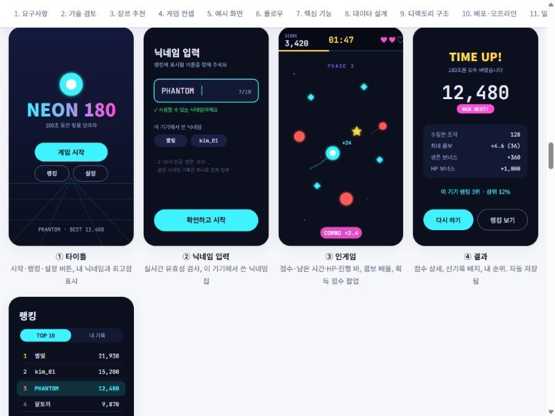
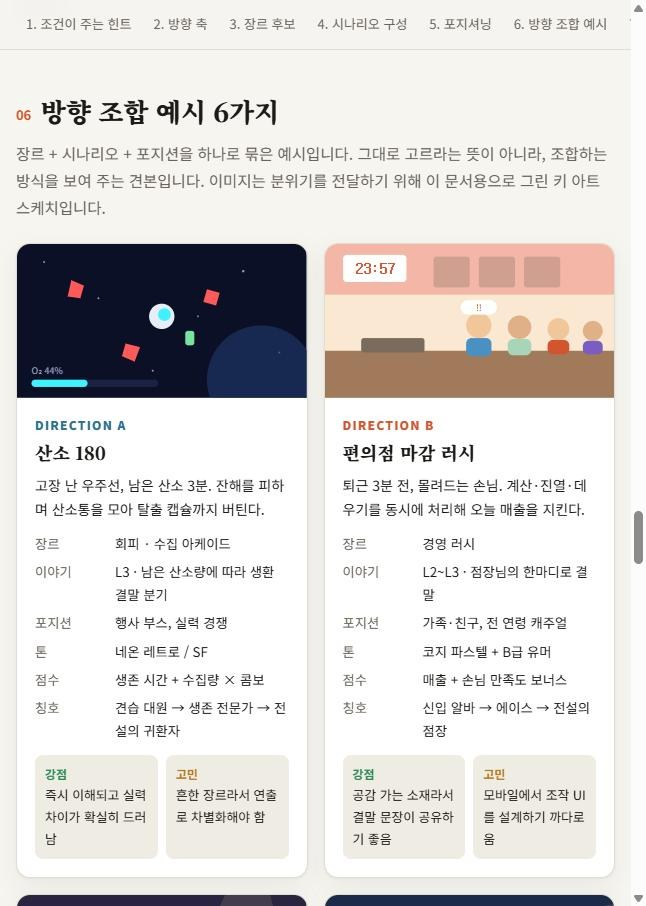
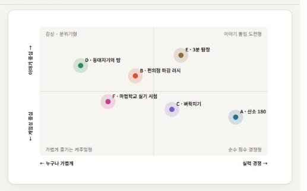
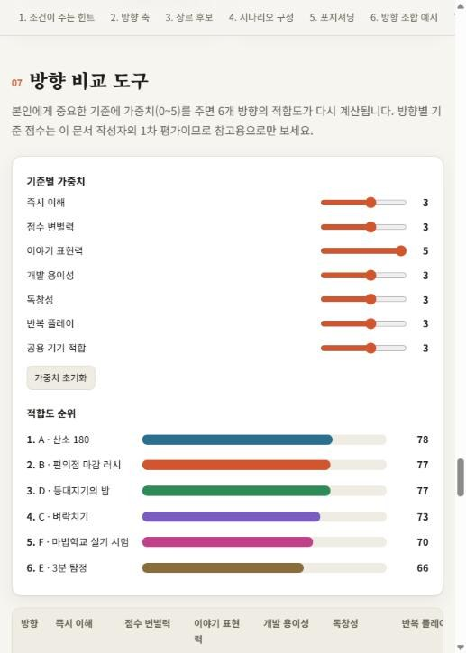
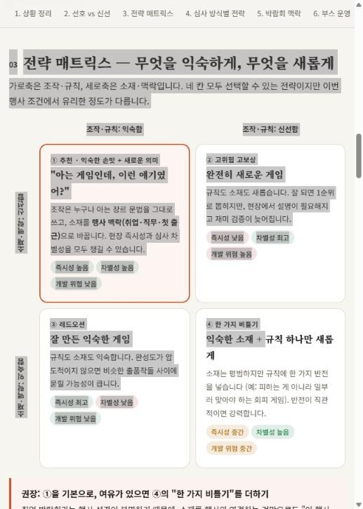
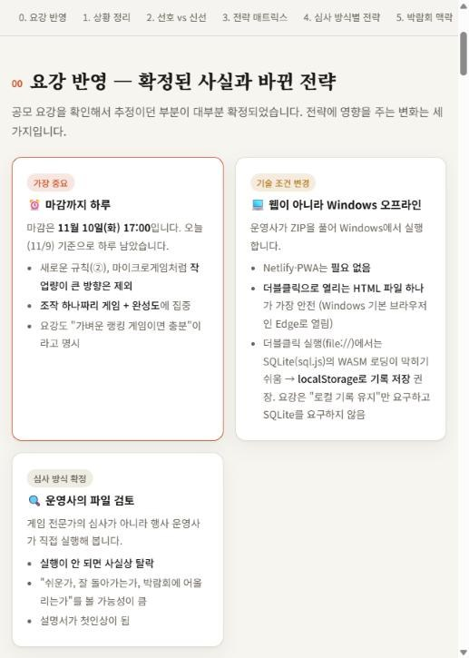
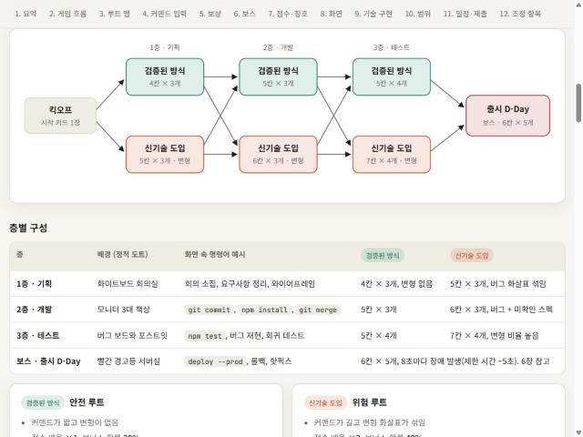
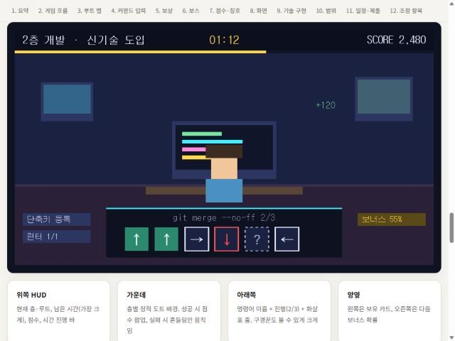

# 01. 기획 과정 — 조건에서 「릴리즈 러시」까지

> 채용박람회 AI 게임 제작 이벤트에 낼 미니게임을 기획한 과정입니다.
> 무엇을 고민했고, 왜 그렇게 결정했는지를 순서대로 정리했습니다.

- 결과물: `game-plan.html` → `game-direction.html` → `entry-strategy.html` → `game-design.html` (모두 프로젝트 루트)

---

## 1단계. 처음 세운 조건

직접 정한 기본 조건은 네 가지였습니다.

| 조건 | 내용 |
|---|---|
| 플레이 시간 | 3~5분 이내 |
| 실행 환경 | 오프라인 + 웹. Netlify 정적 배포를 생각함 |
| 랭킹 | 점수 순위, 게임을 꺼도 기록 유지. SQLite를 생각함 |
| 닉네임 | 입력 가능 |

### 첫 결과물과 방향 수정
- **만든 것:** `game-plan.html`. "NEON 180"이라는 회피 아케이드 하나를 정해 구현 스펙(디렉토리 구조, DB 스키마, 일정)까지 쓴 기획서입니다.
- **문제:** 원했던 건 바로 만들 게임의 스펙이 아니라, **방향을 정하기 위한 탐구 자료**였습니다.
- **교훈:** 기획 초반에는 답을 하나로 정하지 말고, 선택지와 판단 기준을 펼쳐 놓아야 합니다.

---

## 2단계. 방향성 탐구 (`game-direction.html`)

| 다룬 내용 | 요점 |
|---|---|
| 조건이 주는 힌트 | 짧은 플레이 = 10초 안에 규칙 이해. 로컬 랭킹 = 기기 하나를 여럿이 쓰는 상황(행사 부스)에 맞음. 닉네임 = 주인공 이름으로 활용 가능 |
| 방향 축 6개 | 반사신경↔사고력, 실력↔운, 긴장↔편안, 게임성↔이야기, 혼자↔경쟁, 매판 동일↔랜덤 |
| 장르 후보 8개 | 회피 아케이드, 경영 러시, 타이핑·퀴즈, 원버튼 타이밍, 병합 퍼즐, 추리, 마이크로게임, 자원 배분 |
| 시나리오 구성 | 이야기 강도 L0(추상)~L4(누적 이야기). 3분 게임은 L1~L3이 효율적 |
| 포지셔닝 | 페르소나 4개, 포지셔닝 맵, 톤·무드 6종, 포지션 선언문 템플릿 |
| 비교 도구 | 기준별 가중치를 조절하면 방향 6개의 적합도가 다시 계산됨 |

| 방향 조합 예시 | 포지셔닝 맵 |
|---|---|
|  |  |

---

## 3단계. 출품 전략 (`entry-strategy.html`)

행사 정보가 추가되었습니다. **취업 박람회 성격의 행사 부스, 전체 출품작 중 10개 선정.**

### 핵심 고민: 사람들이 좋아하는 장르 vs 신선한 장르
- 게임은 두 관문을 통과해야 합니다. **심사**에서는 차별성이, **현장 부스**에서는 처음 보는 사람이 10초 안에 이해하는 즉시성이 필요합니다.
- 완전히 익숙한 게임은 심사에서 묻히고, 완전히 새로운 게임은 현장에서 설명이 필요해집니다.

### 결론: 전략 매트릭스
게임을 **조작·규칙**과 **소재·맥락**으로 나눠서 생각했습니다.

| | 조작 익숙함 | 조작 신선함 |
|---|---|---|
| **소재 신선함** | ① **추천** — 아는 조작 + 행사 맞춤 소재 | ② 고위험 고보상 |
| **소재 익숙함** | ③ 레드오션 | ④ 규칙 하나만 비틀기 |

> "선호 장르의 조작을 빌리고, 행사 맥락의 소재로 신선함을 만든다."

---

## 4단계. 공모 요강 확인 — 전제가 바뀜

요강을 받아 보니 처음 조건과 다른 점이 많았습니다.

| 요강 | 바뀐 점 |
|---|---|
| 마감 11/10(화) 17:00 | 남은 시간이 **하루**. 작업량이 큰 방향은 제외 |
| **인터넷 없이 Windows에서 실행** | Netlify·PWA 불필요. **더블클릭으로 열리는 HTML 파일 하나**가 가장 안전 |
| 로컬 기록 유지 | SQLite는 요구사항이 아님. 더블클릭 실행에서는 WASM 로딩이 막히기 쉬워 **localStorage**로 결정 |
| 누구나 쉽고 빠르게 | 3~5분 대신 **1~2분** 권장 |
| ZIP + 설명서(PDF/TXT) | 설명서 4항목: 게임 소개, 실행 방법, 조작 방법, 랭킹 확인 방법 |
| 운영사 검토로 선정 | **실행이 안 되면 사실상 탈락.** 실행 안정성이 최우선 |
| 1인 1개 | 2개 이상 제출 시 미제출 처리 |

---

## 5단계. 장르와 구조를 좁혀 간 대화

| 순서 | 제안·질문 | 판단 | 남은 것 |
|---|---|---|---|
| 1 | 도트 핵앤슬래시 | 부스 관전 재미는 크지만 애니메이션·타격감 작업이 하루 안에 빠듯함 | 도트 그래픽 |
| 2 | 도트를 **정적인 화면 구성**에만 쓰고 다른 장르로 | 애니메이션 비용이 사라져 좋은 조합. 교육 과정이 **개발 직종**이라는 점을 소재로 | 개발 소재 |
| 3 | LoL 특별 모드처럼 **운 + 선택** | 무작위 강화 중 하나를 고르는 구조를 차용. 운이 랭킹을 망치지 않도록 3장 중 선택·확률 공개·보정 장치 | 강화 카드 |
| 4 | 스노우볼 / 왕귀 트랙 | 좋은 아이디어지만 이번 범위에서는 **보류** | 백로그 |
| 5 | 공략 / 스코어 / 목표 도달 | 성취감(목표)과 랭킹(점수)을 둘 다 잡는 **혼합형** | 목표 도달 + 점수 랭킹 |
| 6 | 목표까지를 **레이어**로 나누고 확정 카드 + 운 보너스 | 확정 보상이 바닥, 운이 천장. 비율은 확정 70 : 운 30 | 레이어 구조 |
| 7 | 타임어택 / 레이어 클리어 / 보스 / **루트 선택 = 난이도** / 운 보너스 | 다섯 요소를 하나의 루트 맵으로 묶음 | 핵심 구조 확정 |
| 8 | 타이핑 대신 **커맨드 입력** | 한/영 전환 문제 없음, 누구나 가능, 구경꾼도 따라 볼 수 있음 | 방향키 커맨드 |
| 9 | 레이어 소재: 커리어 사다리 vs **프로젝트 공정** | 프로젝트 공정 선택 (기획 → 개발 → 테스트 → 출시) | 소재 확정 |

---

## 6단계. 게임 설계 확정 (`game-design.html`)

> **릴리즈 러시 (가칭)** — 방향키 커맨드로 프로젝트 공정을 돌파하며, 매 층 "검증된 방식"과 "신기술 도입" 중 하나를 골라 제한 시간 안에 출시까지 가는 게임.

설계 당시 구성: 120초, 3층 + 보스, 확정 카드 10종, 특수 보상 4종, 룰렛 + 보정 장치, 황금 커맨드, 점수 공식, 칭호 5단계.
이후 구현하며 많이 바뀌었습니다. 현재 설정은 [02-game-spec.md](02-game-spec.md), 바뀐 과정은 [04-dev-log.md](04-dev-log.md)에 있습니다.

| 설계서의 루트 맵 | 설계서의 플레이 화면 목업 |
|---|---|
|  |  |

### 배포 방식 논의: Electron
- **장점:** 브라우저마다 기록이 갈리는 문제 해결, 전체 화면 고정, 프로그램처럼 보이는 첫인상.
- **위험:** 서명 없는 exe의 Windows 보안 경고, 백신 오탐, 용량 80~100MB, 추가 작업 시간.
- **결론:** HTML 게임을 먼저 완성하고, 배포 방식은 **나중에 결정**. Electron을 쓰더라도 HTML 버전을 함께 넣는 방안을 권장.

---

## 의사결정 로그

앞으로 기획 결정이 생기면 이 표에 이어서 추가합니다.

| # | 결정 | 원인 / 목적 | 예상 결과 |
|---|---|---|---|
| P1 | 확정 스펙 대신 방향성 탐구부터 | 사용자가 원한 것은 방향 탐구 자료 | 선택지를 비교한 뒤 결정할 수 있음 |
| P2 | 익숙한 조작 + 행사 맞춤 소재 | 심사는 차별성, 현장은 즉시성을 요구 | 두 관문 모두에서 약점이 줄어듦 |
| P3 | 단일 HTML + localStorage | 요강이 Windows 오프라인 실행을 요구, 실행 실패는 탈락 | 더블클릭만으로 실행, 실패 위험 최소화 |
| P4 | 개발 직종 소재 | 교육 과정이 개발 직종 | "개발 교육생이 만든 개발자 게임"으로 설명이 쉬움 |
| P5 | 운 + 선택 (확정 카드 + 운 보너스) | 매판 다른 빌드로 재도전 동기 | 확정 70 : 운 30으로 랭킹 공정성 유지 |
| P6 | 루트 선택 = 난이도 | 초보와 고수를 한 게임에서 받기 | 각자 맞는 위험도를 스스로 선택 |
| P7 | 프로젝트 공정 소재 | 개발 맥락과 가장 밀접 | 층 = 기획·개발·테스트, 보스 = 출시 |
| P8 | 배포 방식은 보류 | HTML 완성이 우선, Electron은 위험 요소가 있음 | 일정 위험을 줄임 |
| P9 | 스노우볼·왕귀 트랙 보류 | 범위 대비 효과가 불확실 | 백로그에서 관리 |
| P10 | 미니게임 4종 랜덤 배정 + WARNING 중간보스 + 최종 보스 섞기 | 판마다 다른 조합으로 재도전 동기, 층마다 다른 행동으로 단조로움 해소 | 중간보스가 다음 층 예고편·튜토리얼, 최종 보스가 총정리 |
| P11 | WARNING은 관문이 아닌 8초 점수 이벤트 | 처음 보는 규칙을 어려운 버전으로 먼저 만나면 좌절할 수 있음 | 못 해도 게임이 이어지고, 잘하면 보너스 |
| P12 | 카드·루트 선택은 시간 제한 없이, 카드 효과는 숫자로 | 고득점 전략을 플레이어가 직접 세우게 하려고 | 카드 조합에 따라 점수 차이가 커지고 재도전 동기가 생김 |
| P13 | 아이템(즉시·다음 층 버프)과 코인·상점 추가, 확률은 화면에 공개 | 운과 선택의 재미를 늘리고 코인 사용이라는 전략 축 추가 | 수치는 추정치로 시작해 플레이하며 조정 |
| P14 | 스테이지는 룰 카드를 보고 Space로 시작, 점수·코인은 플레이 박스 위 | 규칙을 모른 채 시작하는 문제, 시선 이동 줄이기 | 첫 플레이 미스 감소, 대신 화면 수가 늘어 한 판이 길어짐 |
| P15 | 점수는 플레이 박스 양옆, 클리어 조건(남은 작업 ●○)을 항상 표시, 미스 = 시간 −2초, 엔딩에서 게임 로그 공개 | 점수 상자가 전투 화면을 가림, 진행 조건·실패 압박이 안 보임, 내 선택을 돌아볼 틈이 없음 | 목표와 긴장감이 분명해지고, 선택→결과가 보여 재도전 동기 증가. 체력 칸(3목숨)은 판이 너무 일찍 끝날 수 있어 채택하지 않음 |
| P16 | 끝난 뒤 화면은 결과별 배경(성공 새벽 도시 · 실패 비 오는 사무실) + 3초 출시 컷신 | 결과·엔딩 화면이 시작 화면과 같아 끝난 느낌이 약함 | "밤 → 새벽" 대비와 SERVICE OPEN 순간으로 마무리감. 대신 한 판이 3~4초 길어짐. 엔딩 크레딧·합격 통지서·직전 기록 배너는 보류 |
| P17 | 스테이지마다 CLEAR 연출 + 정산표, 층 남은 시간은 보너스만 주고 이어짐(보스만 실제로 시간을 점수로 바꿈) | 시간이 남았는데 갑자기 넘어가 어리둥절함, 클리어 순간이 눈에 띄지 않음 | 넘어가는 이유와 남은 시간의 행방이 보이고, 빨리 깰 동기가 생김. 대신 Space 입력이 한 판에 6번 늘어남 |
| P18 | 보스는 체력 바 + (랜덤 미니게임 4개 → 그로기 연타) 반복, 보너스 스테이지는 랜덤 미니게임 | 보스전이 층과 다를 게 없었고 보너스는 늘 같은 방향키 러시 | 보스전에 패턴·빈틈·몰아치기 리듬이 생김. 체력 60은 시뮬레이션으로 초보 60%에 맞춘 추정치 |
| P19 | 난이도는 일반인 반응속도 봇으로 측정해 맞춤: 위험 루트 = 1.5배 어려움 · 점수 2배(작업 수는 같게), 보스 체력 180 + 제한 시간 65초 | 감으로 정한 수치가 게임마다 들쭉날쭉(위험이 오히려 쉬운 게임도 있었음), 보스가 너무 빨리 쓰러짐 | 루트 선택이 공정한 위험·보상 거래가 됨. 보통 클리어 약 85%, 초보 약 37% |
| P20 | 신기술은 고를 때마다 Lv이 올라 난이도 +10%·점수 +20% 복리, 루트 화면에 숫자로 공개 | 위험 루트가 층마다 같은 배율이라 연속 선택의 의미가 약함 | 연속 신기술이 커지는 위험·보상이 되고, 고르기 전에 계산 가능. 난이도 1.1배당 점수 1.2배로 기존 1.5배→2배 비율 유지 |
| P21 | 출시하면 남은 코인을 1개당 30점으로 환산 | 번 코인의 약 65%가 쓰이지 않고 사라짐, 보스전 코인은 쓸 곳이 없음 | 코인이 끝까지 의미를 가짐. 상점 vs 저축이 새 선택지. 30점은 추정치 |
| P22 | 점수 정산 정리: 연타 1회 15점, 출시 보너스에 신기술 Lv × 500, 층 시간 보너스는 처리 속도 기준, 연타에도 아이템 배율, 결과창에 점수 구성 공개 | 연타가 점수의 1/3, 같은 시간을 여러 번 셈, 보스에서 신기술 보상 없음, 점수 출처가 안 보임 | 연타 비중 약 27%로, 신기술 ÷ 안전 점수 약 1.5배. 플레이어가 점수 구성을 보고 전략을 세울 수 있음 |
| P23 | 1층은 안전 루트로 바로 시작하고 시작 카드는 1층 뒤에, 한 번 본 미니게임은 짧은 룰 카드, 정산표는 2초 자동 진행 | 첫 플레이까지 5단계, 넘기는 입력이 많음 | 처음 오는 사람이 바로 해 볼 수 있음. 대신 신기술은 최대 Lv.2 |
| P24 | 소리는 음원 파일 없이 코드로 합성(효과음 8비트 칩튠 A안), BGM도 같은 방식으로 샘플 후 결정 | 저작권 걱정 없이 오프라인 한 파일 유지 | 타격감 · 피드백 향상. M 키로 끌 수 있어 부스 상황에 맞춤 |
| P25 | BGM은 장면별 4곡(사무실 대기 · 통통 튀는 · 긴장 · 엔딩), 대기 화면·데모에서는 끔 | 장면 분위기 구분, 부스에서 데모가 계속 소리를 내지 않게 | 플레이 몰입감 향상, 대기 중에는 조용함 |
| P26 | 알파 테스트 피드백 반영: 룰 카드는 키 + 직관적이지 않은 조작만 TIP 한 문장 + 시범 플레이 반복, 화면 글은 줄이고 핵심 숫자를 크게, 피버 주변 연출 추가, 결과창은 등급 · 점수 · 순위 · TOP 5만 | 사람 테스트에서 "도입 설명이 현학적이고 어렵다 · 글이 너무 많다 · 결과창이 너무 상세하다" | 읽지 않아도 보고 따라 할 수 있음. 넘기는 화면이 빨리 읽혀 회전율 향상 |
| P27 | 신기술 루트 변별력 강화: 신기술 층 난이도 한 번 더 ×1.5 · 작업 수 ×1.5 · 신기술 1회마다 보스 체력 ×2 (점수 배율은 그대로) | 안전 · 신기술의 출시율이 97% vs 90%로 거의 같아 루트 선택이 체감되지 않음 | 보스를 그로기 한 번에 끝낼 수 없음(사람 연타 기준 4~6번), 신기술 ÷ 안전 점수 1.43배 → 2.0배. 느린 연타(초당 8~12회)에서는 출시 10~73% (#41 · #42) |
| P28 | 연타는 그대로 두고 출시 때 남은 시간 점수를 1초당 20 → 200점 × 신기술 배율로 | 연타 비중 61%, 그로기를 오래 할수록 점수가 높아 늦게 깬 판이 더 유리했음 | 빨리 깰수록 점수가 높음(빠른 판 ÷ 느린 판 1.09~1.60), 연타 비중 43%로, 신기술 ÷ 안전 약 2배 유지 |
| P29 | 피버 · 그로기 게이지에 만화식 외침 말풍선 폭발 테두리(가시 · 잉크 외곽선 · 망점 · 창 파편 · 별) | 피버가 터지는 순간을 더 강하게 보여 달라는 요청 · 참고 이미지 | 불꽃 시안은 폐기, 시안 B 채택. 미니게임 글자는 가리지 않게 아래쪽은 평평하게 |
| P31 | 대기 화면 · 데모에 BGM(128 BPM 신스웨이브풍), 레이저 비트를 음악 박자에 맞춤 | 대기 화면에도 음악이 있었으면 한다는 요청. 15초 뒤 데모로 넘어갈 때 끊기지 않게 | 부스에서 소리로도 눈길을 끎. 데모 효과음은 계속 끔 |
| P30 | 초기 화면을 레이저형으로(레이저 테두리 · 광선 · 스캔선 + 네온 도시 · 격자 바닥 · 행진) | 부스에서 이목을 끌 역동적인 대기 화면 필요. 말풍선형은 피버 연출과 겹침 | 대기 화면만의 개성, 글자 뒤 어두운 판으로 멀리서도 읽힘 |
| P32 | 미니게임 성공 이펙트를 과하게(도장 · 번개 · CRITICAL · 파편 · 코인 · 점수 · 가장자리 번쩍 · 줌 펀치 · 연속 퍼펙트 · 콤보 배너), 단 미니게임 패널 안은 짧고 가는 효과만 | "게임이 올드하니 이펙트로 도파민을" · 가시성은 해치지 않게 | 성공 한 번마다 화면 전체가 반응. 60fps 유지 |
| P33 | 게임 방향을 **「도파민 터지고 급박한 3분」**으로 지정. 배경과 이펙트를 지금보다 더 과하게(남은 시간에 따라 조여 오는 연출 · 움직이는 층별 배경 · 몰입할수록 빨라지는 배경) | 전반적인 유저 피드백과 방향성 재검토 결과(사용자 결정) | 한 판 내내 화면이 쉬지 않고 움직이고, 끝으로 갈수록 긴장이 커짐. 단 미니게임 패널 · 점수 · 타이머는 계속 읽혀야 함 (#58 시안부터) |
| P34 | #58 시안 적용 + **10콤보부터 콤보마다 「N COMBO!」**, 콤보가 쌓일수록 크고 화려하게(50콤보에서 최대: 크기 · 집중선 · 가시 폭발 · 무지개 · 흔들림 · 색종이 · NICE → LEGENDARY 칭찬) | 사용자 요청: "10콤보 이상 이어가면 11 12 13… 콤보마다 점점 크고 화려한 이펙트로" | 콤보를 이어 갈수록 보상이 눈에 보여 끊기 싫어짐. 화면 위쪽 가운데라 패널 · 타이머는 가리지 않음 |
| P35 | 피버도 콤보로: **A.** 피버 · 그로기가 끝나면 연타 10회마다 +1콤보(규칙) + **B.** 피버 중 HIT 숫자도 30 · 60 · 100 · 150 HIT마다 커지고 화려하게(연출) | 사용자 제안 "피버타임도 콤보에 포함시키는 게 좋지 않을까?". 연타 1회 = 1콤보로 세면 피버 한 번에 약 150콤보가 되어 콤보 단계 · 최대 콤보 기록이 무의미해져 A+B로 결정(사용자 선택) | 피버가 콤보를 키우는 보상이 되고(피버 한 번 약 +15콤보), 콤보 단계는 계속 "점점" 올라감. 점수 영향은 작음 |
| P36 | 피버 · 그로기 동안 미니게임 패널 자리를 피버 패널로(#63 시안), 좌우 가시는 짧게, 끝나면 0.4초 「다시 시작!」 · 입력 무시 | 유저 피드백 "피버 게이지를 미니게임 위치로 옮겨 더 잘 보이는 지시로". 안내가 세 곳에 흩어지고 패널엔 멈춘 미니게임이 보였음 | 시선이 있는 곳에 지시 하나, 전투 화면이 비어 연타 공격 · 보스 체력이 잘 보임. 피버 직후 미스 방지 |
| P37 | 룰 카드에 미니게임별 **「방법」 한 줄**(무엇을 하면 성공인지)을 모든 카드에, 같은 내용의 TIP은 생략 | 부스 플레이어 피드백 "사람들이 너무 이해를 못 한다" — #40에서 키 + TIP만 남기며 '무엇을 하면 성공인지' 문장이 빠졌음(배포 타이밍은 키만) | 카드 한 장만 보고 바로 따라 할 수 있음. 카드 줄 수는 TIP 생략으로 거의 그대로 |
