# 02. 게임 설정 — 릴리즈 러시 (현재 버전)

> 지금 코드(`game/release-rush.html`)에 들어 있는 규칙과 수치입니다.
> 수치가 바뀌면 이 문서도 함께 고칩니다. 바뀐 이유는 [04-dev-log.md](04-dev-log.md)에 있습니다.

- 기준 버전: **v15.9** (v15.8 + **룰 카드 「방법」 한 줄**: 무엇을 하면 성공인지, #65)
- v15.8: (v15.7 + **피버 패널**: 피버 · 그로기 동안 미니게임 패널 자리가 피버 패널로, 끝나면 0.4초 「다시 시작!」, #64)
- v15.7: (v15.6 + **피버도 콤보로**: 피버 · 그로기가 끝나면 연타 10회당 +1콤보 · 피버 중 HIT 숫자 단계 연출, #60)
- v15.6: (v15.5 + **급박한 3분**: 남은 시간 긴장 단계 HURRY · DANGER · LAST 5 · 움직이는 층별 배경 · 몰입 속도선 + **10콤보부터 콤보마다 커지는 「N COMBO!」**, #59)
- v15.5: (v15.4 + **미니게임 성공 이펙트**: 판정 도장 · 번개 · CRITICAL · 파편 · 충격파 · 코인/점수 날아가기 · 가장자리 번쩍 · 줌 펀치 · 연속 퍼펙트 · 콤보 배너, #57)
- v15.4: (v15.3 + **대기 화면 BGM**: 128 BPM 신스웨이브풍, 대기 화면 → 데모까지 이어짐, 레이저 비트를 음악 박자에 맞춤, #55)
- v15.3: (v15.2 + **초기 화면 레이저형**: 레이저 테두리 · 광선 · 스캔선, 네온 도시 · 격자 바닥 · 주인공 행진, #54)
- v15.2: (v15.1 + **제한 시간 65 → 60초 · 피버 망점 최적화(프레임 멈춤 제거)**, #52)
- v15.1: (v15.0 + **몬스터 타격음 4종**, #49)
- v15.0: (v14.9 + **피버 · 그로기 외침 말풍선 폭발 테두리**, #47)
- v14.9: (v14.8 + **두더지 · 장애 알림 수정**: 시간 초과 · 미스 · 성공 직후 0.35초 입력 무시, 두더지 신기술 알림 시간 0.40 → 0.50초, #45)
- v14.8: (v14.7 + **남은 시간 점수 강화**: 출시 때 남은 1초당 20 → 200점 × 신기술 배율, 보스 룰 카드에 표시, #43)
- v14.7: v14.6 + **신기술 변별력 강화**: 신기술 층 난이도 한 번 더 ×1.5 · 작업 수 ×1.5 · 신기술 1회마다 보스 체력 ×2, 룰 카드 여백, #41)
- v14.6: v14.5 + 알파 테스트 피드백 반영: 룰 카드 = 키 + TIP 한 줄 + 시범 플레이 · 글 줄이고 핵심 숫자 크게 · 피버 주변 연출 · 결과창 압축 (#40)
- v14.5: v14.4 + 피버 게이지 두껍게 + 형광 강조 (#39)
- v14.4: v14.3 + 버튼 클릭이 다음 룰 카드를 넘기던 문제 수정 (#38)
- v14.3: v14.2 + BGM 4곡
- v14.2: v14.1 + 효과음 16종
- v14.1: v14 + **1층 바로 시작 · 시작 카드는 1층 뒤 · 한 번 본 미니게임은 짧은 룰 카드 · 정산표 2초 자동 진행**)
- v14: v13.1 + **점수 정산 정리**: 연타 15점 · 출시 보너스 신기술 보상 · 처리 속도 보너스 · 결과창 점수 구성). 점수 계산 전체는 [06-scoring.md](06-scoring.md)
- v13.1: v13 + 신기술 누적 복리 · 커맨드 작업 수 ×0.7
- v13: v12 + 미니게임 6종 · 일반인 기준 난이도 재조정 · 보스 체력 180 · 제한 시간 65초
- v12: v11 + 보스 체력·그로기 · 랜덤 보너스 스테이지
- v11: v10 + 클리어 연출 · 남은 시간 정산표
- v10: v9 + 출시 컷신 · 결과별 배경
- v9: v8 + 요약형 게임 결과창
- 이전 기준: v8 (미니게임 랜덤 배정 + WARNING 중간보스 + 수치형 전략 카드 + 아이템·코인·상점 + 스테이지 시작 룰 카드(Space로 시작) + **클리어 조건 표시 · 미스 −2초 · 엔딩 게임 로그** + 피버 연타 + 전투 연출)

---

## 한 줄 소개

> 직장인 주인공이 업무 몬스터를 쓰러뜨리며 **기획 → 개발 → 테스트**를 지나 **60초 안에 서비스를 출시**하는 아케이드 게임. 층마다 미니게임이 무작위로 바뀝니다.

## 한 판의 흐름

```
대기 화면(TOP 10, 15초 뒤 데모 플레이)
 → 닉네임 입력 (미니게임 6종 중 3종을 1·2·3층에 무작위 배정)
 → 1층 (미니게임 A, 안전 루트로 바로 시작) → 정산표
 → 시작 카드 3장 중 1장 (1층을 해 본 뒤 고름)
 → ⚠ WARNING: 2층 미니게임 B 미리보기 8초 → 정산표 → WARNING 보상 아이템 3개 중 1개
 → (가끔) 보너스 스테이지 → 보상 카드 → 룰렛 → 이벤트(대박 상점 / 일반 상점 / 랜덤 카드 / 없음) → 루트 선택
 → 2층 (미니게임 B) → 정산표
 → ⚠ WARNING: 3층 미니게임 C 미리보기 → 정산표 → WARNING 보상 아이템
 → (가끔) 보너스 스테이지 → 보상 카드 → 룰렛 → 이벤트 → 루트 선택
 → 3층 (미니게임 C) → 정산표 → (가끔) 보너스 스테이지 → 보상 카드 → 룰렛 → 이벤트
 → 최종 보스 「출시 D-Day」: 체력 180, 미니게임 4개 → 그로기 연타 반복 → 출시 정산표
 → (페이드) 출시 컷신 3초 (성공: SERVICE OPEN · 실패: DEPLOY FAILED)
 → (페이드) 엔딩: 이번 판 게임 로그를 한 줄씩 → (페이드) 결과 · 칭호 → 랭킹
```

- **종료 조건:** 보스 클리어(출시 성공) 또는 제한 시간 소진(게임오버). 어느 쪽이든 기록이 저장됩니다.
- **스테이지 클리어:** 층·보스는 작업 N개를 모두 처리하면 다음 단계로. 남은 개수는 위쪽 HUD 오른쪽 `클리어까지 N개 ■■□□□`에 항상 보입니다. WARNING은 8초 동안 최대한 많이(실패 없음).
- **미스 1회 = 제한 시간 −2초** (추정치). 린터·보험으로 막은 미스, WARNING 중 미스는 시간이 줄지 않습니다. 최종 보스는 8초마다 장애로 −5초가 추가됩니다.
- 카드·루트 선택, 룰렛, 보너스 스테이지, **WARNING 중간보스**, 피버 연타·보스 그로기 중에는 **제한 시간이 멈춥니다.**
- **모든 스테이지(층·WARNING·최종 보스)는 룰 카드를 보여 주고 Space(또는 클릭)를 눌러야 시작합니다.** 기다리는 동안 시간은 멈춥니다.
  - 룰 카드(#40 · #65): **미니게임 이름 + 누를 키(크게)** + **「방법」 한 줄**(#65, 무엇을 하면 성공인지: 배포 타이밍 「커서가 초록 구간에 오면 Space」 · 커맨드 「화살표를 순서대로 방향키로 입력」 · 장애 알림 「빨간불이 초록불로 바뀌는 순간 Space」 · 코드 리뷰 「버그면 ← 반려 · 정상이면 → 승인」 · 컴파일 차지 「Space를 꾹 누르고 초록 구간에서 손 떼기」 · 알림 두더지 「알림이 뜬 칸의 방향키로 끄기」) + 직관적이지 않은 조작만 **TIP 한 문장**(「방법」과 같은 내용인 코드 리뷰 · 컴파일 차지는 TIP 생략)(커맨드 · 장애 알림 · 코드 리뷰 · 컴파일 차지 · 알림 두더지. 배포 타이밍은 TIP 없음). WARNING은 「8초 동안 최대한 많이!」, 보너스는 「8초 안에 3번 성공 → ★ 보상」, 보스는 「체력 180 → 0」과 3종의 키.
  - **시범 플레이:** 룰 카드가 떠 있는 동안 아래 미니게임 패널에서 지금 작업을 복제한 자동 플레이가 반복됨(「▶ 시범 플레이」 표시, PERFECT 글자). 누르는 순간 룰 카드의 해당 키 캡이 하늘색으로 빛남. 복제본만 움직여 실제 작업 · 점수 · 시간 · 난수와 무관.
- 카드·루트 선택에는 **시간 제한이 없습니다.** 지금까지 모은 카드 효과가 숫자로 요약되어, 고득점 전략을 세우고 고를 수 있습니다.

## 현재 화면

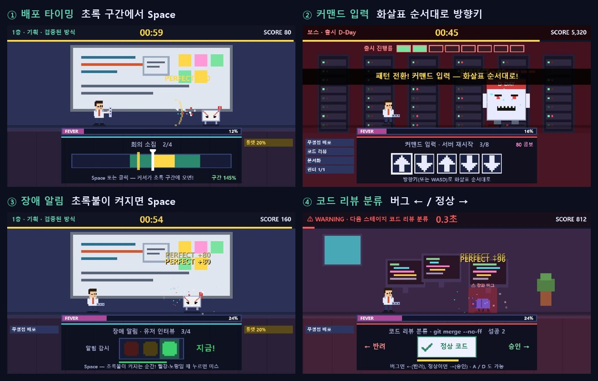

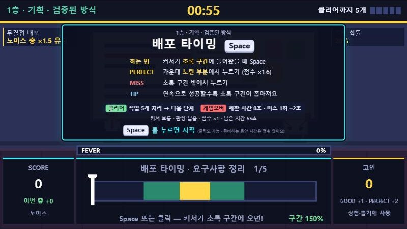

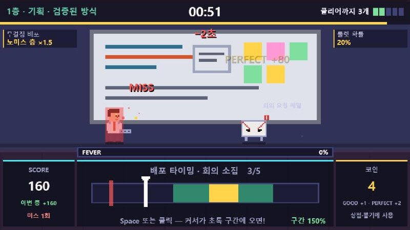

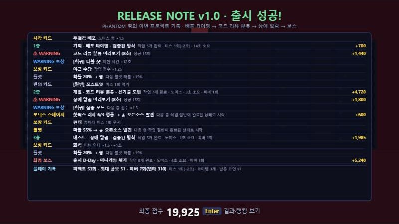

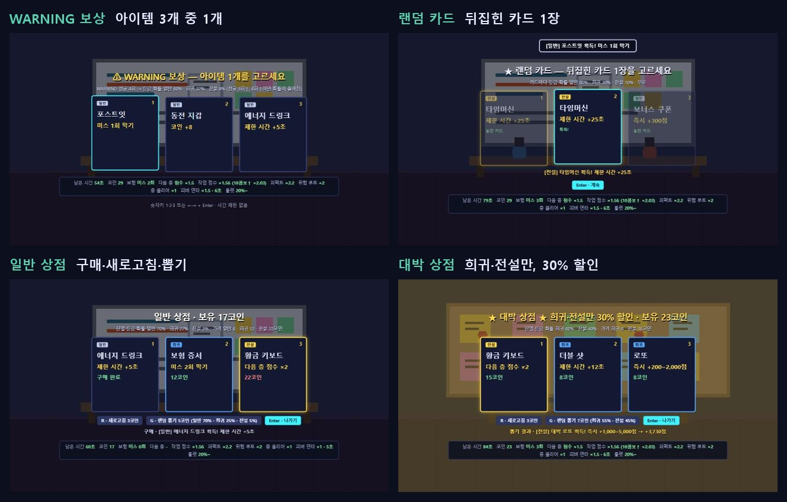

| 보상 카드 선택 (수치형 효과 + 현재 빌드) | 루트 선택 (이번 판 미니게임 순서) |
|---|---|
| 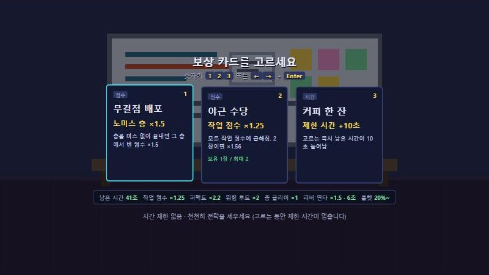 | 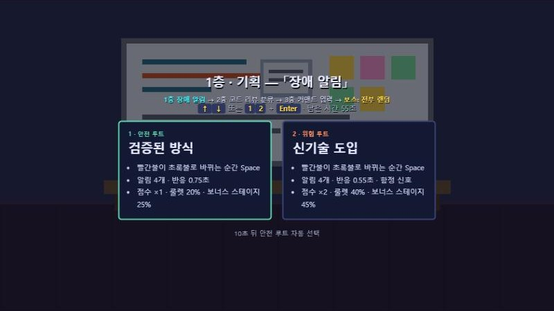 |
| **WARNING 중간보스 예고** | **최종 보스 (미니게임 섞기)** |
| 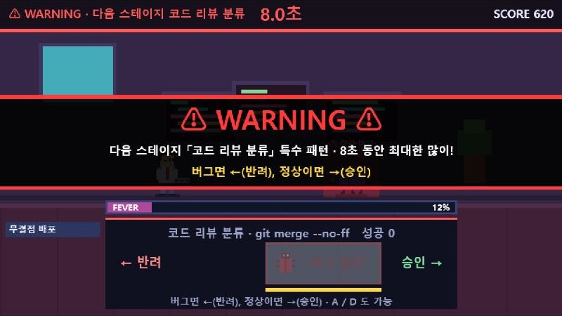 | 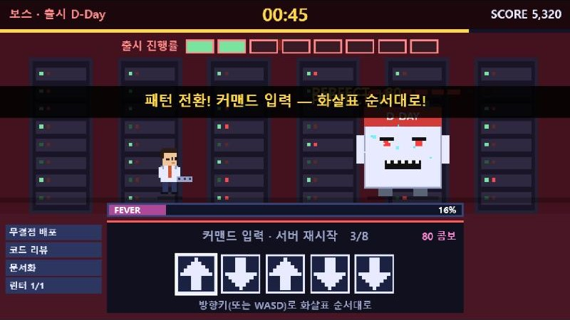 |
| **피버 연타** | **결과·랭킹** |
| 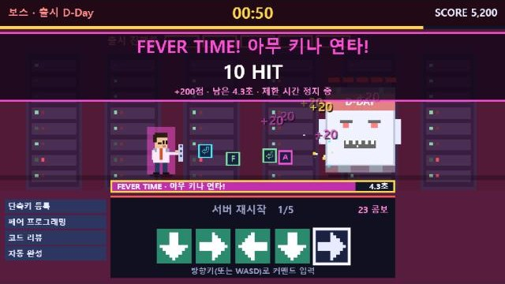 | 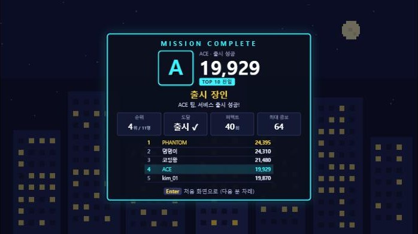 |


---

## 조작

| 상황 | 입력 |
|---|---|
| 배포 타이밍 · 장애 알림 | **Space** / Enter / 마우스 클릭 |
| 커맨드 입력 | **방향키** 또는 WASD |
| 보너스 스테이지 | 그때 나온 미니게임의 키 (룰 카드에 표시) |
| 보스 그로기 | **아무 키** 연타 (연타 1회 = 보스 체력 −1) |
| 코드 리뷰 분류 | **←(반려) / →(승인)** 또는 A / D |
| 피버 연타 | **아무 키** (꾹 누르기는 인정 안 함) |
| 카드 선택 | 1·2·3 / ←→ + Enter / 클릭 |
| 루트 선택 | 1·2 / ↑↓ + Enter / 클릭 |
| 일시정지 | Esc (창이 비활성화되면 자동) |
| 스테이지 정산표 | 0.4초 뒤부터 Space·Enter·클릭: 계산 중이면 바로 끝내기 → 한 번 더 누르면 다음 단계. 층·WARNING·보너스 정산표는 다 나온 뒤 **2초가 지나면 자동으로 다음**(출시 정산표는 Space를 눌러야 함) |
| 룰 카드 | 키 + TIP 한 줄 + 시범 플레이(#40). Space · 클릭으로 시작 |
| 출시 컷신 | 0.6초 뒤부터 Enter·Space로 건너뛰기, 그냥 두면 3초 뒤 엔딩으로 |
| 엔딩(게임 로그) | **Enter 또는 Space만** 반응: 남은 줄 모두 보기 → 한 번 더 누르면 결과 화면 (자동으로 넘어가지 않음, 클릭·Esc 무시) |
| 결과 화면 | Enter 또는 Esc: 처음 화면으로 (1인 1회 플레이라 다시 도전 없음). 자동으로 돌아가지 않음 |
| 소리 켜기/끄기 | **M** (설정은 브라우저에 저장) |
| 운영자 기록 초기화 | 대기 화면에서 R 키 5번 + 확인 |

---

## 기본 설정값

| 항목 | 값 |
|---|---|
| 제한 시간 | **60초** (#52: 65 → 60. 55 → 65는 보스 체력을 3배로 늘리면서) |
| 미스 페널티 | 1회당 제한 시간 −2초 (`MISS_TIME`, 추정치) |
| 엔딩 | 페이드 0.7초, 로그 한 줄 0.32초 간격, 다 나온 뒤에는 Enter·Space를 누를 때까지 유지 |
| 카드·루트 선택 | 시간 제한 없음 |
| 부스 안전장치 | 선택 화면에서 입력 없이 3분이 지나면 처음 화면으로 |
| 데모 시작 대기 | 15초 |

## 미니게임 6종

판마다 6종 중 3종이 1·2·3층에 무작위로 배정됩니다. 보너스 스테이지는 6종 중 아무거나, 최종 보스는 이번 판 3종을 섞습니다.

| 미니게임 | 하는 일 | 퍼펙트 | 미스 |
|---|---|---|---|
| ① 배포 타이밍 | 커서가 진행 바를 왕복. 초록 구간에서 Space | 구간 중앙 30% 안 | 구간 밖에서 누름 |
| ② 커맨드 입력 | 화살표 순서대로 방향키. 빨강은 반대 방향, `?`는 차례가 되면 공개 | 커맨드를 한 번도 안 틀리고 완성 | 틀린 방향 (그 커맨드 처음부터) |
| ③ 장애 알림 | 빨간불(대기)이 초록불로 바뀌는 순간 Space. 노란불은 함정 | 제한 시간의 앞 40% 안에 반응 | 빨강·노랑에 누름, 초록불을 놓침 |
| ④ 코드 리뷰 분류 | 버그 카드면 ←(반려), 정상 카드면 →(승인) | 제한 시간의 앞 40% 안에 판단 | 잘못 분류, 시간 초과 |
| ⑤ **컴파일 차지** | Space(또는 마우스)를 **꾹 누르면** 빌드 게이지가 차오름. 초록 구간에서 **손을 뗌** | 구간 중앙 35% 안에서 뗌 | 구간 밖에서 뗌, 끝까지 차서 과열 |
| ⑥ **알림 두더지** | 세 칸(메일·메신저·캘린더) 중 알림이 뜬 칸의 방향키 **← ↓ →**(A S D). 👑 대표님 메시지는 끄지 말고 기다림 | 알림 시간의 앞 40% 안에 끔 | 다른 칸, 빈칸, 대표님 메시지를 누름, 알림을 놓침 |

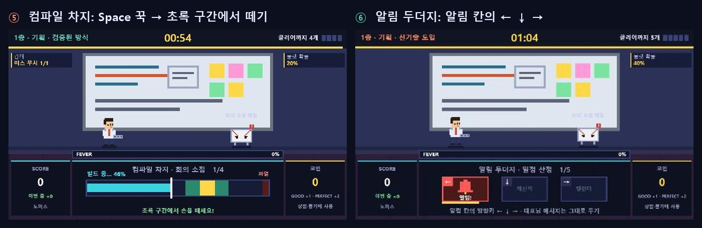

### 난이도 (일반인 반응속도 봇으로 측정해 맞춤)

**원칙: 위험 루트는 안전 루트보다 약 1.5배 어렵고, 점수는 2배.** 작업 수는 루트와 상관없이 같습니다. 어려움은 "작업 하나에 드는 시간 + 미스 1회당 2초"로 잽니다. 층이 오를수록 조금씩 어려워지고, WARNING·최종 보스는 안전 루트의 약 1.4배입니다.

| 미니게임 | 안전 (1층 / 2층 / 3층) | 위험 (1층 / 2층 / 3층) | WARNING | 최종 보스 |
|---|---|---|---|---|
| 배포 타이밍: 커서 속도·구간 폭 | 0.85·30% / 0.90·25% / 0.95·19% | 1.10·12% / 1.15·12%(이동) / 1.25·14%(이동) | 1.20·15%(이동) | 1.20·13%(이동) |
| 커맨드 입력: 칸 수 | 3 / 4 / 4칸, 변형 없음 | 4칸(빨강 12%) / 5칸(빨강·?) / 5칸(빨강 18%·?) | 4칸, 빨강 25% | 5칸, 빨강 15% |
| 장애 알림: 반응 시간·함정 | 0.75 / 0.68 / 0.55초(함정 15%) | 0.38초·함정 35% / 0.38·35% / 0.36·40% | 0.38초·35% | 0.38초·35% |
| 코드 리뷰 분류: 카드당 시간 | 1.6 / 1.3 / 1.05초 | 0.82 / 0.82 / 0.80초 | 0.85초 | 0.80초 |
| 컴파일 차지: 게이지 속도·구간 폭 | 0.75·24% / 0.85·22% / 0.95·20% | 1.05·17% / 1.10·16% / 1.10·16% | 1.10·16% | 1.10·16% |
| 알림 두더지: 알림 시간·대표님 | 1.00 / 0.95 / 0.90초(10%) | 0.70초·22% / 0.64·25% / 0.58·30% | 0.66초·25% | 0.60초·30% |

> #45: 신기술 강화 곡선에서 두더지만 너무 가파르게 줄던 문제(지수 1.2, 하한 0.4초)를 지수 0.6 · 하한 0.48초로. 신기술 Lv.1 2층 0.64 → **0.50초**(PERFECT 0.20초), Lv.2 3층 → **0.48초**(PERFECT 0.19초). 대기 상태 처음 0.35초 입력은 무시(두더지 · 장애 알림).

측정 결과(보통 봇, 위험 ÷ 안전): 배포 타이밍 1.38~1.71 · 커맨드 1.38~1.52 · 장애 알림 1.48~1.63 · 코드 리뷰 1.31~1.68 · 컴파일 차지 1.50~1.86 · 알림 두더지 1.31~1.46, **평균 약 1.5**.

### 층별 작업 수

| 층 | 안전 | 위험 (#41 이전) | 위험 (#41, ×1.5) |
|---|---|---|---|
| 1층 기획 | 5 | 5 | 7.5 |
| 2층 개발 | 6 | 6 | 9 |
| 3층 테스트 | 7 | 7 | 10.5 |

위험 루트 작업 수는 `RISK.countMult`(1.5)를 곱한 뒤 미니게임 배율을 곱해 반올림합니다(1층은 항상 안전 루트라 실제로는 2·3층에만 적용).

오래 걸리는 미니게임은 작업 수를 줄입니다: 배포 타이밍 ×1, 커맨드 입력 ×0.7, 장애 알림 ×0.7, 코드 리뷰 분류 ×1, 컴파일 차지 ×0.8, 알림 두더지 ×0.9 (반올림).

### 배포 타이밍의 판정 구간 변화 (콤보 연동)

콤보 0이면 기본 폭의 **150%**, 콤보 1마다 5%씩 줄어 최소 **70%**. 미스하면 다시 150%. 상한은 바 전체의 60%.

## 루트

| 루트 | 점수 배율 | 룰렛 확률 | 보너스 스테이지 확률 |
|---|---|---|---|
| 검증된 방식 (안전) | ×1 | 20% | 25% |
| 신기술 도입 (위험) | ×2부터 복리 (아래) | 40% | 45% |

### 신기술 누적 복리

신기술을 고를 때마다 **신기술 Lv**이 1씩 오르고, 그 층의 난이도와 점수가 복리로 올라갑니다. 안전 루트를 골라도 Lv은 내려가지 않습니다(다음에 신기술을 고르면 이어서 오름).

| 신기술 Lv | 난이도 (안전 대비) | 점수 배율 | 위험한 기술 카드(×2.5)가 있을 때 |
|---|---|---|---|
| Lv.1 | ×1.5 → **×2.25** (#41) | ×2 | ×2.5 |
| Lv.2 | ×1.65 → **×2.48** (+10%) | ×2.4 (+20%) | ×3 |
| Lv.3 | ×1.82 → **×2.72** (+10%) | ×2.88 (+20%) | ×3.6 |

**#41 신기술 강화:** 신기술을 고른 층은 위 복리에 더해 `RISK.boost`(1.5)만큼 한 번 더 어려워집니다(`harden`의 같은 곡선으로 속도 · 구간 · 반응 시간 · 함정 확률을 조정). 점수 배율은 그대로.

1층은 항상 안전 루트로 바로 시작하므로 신기술은 2·3층에서만 고를 수 있어 **실제 최대는 Lv.2**입니다.

- 난이도 1.1배당 점수 1.2배는 "1.5배 어려우면 점수 2배"와 같은 비율입니다(1.5^1.7 ≈ 2, 1.1^1.7 ≈ 1.18).
- 어려움은 미니게임마다 다르게 올립니다: 배포 타이밍(커서 속도↑·구간 폭↓), 커맨드(빨강·? 화살표 확률↑), 장애 알림(반응 시간↓·함정↑), 코드 리뷰(카드당 시간↓), 컴파일 차지(게이지 속도↑·구간 폭↓), 알림 두더지(알림 시간↓·대표님 메시지↑). 일반인 봇으로 재서 Lv마다 약 1.1배(측정 1.07~1.18)가 되도록 맞춤.
- **루트 선택 화면**에는 **점수 ×N(크게) · 난이도 ×N**과 작업 수 한 줄만 보여 줍니다(#40에서 Lv 사다리 · 룰렛 · 보너스 확률 글은 뺌). 화면 위쪽에 "신기술 도입 Lv.2"처럼 표시됩니다.

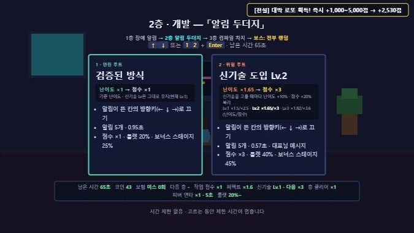

## ⚠ WARNING 중간보스

1층과 2층을 클리어하면 등장합니다. **다음 층의 미니게임을 강한 패턴으로 미리 체험**하는 이벤트입니다.

| 항목 | 값 |
|---|---|
| 시간 | 8초 (본 게임 제한 시간은 멈춤) |
| 클리어 조건 | 없음. 시간 동안 성공할수록 점수 |
| 성공 1회 | +60점 (퍼펙트 ×1.6) |
| 연출 | 붉은 경고등, 다음 층 배경, "⚠ 강화" 몬스터 |

반드시 깨야 하는 관문이 아니라서, 처음 보는 규칙을 어려운 버전으로 먼저 만나도 게임이 끊기지 않습니다.

## 최종 보스 「출시 D-Day」

| 항목 | 값 |
|---|---|
| 체력 | **180 × 2^신기술 횟수** (#41: 0회 180 · 1회 360 · 2회 720, `RISK.bossHpMult`). HUD 아래 체력 바, 보스 머리 위 작은 바. 루트 선택 화면에 고르면 될 보스 체력 표시 |
| 패턴 | 이번 판 미니게임 3종 중 **무작위 4개**(같은 게임이 연속으로 나올 수 있음). 위쪽 **GROGGY 게이지**가 4칸 차면 그로기 |
| 그로기 | **6초 연타 피버**(회식 카드 1장당 +1초). 아무 키 1회 = 체력 −1(회식 카드 1장당 ×1.5) + 피버 점수. 제한 시간 정지. 보스는 X 눈 · 머리 위 별 |
| 반복 | 그로기가 끝나면 다시 미니게임 4개 → 그로기 … 체력이 0이 되는 순간 클리어 |
| 일반 피버 | 보스전에서는 쌓이지 않음 (그로기가 보스전의 피버) |
| 미리 채우기 | 리팩토링·오픈소스·만능 패스는 첫 그로기 게이지를 미리 채움 (최대 3칸) |
| 장애 발생 | 10초마다 제한 시간 −3초 (그로기 중에는 시간이 멈춰 발생 안 함) |
| 클리어 | +2,000점 + 신기술 Lv × 500 + **남은 초 × 200 × 신기술 배율**(#43) + **남은 코인 × 30** (정산표에서 타이머와 코인이 0까지 줄어듦) |
| 시뮬레이션 | 일반인 반응속도 봇: 보통(안전) 87% · 보통(위험) 73% · 초보 37% · 숙련 100%, 그로기 4~5회 |

## 보너스 스테이지 (랜덤 미니게임)

층을 클리어한 뒤(WARNING 다음) 확률로 등장합니다(안전 25% · 위험 45%, 행운의 키링 ×1.5).
- **미니게임 4종 중 하나가 무작위로** 나옵니다 (이번 판에 안 나온 게임일 수도 있음). 난이도는 그 층의 안전 루트 수준.
- 룰 카드(금색)를 보고 Space로 시작. **8초 안에 3번 성공하면 ★ 특수 보상**(오픈소스 발견 · 시니어 합류 · 서버 증설 · 투자 유치 중 하나). 성공 1회당 +100점, 코인 +1.
- WARNING처럼 본 게임 시간이 멈추고, 미스해도 시간이 줄지 않습니다. 끝나면 정산표 → 보상 카드.

## 피버 타임 (아무 키 연타)

| 게이지 증가 | 값 |
|---|---|
| 작업 PERFECT / GOOD | +12% / +7% |
| 커맨드 화살표 1칸 / 커맨드 완성 | +3.5% / +6% |
| 콤보 보너스 | 콤보 1당 +0.2% (최대 20콤보) |
| 위험 루트 | 1.25배 빨리 참 |
| 미스 | −30% |

게이지가 가득 차면 **5초**(회식 카드 1장당 +1초) 동안 미니게임과 제한 시간이 멈추고 연타 구간이 열립니다. 연타 1회 **+15점**(#31에서 20 → 15) × 루트 배율(보스·WARNING은 ×1) × 회식 카드 1장당 ×1.5 × 아이템 배율.

- **피버 패널 (#64):** 피버 · 그로기 동안 **미니게임 패널 자리**가 피버 패널(말풍선 테두리 · 제목 · HIT · 「제한 시간 정지 · 끝나면 연타 10회당 +1콤보」 · 줄어드는 남은 시간 게이지와 점수 또는 체력 −N)로 바뀜. 위쪽 안내 띠 · 그로기 상자 · 패널 위 두꺼운 게이지는 없앰(전투 화면 · 보스 체력 바가 보이게). 좌우 가시는 점수 · 코인 칸을 가리지 않게 짧게.
- **다시 시작 (#64):** 피버 · 그로기가 끝나면 **0.4초** 동안 패널에 「다시 시작!」, 그동안 미니게임 · 제한 시간이 멈추고 입력은 무시(연타하던 손으로 바로 미스하지 않게).
- **피버 콤보 보너스 (#60):** 피버 · 보스 그로기가 끝나면 **연타 10회마다 +1콤보**(최대 콤보 기록에도 반영). 「FEVER BONUS +N COMBO」 배너 뒤, 안내 띠가 사라지면 「N COMBO!」 단계 연출. 그로기로 보스를 쓰러뜨리면 바로 클리어라 보너스 없음.
- **HIT 단계 연출 (#60, 판정과 무관):** 연타마다 「N HIT」가 튀고, 30 HIT 집중선 · HOT! / 60 가시 폭발 · ON FIRE! / 100 무지개 글자 · BURNING! / 150 MAX POWER! (30 · 60 · 100 · 150 도달 순간 번쩍 + 색종이).
- **외침 말풍선 폭발 테두리 (#47, 판정과 무관):** 게이지 둘레에 길이가 제각각인 날카로운 가시 34개(잉크 외곽선 · 분홍/노랑 층 · 망점 · 사선 줄), 날아가는 창 파편 10개, 별 6개. 0.1초마다 모양이 바뀌고 연타하면 순간 커짐. 아래쪽은 평평하게(미니게임 글자 보호). 그로기는 주황 · 금색.
- **피버 주변 연출 (#40, 판정과 무관):** 화면 테두리 3겹 형광(맥박) + 네 모서리 꺾쇠, 전투 화면을 가로지르는 속도선 12개, 연타할 때마다 게이지에서 퍼지는 사각 충격파, 피버 시작 순간 화면 전체로 퍼지는 폭발 링. 그로기는 금색 · 주황.
- **피버 중 게이지 연출 (#39, 판정과 무관):** 시작 0.18초 동안 게이지가 8px → **14px**로 두꺼워지고(위로 4px · 아래로 2px), 형광 테두리(분홍 ↔ 하늘 깜빡임) · 3겹 빛 번짐 + 부드러운 번짐(맥박처럼 커졌다 작아짐) · 흐르는 사선 줄무늬 · 지나가는 빛줄기 · 남은 시간 끝의 밝은 선 · 위로 튀는 불꽃 14개. 글자도 조금 커지고 그림자가 생김. 보스 그로기도 같은 연출을 **금색 · 주황**으로.

---

## 점수

| 항목 | 점수 |
|---|---|
| 작업 GOOD | 50 × 루트 배율 × 작업 점수 배율 |
| 작업 PERFECT | 50 × 루트 배율 × 퍼펙트 배율(1.6, 장인 정신이면 2.2) × 작업 점수 배율 |
| 아이템 층 버프 | 위 작업 점수에 × (집중 모드 1.5, 황금 키보드 2) |
| 최종 보스 작업 | 50 (퍼펙트 80), 루트 배율 없음 |
| WARNING 성공 | 60 (퍼펙트 96) |
| 층 클리어 | 300 × 루트 배율 × 성과급(1장당 ×1.5) |
| 층 처리 속도 보너스 | (작업 수 × 1.8초 − 이번 층 소요 시간) × 50 (신기술은 기준 시간 × 난이도 배율). 남은 시간은 줄지 않고 다음 스테이지로 이어짐 |
| 무결점 배포 카드 + 층 미스 0회 | 그 층 점수 ×1.5 |
| 보너스 스테이지 | 성공 1회당 +100 |
| 보스 그로기 연타 | 1회당 +15 × 회식(1장당 ×1.5) × 아이템 배율, 보스 체력 −1 |
| 피버 연타 | 1회당 +15 × 루트 배율 × 회식(1장당 ×1.5) × 아이템 배율 |
| 보스 클리어 | +2,000 + 신기술 Lv × 500 + **남은 초(내림) × 200 × 신기술 점수 배율**(#43) + 남은 코인 × 30. 정산표에서 타이머와 코인이 0까지 줄며 점수로 바뀜 |
| 투자 유치 (특수 보상) | +1,000 |

## 확정 카드 12종 (수치형 전략 카드)

카드 효과를 모두 숫자로 보여 줍니다. "점수 배율을 쌓을지, 시간을 벌지, 실수를 막을지"를 플레이어가 고르는 구조입니다.
카드 선택 화면 아래에는 **남은 시간 · 코인 · 총점** 3개만 크게 보여 줍니다(#40에서 10개 → 3개). 카드에는 이름과 효과 숫자만(설명 글은 뺌).

| 카드 | 분류 | 최대 | 효과 (카드에 크게 표시) | 설명 |
|---|---|---|---|---|
| 야근 수당 | 점수 | 2 | 작업 점수 ×1.25 | 2장이면 ×1.56 |
| 성과급 | 점수 | 2 | 층 클리어 ×1.5 | 층 클리어 보너스에 곱해짐 |
| 장인 정신 | 점수 | 1 | 퍼펙트 ×1.6 → ×2.2 | 퍼펙트 위주 플레이에 유리 |
| 연속 근무 | 점수 | 1 | 10콤보↑ 점수 ×1.3 | 미스하면 콤보 0 |
| 위험 수당 | 루트 | 1 | 위험 루트 ×2 → ×2.5 | 위험 루트 위주 플레이에 유리 |
| 무결점 배포 | 점수 | 1 | 노미스 층 ×1.5 | 그 층에서 번 점수 ×1.5 |
| 회식 | 피버 | 2 | 피버 연타 ×1.5 · +1초 | 연타가 빠른 사람에게 유리 |
| 커피 한 잔 | 시간 | 99 | 제한 시간 +10초 | 즉시 적용 |
| 리팩토링 | 시간 | 99 | 다음 층 작업 −1 | 작업이 줄어 시간 절약 |
| 단축키 등록 | 안정 | 1 | 판정 여유 ×1.3 | 판정 구간·반응·판단 시간 ×1.3, 커맨드 −1칸 |
| 린터 | 안정 | 2 | 층마다 미스 1회 무시 | 콤보와 피버 게이지도 지켜 줌 |
| 행운의 커밋 | 운 | 1 | 룰렛 +15%p | 보너스 스테이지 등장 ×1.5 |

### 점수 배율 계산 예

| 상황 | 계산 | 점수 |
|---|---|---|
| 카드 없음, 위험 루트 퍼펙트 | 50 × 2 × 1.6 | 160 |
| 야근 수당 2장 + 장인 정신 + 위험 수당, 위험 루트 퍼펙트 | 50 × 2.5 × 2.2 × 1.5625 | 430 |
| 연속 근무, 12콤보, 위험 루트 퍼펙트 | 50 × 2 × 1.6 × 1.3 | 208 |

## 특수 보상 4종 (운)

| 보상 | 효과 |
|---|---|
| 오픈소스 발견 | 다음 층 작업 절반이 완료된 상태로 시작 |
| 시니어 합류 | 다음 카드 보상에서 2장 선택 |
| 서버 증설 | 제한 시간 +20초 |
| 투자 유치 | 즉시 +1,000점 |

룰렛 확률 = 루트 기본값 + 보정 + 행운의 커밋(+15%), 최대 90%. 꽝이 나올 때마다 다음 확률 +15%(최대 +60%), 당첨되면 초기화.

---

## 아이템 · 코인 · 상점

> 모든 수치(확률·가격·효과)는 **추정치**입니다. 직접 플레이해 보며 조정할 예정입니다.

카드는 계속 쌓이는 빌드, 아이템은 **즉시 효과** 또는 **다음 층 한정 버프**입니다.

### 아이템 14종

| 등급 | 아이템 | 효과 |
|---|---|---|
| 일반 | 에너지 드링크 | 제한 시간 +5초 |
| 일반 | 포스트잇 | 미스 1회 막기 |
| 일반 | 간식 상자 | 피버 게이지 +40% |
| 일반 | 보너스 쿠폰 | 즉시 +300점 |
| 일반 | 동전 지갑 | 코인 +8 |
| 희귀 | 더블 샷 | 제한 시간 +12초 |
| 희귀 | 집중 모드 | 다음 층 점수 ×1.5 |
| 희귀 | 보험 증서 | 미스 2회 막기 |
| 희귀 | 피버 부스터 | 피버 게이지 99% (다음 성공에 발동) |
| 희귀 | 로또 | 즉시 +200~2,000점 (무작위) |
| 전설 | 황금 키보드 | 다음 층 점수 ×2 |
| 전설 | 타임머신 | 제한 시간 +25초 |
| 전설 | 만능 패스 | 다음 층 작업 3개 자동 완료 |
| 전설 | 대박 로또 | 즉시 +1,000~5,000점 (무작위) |

- "미스 막기"는 린터 카드 다음 순서로 쓰이며, 막은 미스는 콤보·피버 게이지에 영향이 없습니다.
- "다음 층" 효과는 최종 보스에도 적용됩니다.

### 아이템을 얻는 곳과 확률

| 획득처 | 언제 | 방식 | 등급 확률 (일반 / 희귀 / 전설) |
|---|---|---|---|
| WARNING 보상 | 1·2층 WARNING 직후 (항상) | 3개 중 1개 선택, 무료 | 성공 0~2회 80/18/2 · 3~5회 60/32/8 · 6회↑ 40/45/15 |
| 랜덤 카드 | 층 보상 뒤 이벤트 25% | 뒤집힌 카드 3장 중 1장, 무료 | 60 / 30 / 10 |
| 일반 상점 | 층 보상 뒤 이벤트 35% | 진열 3개 구매 | 진열 70 / 27 / 3 |
| 대박 상점 | 층 보상 뒤 이벤트 10% | 진열 3개 구매, 30% 할인 | 진열 0 / 60 / 40 |
| (없음) | 층 보상 뒤 이벤트 30% | 바로 다음 층 | - |

### 상점 선택지

| 선택지 | 일반 상점 | 대박 상점 |
|---|---|---|
| 구매 (1·2·3) | 일반 6 · 희귀 12 · 전설 22코인 | 희귀 8 · 전설 15코인 (30% 할인) |
| 새로고침 (R) | 3코인, 쓸 때마다 +2 | 같음 |
| 랜덤 뽑기 (G) | 5코인, 70 / 25 / 5 | 7코인, 0 / 55 / 45 |
| 나가기 (Enter) | 다음 층으로 | 같음 |

### 코인

| 얻는 방법 | 코인 |
|---|---|
| 작업 GOOD / PERFECT | +1 / +2 |
| 층 클리어 | +5 |
| WARNING 성공 1회 | +1 |
| 보너스 스테이지 성공 1회 | +1 |
| 동전 지갑 (아이템) | +8 |

- 시뮬레이션 기준 한 판에 약 80코인을 모으고, 상점에서 최대한 사도 약 50코인이 남습니다.
- **정산:** 출시(보스 클리어)하면 남은 코인을 **1개당 30점**으로 바꿉니다(`COIN.score`, 추정치). 시간 종료로 끝나면 바꾸지 않습니다. 엔딩 로그에 "남은 코인 N개 → +X점"으로 남습니다.

### 플레이 화면 표시

| 위치 | 내용 |
|---|---|
| 위쪽 HUD | 스테이지 이름, 남은 시간(미스하면 깜빡이며 −2초), **오른쪽에 클리어까지 남은 작업 ■■□□□** |
| 플레이 박스 왼쪽 | **SCORE** · 이번 층 점수 · 미스 횟수 |
| 플레이 박스 오른쪽 | **코인** · 획득량(GOOD +1 · PERFECT +2) · 사용처 |
| 왼쪽 위 | 보유 카드 이름 + 현재 효과 수치 (예: 야근 수당 ×2 → 작업 점수 ×1.56, 린터 → 미스 무시 1/1) |
| 오른쪽 위 | 룰렛 확률, 보험(남은 미스 막기), 이번 층·다음 층 아이템 버프 |
| 오른쪽 맨 위 | 아이템 획득 알림 (잠깐) |
| 선택 화면 아래 | 남은 시간 · 코인 · 총점 (#40) |

---

## 칭호

| 조건 | 칭호 |
|---|---|
| 출시 성공 + 신기술 2회 (2·3층 모두) | 유니콘 스타트업 CTO |
| 출시 성공 | 출시 장인 |
| 보스까지 도달 | 배포 직전의 개발자 |
| 3층까지 도달 | QA 통과 대기 중 |
| 그 외 | 열정 넘치는 인턴 |

## 전투 연출 (보여 주기용, 판정과 무관)

| 층 | 몬스터 |
|---|---|
| 기획 | 회의 요청 메일 |
| 개발 | 버그 |
| 테스트 | 에러 로그 슬라임 |
| WARNING | 다음 층 몬스터의 "⚠ 강화" 버전 (붉은 오라) |
| 보스 | 거대 D-DAY 달력 |

작업 성공 = 주인공의 키보드 공격, 미스 = 몬스터의 반격, 피버 = 키캡 난사 + 두꺼운 형광 게이지(#39), 클리어 = 승리 포즈.

### 화면 연출 (판정 · 점수와 무관)

- **성공 이펙트(#57):** 판정 도장 · 번개 · CRITICAL · 파편 · 충격파 · 코인/점수 날아가기 · 가장자리 번쩍 · 줌 펀치, 연속 퍼펙트 3 · 5 · 8 · 이후 4마다 배너.
- **콤보(#59):** 5콤보 작은 알림 → 10의 배수 큰 배너(콤보가 클수록 최대 1.5배) → **11콤보부터는 콤보마다 「N COMBO!」** (0.7초, 50콤보에서 최대).

| 콤보 | 더해지는 것 | 칭찬 |
|---|---|---|
| 11~ | 글자(0.55 → 1.1배) · 충격파 · 별 파편 | NICE! |
| 15~ | 무지개 집중선 | |
| 20~ | 회전하는 가시 폭발 · 무지개 글자 | GREAT! |
| 25~ | 화면 흔들림 · 무지개 테두리 | |
| 30~ | 색종이 | AMAZING! |
| 40~ · 50~ · 80~ | 글자 떨림 | INCREDIBLE! · UNSTOPPABLE! · LEGENDARY! |

  피버 · 그로기가 끝나면 연타 10회당 +1콤보가 더해져 단계가 한 번에 올라감(#60, 「피버 타임」 참고).

- **남은 시간 긴장 단계(#59, 본 게임 시간 기준, WARNING · 보너스 중에는 없음):**

| 단계 | 남은 시간 | 연출 |
|---|---|---|
| HURRY | 30초 이하 | 주황 박자 깜빡임, 타이머가 박자마다 튐 |
| DANGER | 15초 이하 | 붉은 심장 박동 테두리, 위아래 경고 테이프, 매초 타이머가 크게 튐 |
| LAST 5 | 5초 이하 | 화면 가운데 거대 카운트다운 5 → 1, 매초 붉은 번쩍 |

  단계가 올라가는 순간 경고 띠(「HURRY UP! / DANGER! / LAST 5!」)가 1.3초 지나가며 번쩍 · 흔들림(한 판에 단계마다 한 번). HURRY부터 타이머는 올림으로 표시(카운트다운 숫자와 맞춤).
- **움직이는 층별 배경(#59):** 모든 층 벽에 흐르는 대각선 줄무늬 · BGM 박자마다 빛나는 바닥선. 기획 = 화이트보드 진행 막대 · 상승 그래프 · 메모지 번쩍 / 개발 = 코드 비 · 모니터 스크롤 / QA = 기어다니는 버그 · 경광등 / 보스 = 붉은 탐조등 · 4박마다 번개. 콤보 · 연속 퍼펙트가 쌓이면 빨라지고 속도선(최대 14줄)이 지나감.

## 랭킹

- TOP 10, 닉네임별 최고점 기준. 동점이면 먼저 달성한 기록이 위.
- 결과 화면(게임 결과창, #40에서 압축): 가운데 카드 한 장에 **등급 · 최종 점수(크게, 카운트업) · 배지 · 칭호 · 순위(N위 / M명) · 도달 · TOP 5**. 퍼펙트 · 최대 콤보 칸과 점수 구성 막대는 뺌(점수 출처 기록 `G.book`은 계속 남김).
  - 머리글: 출시 성공 `MISSION COMPLETE`(하늘색 테두리), 시간 종료 `TIME OVER`(주황 테두리)
  - 배지: 1인 1회 플레이라 개인 최고 기록 대신 `★ 전체 1위!` 또는 `TOP 10 진입`(그 밖은 배지 없음), 데모는 `DEMO · 기록 안 됨`
  - TOP 5에서 내 줄을 강조하고, 내가 5위 밖이면 `⋯` 뒤에 내 순위 줄을 덧붙임
  - 등급(점수 기준은 추정치, `GRADE`): 출시 성공 S 25,000↑ · A 18,000↑ · B 그 밖 / 시간 종료 C 보스 도달 · D 그 밖
- 데모 플레이 기록은 저장하지 않습니다.

## 엔딩 (게임 로그)

한 판이 끝나면(출시 성공 · 시간 종료 모두) 페이드아웃 후 엔딩 화면이 페이드인되고, 이번 판에 일어난 일을 **일어난 순서대로** 한 줄씩 보여 줍니다. **#40부터는 점수가 생긴 줄 · ★ 보상 줄 · 플레이 기록만** 보여 주고(약 8~12줄), 세부 설명 글은 빼고 글자를 키움. 아래 표는 기록되는 전체 항목.

| 태그 | 내용 |
|---|---|
| 시작 카드 · 보상 카드 | 고른 카드 이름과 효과 |
| 1층 · 2층 · 3층 | 미니게임 · 루트 · 작업 완료(또는 "2/4에서 시간 종료") · 미스(잃은 초) · 소요 시간 · 피버 · 획득 점수 |
| ⚠ WARNING | 미리보기 미니게임 · 성공 횟수 · 획득 점수 |
| WARNING 보상 · 랜덤 카드 | 얻은 아이템(등급)과 효과 |
| 보너스 스테이지 | 성공 수와 특수 보상 |
| 룰렛 | 확률과 결과 |
| 일반 상점 · 대박 상점 | 구매·뽑기한 아이템, 새로고침 횟수, 쓴 코인 |
| 최종 보스 | 작업 완료 · 미스 · 장애 횟수 · 획득 점수 |
| 플레이 기록 | 퍼펙트 · 최대 콤보 · 피버(연타) · 미스(잃은 시간) · 아이템 수 · 남은 코인 |

- 제목: 출시 성공은 `RELEASE NOTE v1.0 · 출시 성공!`, 시간 종료는 `INCIDENT REPORT · 시간 종료`.
- 맨 아래 최종 점수, Enter로 결과·랭킹 화면.

## 끝난 뒤 화면 (출시 컷신 · 결과별 배경)

끝나는 순간을 시작 화면(밤 도시)과 확실히 다르게 보여 주려고, 끝난 뒤 화면(컷신 · 엔딩 · 결과)은 결과에 따라 배경이 바뀝니다.

| | 출시 성공 | 시간 종료 |
|---|---|---|
| 배경 | **새벽 도시**: 밤샘이 끝나고 해가 뜨는 하늘, 불이 거의 꺼진 빌딩, 떨어지는 색종이 | **비 오는 밤의 야근 사무실**: 큰 창 너머 빗줄기 |
| 컷신 (약 3초) | 모니터 "배포 중… 0→100%" → 화면 번쩍 → **SERVICE OPEN** · 주인공 만세 · 동료 박수 · 불꽃놀이 6발 · 자막 "출시 성공! ○○ 팀의 서비스가 세상에 나왔습니다" | 진행률이 72%에서 멈춤 → **DEPLOY FAILED** 깜빡임 · 붉은 빛 · 주인공 고개 떨굼 · 사무실 불이 세 번에 걸쳐 꺼짐 · 자막 "시간 종료… ○○ 팀의 배포는 다음 스프린트로" |
| 엔딩 · 결과 화면 | 같은 새벽 배경 (결과 화면은 배경이 잘 보이게 덜 어둡게) | 같은 사무실 배경 |

- 컷신 시간: 성공 3.6초, 시간 종료 3.0초 (`LAUNCH_TIME`). 페이드인이 끝난 뒤부터 셈.
- 보스전 Space 연타가 컷신을 바로 넘기지 않도록 시작 0.6초 동안은 건너뛰기 입력을 받지 않음.

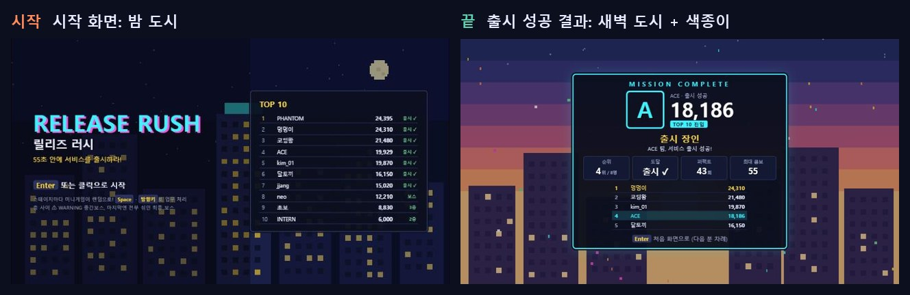

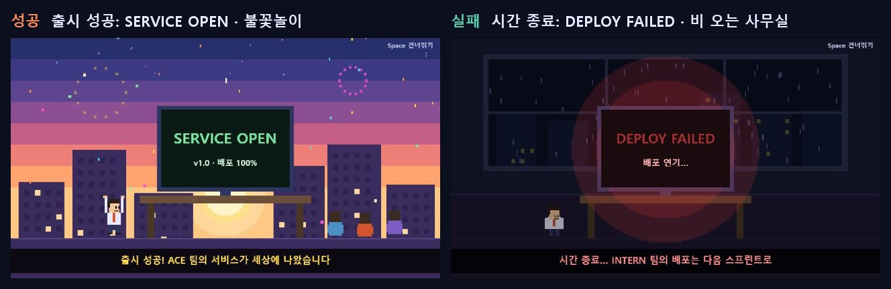

## 스테이지 클리어 연출과 정산표

클리어 조건(작업 N개 처리)을 채우는 순간과, 남은 시간이 점수로 바뀌는 과정을 보여 준 뒤 플레이어가 Space로 넘어갑니다.

1. **달성 순간 (0.9초):** 화면이 번쩍이고 `STAGE CLEAR!`(보스 `출시 성공!`, WARNING `WARNING 종료!`) 글자가 도장처럼 찍히며 조각이 터짐. 아래에 "작업 5/5 처리 완료". 위쪽 HUD의 진행 칸이 모두 초록이 되고 `CLEAR!`가 깜빡임.
2. **정산표:** 한 줄씩 나타나며 점수가 올라감. 올라가는 만큼 왼쪽 SCORE에도 실제로 더해짐. 남은 시간 줄을 계산할 때는 위쪽 타이머가 하늘색으로 반짝임. #40부터 줄마다 **이름 + 점수**만(세부 계산식 · 맺음말은 뺌), 맨 아래 **이번 스테이지 점수를 크게**와 총점.

| 종류 | 줄 | 맺음말 | 다음 |
|---|---|---|---|
| 층 | 이번 층 작업 점수 · 클리어 보너스 · 처리 속도 보너스((기준 − 소요) × 50) · (무결점 배포) · 코인 +5 | 남은 시간 N초는 줄지 않고 다음 스테이지로 이어집니다 | WARNING 또는 보상 고르기 |
| WARNING | 성공 N회 | 성공 횟수에 따른 보상 아이템 등급 확률 | 보상 아이템 고르기 |
| 최종 보스 | 보스전 획득 점수 · 출시 보너스 2,000 · ⏱ 남은 시간 보너스(초 × 200 × 신기술 배율, #43) · 남은 코인(개 × 30) | 남은 시간과 코인을 모두 점수로 바꿨습니다 (타이머·코인이 0까지 줄어듦) | 출시 컷신 |

- 시간은 판 전체가 하나라서 층에서는 **보너스만 주고 시간은 그대로 이어집니다.** 실제로 시간을 점수로 바꿔 없애는 것은 마지막 보스뿐입니다.
- 마지막 작업의 Space 연타가 정산표를 바로 넘기지 않도록 0.6초 동안 입력을 받지 않습니다. 정산표에서는 시간이 멈춥니다. 입력 없이 3분이면 처음 화면으로 돌아갑니다(부스 안전장치).
- 남은 작업이 1개가 되면 HUD에 `클리어까지 1개 · 마지막!`이 깜빡입니다.

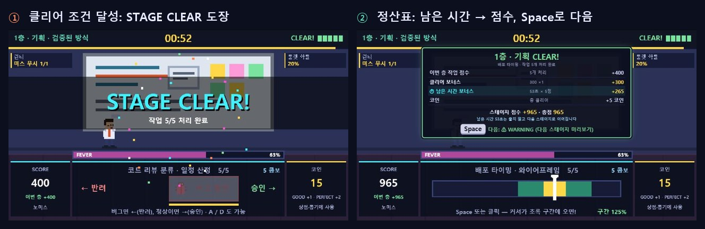

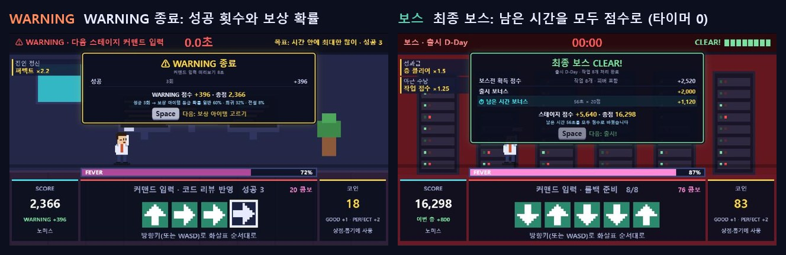

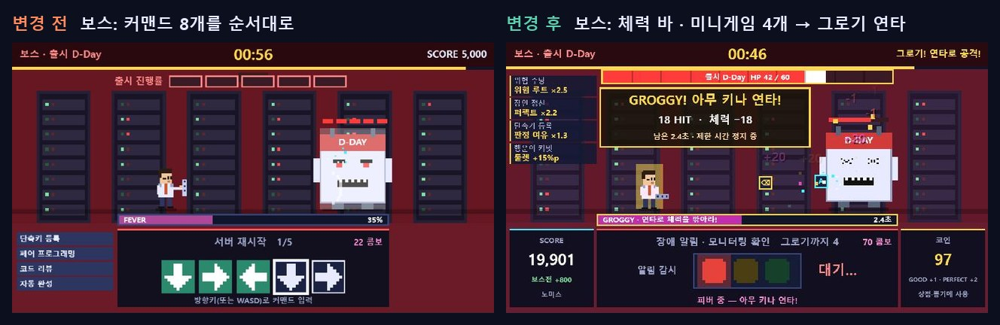

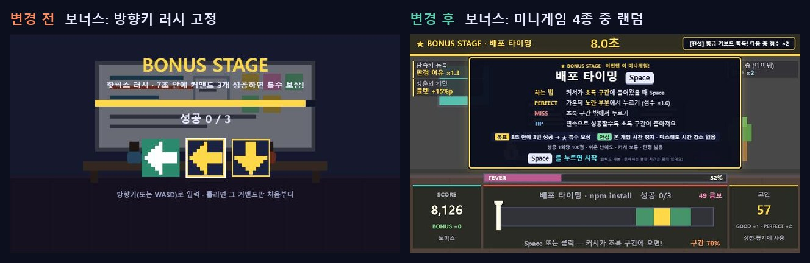

## 소리

- **효과음 20종**(#49에서 타격음 4종 추가): 음원 파일 없이 Web Audio로 코드에서 직접 합성(저작권 없음, 오프라인 동작). 샘플 비교 후 **A(8비트 칩튠)**로 결정.

| 소리 | 나는 때 |
|---|---|
| 작업 성공 · 퍼펙트 · 미스 | 작업 판정 |
| 입력 1칸 | 커맨드 화살표, 컴파일 차지 누르기, 메뉴 커서 이동 |
| 스테이지 시작 · CLEAR 도장 | Space로 시작, 클리어 순간 |
| 정산표 숫자 · 코인 | 정산표 점수가 올라가는 동안(0.06초 간격), 남은 코인 환산 · 상점 구매 |
| 피버 시작 · 연타 | 피버 게이지가 가득 참, 피버·그로기 연타 |
| 보스 그로기 · 장애 경보 | 미니게임 4개 성공, 보스 장애 −3초 |
| 출시 팡파르 · 시간 종료 | 출시 컷신의 SERVICE OPEN / DEPLOY FAILED 순간 |
| 메뉴 선택 · 등급 도장 | 카드·루트·아이템 고르기, 결과창 등급 |
| 타격 · 강타 · 처치 (#49) | 주인공이 몬스터를 칠 때(GOOD · PERFECT/보스), 몬스터를 쓰러뜨릴 때 |
| 키캡 명중 (#49) | 피버 · 그로기 연타의 키캡이 몬스터에 맞을 때 (0.08초에 한 번까지) |

- 브라우저 정책상 첫 키 입력 · 클릭 뒤부터 소리가 남. 데모(어트랙트 모드)에서는 효과음을 내지 않음(부스 소음).
- **M** 키로 소리 켜기/끄기, 설정은 브라우저에 저장. 대기 화면에 안내.
- **BGM 5곡**(#55에서 대기 화면 곡 추가) (같은 방식으로 코드가 연주하는 칩튠, 샘플 비교 후 결정). 장면이 바뀌면 0.4초 동안 서서히 커지며 바뀜. 효과음보다 작게(0.2).

| 장면 | 곡 |
|---|---|
| 닉네임 · 카드 · 루트 · 아이템 · 상점 · 룰렛 | 사무실 대기 (96BPM) |
| 1·2·3층 · 보너스 스테이지 | 통통 튀는 (140BPM) |
| WARNING · 최종 보스 | 긴장 (150BPM) |
| 엔딩 · 결과 | 엔딩 (88BPM) |
| 대기 화면 · 데모 플레이 (#55) | 신스웨이브풍 (128BPM, 톱니 베이스 · 16분 아르페지오 · 4박 킥). 레이저 화면 비트가 이 박자에 맞춰 번쩍. 데모 효과음은 계속 끔 |
| 출시 컷신 · 일시정지 · 창이 가려졌을 때 | 없음 (컷신은 효과음 팡파르) |

- 브라우저 정책상 게임을 연 뒤 **첫 키 입력 · 클릭 전에는 소리가 나지 않음**. 부스에서는 켠 뒤 Shift 같은 키를 한 번 눌러 두면 대기 화면 곡부터 나옴(Enter는 닉네임으로 넘어감).

- M 키는 효과음과 BGM을 함께 끄고 켬.
