# 04. 개발 로그

> 구현을 시작한 뒤 생긴 논의와 수정을 순서대로 기록합니다.
> 항목마다 **원인/목적 → 수정 내용 → 예상 결과 → 검증 결과**를 남깁니다.
> 새 항목은 맨 아래에 추가합니다. 하루 동안의 작업이라 날짜 대신 번호 순서가 진행 순서입니다.
> 큰 수정에는 변경 전/후 캡처를 함께 남깁니다. 이미지는 `images/` 폴더에 있습니다.
> 작성 양식은 [README.md](README.md#개발-로그-작성-양식)에 있습니다.

---

## #01 게임 초안 구현 (방향키 커맨드 버전)

- **원인/목적:** 설계서대로 실제로 돌아가는 모습을 보고 수정하기 위해. 배포 방식은 나중에 정하기로 함.
- **수정 내용**
  - `game/release-rush.html` 한 파일로 구현. 외부 리소스 없음.
  - 대기 화면(TOP 10) → 닉네임 → 시작 카드 → 루트 → 층(방향키 커맨드) → 보상 카드 → 룰렛 → 보스 → 결과.
  - 카드 10종, 특수 보상 4종, 룰렛 보정, 황금 커맨드, 칭호, localStorage 랭킹, 자동 일시정지, 운영자 기록 초기화.
  - 점검용 훅 `window.__RR`과 로컬 서버 설정 추가.
- **예상 결과:** 한 판 전체를 끝까지 플레이할 수 있고, 새로고침해도 랭킹이 남는다.
- **검증 결과**
  - 가상 플레이어 여러 판에서 처음부터 결과 화면까지 진행됨. 보스 클리어 종료와 시간 초과 종료 모두 확인.
  - 오입력 리셋, 린터, 페어 프로그래밍, 자동 완성, 시니어 합류, 오픈소스, 10초 자동 선택, 자동 일시정지 확인.
  - 새로고침 후 기록 5건과 마지막 닉네임 유지 확인. 콘솔 오류 없음.
- **관련 파일:** `game/release-rush.html`, `.claude/launch.json`
- **화면 (초안)**

| 카드 선택 | 루트 선택 |
|---|---|
| 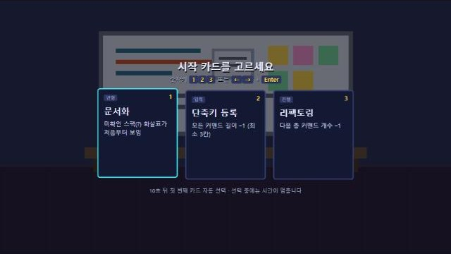 | 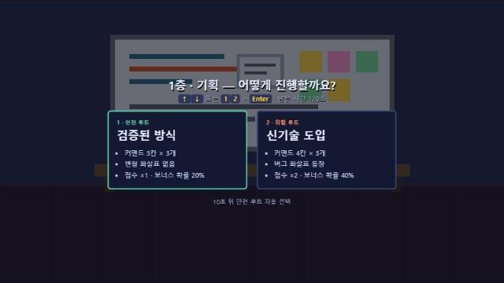 |
| **룰렛** | **결과·랭킹** |
| 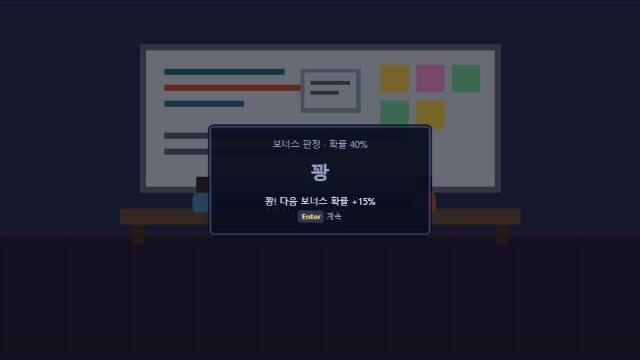 | 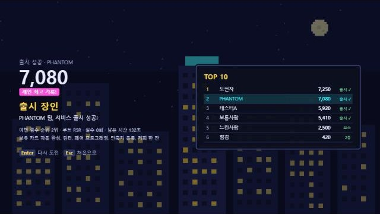 |

## #02 점검 중 발견한 화면 문제 수정

- **원인/목적:** 화면을 직접 보니 읽기 어렵거나 헷갈리는 부분이 있었음.
- **수정 내용**
  - 화살표를 7×7에서 9×9 도트로 키우고 칸도 18→22로 넓힘.
  - 빨간 화살표·`?` 화살표가 나오면 "빨간 화살표는 반대 방향으로!" 안내 표시.
  - 시니어 합류로 두 번째 카드를 고를 때 "한 장 더 고르세요" 제목 표시.
  - 대기·결과 화면 글씨에 그림자 추가, 깨져 보이던 달 모양 수정.
- **예상 결과:** 처음 보는 사람도 화살표와 변형 규칙을 바로 알아본다.
- **검증 결과:** 화면 캡처로 확인.

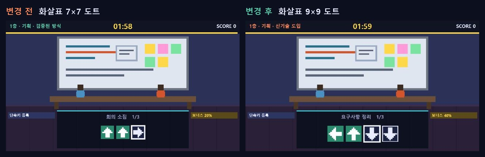

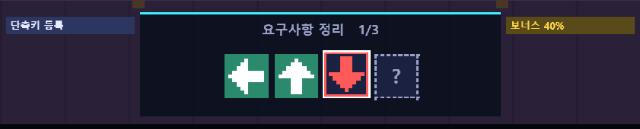

## #03 제한 시간 120초 → 60초

- **원인/목적:** 시뮬레이션해 보니 120초가 너무 넉넉함. 실제 입력 시간이 빠른 사람 14~23초, 보통 33~60초라 대부분 시간이 크게 남고 남은 시간 보너스가 점수를 좌우함.
- **수정 내용:** `TOTAL_TIME` 60초. 대기 화면 문구도 설정값을 따라가게 바꿈.
- **예상 결과:** 느린 사람은 보스 앞에서 아깝게 끝나고, 다시 하면 깨는 흐름.
- **검증 결과 (유형별 20판)**

| 유형 | 출시 성공률 | 점수 중앙값 |
|---|---|---|
| 빠름 · 위험 | 100% | 6,490 |
| 보통 · 안전 | 95% | 4,470 |
| 느림 · 안전 | 15% | 1,830 |

- **남은 문제:** 가상 플레이어는 변형 화살표에서 느려지지 않아 위험 루트가 과하게 유리하게 나옴.

## #04 데모 플레이 (오락실 어트랙트 모드)

- **원인/목적:** 한 판의 흐름을 영상처럼 보고 싶다는 요청. 오락실 기계의 데모 플레이에서 착안.
- **수정 내용**
  - 대기 화면에서 15초 동안 입력이 없거나 주소에 `?demo`를 붙이면 게임이 스스로 플레이.
  - 사람처럼 보이게 고민하는 척, 빨간 화살표 앞에서 멈칫, 가끔 실수.
  - 오른쪽 위에 "DEMO PLAY · 아무 키나 누르면 시작" 표시. 아무 키나 클릭하면 바로 닉네임 화면.
  - 데모 기록은 저장하지 않고 마지막 닉네임도 바꾸지 않음.
- **예상 결과:** 흐름 확인에 쓰고, 부스에서는 지나가는 사람의 눈길을 끄는 역할.
- **검증 결과:** 한 판 약 73초에 결과까지 진행, 80초에 대기 화면 복귀. 중단 후 정상 시작, 기록 0건.

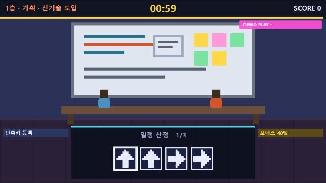

## #05 피버 게이지 추가 (1차)

- **원인/목적:** 잘하는 플레이에 보상을 주고 싶다는 요청.
- **수정 내용:** 맞게 입력하면 게이지가 차고(콤보가 길수록 빨리), 틀리면 −30%. 가득 차면 6초 동안 점수 ×2, 실수해도 리셋 없음.
- **예상 결과:** 연속 성공을 노리는 긴장감과 실력 차이가 점수에 반영됨.
- **검증 결과:** 빠른 사람은 입력 시간의 58%가 피버 상태라 너무 흔했음. → #08에서 방식 자체를 바꿈.

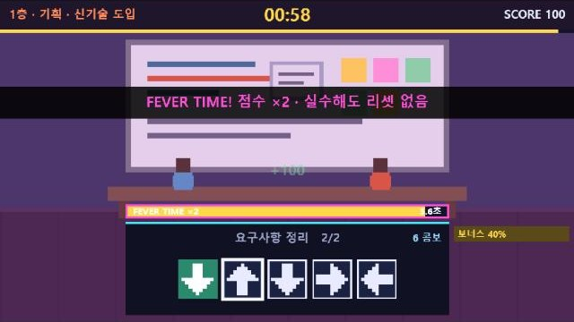

## #06 기본 흐름을 타이밍 원버튼으로 교체 (v2)

- **원인/목적:** "방향키 입력이 메인 흐름이면 너무 피로하지 않을까?" 피로보다 **모든 층이 같은 행동이라 단조롭다**는 문제가 더 컸음. 방향키는 보스·보너스에서만 특수 패턴으로 쓰기로 함.
- **수정 내용**
  - 층 플레이: 커서가 진행 바를 왕복하고, 초록 구간에서 **Space**. 가운데면 PERFECT.
  - 위험 루트: 커서가 빠르고 구간이 좁으며, 2·3층은 구간이 움직임.
  - 보스: 기존 방향키 커맨드 유지(특수 패턴).
  - **보너스 스테이지** 신설: 층 클리어 후 확률로 7초 방향키 러시. 황금 커맨드는 이것으로 대체.
  - 카드 효과를 새 흐름에 맞게 재해석(단축키 = 구간 넓힘, 자동 완성 = 커서 느리게 등).
  - 층 끝난 직후 Space 연타가 카드 선택으로 넘어가지 않게 0.6초 입력 차단.
  - 이전 버전은 `game/backup/release-rush-v1-arrows.html`에 백업.
- **예상 결과:** 층은 무난하게 넘기고, 보스의 방향키 패턴에서 실력이 갈림.
- **검증 결과 (유형별 12판)**

| 유형 | 출시 성공률 | 입력 시간 | 비고 |
|---|---|---|---|
| 숙련 | 100% | 18~21초 | |
| 보통 | 100% | 약 26초 | |
| 초보 | 60~80% | 약 45초 | 실패는 **전부 보스전** |

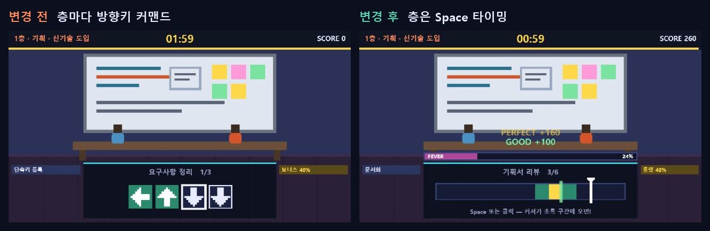

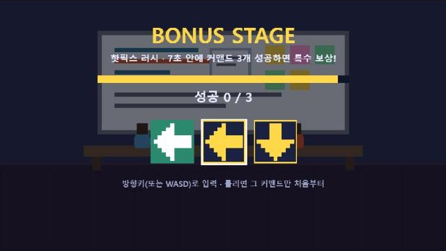

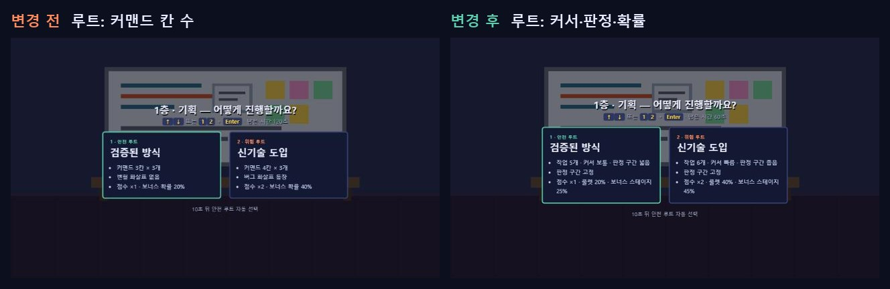

## #07 판정 구간이 콤보에 따라 좁아지도록

- **원인/목적:** 처음엔 넓게 시작해서 연속 성공할수록 좁아지게 해 달라는 요청. 초보는 쉽게 시작하고 잘할수록 긴장감이 커지게.
- **수정 내용:** 콤보 0일 때 기본 폭의 150%, 콤보 1마다 5%씩 줄어 최소 70%. 미스하면 다시 150%. 폭은 부드럽게 변하고 판정도 보이는 폭 그대로. `구간 150%` 표시 추가.
- **예상 결과:** 첫 몇 번은 누구나 성공하고, 콤보가 쌓일수록 어려워짐.
- **검증 결과 (유형별 10판)**

| 유형 | 출시 성공률 | Space 미스율 (안전 / 위험) |
|---|---|---|
| 숙련 | 100% | 0% / 1% |
| 보통 | 100% | 4% / 12% |
| 초보 | 70~80% | 12% / 27% |

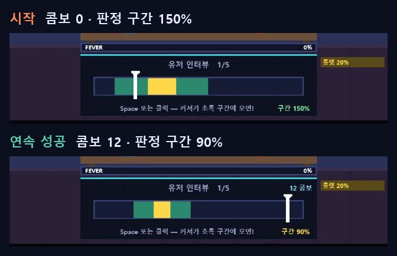

## #08 피버 타임을 "아무 키나 연타" 구간으로

- **원인/목적:** 피버를 더 직관적이고 신나는 순간으로 만들기 위해 "피버 타임에는 아무 키나 연타"하도록 요청.
- **수정 내용**
  - 게이지가 가득 차면 **5초** 동안 미니게임과 제한 시간이 멈추고 연타 화면이 열림.
  - 아무 키 1회 = +20점(루트 배율). 꾹 누르기는 무시. 연타 중 F5·Tab 등 브라우저 동작 차단.
  - 기존 점수 ×2·실수 면제 효과는 제거.
  - 결과 화면에 총 연타 수 표시.
- **예상 결과:** 짧고 강한 보상 구간. 부스에서 구경꾼도 함께 흥분할 수 있는 장면.
- **검증 결과:** 시간·커서 정지, 연타 점수, 꾹 누르기 무시, F5 차단, 종료 후 재개 확인. 데모 기준 한 판에 피버 2~4회, 한 판 길이 약 80~90초로 늘어남.

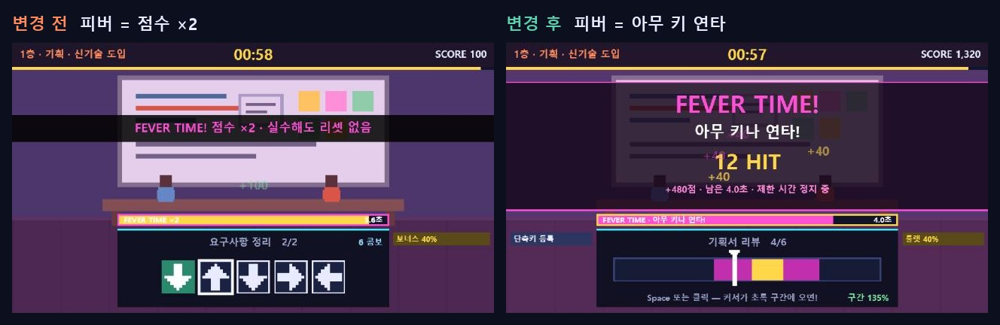

## #09 배경 전투 연출: 직장인 vs 업무 몬스터

- **원인/목적:** 배경이 너무 정적이라는 의견. 직장인이 일하면서 싸우는 연출을 원함.
- **수정 내용**
  - 주인공(넥타이 맨 직장인, 무기는 키보드)과 층별 몬스터(회의 요청 메일, 버그, 에러 로그 슬라임, 거대 D-DAY 달력) 도트 추가.
  - 작업 1개 = 몬스터 1마리. 성공하면 베기 + 폭발, 미스하면 피격, 피버 때 키캡 난사, 클리어 때 승리 포즈, 보스 장애 때 반격.
  - 플레이 중에는 책상·동료를 치워 무대를 비우고, 피버·클리어 안내를 화면 위쪽으로 옮김. 점수 팝업에 그림자 추가.
  - 판정과 분리된 보여 주기용 레이어라 점수에는 영향 없음.
  - 이전 버전은 `game/backup/release-rush-v2-timing.html`에 백업.
- **예상 결과:** 입력 하나하나에 눈에 보이는 반응이 생겨 손맛과 관전 재미가 커짐.
- **검증 결과:** 데모 3판 + 일반 플레이 1판(출시 성공, 피버 4회) 끝까지 진행, 기록 정상 저장, 콘솔 오류 없음.

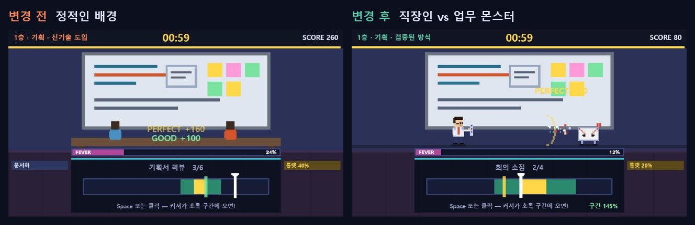

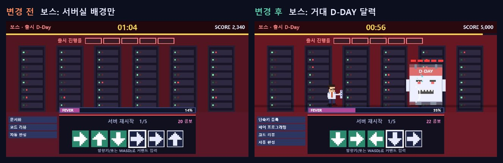

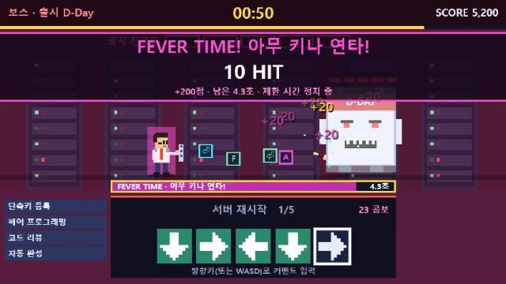

## #10 개발 과정 문서화 체계 도입

- **원인/목적:** 지금까지의 개발 과정을 정리하고, 앞으로의 논의·수정도 계속 기록하기로 함.
- **수정 내용:** `docs/` 폴더에 목차, 기획 과정, 게임 설정, 기술 구조, 개발 로그, 남은 과제 문서 작성. 하루 작업이라 날짜 대신 번호 순서로 기록.
- **예상 결과:** 수정할 때마다 원인·내용·결과가 쌓여서 나중에 바뀐 이유를 추적할 수 있음.
- **검증 결과:** 문서 6개 작성.

## #11 캡처와 변경 전/후 비교 이미지 추가

- **원인/목적:** 글로만 보면 무엇이 바뀌었는지 와닿지 않음. 큰 수정마다 이미지를 남겨 변화를 바로 확인하기 위해.
- **수정 내용**
  - 개발하면서 찍어 둔 캡처를 `docs/images/`로 정리하고, 위아래 검은 여백을 잘라 게임 화면만 남김.
  - 빠진 장면(현재 대기·루트·결과 화면, 전투 연출 전 보스 화면)을 새로 촬영. 이전 버전은 `game/backup/` 파일을 띄워서 찍음.
  - 변경 전/후를 한 장에 나란히 놓은 비교 이미지 8장 제작.
  - 기획 과정, 게임 설정, 개발 로그 문서에 이미지 삽입.
- **예상 결과:** 문서에서 변화를 한눈에 확인할 수 있음.
- **검증 결과:** 이미지 39장, 약 1.9MB. 비교 이미지 표시 확인.

## #12 미니게임 랜덤 배정 + WARNING 중간보스 + 최종 보스 섞기 (v4)

- **원인/목적:** "미니게임을 스테이지보다 많이 만들어 스테이지마다 랜덤하게 부여하자"는 제안. 게임을 시작하면 미니게임을 정하고, 1스테이지가 끝나면 중간보스가 2스테이지 미니게임을 **WARNING 특수 패턴**으로 먼저 보여 주고, 2스테이지부터는 그 패턴이 기본이 되며, 마지막 보스는 모든 미니게임을 섞는 구조. 매판 조합이 달라져 재도전 동기가 생기고, 층마다 하는 일이 달라 단조로움도 줄어듦.
- **수정 내용**
  - 미니게임을 공통 틀(`MGX`: 입력 · 업데이트 · 그리기)로 묶고, 새 미니게임 2종 추가.
    - **장애 알림:** 빨간불이 초록불로 바뀌는 순간 Space. 노란불은 함정.
    - **코드 리뷰 분류:** 버그 카드면 ←(반려), 정상 카드면 →(승인).
  - 판마다 4종(배포 타이밍·커맨드 입력·장애 알림·코드 리뷰 분류) 중 3종을 1·2·3층에 무작위 배정.
  - **WARNING 중간보스:** 1·2층 클리어 뒤 다음 층 미니게임을 강한 패턴으로 8초. 반드시 깨야 하는 관문이 아니라 점수 이벤트이고, 본 게임 시간은 멈춤.
  - **최종 보스:** 이번 판 미니게임 3종을 골고루 섞어 8개. 바뀔 때마다 "패턴 전환!" 안내.
  - 미니게임마다 안전·위험·WARNING·보스 난이도표를 따로 두고, 오래 걸리는 미니게임은 작업 수를 줄임.
  - 카드 효과를 모든 미니게임에 맞게 일반화 (단축키 = 모든 판정 30% 완화 등).
  - 시작 카드·루트 선택 화면에 이번 판 미니게임 순서 표시, 결과 화면에 미니게임 순서와 WARNING 점수 표시.
  - 데모 봇이 미니게임 4종을 모두 플레이하도록 수정.
  - 이전 버전은 `game/backup/release-rush-v3-battle.html`에 백업.
- **예상 결과:** 판마다 다른 조합, WARNING이 다음 층의 예고편이자 튜토리얼 역할, 최종 보스가 그 판의 총정리가 됨.
- **검증 결과**
  - 흐름: 1층(장애 알림) → WARNING(배포 타이밍) → 2층(배포 타이밍) → WARNING(커맨드 입력) → 3층(커맨드 입력) → 보스(세 가지 섞임) 순서 확인.
  - 판정: 장애 알림의 빨간불·노란불 조급 입력 미스, 초록불 놓침 미스, 빠른 반응 퍼펙트·늦은 반응 굿. 코드 리뷰 분류의 오판·시간 초과 미스, 정답 퍼펙트. 다른 미니게임 키 무시. 린터, WARNING 중 본 게임 시간 정지 모두 확인.
  - 처음 70초로 시뮬레이션하니 초보까지 100% 출시 성공 → **제한 시간 55초, 최종 보스 작업 6 → 8개**로 조정.
  - 조정 후 가상 플레이어 10~12판씩:

| 유형 | 출시 성공률 (안전 / 위험) | 한 판 전체 길이 |
|---|---|---|
| 숙련 | 100% / 100% | 약 86~106초 |
| 보통 | 100% / 100% | 약 92~104초 |
| 초보 | 80% / 40% | 약 96~109초, 실패는 거의 **최종 보스**에서 |

  - 콘솔 오류 없음.
- **관련 파일:** `game/release-rush.html`

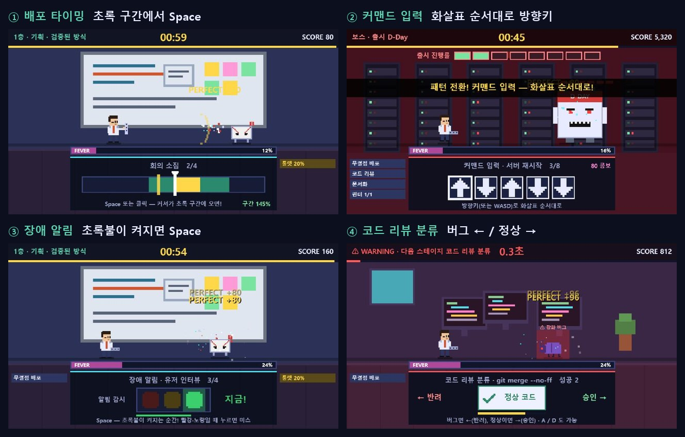

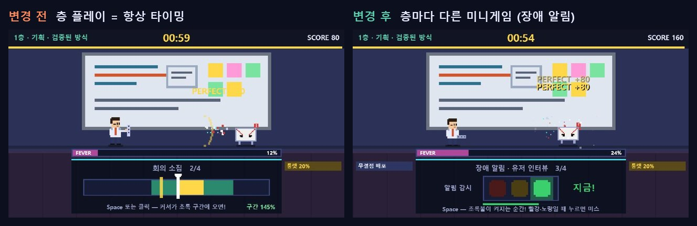

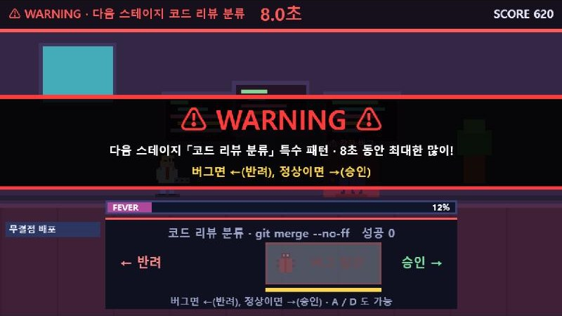

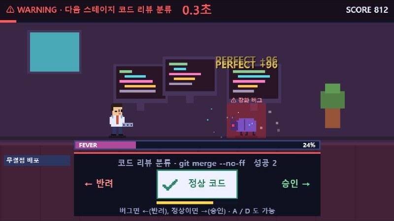

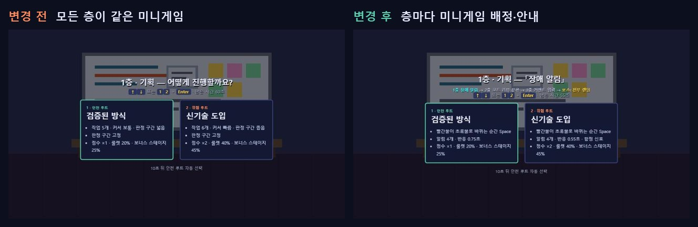

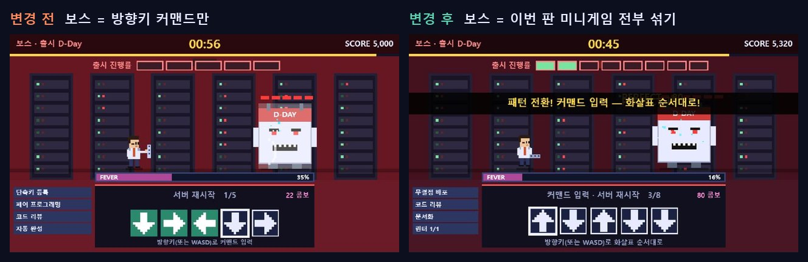

## #13 선택 화면 시간 제한 제거 + 수치형 전략 카드 (v5)

- **원인/목적:** 카드·루트 선택에 10초 제한이 있으면 고민할 틈이 없고, 카드 설명도 "판정 30% 완화" 같은 문장이라 점수 계산이 어려움. **시간 제한 없이 고르게 하고, 효과를 "점수 ×1.25", "제한 시간 +10초"처럼 숫자로 보여 줘서** 플레이어가 고득점 전략을 직접 세우게 하자는 요청.
- **수정 내용**
  - 카드·루트 선택의 10초 자동 선택 제거. 화면에 "시간 제한 없음 · 천천히 전략을 세우세요" 표시. 고르는 동안 제한 시간은 그대로 멈춤.
  - 부스 안전장치: 선택 화면에서 입력 없이 3분이 지나면 처음 화면으로 (자리를 비운 판이 남지 않도록).
  - 카드를 12종의 수치형 카드로 개편. 카드마다 큰 글씨의 효과 수치(`big`)와 보충 설명을 따로 둠.
    - **새 점수 카드:** 야근 수당(작업 점수 ×1.25), 성과급(층 클리어 ×1.5), 장인 정신(퍼펙트 ×1.6 → ×2.2), 연속 근무(10콤보↑ ×1.3), 위험 수당(위험 루트 ×2 → ×2.5), 회식(피버 연타 ×1.5 · +1초).
    - **바뀐 카드:** 커피 한 잔 +8초 → **+10초**, 단축키 등록 "판정 여유 ×1.3".
    - **뺀 카드:** 자동 완성, 페어 프로그래밍, 코드 리뷰, 문서화 (효과를 숫자로 표현하기 어렵고 특정 미니게임에만 쓰임).
  - 카드·루트 선택 화면 아래에 **현재 빌드 요약** 추가: 남은 시간, 작업 점수 배율, 퍼펙트 배율, 위험 루트 배율, 층 클리어 배율, 피버 배율·시간, 룰렛 확률.
  - 점수 계산을 배율 함수(`routeMult`, `perfectMult`, `workMult`, `feverDuration`)로 모아 카드 효과가 한곳에서 적용되게 함.
  - 이전 버전은 `game/backup/release-rush-v4-minigames.html`에 백업.
- **예상 결과:** "배율을 쌓을까, 시간을 벌까, 실수를 막을까"라는 선택이 생기고, 같은 실력이라도 카드 조합에 따라 점수 차이가 남. 랭킹 상위권 경쟁에 전략 요소가 더해짐.
- **검증 결과**
  - 30초를 기다려도 카드·루트가 자동으로 선택되지 않음. 입력 없이 3분이면 처음 화면으로 돌아감.
  - 배율 계산 확인: 카드 없이 위험 루트 퍼펙트 160점, 야근 수당 2장 + 장인 정신 + 위험 수당 430점, 연속 근무 12콤보 208점, 회식 2장 피버 7초·연타 1회 90점. 모두 계산값과 일치.
  - 가상 플레이어 8판씩 (카드는 무작위 선택):

| 유형 | 출시 성공률 | 점수 (최저 / 중간 / 최고) |
|---|---|---|
| 숙련 · 위험 | 100% | 13,406 / 19,531 / 33,626 |
| 보통 · 안전 / 위험 | 100% / 100% | 9,921 / 13,862 (중간값) |
| 초보 · 안전 / 위험 | 63% / 63% | 5,326 / 9,492 (중간값) |

  - 같은 숙련자도 카드 조합에 따라 점수가 약 1만 3천~3만 4천으로 벌어짐 → 전략의 영향이 큼.
  - 콘솔 오류 없음.
- **관련 파일:** `game/release-rush.html`

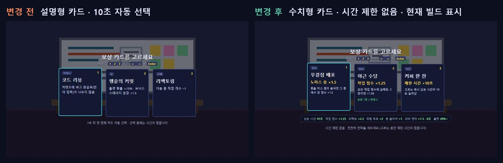

## #14 카드 효과 표시 + 아이템·코인·상점 (v6)

- **원인/목적:** 플레이 화면 왼쪽에 고른 카드의 이름만 있고 효과가 보이지 않아, 지금 어떤 배율로 플레이 중인지 알 수 없었음. 또 랜덤 아이템 뽑기를 넣어 운과 선택의 재미를 늘리고, 아이템을 얻는 곳으로 **WARNING 중간보스 · 랜덤 카드 · 랜덤 상점 2종(일반·대박)**을 두자는 요청. 확률을 화면에 명시하고 상점 선택지도 만들되, 이번에는 구현만 하고 수치는 추정치로 둠.
- **수정 내용**
  - **플레이 화면 양옆 패널:** 왼쪽은 보유 카드 이름과 현재 효과 수치(예: "야근 수당 ×2 · 작업 점수 ×1.56", "린터 · 미스 무시 1/1", 10콤보 이상이면 "ON"). 오른쪽은 코인, 룰렛 확률, 보험(남은 미스 막기), 이번 층·다음 층 아이템 버프.
  - **아이템 14종** (일반 5 · 희귀 5 · 전설 4): 시간 추가, 미스 막기, 피버 게이지, 즉시 점수(고정·무작위), 코인, 다음 층 점수 ×1.5·×2, 다음 층 작업 자동 완료.
  - **코인:** 작업 GOOD +1, PERFECT +2, 층 클리어 +5, WARNING 성공 +1, 보너스 커맨드 +1.
  - **WARNING 보상:** WARNING이 끝나면 항상 아이템 3개 중 1개 선택. 성공 횟수가 많을수록 등급 확률이 좋아짐.
  - **층 보상 뒤 이벤트:** 대박 상점 10% · 일반 상점 35% · 랜덤 카드 25% · 없음 30%.
    - **랜덤 카드:** 뒤집힌 카드 3장 중 1장을 고르면 공개(일반 60 / 희귀 30 / 전설 10). 놓친 카드도 보여 줌.
    - **상점:** 구매(1·2·3), 새로고침(R, 3코인부터 +2씩), 랜덤 뽑기(G, 확률 표시), 나가기(Enter). 대박 상점은 희귀·전설만 진열하고 30% 할인.
  - 모든 선택 화면에 **등급 확률과 가격을 표시**, 아이템 카드는 등급별 색(일반 회색 · 희귀 파랑 · 전설 금색).
  - 아이템을 얻으면 화면 위에 알림 표시. 결과 화면에 아이템 개수와 남은 코인 표시.
  - 데모 봇이 아이템 고르기, 카드 뒤집기, 상점 구매까지 플레이.
  - 이전 버전은 `game/backup/release-rush-v5-cards.html`에 백업.
- **예상 결과:** 지금 빌드를 한눈에 보며 플레이하고, 코인을 어디에 쓸지(시간·안정·점수)라는 전략이 하나 더 생김. 랜덤 카드와 대박 상점이 "운 좋은 판"의 순간을 만듦.
- **검증 결과**
  - 등급 확률 2만 번 뽑기: 일반 상점 70.0 / 27.1 / 2.9%, 대박 상점 0 / 59.5 / 40.5%, 랜덤 카드 60.5 / 29.5 / 10.0%, WARNING 6회↑ 40.6 / 44.4 / 15.0% → 설정값과 ±0.5%p 이내로 일치.
  - 상점: 코인 부족 시 구매 거절과 안내, 구매 후 재구매 불가, 새로고침 비용 3 → 5, 뽑기 5코인, 대박 상점 가격 30% 할인(전설 15 · 희귀 8) 확인.
  - 아이템: 보험이 미스를 막음(미스 수 증가 없음), 황금 키보드 + 만능 패스가 다음 층(보스)에서 점수 ×2·작업 3개 자동 완료로 적용됨.
  - 흐름: 1층 → WARNING → 아이템 선택 → 카드 → 룰렛 → 랜덤 카드 → 2층 → WARNING → 아이템 선택 → … → 상점 → … → 보스 → 결과. 데모 3판 끝까지 진행. 콘솔 오류 없음.
  - 점검 중 발견: 코인이 부족한 상품의 가격 표시가 카드 오른쪽 위 번호 자리로 튀어 나감(클래스 이름 충돌) → 수정.
  - **밸런스(확률·가격·효과)는 추정치이며 아직 조정하지 않음.**
- **관련 파일:** `game/release-rush.html`

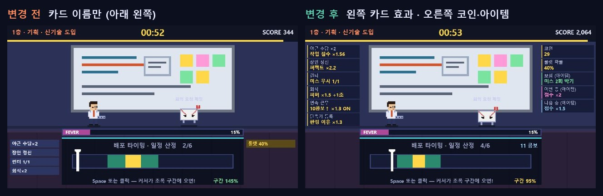

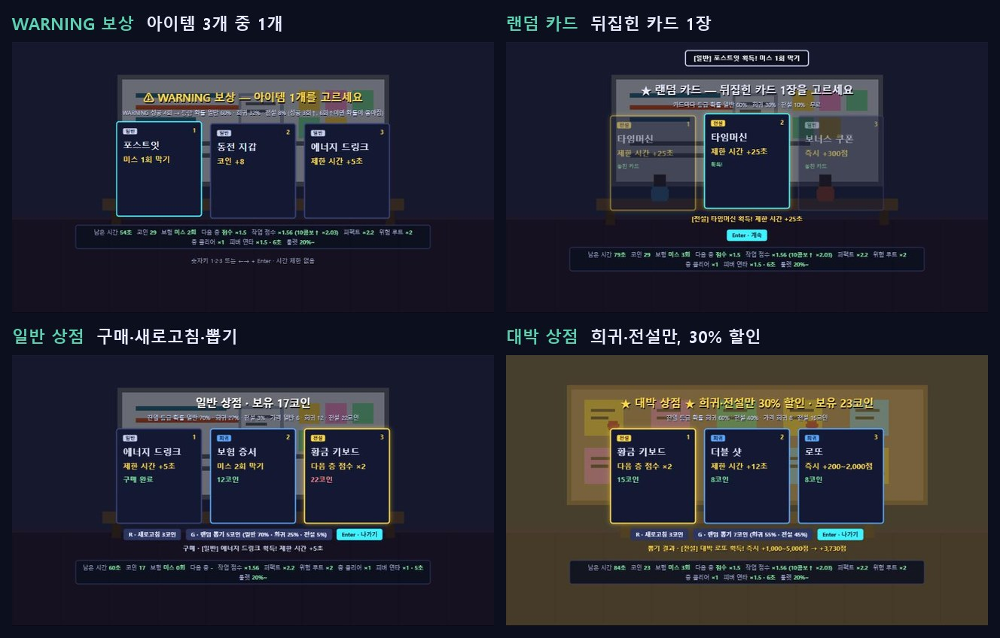

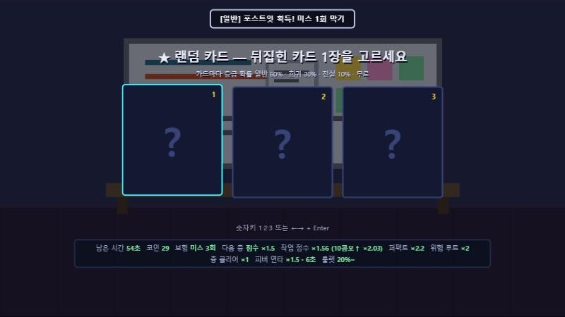

## #15 스테이지 시작은 Space로 + 룰 카드 + 점수·코인 위치 (v7)

- **원인/목적:** 스테이지가 1.5초 안내 뒤 저절로 시작돼서, 규칙을 이해하지 못한 채 플레이하는 경우가 있었음. 시작은 반드시 플레이어가 Space를 눌러서 하고, 규칙 설명이 잘 보이게 하자는 요청. 또 점수와 코인은 화면 맨 위가 아니라 **플레이 박스 가운데 위**에 두자는 요청.
- **수정 내용**
  - **시작 대기:** 층 · WARNING · 최종 보스 모두 시작 전에 룰 카드를 띄우고, Space · Enter · 클릭으로만 시작. 기다리는 동안 제한 시간과 미니게임은 멈춤. 다른 키나 미니게임 입력은 무시.
  - **룰 카드:** 미니게임 이름과 누를 키(키보드 모양), 하는 법 · PERFECT · MISS · TIP 네 줄, 작업 수 · 난이도 · 점수 배율 · 남은 시간. 중요한 단어는 색으로 강조(초록불, 빨간 화살표 등).
    - WARNING은 붉은 테두리와 "8초 동안 최대한 많이! 못 해도 괜찮아요".
    - 최종 보스는 이번 판 미니게임 3종의 키와 하는 법을 한 번에 보여 주고, 장애 발생 규칙을 강조.
  - 시작하면 "START!" 신호를 0.6초 표시.
  - **점수·코인 상자:** 위쪽 HUD의 SCORE와 오른쪽 목록의 코인을 빼고, 플레이 박스(피버 게이지) 바로 위 가운데에 `SCORE | 코인` 상자로 표시. 몬스터 위치를 살짝 오른쪽으로 옮겨 겹치지 않게 함.
  - 아이템 획득 알림을 화면 오른쪽 맨 위로 옮김 (보스전에서 타이머를 가리던 문제).
  - 부스 안전장치: 시작 대기 화면에서도 입력 없이 3분이면 처음 화면으로.
  - 데모 봇은 룰 카드를 2초쯤 보여 준 뒤 시작.
  - 이전 버전은 `game/backup/release-rush-v6-items.html`에 백업.
- **예상 결과:** 규칙을 읽고 준비가 된 다음에 시작하므로 첫 플레이에서 영문도 모르고 미스하는 일이 줄어듦. 점수가 플레이하는 곳 가까이에 있어 눈을 덜 움직임.
- **검증 결과**
  - 30초를 기다려도 시작하지 않고 시간·미니게임이 멈춰 있음. 방향키·Q·미니게임 입력은 무시, Space를 누르면 시작하고 1초에 1초씩 줄어듦.
  - WARNING도 대기(타이머 8초 유지), 클릭으로도 시작됨.
  - 데모 3판: 한 판에 시작 대기 화면 6번(층 3 · WARNING 2 · 보스 1), 모두 끝까지 진행. 데모 한 바퀴는 화면이 늘어 약 130~155초.
  - 콘솔 오류 없음.
- **관련 파일:** `game/release-rush.html`

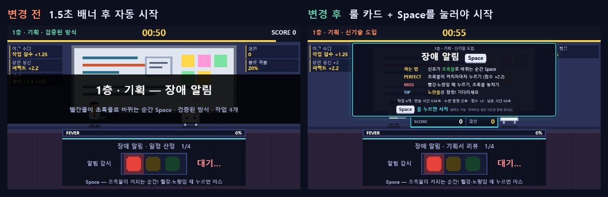

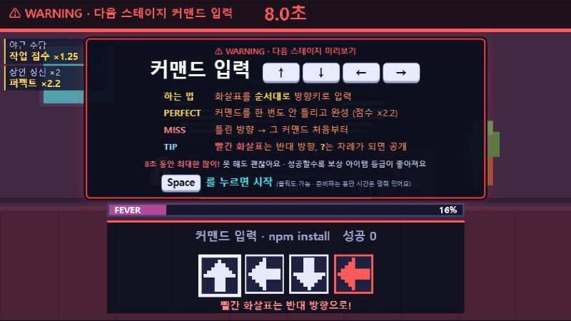

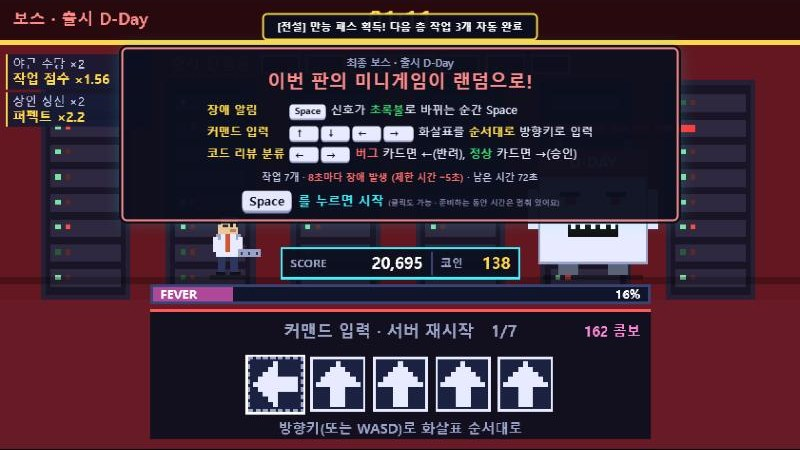

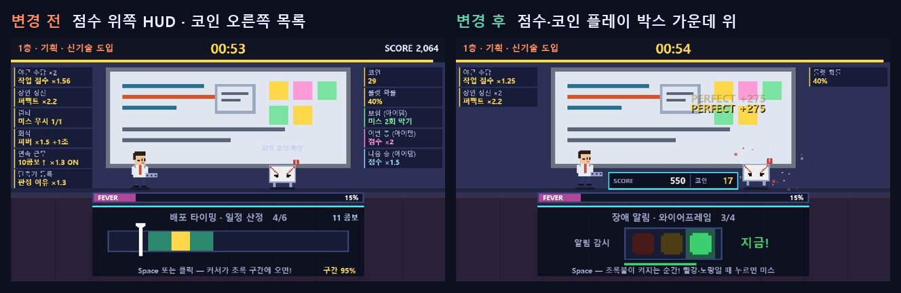

## #16 점수 위치 재조정 + 클리어 조건 표시 + 미스 −2초 + 엔딩 화면 (v8)

- **원인/목적**
  - v7에서 플레이 박스 가운데 위로 옮긴 점수 상자가 **위쪽 전투 화면(주인공·몬스터)을 가림.**
  - "스테이지가 넘어가는 조건이 안 보인다"는 피드백. 진단해 보니 게임오버(제한 시간 0초)는 있었지만, ① 클리어 조건이 패널 제목의 작은 `3/6`으로만 보였고 ② **미스해도 잃는 것이 보이지 않아서** 긴장감이 없었음.
  - 클리어하면 바로 결과 화면으로 넘어가서, 이번 판에 무엇을 골랐고 어떻게 됐는지 돌아볼 틈이 없었음. 페이드 전환과 함께 게임 로그를 순서대로 보여 주는 엔딩 화면을 요청.
- **수정 내용**
  - **점수·코인 위치 (A안):** 플레이 박스 양옆 빈칸으로 이동. 왼쪽은 `SCORE`(큰 숫자) · 이번 층 점수 · 미스 횟수, 오른쪽은 `코인`(큰 숫자) · 획득량(GOOD +1 · PERFECT +2) · 사용처. 위쪽 전투 화면은 다시 비움.
  - **클리어 조건 표시:** 위쪽 HUD 오른쪽에 `클리어까지 N개 ■■□□□`(처리한 작업은 초록). WARNING은 "목표: 시간 안에 최대한 많이 · 성공 N", 보스는 "출시까지 N개". 보스전 가운데에 있던 진행률 칸은 HUD와 겹쳐서 제거.
  - **룰 카드에 조건 한 줄:** `클리어` 작업 N개 처리 → 다음 단계 · `게임오버` 제한 시간 0초 · 미스 1회 −2초. WARNING은 "본 게임 시간 정지 · 미스해도 시간 감소 없음", 보스는 장애 −5초까지 함께 표시.
  - **미스 = 제한 시간 −2초 (추정치, `MISS_TIME`):** 타이머 아래에 빨간 `−2초`가 뜨고 타이머가 잠깐 깜빡임. 린터·보험으로 막은 미스와 WARNING 중 미스는 시간이 줄지 않음.
  - **게임 로그 기록:** 시작·보상 카드, 층 결과(미니게임·루트·작업 수·미스·소요 시간·피버·획득 점수), WARNING 성공 수, WARNING 보상 아이템, 보너스 스테이지, 룰렛, 랜덤 카드, 상점 구매·뽑기·새로고침, 최종 보스(장애 횟수)를 일어난 순서대로 `G.log`에 저장.
  - **엔딩 화면:** 끝나면 0.7초 페이드아웃 → 엔딩 페이드인 → 로그가 0.32초 간격으로 한 줄씩 나타남 → 마지막 줄에 플레이 기록(퍼펙트·최대 콤보·피버·미스로 잃은 시간) → 최종 점수 → Enter로 결과·랭킹(다시 페이드).
    - 출시 성공은 `RELEASE NOTE v1.0`, 시간 종료는 `INCIDENT REPORT`(장애 보고서)라는 개발자 소재 제목. 시간 종료된 층도 "작업 2/4에서 시간 종료"로 남김.
    - Space로 남은 줄을 한 번에 표시. 다 나온 뒤 20초 입력이 없으면 결과 화면으로(부스 안전장치). 페이드 중에는 입력 무시. 결과 화면 진입 직후 0.6초 입력 잠금(Enter 연타로 바로 다시 시작되는 것 방지).
    - 데모 봇은 엔딩을 3초 보여 준 뒤 결과 화면으로.
  - 이전 버전은 `game/backup/release-rush-v7-ready.html`에 백업.
- **예상 결과:** 전투 화면이 다시 보이고, 점수는 플레이하는 곳 바로 옆에 있음. 남은 작업 수와 "미스하면 시간이 준다"가 보여서 진행 조건과 긴장감이 생김. 엔딩에서 내 선택(카드·아이템·루트)이 결과에 어떻게 이어졌는지 보여서 "다음엔 다르게 골라 보자"는 재도전 동기가 생김.
- **검증 결과**
  - 미스 1회에 55.0초 → 53.0초, 린터·보험·WARNING에서는 감소 없음. 시간이 0이 되면 시간 종료 엔딩으로 넘어감.
  - 가상 플레이어 시뮬레이션(미스 −2초 적용): 초보 15/20 클리어(이전 측정 63~80% 범위 안), 보통 20/20. 초보는 미스 약 14회, 시간 약 19초를 잃음.
  - 한 판 로그는 18~22줄, 한 화면에 들어감(넘치면 목록이 스크롤됨).
  - 데모 한 바퀴: 플레이 → 엔딩(약 12초) → 결과 → 대기 화면, 총 약 156초. 콘솔 오류 없음.
  - 점검 중 발견: 태그가 두 줄로 줄바꿈되고 21줄이 넘쳐서 글자 크기·줄 간격을 줄임. 직전 아이템 알림이 엔딩을 가려서 엔딩 진입 때 알림을 닫음.
- **관련 파일:** `game/release-rush.html`

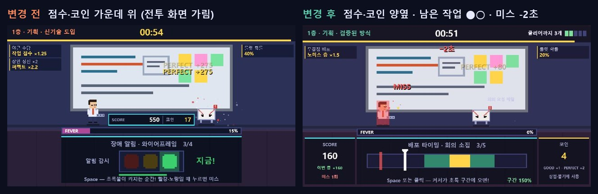

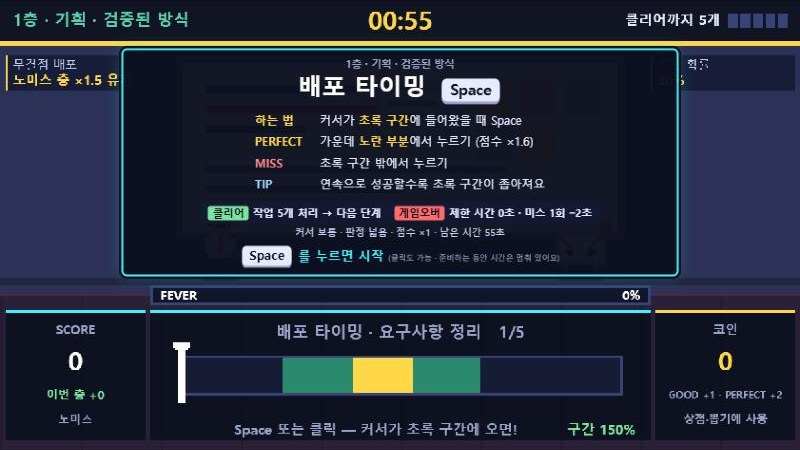

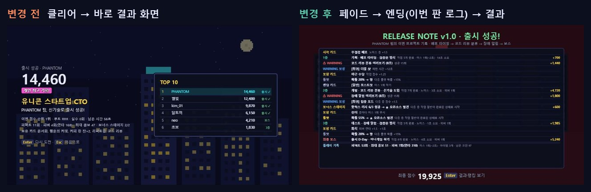

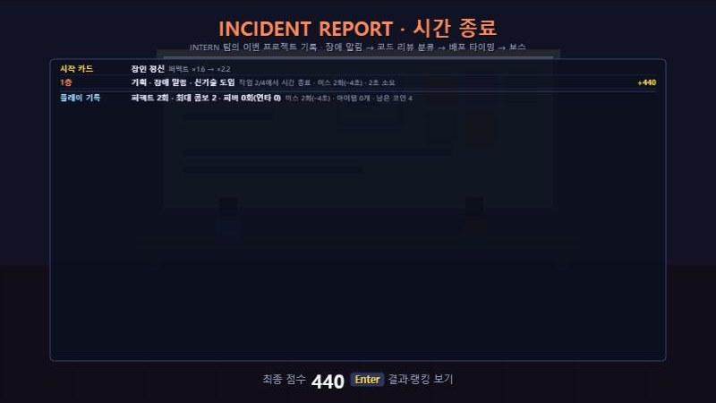

## #17 이미지를 버전별 폴더로 정리

- **원인/목적:** `docs/images/`에 이미지 71장이 한 폴더에 섞여 있어서 버전별로 확인하기 불편하다는 요청.
- **수정 내용**
  - 버전마다 폴더 하나로 이동: `0-plan/`, `v1-arrows/`, `v2-timing/`, `v3-battle/`, `v4-minigames/`, `v5-cards/`, `v6-items/`, `v7-ready/`, `v8-ending/`. 폴더 이름은 `game/backup/`의 백업 파일 이름과 맞춤. 파일 이름은 그대로 둠.
  - 변경 전/후 비교 이미지(`compare-`)는 **변경 후 버전** 폴더에 넣음.
  - `images/README.md`에 버전별 목차를 만듦: 폴더 · 버전 · 내용 · 개발 로그 번호 · 장수 표, 그리고 버전마다 비교 이미지와 화면(2열)을 캡션과 함께 나열.
  - 모든 문서(01~05, README)의 이미지 경로를 새 폴더로 고침(67곳). 캡처 정리 스크립트도 새 폴더에 저장하도록 변경.
- **예상 결과:** 목차 한 장에서 버전 순서대로 화면 변화를 확인할 수 있음.
- **검증 결과:** 문서 속 이미지 링크를 모두 검사해 깨진 링크 0개. 이미지 폴더 바깥에 남은 파일 없음.
- **관련 파일:** `docs/images/`, `docs/images/README.md`, `docs/*.md`

## #18 엔딩은 Enter·Space로만 넘기기 + 다시 도전 제거

- **원인/목적:** 엔딩 화면이 20초 뒤 저절로 결과 화면으로 넘어가서, 로그를 다 읽기 전에 사라질 수 있음. Enter나 Space를 눌렀을 때만 넘어가게 해 달라는 요청. 또 부스는 **1인 1회 플레이**라 결과 화면의 "다시 도전"이 필요 없음.
- **수정 내용**
  - 엔딩: 20초 자동 넘김을 없앰. 클릭과 Esc로도 넘어가지 않고 **Enter·Space만** 반응(처음 누르면 남은 줄을 모두 표시, 다 나온 뒤 누르면 결과 화면). 안내 문구도 "Enter 또는 Space 결과·랭킹 보기"로 바꿈.
  - 결과 화면: "Enter 다시 도전"을 없애고 Enter·Esc 모두 **처음 화면으로**("다음 분 차례"). 같은 닉네임으로 바로 다시 시작하는 길이 사라짐.
  - 가장 낮은 칭호의 문구 "다시 도전해 보세요" → "수고하셨습니다".
  - 데모 봇은 기존처럼 엔딩을 3초 보여 준 뒤 스스로 넘어감.
  - 이전 버전은 `game/backup/release-rush-v8-ending.html`에 백업.
- **예상 결과:** 플레이어가 자기 로그를 끝까지 읽고 직접 넘김. 결과 화면 다음에는 항상 처음 화면으로 돌아가 다음 사람이 닉네임을 입력.
- **검증 결과:** 엔딩에서 60초 대기·클릭·Esc·다른 키로는 넘어가지 않음. Space로 결과 화면, 결과 화면에서 Enter로 처음 화면. 데모 한 바퀴(엔딩 → 결과 → 대기 화면) 정상. 콘솔 오류 없음.
- **남은 점:** 결과 화면의 60초 자동 복귀는 #19에서 제거.
- **관련 파일:** `game/release-rush.html`

## #19 결과 화면 자동 복귀 제거

- **원인/목적:** 결과 화면이 입력 없이 60초가 지나면 처음 화면으로 돌아갔음. 엔딩과 마찬가지로 플레이어(또는 운영자)가 직접 넘길 때까지 순위·기록을 보여 주자는 요청.
- **수정 내용**
  - 결과 화면의 60초 자동 복귀를 없앰. Enter·Esc를 눌러야 처음 화면으로.
  - 점검 중 발견한 문제 수정: 화면 전환(페이드) 도중에 데모가 시작되면, 전환이 끝날 때 빈 판으로 결과 화면을 그리려다 오류가 남. 데모를 시작할 때 진행 중인 전환을 취소하도록 함. (실제로는 대기 화면에서만 데모가 시작되므로 플레이 중에는 생기지 않던 문제)
  - 데모 플레이는 기존처럼 결과 화면을 7초 보여 준 뒤 스스로 대기 화면으로 돌아감.
- **예상 결과:** 결과 화면이 다음 사람이 올 때까지 그대로 남아 순위를 보여 줌.
- **검증 결과:** 결과 화면에서 300초를 기다려도 그대로, Enter로 처음 화면. 페이드 도중 데모 시작 시 오류 없음, 데모 한 바퀴 정상. 콘솔 오류 없음.
- **관련 파일:** `game/release-rush.html`

## #20 결과 화면을 요약형 게임 결과창으로 (v9)

- **원인/목적:** 결과 화면에 루트·실수·남은 시간·퍼펙트·피버·연타·콤보·보너스·미니게임 순서·WARNING·아이템·코인·보유 카드까지 아홉 가지 이상이 줄글로 나열돼 너무 상세했음. 바로 앞 엔딩 로그와 내용이 겹치고, 배치(왼쪽 글 + 오른쪽 TOP 10)가 시작 화면과 같아서 "게임 결과창"처럼 보이지 않음.
- **수정 내용**
  - 가운데 카드 한 장으로 바꿈: 머리글(`MISSION COMPLETE` / `TIME OVER`) → **등급 도장(S·A·B·C·D)** + 점수 → 배지 → 칭호 → **핵심 기록 4칸**(순위 · 도달 · 퍼펙트 · 최대 콤보) → **TOP 5** → Enter 안내.
  - 연출: 등급 도장이 0.5초 뒤 기울어진 채 크게 찍히듯 나타나고, 점수는 1초 동안 0부터 올라감.
  - 배지: 1인 1회 플레이에서는 "개인 최고 기록"이 매번 뜨므로 의미가 없어 `★ 전체 1위!` / `TOP 10 진입`으로 바꿈.
  - TOP 5에서 5위 밖이면 `⋯` 아래에 내 순위를 덧붙임. TOP 10 전체는 시작 화면에서 보여 줌.
  - 성공은 하늘색, 시간 종료는 주황 테두리로 구분.
  - 이전 버전은 `game/backup/release-rush-v8-final.html`에 백업.
- **예상 결과:** 한눈에 "몇 등급·몇 점·몇 위"가 들어오고, 상세 내용은 엔딩 로그가 맡아 역할이 나뉨.
- **검증 결과:** 출시 성공(A 등급, 4위/11명, TOP 10 진입), 시간 종료(D 등급, 10위 → TOP 5 뒤에 내 줄 추가) 모두 확인. 데모는 `DEMO · 기록 안 됨` 배지 후 대기 화면으로. 콘솔 오류 없음.
- **남은 점:** 배경은 아직 시작 화면과 같은 도시 야경이라 "끝났다"는 느낌이 약함 → 수정안을 검토 중(백로그).
- **관련 파일:** `game/release-rush.html`

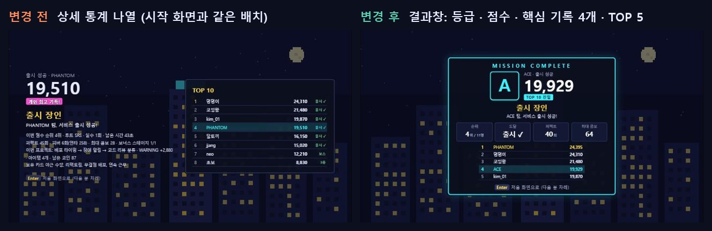

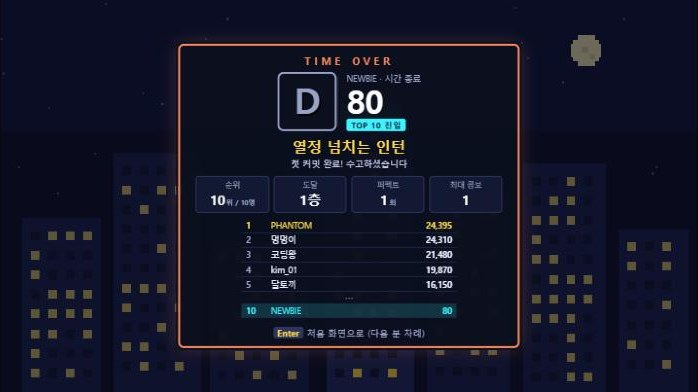

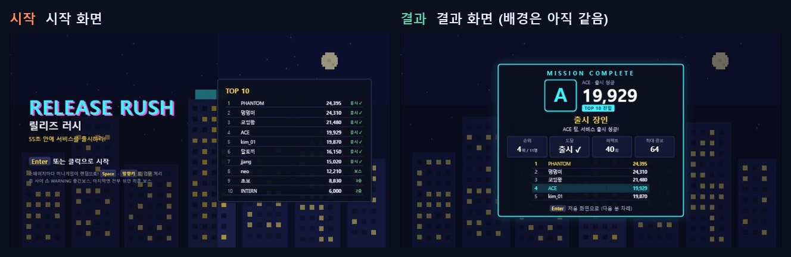

## #21 출시 컷신 + 결과별 배경 (v10)

- **원인/목적:** 엔딩·결과 화면과 시작 화면이 같은 밤 도시 배경이라 "게임이 끝났다"는 느낌이 약함. 수정안 다섯 가지(출시 컷신, 결과별 배경, 엔딩 크레딧, 합격 통지서, 직전 기록 배너) 가운데 추천안인 **결과별 배경 + 출시 컷신**으로 진행.
- **수정 내용**
  - **결과별 배경:** 출시 성공은 **새벽 도시**(보라→주황 하늘, 떠오르는 해, 불이 거의 꺼진 빌딩, 색종이), 시간 종료는 **비 오는 야근 사무실**(큰 창 너머 빗줄기). 컷신 · 엔딩 · 결과 화면에 공통으로 씀. 시작 화면의 밤 도시와 "밤 → 새벽"으로 대비되게 함. 결과 화면은 배경이 보이게 덜 어둡게.
  - **출시 컷신(새 장면 `launch`):** 판이 끝나면 페이드 → 3초짜리 도트 연출 → 페이드 → 엔딩 로그.
    - 성공: 모니터 "배포 중…" 진행률 0→100% → 화면 번쩍 → `SERVICE OPEN` · 주인공 만세 점프 · 동료 3명 박수 · 불꽃놀이 · 자막. 색종이는 배포가 끝난 뒤부터 내림.
    - 실패: 진행률이 72%에서 멈춤 → `DEPLOY FAILED` 깜빡임 · 모니터 붉은 빛 · 주인공 고개 떨굼(식은땀) · 사무실 불이 세 번에 걸쳐 꺼짐 · 자막.
    - Enter·Space로 건너뛰기. 보스전 Space 연타가 바로 넘기지 않게 시작 0.6초 동안은 무시. 그냥 두면 끝나고 엔딩으로 이어짐(엔딩부터는 Enter·Space를 눌러야 넘어감).
  - 점검 중 발견해 고친 것
    - 컷신 시간이 페이드인 동안에도 흘러서 앞부분이 가려짐 → 페이드인이 끝난 뒤부터 셈.
    - 결과창 TOP 5가 닉네임 기준으로 강조해서, 같은 닉네임의 예전 최고 기록이 있으면 이번 판(4칸의 순위)과 다른 줄이 강조됨 → 이번 판 기록 기준으로 순위·강조를 계산.
    - 실패 컷신에서 주인공이 모니터 뒤에 가려짐 → 왼쪽으로 옮김. 붉은 빛이 네모로 보임 → 둥근 빛으로.
    - 아이템 알림이 컷신 위에 남음 → 컷신 시작 때 닫음.
  - 점검용 훅에 화면 고정(`freeze`)을 추가 (게임 동작과 무관, 캡처용).
  - 이전 버전은 `game/backup/release-rush-v9-result.html`에 백업.
- **예상 결과:** 끝나는 순간에 "출시됐다 / 못 했다"가 장면으로 보이고, 끝난 뒤 화면이 시작 화면과 확실히 달라 한 판을 마친 느낌이 생김.
- **검증 결과**
  - 성공·실패 컷신, 새벽·사무실 배경의 엔딩·결과 화면 확인.
  - 컷신 0.5초 안의 Space 연타로는 넘어가지 않고, 0.6초 뒤 Space로 엔딩. 입력이 없으면 3초 뒤 엔딩, 엔딩에서는 60초를 기다려도 그대로.
  - 데모 한 바퀴: 컷신 → 엔딩 → 결과 → 대기 화면, 약 189초(이전보다 컷신만큼 길어짐). 콘솔 오류 없음.
- **관련 파일:** `game/release-rush.html`

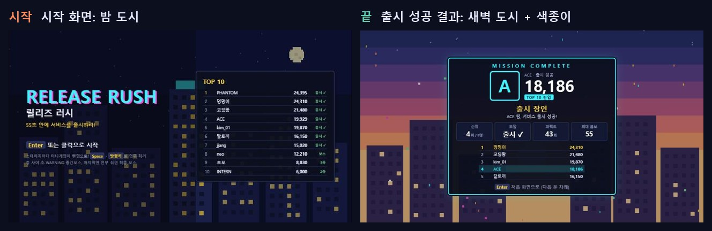

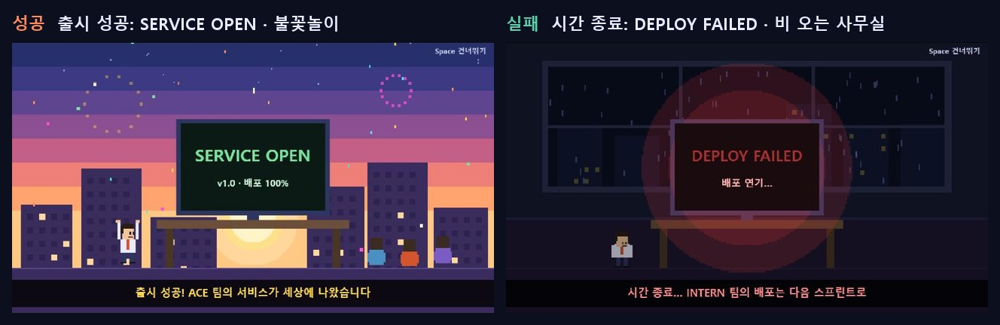

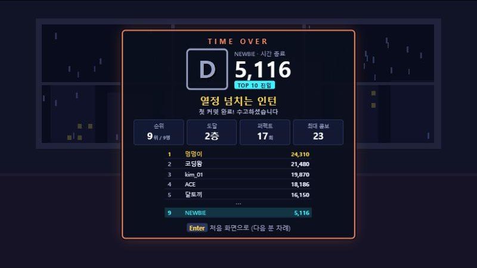

## #22 스테이지 클리어 연출 + 남은 시간 정산표 (v11)

- **원인/목적:** 층을 끝내면 1.2초 띠만 뜨고 바로 다음으로 넘어가서, 타이머에 시간이 남아 있는데 갑자기 넘어가 어리둥절할 수 있음. 남은 시간이 점수로 바뀌는 과정을 보여 주고, 클리어 조건을 채운 순간도 눈에 띄게 알려 달라는 요청.
- **수정 내용**
  - **달성 순간:** 마지막 작업을 처리하면 화면 번쩍 + `STAGE CLEAR!` 도장(크게 찍혔다 줄어듦) + 조각 터짐 + "작업 5/5 처리 완료". HUD 진행 칸이 모두 초록이 되고 `CLEAR!` 깜빡임. 남은 작업이 1개일 때는 `마지막!` 표시.
  - **정산표:** 층 · WARNING · 최종 보스가 끝날 때마다 정산표가 뜸. 줄이 하나씩 나타나며 점수가 올라가고, 올라가는 만큼 SCORE에도 실제로 더해짐.
    - 층: 이번 층 작업 점수 → 클리어 보너스 → **⏱ 남은 시간 보너스(초 × 5)** → 무결점 배포(해당 시) → 코인 +5. "남은 시간 N초는 줄지 않고 다음 스테이지로 이어집니다".
    - WARNING: 성공 N회와 그에 따른 보상 아이템 등급 확률.
    - 최종 보스: 보스전 획득 점수 → 출시 보너스 2,000 → **남은 시간 보너스(초 × 20)**, 이때 **타이머가 실제로 0까지 줄어듦**.
    - 남은 시간 줄을 계산할 때 위쪽 타이머가 하늘색으로 반짝여 "이 시간이 점수가 된다"는 연결을 보여 줌.
    - Space·Enter·클릭: 계산 중이면 바로 끝내고, 끝났으면 다음 단계로. 시작 0.6초는 입력 무시.
  - **설계 판단:** 제한 시간은 판 전체가 하나라서 층마다 남은 시간을 없애면 다음 층을 할 수 없음. 그래서 층에서는 보너스만 주고 시간은 이어지며, 실제로 시간을 점수로 바꿔 없애는 것은 마지막 보스뿐.
  - 남은 초는 타이머 표시와 맞게 내림으로 계산. 기록의 남은 시간은 보스 정산 전 값으로 저장.
  - 게임 로그의 층·보스 점수는 정산 보너스까지 더한 뒤 기록. 데모 봇은 정산을 끝까지 보고 1.4초 뒤 넘어감.
  - 점검 중 발견: 줄이 늘 때마다 정산표 전체를 다시 그려 등장 애니메이션이 반복됨 → 바뀐 줄만 고치도록 변경.
  - 이전 버전은 `game/backup/release-rush-v10-launch.html`에 백업.
- **예상 결과:** 타이머가 남았는데 넘어가는 이유("클리어 조건을 채웠다")와 남은 시간이 어디로 가는지(보너스 + 다음 스테이지로 이어짐)가 보여서 덜 어리둥절함. 빨리 깰수록 점수가 오른다는 동기가 생김.
- **검증 결과**
  - 한 판 전체: 층 정산 3번, WARNING 정산 2번, 보스 정산 1번이 차례로 나오고 각각 WARNING · 아이템 선택 · 보상 · 출시 컷신으로 이어짐.
  - 층 정산 뒤 타이머 그대로(예: 50.6초 → 50.6초), 점수는 보너스만큼만 증가(예: 클리어 450 + 시간 250 = +700). 보스 정산 뒤 타이머 0, 기록에는 정산 전 남은 시간 저장.
  - 0.3초 Space는 무시, 0.7초 Space는 계산 즉시 완료, 한 번 더 누르면 다음 단계.
  - 데모 한 바퀴 약 186초, 정산표 6번 통과. 콘솔 오류 없음.
- **남은 점:** 층 남은 시간 보너스(×5)는 추정치. 한 판에 정산표 6번이 더해져 Space를 6번 더 누름.
- **관련 파일:** `game/release-rush.html`

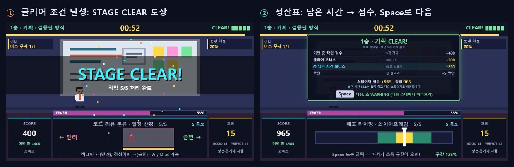

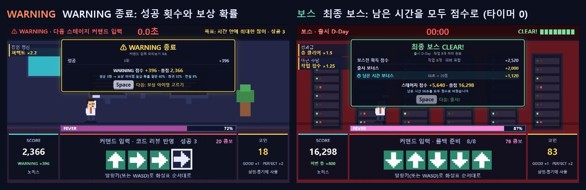

## #23 보스 체력·그로기 + 보너스 스테이지를 랜덤 미니게임으로 (v12)

- **원인/목적:** 보스전이 "작업 8개를 순서대로"라 층과 다를 게 없었음. 체력 바를 두고 "미니게임 4개 → 그로기 → 연타로 체력 깎기"를 반복하는 보스전으로 바꾸자는 요청. 보너스 스테이지(방향키 러시 고정)도 랜덤 미니게임으로.
- **수정 내용**
  - **보스 체력 바:** HUD 바로 아래 가운데 큰 체력 바(깎인 부분이 하얗게 남았다가 따라 줄어듦, 30% 아래에서 깜빡임) + 보스 머리 위 작은 바.
  - **패턴:** 이번 판 미니게임 3종 중 무작위로 한 개씩(같은 게임 연속 가능). 4개 성공하면 **그로기**. 피버 게이지 자리는 보스전에서 **GROGGY 게이지(4칸)**로 바뀌고, HUD 오른쪽에 "그로기까지 N개".
  - **그로기:** 5초 연타 피버. 아무 키 1회마다 체력 −1(회식 카드 ×1.5)과 피버 점수. 보스는 X 눈과 머리 위를 도는 별, 체력 바 테두리가 금색으로. 안내 상자는 보스와 체력 바가 보이게 왼쪽에 작게.
  - **반복:** 그로기가 끝나면 "남은 체력 N — 다시 미니게임 4개!" → 체력이 0이 되는 순간 클리어(CLEAR 연출 → 정산표 → 출시 컷신). 시간이 0이 되면 기존처럼 시간 종료.
  - 보스전에서는 일반 피버가 쌓이지 않음(두 가지 피버가 겹치지 않게). 리팩토링·오픈소스·만능 패스는 첫 그로기 게이지를 미리 채움.
  - 룰 카드: "체력 60을 0으로 만들면 출시!", 미니게임 3종 + 그로기 규칙, 클리어/게임오버 조건. 게임 로그·정산표도 "그로기 N회 · 연타 N회" 기준으로.
  - **보너스 스테이지:** 미니게임 4종 중 무작위 1종을 8초 동안. 3번 성공하면 특수 보상. WARNING과 같은 구조(시간 정지, 미스 페널티 없음, 룰 카드 → 정산표)를 금색으로. 끝나면 보상 카드로. 옛 방향키 러시 화면·코드는 제거.
  - 점검용 훅에 보스·보너스 상수(`consts`)를 열어 시뮬레이션 중 체력을 바꿔 볼 수 있게 함.
  - 이전 버전은 `game/backup/release-rush-v11-tally.html`에 백업.
- **예상 결과:** 보스전이 "패턴 → 빈틈 → 몰아치기"의 리듬을 가져 최종 보스다워짐. 연타가 곧 공격이라 피버가 보스전의 클라이맥스가 됨. 보너스 스테이지는 매번 다른 게임이라 지루하지 않음.
- **검증 결과**
  - 보너스: 랜덤 미니게임 룰 카드 → 플레이 → "★ BONUS STAGE 성공!" 정산표(특수 보상 이름·효과) → 보상 카드.
  - 보스: 미니게임 4개마다 그로기, 연타만큼 체력 감소, 체력 0에서 CLEAR → 정산표 → 출시 컷신. 같은 미니게임 연속 등장 확인.
  - **체력 조정(시뮬레이션):** 체력 90은 초보 클리어 10/30(33%)로 너무 어려움 → **60**으로: 초보 18/30(60%), 보통 19/20(95%), 숙련 15/15(100%), 그로기는 대부분 2회.
  - 데모 3판 모두 끝까지(그로기 1~2회, 보너스 스테이지 등장 포함), 한 바퀴 약 176~191초. 콘솔 오류 없음.
  - 점검 중 발견: 옛 보너스 코드를 지우다 출시 컷신 진행 줄까지 지워짐 → 복구, 문법 검사(`node --check`)와 변경 전후 비교로 확인. 시뮬레이션 봇이 커맨드 화살표를 작업 하나만큼 느리게 입력해 난이도가 과장됨 → 봇 수정 후 다시 측정.
- **남은 점:** 체력 60 · 연타 피해 1은 추정치. 실제 사람의 연타 속도(초당 6~10회)에 따라 조정 필요.
- **관련 파일:** `game/release-rush.html`

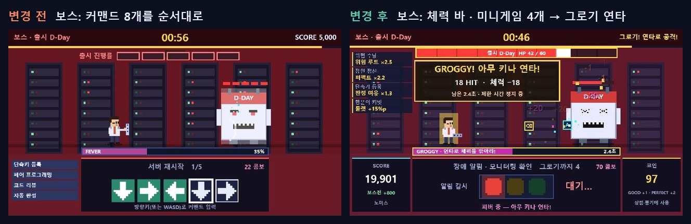

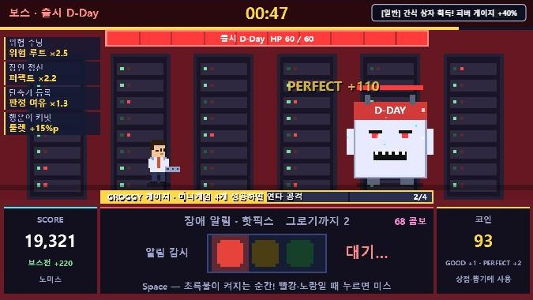

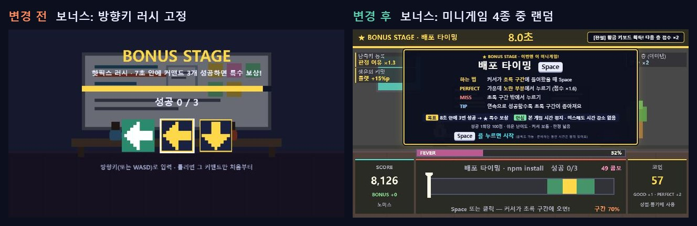

## #24 미니게임 2종 추가 + 일반인 반응속도로 난이도 재조정 + 보스 체력 3배 (v13)

- **원인/목적:** 추천안(컴파일 차지 · 알림 두더지) 추가. 일반적인 사람의 반응속도로 실제로 클리어해 보고 난이도를 다시 잡되, **위험 루트가 1.5배 어려우면 점수는 2배**가 되도록. 최종 보스 체력은 최소 3배. 스테이지 정산표와 결과창은 1.5배 빠르게.
- **수정 내용**
  - **⑤ 컴파일 차지:** Space(또는 마우스)를 꾹 누르면 빌드 게이지가 차고, 초록 구간에서 떼면 성공. 끝까지 차면 "과열" 미스. 지금까지 없던 "누르고 있기" 조작. 키를 뗄 때 판정(`keyup`)을 새로 추가.
  - **⑥ 알림 두더지:** 세 칸(메일·메신저·캘린더) 중 알림이 뜬 칸의 방향키 ← ↓ →. 👑 대표님 메시지는 끄면 미스. 위치를 보고 고르는 순발력.
  - 미니게임이 6종이 되어 층·WARNING·보너스·보스에 자동으로 섞임. 룰 카드·루트 설명·데모 봇도 두 게임에 맞춤.
  - **일반인 반응속도 봇:** 단순 반응 0.30초(±0.06), 타이밍 오차 ±0.055초, 화살표 1칸 0.30초, 카드 판단 0.62초, 선택 반응 0.40초, 함정에 속을 확률 12~15%, 연타 초당 7회(보통). 초보·숙련은 더 느리고/빠르고 실수도 다르게. 브라우저 화면을 쓰지 않도록 Node에서 게임 스크립트를 화면 없이 돌리는 점검 도구를 만들어 측정.
  - **난이도 측정 → 조정:** 미니게임 × 난이도마다 "작업 하나에 드는 시간 + 미스 1회당 2초"를 360개씩 재서 위험 ÷ 안전을 비교.
    - 조정 전: 배포 타이밍·코드 리뷰·장애 알림은 위험이 거의 안 어려움(0.9~1.1배, 빠른 커서는 오히려 빨리 끝남), 커맨드·컴파일 차지는 너무 어려움(1.8~2.3배).
    - 조정 후: 여섯 게임 모두 위험 ÷ 안전 **약 1.3~1.7, 평균 1.5**. 위험 루트의 작업 수를 안전과 같게 바꿔 "1.5배 어려움 = 점수 2배"가 그대로 성립. 층이 오를수록 조금씩 어려워지고 WARNING·보스는 안전의 약 1.4배.
  - **보스 체력 60 → 180(3배).** 그대로 두면 보통 봇 클리어율이 45~50%로 떨어져서 함께 조정: 제한 시간 55 → **65초**, 장애 8초마다 −5초 → **10초마다 −3초**(보스전이 길어져 장애가 너무 많이 쌓임), 그로기 5 → **6초**.
  - **정산표 1.5배 빠르게:** CLEAR 도장 0.9 → 0.6초, 줄 간격 0.28 → 0.19초, 점수 올라가는 시간 0.45 → 0.3초(남은 시간 줄 0.9 → 0.6초), 입력 잠금 0.6 → 0.4초.
  - **결과창 1.5배 빠르게:** 등급 도장 0.5초 뒤 0.55초 → 0.33초 뒤 0.37초, 점수 카운트업 1초 → 0.67초, 입력 잠금 0.6 → 0.4초.
  - 이전 버전은 `game/backup/release-rush-v12-boss-hp.html`에 백업.
- **검증 결과 (한 판 시뮬레이션, 일반인 반응속도 봇)**

| 플레이어 · 루트 | 클리어 | 평균 점수 | 클리어 시 남은 시간 | 그로기 |
|---|---|---|---|---|
| 보통 · 안전 | 26/30 (87%) | 13,800 | 22초 | 약 4회 |
| 보통 · 위험 | 22/30 (73%) | 16,400 | 28초 | 약 3.6회 |
| 초보 · 안전 | 11/30 (37%) | 9,600 | 23초 | 약 2.8회 |
| 숙련 · 위험 | 20/20 (100%) | 20,900 | 42초 | 약 3.5회 |

  - 층 점수는 위험 루트가 안전의 약 2배(배율 ×2, 작업 수 같음). 판 전체 점수 차이는 보스·보너스가 루트 배율과 무관해 약 1.2배.
  - 데모 5판 모두 끝까지(새 미니게임 등장, 그로기 3~5회), 한 바퀴 약 195~238초. 문법 검사 통과.
- **남은 점:** 초보 클리어율 37%는 낮은 편(초보 봇은 반응 0.37초·한 판 미스 15회로 보수적으로 잡음). 부스에서 너무 어렵다면 보스 체력(`BOSS.hp`)이나 제한 시간을 먼저 조정. 데모 한 바퀴가 3분 넘게 길어짐. 새 미니게임 두 개는 직접 해 보며 손맛 확인 필요.
- **관련 파일:** `game/release-rush.html`

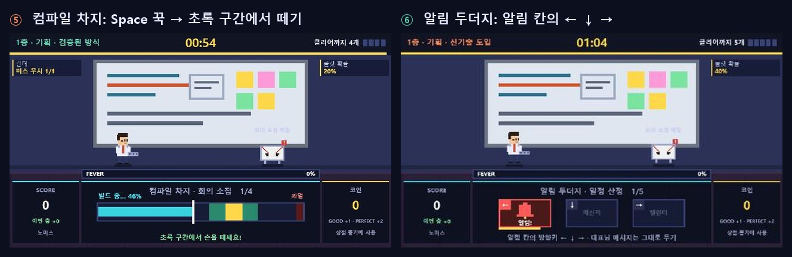

## #25 커맨드 입력 스테이지가 짧게 느껴지는 이유 점검 (분석, 코드 변경 없음)

- **원인/목적:** 층 미니게임 중 커맨드 입력만 사이클이 짧게 느껴진다는 의견. 체감인지 로직 문제인지 확인.
- **점검 방법:** 일반인 반응속도 봇(보통)으로 세 층을 모두 같은 미니게임으로 두고 실제 흐름대로 플레이. 미니게임 × 루트 × 층마다 15판씩, 작업 수 · 제한 시간 소모 · 피버 횟수를 기록.
- **결과 (안전 루트, 1층 / 2층 / 3층)**

| 미니게임 | 작업 수 | 제한 시간 소모(초) | 작업 1개당(초) | 피버(층당) |
|---|---|---|---|---|
| 배포 타이밍 | 4.8 / 5.5 / 6.4 | 4.5 / 5.1 / 5.3 | 0.8~0.95 | 0 / 0.8 / 0.9 |
| **커맨드 입력** | **2.9 / 3.7 / 3.1** | **3.0 / 4.9 / 4.1** | 1.0~1.35 | 0 / 0.9 / 0.9 |
| 장애 알림 | 4.0 / 3.7 / 4.8 | 5.6 / 5.1 / 6.9 | 1.4 | 0 / 0.6 / 0.4 |
| 코드 리뷰 분류 | 4.9 / 5.7 / 6.3 | 3.3 / 4.2 / 4.2 | 0.7 | 0 / 0.5 / 0.5 |
| 컴파일 차지 | 4.0 / 4.5 / 4.9 | 4.7 / 4.8 / 5.3 | 1.1 | 0 / 0.5 / 0.6 |
| 알림 두더지 | 4.9 / 4.7 / 5.3 | 5.4 / 5.0 / 7.0 | 1.1~1.3 | 0 / 0.6 / 0.6 |

- **결론: 체감이 아니라 실제로 짧음.**
  1. **작업 수가 가장 적음.** 커맨드는 층 작업 수 배율이 ×0.6이라 층마다 3개 안팎(다른 게임은 4~6개). 진행 표시(1/3 → 3/3)가 빨리 차서 금방 끝나는 느낌.
  2. **제한 시간 소모도 가장 짧은 편.** 안전 1층 3.0초(다른 게임 3.3~5.6초). ×0.6은 예전에 커맨드가 5~6칸이고 느렸던 시절 값인데, 지금 안전 루트는 3~4칸이라 작업 하나가 1~1.35초로 다른 게임과 비슷해짐.
  3. **피버가 잘 터짐.** 화살표 1칸마다 피버 게이지가 차서(칸당 3.5% + 콤보) 작업 수가 적은데도 피버 횟수는 가장 많음. 피버 동안은 미니게임이 멈추니 "미니게임 하는 시간"은 더 짧게 느껴짐.
  - 코드 리뷰 분류도 제한 시간 소모는 짧지만(작업당 0.7초) 작업 수가 5~6개라 사이클이 짧게 느껴지지는 않음.
- **조정안 (시뮬레이션):** 커맨드 작업 수 배율 ×0.6 → **×0.7**, 피버 게이지 화살표 1칸 3.5% → **2%**, 커맨드 완성 6% → **5%**.
  - 결과: 안전 작업 수 4.0 / 3.5 / 4.7, 제한 시간 소모 **4.5 / 4.9 / 6.2초**로 다른 게임(4~7초)과 비슷해짐. 피버는 층당 0 / 0.7 / 1.1회.
  - ×0.8은 2·3층이 6.5~7.6초로 너무 길어지고 피버가 더 잦아져서 제외.
- **상태:** #26에서 조정안 적용.

## #26 커맨드 조정 적용 + 신기술 누적 복리 (v13.1)

- **원인/목적:** #25 조정안 적용. 그리고 신기술(위험 루트)을 고르면 그 층에서만 어려운 게 아니라, **고를수록 난이도와 점수가 복리로 올라가게** 하고 이를 루트 선택 화면에 보여 주자는 제안.
- **수정 내용**
  - **커맨드:** 층 작업 수 배율 ×0.6 → ×0.7, 피버 게이지 화살표 1칸 3.5% → 2%, 커맨드 완성 6% → 5%.
  - **신기술 Lv:** 신기술을 고를 때마다 Lv +1(안전을 골라도 유지). 그 층은 난이도 ×1.5 × 1.1^(Lv−1), 점수 ×2 × 1.2^(Lv−1). Lv.3이면 난이도 ×1.82, 점수 ×2.88. 위험한 기술 카드가 있으면 점수 기본값 ×2.5에 같은 복리.
  - 난이도는 미니게임마다 다른 수치로 올림(`harden`). 처음 넣은 수치는 일반인 봇 측정에서 게임마다 Lv당 1.02~1.5배로 들쭉날쭉 → 다시 맞춰 **모두 1.07~1.18배(목표 1.1)**.
  - **화면 표시:** 루트 선택의 위험 카드에 "난이도 ×1.65 → 점수 ×2.4", "신기술을 고를 때마다 난이도 +10% · 점수 +20% 복리", Lv.1~3 사다리(이번 Lv 강조). 안전 카드에는 "난이도 ×1 → 점수 ×1 · 신기술 Lv 유지". 룰 카드·화면 위쪽·게임 로그에 "신기술 도입 Lv.N", 선택 화면 아래 빌드 요약에 현재 Lv과 다음 배율.
  - 이전 버전은 `game/backup/release-rush-v13-balance.html`에 백업.
- **예상 결과:** 신기술을 계속 고르는 것이 "점점 커지는 위험과 보상"이 되어 루트 선택에 전략이 생김. 화면에 숫자로 보여서 고르기 전에 계산할 수 있음.
- **검증 결과 (일반인 봇, 한 판 30번씩)**

| 신기술 Lv 측정 (안전 대비 어려움) | Lv.1 | Lv.2 | Lv.3 |
|---|---|---|---|
| 목표 | 1.50 | 1.65 | 1.82 |
| 배포 타이밍 / 커맨드 / 장애 알림 | 1.39 / 1.52 / 1.49 | 1.57 / 1.72 / 1.70 | 1.74 / 1.90 / 1.85 |
| 코드 리뷰 / 컴파일 차지 / 알림 두더지 | 1.44 / 1.48 / 1.31 | 1.64 / 1.73 / 1.49 | 1.78 / 1.85 / 1.76 |

| 한 판 (보통 봇) | 클리어 | 평균 점수 |
|---|---|---|
| 모두 안전 | 25/30 | 13,200 |
| 절반 신기술 | 18/30 | 14,300 |
| 모두 신기술 (Lv.1→2→3) | 26/30 | 17,700 |
| 숙련 · 모두 신기술 | 20/20 | 22,500 |
| 초보 · 모두 안전 | 6/30 | 8,900 |

  - 모두 신기술의 클리어가 낮지 않은 것은 위험 루트의 룰렛·보너스 확률이 높아 "서버 증설(+20초)" 같은 시간 보상을 더 자주 받기 때문. 한 판 30번이라 ±8%p 정도 흔들림.
  - 루트 선택 화면 캡처로 표시 확인. 문법 검사 통과.
- **남은 점:** 초보 클리어율이 다시 낮게 나옴(20%, #24에서 37%). 커맨드 작업 수가 늘어난 영향과 표본 흔들림이 섞여 있음 → 부스용으로는 보스 체력 또는 제한 시간 조정 검토 필요.
- **관련 파일:** `game/release-rush.html`

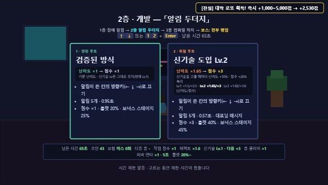

## #27 남은 코인은 어떻게 정산되는가 (분석, 코드 변경 없음)

- **원인/목적:** 코인을 쓰고 남은 경우 클리어 뒤 어떻게 정산되는지 로직 정리 요청.
- **현재 로직**
  - **얻는 곳:** 작업 GOOD +1 · PERFECT +2, WARNING·보너스 스테이지 성공 1회 +1, 층 클리어 +5, 아이템 「동전 지갑」 +8. 보스전 작업도 GOOD·PERFECT로 코인을 줌.
  - **쓰는 곳:** 상점에서만. 일반 상점(구매 6/12/22 · 새로고침 3+2씩 · 뽑기 5), 대박 상점(30% 할인 · 뽑기 7). 상점은 1~3층 보상 뒤 이벤트로만 나옴(대박 10% · 일반 35%, 층마다 45%) → 한 판 최대 3번, **최종 보스 뒤에는 없음**.
  - **정산: 없음.** 남은 코인은 점수로 바뀌지 않고, 기록(랭킹)에도 저장되지 않음. 엔딩 로그 마지막 줄에 "남은 코인 N"으로만 표시되고 결과창에는 나오지 않음.
- **시뮬레이션 (보통 봇 40판, 상점에서 살 수 있는 만큼 사는 봇)**

| 항목 | 평균 |
|---|---|
| 한 판에 번 코인 | 81 |
| 쓴 코인 | 28 |
| **남은 코인 (버려짐)** | **53 (범위 19~106)** |
| 보스 직전 보유 | 31 |
| 보스전에서 번 코인 (쓸 곳 없음) | 22 |
| 상점 등장 | 1.5회 · 한 번도 안 나온 판 3/40 |

- **문제:** 번 코인의 약 65%가 쓰이지 않고 사라짐. 특히 보스전에서 번 코인(평균 22)은 구조상 절대 쓸 수 없음. 상점이 안 나온 판은 코인이 전부 무의미.
- **정산 방식 후보**
  1. **남은 코인 → 점수:** 보스 정산표에 "남은 코인 N × 30점" 줄 추가(평균 약 +1,600점). 가장 간단하고, 코인을 아끼는 것도 선택지가 됨.
  2. **보스 직전 상점 확정:** 3층 보상 뒤 이벤트를 상점으로 고정. 보스 전에 쓸 기회는 생기지만 보스전 코인은 여전히 남음.
  3. **보스전 코인 사용처:** 그로기 때 코인을 써서 연타 피해를 올리는 식. 재미는 있지만 규칙이 늘어남.
- **상태:** #28에서 1안(코인 → 점수) 적용.

## #28 남은 코인을 점수로 환산

- **원인/목적:** #27 분석에서 번 코인의 약 65%가 쓰이지 않고 사라지는 것을 확인. 남은 코인을 점수로 바꾸는 1안으로 결정.
- **수정 내용**
  - 출시(보스 클리어) 정산표 맨 아래에 **"남은 코인 N개 × 30점"** 줄 추가. 남은 시간 줄처럼 점수가 올라가는 동안 오른쪽 코인 숫자가 0까지 줄어듦. 맺음말은 "남은 시간 N초와 코인 M개를 모두 점수로 바꿨습니다".
  - 엔딩 로그 마지막 줄: "남은 코인 N개 → +X점". 게임 로그의 최종 보스 점수에도 포함.
  - 시간 종료로 끝난 판은 환산하지 않음(출시해야 받는 보상).
  - 1개당 30점(`COIN.score`)은 추정치. 상점에서 아무것도 안 산 숙련 봇 기준 남은 코인 73~116개 → +2,190~3,480점(최종 점수의 약 13~15%).
  - 이전 버전은 `game/backup/release-rush-v13.1-compound.html`에 백업.
- **예상 결과:** 코인을 모으는 행동이 끝까지 의미를 가짐. 상점에서 쓸지, 아껴서 점수로 받을지가 새 선택지가 됨.
- **검증 결과:** 화면 없이 6판 플레이 → 6판 모두 정산표의 코인 줄 = 남은 코인 × 30, 정산 뒤 코인 0, 점수가 그만큼 증가, 엔딩 로그 문구 확인. 문법 검사 통과. 브라우저 화면 캡처는 이번에 못 함(브라우저 창이 닫혀 있었음).
- **남은 점:** 아이템 가격(6/12/22코인)과 비교하면 안 사고 모으는 쪽이 유리할 수 있음(희귀 12코인 = 360점). 직접 해 보고 1개당 점수 조정.
- **관련 파일:** `game/release-rush.html`

## #29 점수 정산 전체 점검 (분석, 코드 변경 없음)

- **원인/목적:** 한 판 전체에서 점수 정산 계산과 방식을 한 번에 보고 빠진 부분이 있는지 확인.
- **방법:** 코드에서 점수가 바뀌는 곳을 모두 찾음(작업 · 피버 연타 · 정산표 · 특수 보상 · 아이템, 다섯 함수). 화면 없이 도는 점검 도구에서 점수가 바뀔 때마다 어느 함수에서 바뀌었는지 기록하고, 보통 봇으로 안전·신기술 각 30판을 돌려 출처별 비중을 냄.
- **결과:** 60판 모두 출처별 합계 = 최종 점수(기록되지 않는 점수 변화 없음). 흐름·계산식·배율 적용표·출처별 비중은 [06-scoring.md](06-scoring.md)에 정리.
- **점검에서 눈에 띈 점**
  - 연타(피버 + 그로기)가 점수의 약 32%로 가장 큼. 층 작업은 6.5~9.6%.
  - 최종 보스, WARNING, 보너스 스테이지에는 루트·신기술 배율이 없음.
  - 층 남은 시간 보너스는 이어지는 같은 시간을 층마다 다시 셈.
  - 피버 연타에는 아이템 배율·야근 수당이 붙지 않음.
  - 무결점 배포는 작업 점수 + 클리어 보너스만 1.5배(피버·시간 보너스 제외).
  - 점수 구성을 플레이어에게 보여 주는 화면이 없음.
  - 쓰지 않는 상수 `COIN.bonus`.
- **상태:** 정리만 함. 위 항목은 설계 선택일 수 있어 결정 대기.

## #30 점수 정산 수정안 (승인 대기, 코드 미적용)

- **원인/목적:** #29 점검 결과에 대해 A(연타 비중)는 약 5%p만 낮추고, 나머지는 추천 방식으로 수정안을 내 달라는 요청. 판단 후 승인 예정.
- **방법:** 게임 파일은 그대로 두고, 수정안을 넣은 사본으로 보통 봇 50판씩(안전·신기술) 시뮬레이션.
- **수정안 요약:** A 연타 1회 20 → 15점 · B 출시 보너스 + 신기술 Lv × 500 · C 층 남은 시간 보너스 → 처리 속도 보너스(기준 시간 − 소요 시간) × 50 · D 연타에도 아이템 배율 · E 무결점 배포 설명 수정 · F·G 유지 · H 결과창 점수 구성 막대 · I 쓰지 않는 상수 삭제. 자세한 내용은 [06-scoring.md](06-scoring.md) 6절.
- **시뮬레이션:** 연타 비중 평균 32.4% → 27.0%(−5.4%p). 평균 점수 안전 18,955 → 16,639, 신기술 23,487 → 23,852 (신기술 ÷ 안전 1.24 → 1.43배). 연타 점수 16점은 −2.5%p, 14점은 약 −7%p라 15점을 고름.
- **상태:** #31에서 추천안 전부 적용.

## #31 점수 정산 수정안 적용 (v14)

- **원인/목적:** #30 수정안 중 추천안 전부 승인.
- **수정 내용**
  - **A 연타 1회 20 → 15점** (`FEVER.perPress`). 피버·그로기 공통.
  - **B 출시 보너스 2,000 + 신기술 Lv × 500** (`RELEASE`). 정산표에 "2,000 + 신기술 Lv.3 × 500"처럼 표시.
  - **C 층 "남은 시간 보너스" → "처리 속도 보너스"** (`SPEED_BONUS`): (작업 수 × 1.8초 − 이번 층 소요 시간) × 50, 신기술은 기준 시간 × 난이도 배율. 정산표에 "기준 9.0초 · 소요 5.2초 → 4초 빠름 × 50". 남은 시간은 "다음 스테이지로 이어집니다"로만 보여 주고, 실제로 시간을 점수로 바꾸는 건 출시 때 한 번.
  - **D 피버·그로기 연타에 아이템 배율**(집중 모드·황금 키보드) 적용. WARNING·보너스 스테이지 중 피버는 제외.
  - **E 무결점 배포 카드 설명**을 "그 층의 작업 점수 + 클리어 보너스 ×1.5"로, 정산표 줄도 같은 문구로.
  - **H 결과창 점수 구성 막대:** 점수를 더하는 곳을 모두 `addScore(출처, 점수)` 하나로 모아 미니게임 · 연타 · 정산 · 운으로 기록하고, 결과창 핵심 기록 아래에 4색 막대와 비율·점수 표시.
  - **I** 쓰지 않는 `COIN.bonus` 삭제.
  - F(이벤트에 루트 배율 없음)·G(시간 종료 시 정산 없음)는 유지.
  - 함께 고친 것: 랭킹 기록이 하나도 없을 때 결과창 TOP 5에 "⋯"만 따로 뜨던 문제.
  - 이전 버전은 `game/backup/release-rush-v13.2-coins.html`에 백업.
- **검증 결과 (보통 봇 50판씩)**
  - 연타 비중: 안전 31.3% → **27.0%**, 신기술 33.5% → **26.6%** (평균 −5.6%p).
  - 평균 점수: 안전 18,955 → 16,168, 신기술 23,487 → 24,337.
  - 100판 모두 출처별 합계 = 최종 점수 = 결과창 막대 합계. 코드에서 `G.score +=`는 `addScore` 한 곳만 남음.
  - 브라우저에서 층 정산표의 처리 속도 보너스 줄과 결과창 점수 구성 막대 확인. 문법 검사 통과.
- **관련 파일:** `game/release-rush.html`, `docs/06-scoring.md`

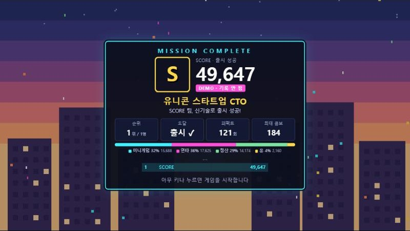

## #32 전체 완성도 · 유불리 평가 (분석, 코드 변경 없음)

- **원인/목적:** 방향성을 다시 점검하기 위해 완성도와 유불리를 평가하고 개선안을 받아 보기로 함.
- **방법:** 공모 요강 항목별 대조(외부 리소스 · 파일 크기 · 제출 준비 상태), 봇으로 한 판의 실제 시간 · 화면 전환 · 입력 횟수 측정(선택 화면 · 룰 카드 읽는 시간 포함, 12판씩).
- **결과:** [07-review.md](07-review.md)에 정리.
  - 요강: 플레이 시간(2.7~3.3분) · 오프라인 · 랭킹 · 닉네임은 충족, **설명서 · ZIP · 실행 확인 · 제출은 아직 없음**.
  - 한 판에 화면 전환 22회, 확인 입력 35회, 미니게임 입력 약 76회, 연타 150~260회. 초보 클리어 2/12.
  - 위험: 제출물 없음(치명), 첫 플레이까지 5단계, 넘기기가 많음, 초보 클리어율, 사람 테스트 없음, 연타 횟수, 효과음 없음.
  - 개선안: P0 제출 준비(오늘 필수) · P1 부스 체감(시작 카드 뒤로, 넘기기 줄이기, 초보 구제, 효과음, 연타 상한) · P2 사람 테스트 등. 새 기능은 마감까지 추가하지 않는 것을 권장.
- **상태:** 방향 결정 대기.

## #33 첫 플레이까지 줄이기 · 넘기기 줄이기 (P1-A · B) + 효과음 샘플 (P1-D, 확인 대기)

- **원인/목적:** #32 평가의 P1-A(시작 카드를 1층 뒤로, 1층 바로 시작) · P1-B(넘기기 줄이기) 진행. P1-D 효과음은 저작권 없는 소리로 샘플을 먼저 들려주고 확인받은 뒤 넣기로 함.
- **수정 내용**
  - **A · 1층 바로 시작:** 닉네임 → 1층 룰 카드(안전 루트) → 플레이. 시작 카드는 1층 정산표 다음에 "1층 완료! 이번 프로젝트의 시작 카드를 고르세요"로 고르고 곧바로 2층 미리보기 WARNING. 첫 플레이까지 5단계 → 3단계(대기 · 닉네임 · 룰 카드).
    - 그 결과 신기술은 2·3층에서만 고를 수 있어 최대 Lv.2(출시 보너스 최대 3,000). 루트 화면의 Lv 사다리를 Lv.1~2로, 칭호 「유니콘 스타트업 CTO」 조건을 신기술 3회 → 2회로.
  - **B① 짧은 룰 카드:** 이번 판에 한 번 시작해 본 미니게임은 "하는 법 한 줄 + 클리어 조건 + Space"만 보여 줌. 예: WARNING에서 미리 본 2층 미니게임, 이미 나온 게임의 보너스 스테이지. 보스 룰 카드는 항상 전체.
  - **B② 정산표 자동 진행:** 층 · WARNING · 보너스 정산표는 다 나온 뒤 2초가 지나면 자동으로 다음("2초 뒤 자동" 표시, Space로 바로). 출시 정산표는 Space를 눌러야 넘어감.
  - **D · 효과음 샘플:** `game/sfx-sample.html`. 음원 파일 없이 Web Audio로 코드에서 직접 합성(저작권 문제 없음, 오프라인 동작). 16가지 상황 × 2가지 느낌(A 8비트 칩튠 · B 부드러운 전자음), 항목별로 고르고 결과 줄을 복사할 수 있게 함. **게임에는 아직 넣지 않음.**
  - 이전 버전은 `game/backup/release-rush-v14-scoring.html`에 백업.
- **검증 결과**
  - 화면 흐름(봇): 1층 룰 카드 → 플레이 → 정산표(2.02초 뒤 자동) → 시작 카드 → WARNING … 2층 · 보너스 · 3층 룰 카드는 짧게, 보스 룰 카드는 전체, 출시 정산표는 자동으로 넘어가지 않음.
  - 한 판 확인 입력: 약 35회 → 29~34회(평균 약 −3회). 화면 전환 수는 그대로 22회(1층 루트 화면이 빠진 대신 시작 카드가 뒤로 옮겨짐). 한 판 실제 시간 2.9~3.5분.
  - 브라우저에서 1층 룰 카드가 닉네임 바로 다음에 나오는 것, 정산표 "2초 뒤 자동" 문구, 2층 짧은 룰 카드 확인. 효과음 샘플 페이지는 16개 소리 모두 오류 없이 합성됨(소리 자체는 확인 대기).
- **남은 점:** 확인 입력은 예상(27회)만큼 줄지 않음. 효과음은 선택 결과를 받은 뒤 게임에 넣음. `sfx-sample.html`은 제출 ZIP에서 뺄 것.
- **관련 파일:** `game/release-rush.html`, `game/sfx-sample.html`

## #34 효과음 적용 + BGM 샘플 (확인 대기)

- **원인/목적:** 효과음 샘플 확인 결과 "모두 A(8비트 칩튠)". BGM도 넣고 싶다는 요청 → 효과음처럼 샘플을 먼저 들려주고 확인받기로 함.
- **수정 내용**
  - **효과음 16종을 게임에 연결:** 샘플 페이지의 A 소리를 그대로 옮김. 작업 성공 · 퍼펙트 · 미스, 입력 1칸, 스테이지 시작, CLEAR 도장, 정산표 숫자(0.06초 간격) · 코인, 피버 시작 · 연타, 보스 그로기 · 장애 경보, 출시 팡파르 · 시간 종료, 메뉴 선택 · 커서 이동, 결과 등급 도장.
  - 첫 키 입력 · 클릭 때 오디오를 준비(브라우저 자동 재생 정책). 데모에서는 효과음 없음. **M 키로 소리 켜기/끄기**(브라우저에 저장, 알림 표시), 대기 화면에 안내. 전체 음량 0.32.
  - **BGM 샘플:** `game/bgm-sample.html`. 효과음처럼 코드로 연주하는 칩튠(저작권 없음 · 오프라인). 장면 4곳 × 후보: ① 메뉴 · 선택(사무실 대기) ② 스테이지(A 경쾌 / B 통통 튀는) ③ WARNING · 보스(A 긴장 / B 묵직) ④ 엔딩 · 결과. 장면마다 고르거나 "없음". **게임에는 아직 넣지 않음.**
  - 이전 버전은 `game/backup/release-rush-v14.1-flow.html`에 백업.
- **검증 결과**
  - 브라우저에서 실제 키 입력 뒤 오디오가 켜짐(running), 한 판 동안 소리 6백여 개가 정상 생성, M 키 두 번으로 끄기 → 켜기와 저장 확인. 콘솔 오류 없음.
  - 화면 없이 48판 회귀 점검(소리 장치가 없는 환경에서도 오류 없이 진행).
  - BGM 샘플 6곡 모두 오류 없이 연주(소리 자체는 확인 대기).
- **남은 점:** 부스에서 연타 소리(한 판 150~300회)가 시끄러울 수 있음 → 직접 들어 보고 연타 소리 음량 조정. `bgm-sample.html` · `sfx-sample.html`은 제출 ZIP에서 뺄 것.
- **관련 파일:** `game/release-rush.html`, `game/bgm-sample.html`

## #35 BGM 적용

- **원인/목적:** BGM 샘플 확인 결과 메뉴=사무실 대기 · 스테이지=통통 튀는 · WARNING·보스=긴장 · 엔딩=엔딩.
- **수정 내용**
  - 샘플 페이지의 곡 4개를 게임에 넣음. 효과음과 같은 방식으로 코드가 직접 연주(0.15초 앞까지 음을 미리 예약해 끊김 없이 반복).
  - 장면별 자동 전환: 닉네임 · 선택 화면 → 사무실 대기, 층 · 보너스 → 통통 튀는, WARNING · 보스 → 긴장, 엔딩 · 결과 → 엔딩. 대기 화면 · 데모 · 출시 컷신 · 일시정지 · 창이 가려졌을 때는 멈춤. 바뀔 때 0.4초 동안 서서히 커짐.
  - BGM 음량 0.2(효과음 0.32보다 작게). M 키가 효과음과 BGM을 함께 끄고 켬.
  - 이전 버전은 `game/backup/release-rush-v14.2-sfx.html`에 백업.
- **검증 결과:** 브라우저에서 실제 키 입력 뒤 한 판 진행하며 장면별 곡 확인(닉네임 · 카드 · 아이템 · 룰렛 · 상점 · 루트 → 사무실 대기, 1층 · 보너스 → 통통 튀는, WARNING · 보스 → 긴장, 출시 컷신 → 없음, 엔딩 · 결과 → 엔딩, 처음 화면 → 없음). 일시정지하면 멈추고 다시 시작하면 재생. M 키로 BGM 음량 0 ↔ 0.2. 콘솔 오류 없음. 화면 없이 6판 회귀 점검 통과.
- **남은 점:** 실제 스피커로 BGM과 효과음의 음량 균형 확인 필요(특히 연타 소리).
- **관련 파일:** `game/release-rush.html`

## #36 제출 준비 (P0)

- **원인/목적:** 마감(11/10 17:00) 전 제출물 만들기. 요강: 실행 파일 전부를 ZIP 하나로 + 설명서(PDF/TXT: 게임 소개 · 실행 방법 · 조작 방법 · 랭킹 확인 방법).
- **만든 것** (`submit/`)
  - `릴리즈러시/게임실행.html` — 게임 본체(v14.3) 그대로 복사.
  - `릴리즈러시/설명서.pdf` — A4 2쪽: 게임 소개 · 실행 방법(더블클릭, Edge/Chrome, F11) · 조작 표 · 랭킹 확인(대기 화면 TOP 10, 결과창 순위·TOP 5, 기록 유지 조건, R 5번 초기화) · 게임 화면 6장 · 한 판의 흐름 · 제작 정보. HTML로 쓰고 Edge로 PDF 변환.
  - `릴리즈러시/설명서.txt` — 같은 내용(메모장에서 깨지지 않게 UTF-8 BOM · CRLF).
  - `릴리즈러시_RELEASE-RUSH.zip` (424KB) — 위 세 파일. 샘플 페이지 · 백업 · 문서는 뺌.
- **검증 결과**
  - **더블클릭 실행 · 기록 유지:** Edge를 화면 없이 띄워 제출본을 `file://`로 열고, 네트워크를 끈 상태(`--offline`)로 한 판 끝까지 진행 → 기록 저장 → 브라우저를 완전히 껐다 다시 켜도 TOP 10에 기록이 남음. 오류 없음. 점검용 프로필은 지움.
  - 게임 파일에 외부 주소 · 외부 파일 참조 0개.
  - ZIP: 한글 파일 이름을 UTF-8 표시로 저장, Windows PowerShell로 풀어서 이름 · 크기 정상, 압축 안 게임 파일 = 원본(해시 일치).
- **남은 것(직접):** Google Drive 업로드 → 링크 공유(뷰어) → 시크릿 창 확인 → 구글폼 제출. 실제 PC에서 더블클릭 · 와이파이 끄고 한 번 확인 권장.
- **관련 파일:** `submit/`

## #37 설명서 리뉴얼: 실제 화면 캡처 + 화면별 설명 + 효과음·BGM

- **원인/목적:** 제출용 설명서(#36, A4 2쪽 · 화면 6장)를 게임 전체 요소와 화면을 캡처해 시각적으로 보여 주고, 그림마다 설명을 달고, 효과음·BGM 설명도 넣어 달라는 요청.
- **수정 내용**
  - **캡처 자동화:** 헤드리스 Chrome을 DevTools 프로토콜로 조종하는 캡처 봇을 만듦(`docs/manual/capture/`). 점검용 훅 `__RR`로 화면을 고정(`freeze`)한 채 시간을 빨리 감으며 실제 게임을 끝까지 플레이하고, 장면마다(대기 · 닉네임 · 룰 카드 · 미니게임 6종 · 미스 · 피버 · 일시정지 · WARNING · 보너스 · 카드 · 아이템 · 룰렛 · 랜덤 카드 · 상점 · 루트 · 보스 · 그로기 · 컷신 · 엔딩 · 결과) 1600×900으로 저장. 시드 5개로 6종 미니게임과 성공 · 시간 종료 판을 모두 담음(58장). 대기 화면 TOP 10은 예시 기록 8개를 넣어 찍고 설명서에 "예시 기록"이라고 밝힘.
  - **설명서 PDF (A4 12쪽, 그림 40여 장):** 표지(대기 화면 · 핵심 숫자 · 목차) → 게임 소개 · 실행 · 조작 → **한 판의 흐름**(장면 15개 번호 순서) → **플레이 화면 읽는 법**(화면 위 번호 10개 + 범례, 층별 배경·몬스터 4종) → **미니게임 6종**(플레이 패널 확대 + 하는 법 · PERFECT · MISS) → 스테이지 진행 화면 → WARNING · 보너스 → 카드 · 아이템 · 상점 · 루트 → 최종 보스 → 엔딩 · 결과 · 랭킹 → **효과음 · BGM**(BGM 4곡: 장면 · BPM · 분위기, 효과음 16종: 들리는 느낌 · 나는 때) → 제작 정보. 모든 그림에 무엇을 보여 주는 화면인지 설명을 붙임.
  - 원본은 `docs/manual/설명서.html` + `docs/manual/images/`(JPG 40장), Chrome으로 PDF 변환. 수치(보스 장애 10초마다 −3초, 아이템 이름·효과, 등급 기준 등)는 게임 코드와 대조.
  - `설명서.txt`에 "그림은 PDF 참고" 안내와 효과음 · 배경 음악 절을 추가(UTF-8 BOM · CRLF 유지).
  - `.claude/launch.json`의 `release-rush` 서버가 지워진 임시 폴더의 Node 스크립트를 가리켜 실행되지 않음 → `python -m http.server 5173`으로 바꿈.
  - 이전 설명서 · ZIP은 `submit/backup-v1/`에 보관.
- **예상 결과:** 처음 보는 사람(심사자 · 부스 방문자)이 글을 다 읽지 않아도 그림만으로 화면 구성과 흐름을 이해함.
- **검증 결과**
  - PDF 12쪽을 쪽마다 확인하고 고침: 한 줄만 다음 쪽으로 넘어가던 곳, 제목만 쪽 끝에 남던 곳, 거의 빈 쪽 2곳, 잘못 잘린 TOP 10 그림, 코드 리뷰 카드가 날아 들어오는 도중에 찍힌 그림(카드가 다 나온 뒤 다시 찍음).
  - ZIP 다시 만듦(2.6MB, 한글 이름 UTF-8 표시), 압축 검사 통과, 안의 게임 파일 = 원본.
  - 캡처 봇의 결과 화면이 검게 찍히던 문제는 게임이 아니라 봇의 장면 시계 문제였음(장면 전환 직후 시계를 초기화하지 않음) → 봇 수정.
- **발견한 문제:** 닉네임 「시작하기」 버튼을 클릭하면 1층 룰 카드가 보이지 않고 바로 시작됨 → #38에서 수정.
- **관련 파일:** `submit/릴리즈러시/설명서.pdf`, `submit/릴리즈러시/설명서.txt`, `submit/릴리즈러시_RELEASE-RUSH.zip`, `docs/manual/`, `.claude/launch.json`

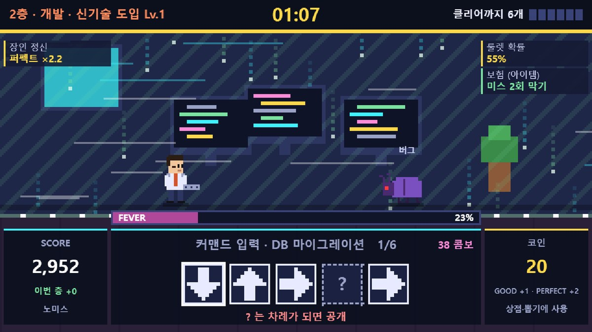

## #38 버튼 클릭이 다음 룰 카드까지 넘기던 문제 수정 (v14.4)

- **원인/목적:** #37에서 화면을 캡처하다 발견. 닉네임 화면에서 Enter 대신 **「시작하기」 버튼을 클릭하면 1층 룰 카드가 한 번도 보이지 않고 바로 START!** 로 시작됨. 처음 하는 사람은 1층 미니게임의 규칙을 못 본 채 시간이 흐르기 시작함.
  - 원인: 화면의 버튼(`#ui`)을 클릭하면 버튼 동작(`submitName` → 1층 룰 카드 표시)이 끝난 뒤 같은 클릭이 바깥 `#stage`의 클릭 처리로 전달됨. `#stage` 클릭은 "룰 카드가 떠 있으면 시작"이라 방금 뜬 룰 카드를 바로 넘김.
  - 코드에서 같은 길을 모두 찾음: 버튼 클릭 직후 룰 카드가 뜨는 곳은 **닉네임 「시작하기」(→ 1층)**, **시작 카드 클릭(→ WARNING)**, **루트 클릭(→ 2·3층)**, 아이템 고르기 클릭(→ 보너스 스테이지가 나올 때), 상점 · 랜덤 카드 「나가기」 클릭(→ 최종 보스로 갈 때). 키보드로 고르면 생기지 않음.
- **재현 (수정 전 v14.3, 실제 마우스 클릭):** 헤드리스 Chrome에서 실제 마우스 이벤트로 클릭 → 닉네임 「시작하기」 · 시작 카드 · 루트 3곳 모두 룰 카드 없이 바로 플레이(`G.ready = false`). Enter 키로 닉네임 제출은 정상.
- **수정 내용**
  - `#ui` 클릭 처리에서 버튼(`[data-act]`)을 찾으면 `e.stopPropagation()`으로 클릭이 `#stage`까지 가지 않게 함. 버튼이 아닌 곳(룰 카드 · 화면)을 클릭하면 지금처럼 `#stage`가 처리.
  - 데모 중 클릭(맨 먼저 받는 capture 단계 처리)은 영향 없음.
  - 이전 버전은 `game/backup/release-rush-v14.3-bgm.html`에 백업.
- **예상 결과:** 마우스로 진행해도 모든 스테이지가 룰 카드부터 보여 주고, Space나 클릭을 해야 시작됨. 키보드로 할 때와 같아짐.
- **검증 결과**
  - 클릭 점검 도구(`docs/manual/capture/clicktest.mjs`, 실제 마우스 이벤트) 5항목: 수정 전 3개 실패 → 수정 후 **5개 모두 통과**.
    - A 닉네임 「시작하기」 클릭 → 1층 룰 카드 ✅ · B 시작 카드 클릭 → WARNING 룰 카드 ✅ · C 루트 클릭 → 2층 룰 카드 ✅
    - D (기존 기능) 룰 카드를 클릭하면 시작 ✅ · E (기존 기능) Enter로 닉네임 제출 → 룰 카드 ✅
  - 브라우저 창에서 직접 「시작하기」 클릭 → 1층 룰 카드 표시, 콘솔 오류 없음.
  - 화면 없이 한 판 전체 4번(시드 1~3 출시 성공, 시드 4 시간 종료) 끝까지 진행, 오류 없음.
- **관련 파일:** `game/release-rush.html`, `submit/릴리즈러시/게임실행.html`, `submit/릴리즈러시_RELEASE-RUSH.zip`, `docs/manual/capture/clicktest.mjs`

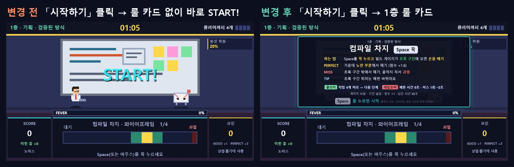

| 시작 카드 클릭 → WARNING 룰 카드 | 루트 클릭 → 2층 룰 카드 |
|---|---|
|  |  |

## #39 피버 게이지를 두껍게 + 형광 강조 연출 (v14.5)

- **원인/목적:** 피버 타임에 게이지가 색만 깜빡여서 "지금 터졌다"는 느낌이 약함. 피버 중에는 게이지가 두꺼워지고 주변에 형광색 강조 효과를 넣어 더 다이내믹하게 보이게 하자는 제안.
- **수정 내용**
  - 피버 게이지 그리기를 `drawFeverGaugeHot()`로 분리(보여 주기용, 판정 · 점수 · 시간과 무관).
    - **두께:** 피버가 시작되면 0.18초 동안 8px → **14px**로 커짐(감속 곡선). 위로 4px · 아래로 2px만 늘려 작업 패널을 가리지 않음.
    - **형광 강조:** 테두리가 분홍 ↔ 하늘로 깜빡이고, 바깥에 도트 느낌의 3겹 빛 번짐 + 캔버스 그림자 번짐. 둘 다 초당 약 2번 맥박처럼 커졌다 작아짐.
    - **채움:** 흐르는 사선 줄무늬, 왼쪽 → 오른쪽으로 지나가는 빛줄기, 위쪽 반사광, 남은 시간 끝(줄어드는 끝)에 밝은 세로선.
    - **불꽃:** 게이지 위로 작은 불꽃 14개가 튀어 오르며 사라짐.
    - 글자: 5 → 6 크기, 검은 그림자.
  - **보스 그로기**는 같은 게이지를 쓰므로 같은 연출을 **금색 · 주황**으로(그로기 안내 상자 색과 맞춤).
  - 피버가 아닐 때의 게이지와 보스전 GROGGY 게이지(4칸)는 그대로.
  - 함께 고친 문서: `02-game-spec.md`의 피버 연타 점수가 #31 이전 값(+20점)으로 남아 있었음 → +15점으로.
  - 이전 버전은 `game/backup/release-rush-v14.4-click-fix.html`에 백업.
- **예상 결과:** 피버 · 그로기가 시작되는 순간이 화면에서 확실히 보이고, 연타하는 동안 화면이 살아 있는 느낌. 게이지가 줄어드는 끝이 밝아 남은 시간이 더 잘 보임.
- **검증 결과**
  - 같은 시드(7)로 변경 전(v14.4) · 후를 같은 순간에 캡처해 비교: 피버(WARNING 중) · 그로기(보스) 모두 두꺼운 게이지와 빛 번짐 확인. 빛 번짐이 작업 패널 글자를 가리지 않음.
  - 브라우저 창에서 실제 시간으로 피버를 띄워 움직임(커짐 · 맥박 · 줄무늬 · 빛줄기 · 불꽃) 확인, 콘솔 오류 없음.
  - 화면 없이 한 판 전체 4번(시드 1~3 출시 성공, 시드 4 시간 종료) 끝까지 진행, 클릭 점검 5항목 모두 통과.
- **남은 점:** 부스 모니터(밝기 · 크기)에서 빛 번짐이 너무 세거나 약하지 않은지 직접 보고 조정(`drawFeverGaugeHot`의 빛 번짐 투명도 0.42 · 번짐 크기 5~12).
- **관련 파일:** `game/release-rush.html`, `docs/02-game-spec.md`, `submit/릴리즈러시/게임실행.html` · `설명서.pdf` · ZIP, `docs/manual/images/fever.jpg` · `groggy.jpg`

## #40 알파 테스트 피드백 반영: 시범 플레이 룰 카드 · 글 줄이기 · 피버 주변 연출 · 결과창 압축 (v14.6)

- **원인/목적:** 사람 대상 알파 테스트에서 받은 피드백 5가지.
  1. 게임 도입 설명이 너무 현학적이고 이해하기 힘듦 → 키만 알려 주고 시범 플레이를 반복해서 보여 주기
  2. 1에 더해, 직관적이지 않은 조작만 TIP 한 문장으로
  3. 전반적으로 글이 너무 많음 → 내용을 압축하고 핵심 수치의 글자를 키워 잘 보이게
  4. 피버 게이지(#39)는 좋음 → 주변에 시각 효과를 더
  5. 결과창 글과 내역이 너무 상세함 → 압축하고 글자를 키워 핵심 점수만
- **수정 내용**
  - **1 · 2 룰 카드 + 시범 플레이**
    - 룰 카드에는 **층 · 미니게임 이름 · 누를 키(크게)**만. 하는 법 · PERFECT · MISS · 클리어/게임오버 조건 · 난이도 · 남은 시간 글을 모두 뺌. 한 번 본 게임의 "짧은 룰 카드"도 같은 카드로 합침.
    - **TIP 한 문장**은 직관적이지 않은 조작에만: 커맨드 "빨간 화살표는 반대 방향, ?는 차례가 되면 공개" · 장애 알림 "노란불은 함정! 초록불에만 누르기" · 코드 리뷰 "버그면 ← 반려 · 정상이면 → 승인" · 컴파일 차지 "꾹 누르고 있다가 초록 구간에서 손 떼기" · 알림 두더지 "👑 대표님 메시지는 누르지 말기". 배포 타이밍은 TIP 없음.
    - WARNING은 「**8초** 동안 최대한 많이!」, 보너스는 「**8초** 안에 **3번** 성공 → ★ 보상」, 보스는 「체력 **180** → 0 이면 출시!」 + 3종 미니게임 이름과 키 + TIP "미니게임 4개 성공 → 아무 키 연타로 체력 깎기"를 큰 숫자로.
    - **시범 플레이(`demoPlayUpdate` · `drawDemoPlayOverlay`):** 룰 카드가 떠 있는 동안 지금 작업을 복제해 아래 미니게임 패널에서 자동 플레이를 반복. 미니게임마다 대본이 있음(타이밍: 노란 부분에서 Space / 커맨드: 빨간 화살표는 반대 키 / 장애 알림: 함정 노란불은 참고 초록불에 Space / 코드 리뷰: 카드에 맞게 ← · → / 컴파일 차지: 꾹 → 초록에서 떼기 / 알림 두더지: 알림 칸 키, 대표님 메시지는 참기). 누르는 순간 **룰 카드의 해당 키 캡이 하늘색으로 빛나고** "PERFECT!" 글자가 뜸. 패널 위에 「▶ 시범 플레이」 표시.
    - 복제본만 움직이고 자체 난수를 써서 실제 작업 · 점수 · 시간 · 게임 난수에는 영향 없음. 보스 카드는 시범 중인 미니게임의 키만 빛남.
  - **3 글 줄이기 · 핵심 숫자 크게**
    - 카드 선택: 제목 "시작 카드 1장" · "보상 카드 1장", 카드 설명 글 삭제(이름 + **효과 숫자 2.15배**), 이번 판 미니게임 줄 · 키 안내 · "시간 제한 없음" 문구 삭제.
    - 선택 화면 아래 빌드 요약 10개 → **남은 시간 · 코인 · 총점** 3개를 크게.
    - 루트 선택: Lv 사다리 · 룰렛 · 보너스 확률 · 설명 3줄 삭제 → **점수 ×N(크게) · 난이도 ×N** + 작업 수 한 줄.
    - WARNING 보상 · 랜덤 카드 · 상점: 등급 확률 줄 삭제, 제목 짧게, 상점 보유 코인 크게.
    - 정산표: 세부 계산식 칸 · 부제 · 맺음말 삭제 → 줄마다 **이름 + 점수**, 맨 아래 **이번 스테이지 점수를 크게** + 총점.
    - 엔딩 로그: **점수가 생긴 줄 · ★ 보상 줄 · 플레이 기록만**(25줄 안팎 → 8~12줄), 세부 설명 글 삭제, 글자 1.06 → 1.75배.
    - 대기 화면 안내 2줄 → 1줄.
  - **4 피버 주변 연출(`drawFeverAuraBack` · `drawFeverAuraFront`):** 화면 테두리 3겹 형광(맥박) + 네 모서리 꺾쇠, 전투 화면을 가로지르는 속도선 12개, **연타할 때마다 게이지에서 퍼지는 사각 충격파**, 피버 시작 순간 화면 전체로 퍼지는 폭발 링. 그로기는 금색 · 주황. 새 피버는 남은 시간이 다시 늘어나는 것으로 알아챔(프레임 간격과 무관).
  - **5 결과창:** 핵심 기록 4칸(순위 · 도달 · 퍼펙트 · 최대 콤보)과 점수 구성 막대, 칭호 아래 문장을 뺌. **등급 · 최종 점수(4.6 → 6.4배)** · 칭호 · **순위 "N위 / M명"(크게)** + 도달 · TOP 5만. 점수 출처 기록(`G.book`)은 계속 남김.
  - 이전 버전은 `game/backup/release-rush-v14.5-fever-glow.html`에 백업.
- **예상 결과:** 처음 하는 사람이 글을 읽지 않고 시범 플레이를 보고 바로 따라 함. 넘기는 화면이 한눈에 읽혀 한 판이 빨라지고, 결과창에서 "몇 점 · 몇 등"이 바로 보임. 피버가 화면 전체로 터져 손맛이 커짐.
- **검증 결과**
  - 같은 시드로 변경 전(v14.5) · 후 화면을 모두 캡처해 비교(룰 카드 7종 · 카드 · 루트 · 아이템 · 상점 · 랜덤 카드 · 정산표 · 피버 · 그로기 · 엔딩 · 결과).
  - 시범 플레이: 6종 미니게임 모두 반복되고 키 캡이 맞게 빛남(브라우저 창에서 실제 시간으로 4초 동안 확인: 컴파일 차지 "Space 꾹" 점등). 시범 중에도 실제 작업은 처음 상태 그대로, Space로 시작하면 정상 플레이.
  - 점검 중 고친 것: 「▶ 시범 플레이」 표시가 긴 작업 이름(보스)과 겹침 → 게이지 위 왼쪽으로 / 보스 카드의 "컴파일 차지 · Space 꾹"이 두 줄로 줄바꿈 → 줄바꿈 막음 / 커맨드와 알림 두더지의 같은 ↓ 키가 함께 빛남 → 시범 중인 미니게임의 키만.
  - 클릭 점검 5항목 모두 통과, 화면 없이 한 판 전체 4번(시드 1~3 출시 성공, 시드 4 시간 종료) 끝까지 진행, 브라우저 콘솔 오류 없음.
- **남은 점:** 시범 플레이는 사람 눈으로 다시 확인 필요(속도가 너무 빠르거나 느리지 않은지). 줄인 글 때문에 빠진 정보(난이도 · 확률 · 점수 구성)를 아쉬워하는 사람이 있는지 다음 테스트에서 확인.
- **관련 파일:** `game/release-rush.html`, `docs/02-game-spec.md`, `docs/01-planning-process.md`(P26), `docs/manual/`, `submit/`

## #41 신기술 변별력 강화: 난이도 ×1.5 · 작업 ×1.5 · 보스 체력 ×2 + 룰 카드 여백 (v14.7)

- **원인/목적:** 사용자 피드백. ① 설명 화면(룰 카드)에 여백이 너무 없음. ② 루트에서 2(신기술 도입)를 골라도 체감이 안 되고, 최저 난이도와 최고 난이도의 차이가 변별력이 없음 → 신기술 층은 지금보다 **난이도 1.5배 · 요구치(작업 수) 1.5배**, **보스 체력은 신기술을 고를 때마다 2배**.
  - 수정 전 측정(아래 표, v14.6): 보통 실력 봇이 모두 안전으로 가면 출시 97%, 모두 신기술로 가도 90% → 실제로 거의 차이가 없었음.
- **수정 내용**
  - `RISK.boost = 1.5`: 신기술을 고른 층은 기존 복리 난이도에 한 번 더 ×1.5. `harden()`에 배율 인수를 더해 같은 곡선(커서 속도 · 판정 폭 · 반응 시간 · 함정 확률 · 화살표 변형)으로 적용. 루트 화면 표시도 난이도 ×1.5 → **×2.25**(Lv.2 ×2.48).
  - `RISK.countMult = 1.5`: 신기술 층 작업 수 ×1.5 (`layerCount()` 하나로 층 시작 · 루트 화면이 같은 값을 씀).
  - `RISK.bossHpMult = 2`: 최종 보스 체력 = 180 × 2^신기술 횟수(0회 180 · 1회 360 · 2회 720). 체력 바 · 보스 머리 위 바 · 룰 카드 · 정산표 · 게임 로그가 모두 이 값을 씀(`bossHpMaxNow()`). 루트 선택 카드에 **"보스 체력 360 (×2)"**처럼 고르면 될 체력을 표시.
  - 점수 배율(신기술 ×2 · 복리 +20%)은 요청대로 그대로 둠.
  - 룰 카드 여백: 안쪽 여백 0.7/2.2em → 1.5/3.2em, 제목 · 키 · TIP · 시작 줄 사이 간격을 넓힘. 카드가 커져 타이머를 가려서 시작 위치를 HUD 아래(10.5%)로.
  - 이전 버전은 `game/backup/release-rush-v14.6-alpha-feedback.html`에 백업.
- **점검 도구 추가 (`docs/manual/capture/sim.mjs` · `simbot.js`):** 캡처 봇은 `cheat()`로 늘 정답이라 난이도를 잴 수 없어서, 게임의 데모 봇과 같은 반응 · 실수 모델로 사람처럼 치는 봇을 만듦. 실력 2가지(보통 = 데모 봇, 숙련 = 반응 0.6배 · 실수 절반 · 연타 약 12회/초), 루트 정책 2가지(모두 안전 / 모두 신기술), 시드 30개씩, 화면 없이 한 판 끝까지(판당 약 1초).
- **핵심 수치 비교 (2층 · 신기술 Lv.1 기준)**

| 미니게임 | 안전 | 신기술 v14.6 | 신기술 v14.7 |
|---|---|---|---|
| 배포 타이밍 | 커서 0.90 · 구간 25% | 1.15 · 12% (이동) | **1.38 · 10%** (이동) |
| 커맨드 입력 | 4칸 · 변형 없음 | 5칸 · 빨강 12% · ? 10% | 5칸 · **빨강 18% · ? 15%** |
| 장애 알림 | 반응 0.68초 · 함정 0% | 0.38초 · 35% | **0.33초 · 53%** |
| 코드 리뷰 분류 | 카드당 1.30초 | 0.82초 | **0.71초** |
| 컴파일 차지 | 게이지 0.85 · 구간 22% | 1.10 · 16% | **1.35 · 13%** |
| 알림 두더지 | 알림 0.95초 · 대표님 0% | 0.64초 · 25% | **0.40초 · 38%** |

| 항목 | 안전 | 신기술 v14.6 | 신기술 v14.7 |
|---|---|---|---|
| 난이도 배율(표시) | ×1 | ×1.5 (Lv.2 ×1.65) | **×2.25 (Lv.2 ×2.48)** |
| 작업 수 (1 · 2 · 3층, 배포 타이밍 기준) | 5 · 6 · 7 | 5 · 6 · 7 | **8 · 9 · 11** |
| 최종 보스 체력 | 180 | 180 | **신기술 1회 360 · 2회 720** |
| 점수 배율 | ×1 | ×2 · ×2.4 | ×2 · ×2.4 (그대로) |

- **검증 결과 (사람 흉내 봇, 설정마다 30판, 1층은 항상 안전이라 신기술은 2 · 3층 = 보스 체력 720)**

| 루트 · 실력 | 출시 성공 v14.6 → v14.7 | 평균 점수 v14.6 → v14.7 | 2층 · 3층 소요 v14.6 → v14.7 | 미스 v14.6 → v14.7 |
|---|---|---|---|---|
| 안전 · 보통 | 97% → 97% | 17,123 → 17,123 | 5.2 · 6.9초 → 같음 | 4.7 → 4.7 |
| 안전 · 숙련 | 100% → 100% | 21,952 → 21,952 | 3.6 · 4.7초 → 같음 | 1.4 → 1.4 |
| 신기술 · 보통 | 90% → **10%** | 22,743 → 20,933 | 6.0 · 7.4초 → **12.2 · 17.6초** | 4.8 → **13.9** |
| 신기술 · 숙련 | 100% → **73%** | 29,754 → **42,536** | 4.1 · 5.6초 → **7.0 · 8.9초** | 2.2 → 3.7 |

  - 안전 루트는 바뀐 것이 없어 수치가 완전히 같음(같은 시드).
  - 신기술 · 보통: 7판은 보스에 가기 전에 시간 종료(보스 도달 30/30 → 23/30), 보스에서 끝난 판도 체력 720 중 평균 399가 남음.
  - 신기술 · 숙련: 보스 체력이 4배라 그로기가 2.6 → 8.4회로 늘고, 연타 점수가 쌓여 평균 점수가 크게 오름(신기술 ÷ 안전 1.36배 → 1.94배).
  - 최저(안전 · 보통)와 최고(신기술 · 숙련)의 차이: 출시 97% vs 100% → **97% vs 73%**, 평균 점수 1.74배 → **2.48배**. 루트와 실력에 따라 결과가 확실히 갈림.
  - 캡처 봇(모든 작업을 정답 처리, 연타 약 14회/초)도 신기술 2회 판에서는 체력 720을 다 깎지 못하고 시간 종료.
  - 클릭 점검 5항목 통과, 룰 카드 · 루트 · 보스 화면 캡처 확인, 문법 검사 통과.
- **남은 점 (결정 필요):** 보통 실력은 신기술을 고르면 10%만 출시하지만 평균 점수는 안전보다 조금 높음(시간 종료여도 신기술 층 점수 ×2가 남음). 체력 720은 숙련자에게도 27%가 실패하는 벽이라, 부스에서 너무 가혹하면 `RISK.bossHpMult`를 1.5(→ 405)로 낮추는 안을 검토.
- **관련 파일:** `game/release-rush.html`, `docs/02-game-spec.md`, `docs/manual/capture/sim.mjs` · `simbot.js`, `docs/manual/`, `submit/`

## #42 실제 플레이 기준으로 시뮬레이션 보정 (분석, 코드 변경 없음)

- **원인/목적:** 사용자 실제 플레이(패치 전 v14.6): **보스가 그로기 한 번에 끝났고 점수는 약 67,000점.** #41 시뮬레이션의 봇은 연타가 초당 8~12회라 이 결과가 나올 수 없음 → 봇이 사람보다 훨씬 느리게 연타해서 난이도를 과대평가했을 가능성.
  - 코드 확인: 연타는 키를 누를 때마다(같은 키 꾹 누름만 제외) 1회로 세고 상한이 없음. 여러 키를 한꺼번에 두드리면 횟수가 그만큼 늘어남. 체력 180을 그로기 한 번(6초)에 깎으려면 회식 카드가 없을 때 초당 약 30회.
- **방법:** `simbot.js`에 초당 연타 횟수 옵션(`mash`)을 더하고, 숙련 실력으로 초당 20회 · 30회, 루트 2가지, 버전 2가지 × 시드 20개 = 160판.
- **보정 확인:** v14.6 · 신기술 · 초당 30회에서 최고 75,598점(그로기 1번, 회식 1장) · 67,784점 → 사용자 판(그로기 1번 · 약 67,000점)과 맞음. **사람 연타는 초당 약 30회로 봄.**
- **결과 (숙련, 설정마다 20판)**

| 루트 · 연타 | 출시 v14.6 → v14.7 | 그로기 1번에 처치 | 평균 그로기 | 평균 점수 v14.6 → v14.7 | 최고 점수 v14.6 → v14.7 | 연타 점수 비중 |
|---|---|---|---|---|---|---|
| 안전 · 20회/초 | 100% → 100% | 5/20 → 5/20 | 1.8 → 1.8 | 25,311 → 25,311 | 33,120 → 33,120 | 43% |
| 안전 · 30회/초 | 100% → 100% | 6/20 → 6/20 | 1.7 → 1.7 | 27,479 → 27,479 | 45,839 → 45,839 | 50% |
| 신기술 · 20회/초 | 100% → **85%** | 5/20 → **0/20** | 1.8 → **6.2** | 36,091 → **47,988** | 54,410 → 74,407 | 45% → 55% |
| 신기술 · 30회/초 | 100% → 100% | 6/20 → **0/20** | 1.7 → **4.5** | 42,992 → **55,050** | 75,598 → 86,129 | 53% → 61% |

- **#41 결과 고침:** #41의 "신기술 출시 보통 10% · 숙련 73%"는 연타가 느린 봇 기준이라 실제보다 어렵게 나온 값. 사람 연타(초당 20~30회) 기준으로는 **신기술도 85~100% 출시**하고, 달라진 점은 ① 보스를 그로기 한 번에 끝낼 수 없음(평균 4.5~6.2번) ② 층 작업이 1.5배 · 더 어려워 시간이 빠듯함 ③ 그로기가 늘어 점수가 더 오름(신기술 ÷ 안전 1.43배 → 2.0배).
- **눈에 띈 점 (결정 필요):** 연타 점수 비중이 신기술에서 61%까지 올라감. 체력이 늘수록 그로기가 늘고, 그로기는 연타 점수를 주므로 **"어려워질수록 연타로 점수가 크게 오르는"** 구조. 연타 상한(예: 초당 15회, #32의 P1-E) 또는 보스 체력이 늘어난 만큼 그로기 연타 점수를 줄이는 안 검토.
- **관련 파일:** `docs/manual/capture/simbot.js`(연타 옵션), `docs/manual/capture/sim.mjs`(`POLICIES` · `PROFILES` · `MASH` 환경 변수)

## #43 남은 시간 점수 강화: 빨리 깰수록 높은 점수 (v14.8)

- **원인/목적:** #42에서 연타 점수 비중이 61%까지 오르는 문제를 확인. 사용자 제안: **연타는 그대로 두고 남은 시간의 점수 비율을 높여, 정신없이 연타해서 빨리 클리어할수록 더 높은 점수를 얻게.**
  - 측정해 보니 지금(남은 1초 20점)은 오히려 **늦게 깬 판이 점수가 더 높음**(안전 · 숙련: 남은 시간 상위 1/4 판 ÷ 하위 1/4 판 = 0.82). 그로기를 여러 번 할수록 연타 점수가 더 쌓이기 때문.
- **방법:** 남은 시간 보너스는 출시 정산표에만 더해져 플레이에 영향이 없으므로, 시뮬레이션 판마다 출시 순간 남은 시간(`left`)을 기록해 배율 후보를 계산으로 비교(사람 연타 초당 30회 · 숙련, 20판씩).

| 1초당 점수 | 방식 | 안전 평균 · 시간 비중 · 빠름 ÷ 느림 | 신기술 평균 · 시간 비중 · 빠름 ÷ 느림 | 신기술 ÷ 안전 |
|---|---|---|---|---|
| 20 (지금) | 같은 점수 | 27,479 · 5% · 0.82 | 55,050 · 2% · 1.22 | 2.00 |
| 200 | 같은 점수 | 39,251 · 33% · 1.09 | 64,113 · 15% · 1.38 | 1.63 |
| 300 | 같은 점수 | 45,791 · 43% · 1.20 | 69,148 · 21% · 1.45 | 1.51 |
| **200** | **× 신기술 배율** | 39,251 · 33% · 1.09 | 78,211 · 30% · 1.57 | **1.99** |
| 300 | × 신기술 배율 | 45,791 · 43% · 1.20 | 90,295 · 39% · 1.70 | 1.97 |

  - 같은 점수로 올리면 시간이 더 많이 남는 안전 루트가 유리해져 신기술 보상이 줄어듦(2.0 → 1.5배) → **신기술 점수 배율도 곱하는 방식**으로.
  - 300은 점수가 크게 부풀어(신기술 최고 15만 점대) 200을 고름.
- **수정 내용**
  - `TIME_BONUS.boss` 20 → **200**, 실제 1초당 점수 = 200 × 신기술 점수 배율(`timeBonusPerSec()`: 안전만 갔으면 ×1, 신기술 Lv.1 ×2 · Lv.2 ×2.4, 위험 수당 카드면 ×2.5 · ×3). 출시 정산표 줄에 "38초 × 600점"처럼 표시.
  - 보스 룰 카드에 **「점수 · 빨리 깰수록 남은 1초당 N점」** 한 줄 추가.
  - 연타 규칙 · 점수는 그대로.
  - 이전 버전은 `game/backup/release-rush-v14.7-risk-balance.html`에 백업.
- **예상 결과:** 그로기를 빨리 끝내 시간을 남길수록 점수가 오름. 연타는 여전히 점수를 주지만 "빨리 깨기"의 수단이 됨.
- **검증 결과 (v14.8 실제 시뮬레이션, 사람 연타 초당 30회, 20판씩)**

| 루트 · 실력 | 출시 | 평균 점수 v14.7 → v14.8 | 연타 점수 비중 v14.7 → v14.8 | 빠름 ÷ 느림 v14.7 → v14.8 |
|---|---|---|---|---|
| 안전 · 보통 | 100% | 19,937 → 29,306 | 44% → 30% | 1.39 → 1.53 |
| 안전 · 숙련 | 100% | 27,479 → 39,251 | 50% → 35% | 0.82 → 1.09 |
| 신기술 · 보통 | 50% | 31,343 → 38,161 | 60% → 54% | 0.85 → 1.48 |
| 신기술 · 숙련 | 100% | 55,050 → 80,677 | 61% → 43% | 1.22 → 1.60 |

  - 안전 루트는 계산 예측과 정확히 같은 점수. 신기술 · 숙련은 예측(78,211)보다 조금 높음 — 위험 수당 카드(×2.5)가 시간 보너스에도 곱해진 몫.
  - 출시 정산표 · 보스 룰 카드 화면 확인(위험 수당 카드 판: "남은 1초당 600점", 38초 → +22,800). 클릭 점검 5항목 통과, 문법 검사 통과, 외부 주소 0개.
- **남은 점 (결정 필요):** 점수가 전체적으로 올라 결과 등급 기준(S 25,000 · A 18,000)이 낮아짐. 시뮬레이션상 안전 · 보통 평균도 약 29,000점이라 대부분 S → 등급 기준 재조정 필요(예: S 60,000 · A 35,000).
- **관련 파일:** `game/release-rush.html`, `docs/02-game-spec.md`, `docs/06-scoring.md`, `docs/manual/capture/simbot.js`(남은 시간 기록), `docs/manual/`, `submit/`

## #44 알림 두더지 로직 점검 (분석, 코드 변경 없음)

- **원인/목적:** "두더지에 버그가 있는 것 같다"는 사용자 제보.
- **방법:** 두더지 관련 코드(`moleNext` · `MGX.mole` · `drawMole` · 난이도 `harden`)를 읽고, 게임 안에서 상황을 직접 만들어 재현(헤드리스 Chrome, 작업을 만들어 상태를 지정한 뒤 입력).
- **결과**

| # | 내용 | 재현 | 판정 |
|---|---|---|---|
| 1 | **늦게 누르면 미스 2번(−4초).** 알림이 시간 초과로 사라지면 "알림을 놓쳤다" 미스(−2초) 후 바로 다음 대기 상태가 되는데, 0.05초 늦게 누른 같은 키가 대기 중 입력으로 "빈칸을 눌렀다" 미스(−2초)를 한 번 더 받음 | 미스 2회, 4초 손실 | **버그** |
| 2 | 대기(알림 없음) 중에 방향키를 누르면 바로 미스. 성공 · 미스 직후 0.35~0.9초 대기라, 손가락이 튀거나 두 번 눌러도 미스 | ←: 미스 1회 (↑는 무시) | 1번과 같은 원인 · 너무 가혹 |
| 3 | **#41 이후 신기술 알림 시간이 하한 0.40초에 걸림.** 두더지만 난이도 곡선 지수가 1.2라(다른 게임 0.35~0.45) ×1.5 강화에서 0.64 → 0.39초로 줄어 하한(0.4)에 닿음. PERFECT 기준(알림 시간의 40%)은 **0.16초**로 사람 반응 속도(약 0.25초)보다 짧아 사실상 불가능, 보통 반응(0.25~0.45초)이면 약 4번에 1번 시간 초과 | 신기술 Lv.1 · Lv.2 모두 0.40초 · PERFECT 0.16초, 대표님 메시지 38% · 50% | **밸런스 문제** (#41에서 생김) |
| 4 | 대표님 메시지를 잘 참아도 1.27초(알림 시간 × 1.4) 동안 진행이 없음. 신기술에서 대표님 메시지가 38~50%라 시간만 소모 | 미스 0 · 진행 0 | 설계 · 참고 |

- 같은 구조(시간 초과 직후 대기 → 늦은 입력이 또 미스)가 **장애 알림**에도 있음("늦었다!" 뒤 늦은 Space가 "너무 빨라!").
- **수정안 → #45에서 둘 다 적용**
  1. 시간 초과 · 미스 · 성공 직후 대기 상태의 처음 0.35초 입력은 무시(미스 아님). 장애 알림에도 같은 처리.
  2. 두더지 강화 곡선 지수 1.2 → 0.6(다른 게임과 비슷하게)로, 신기술 알림 시간 0.40 → 약 0.50초 · PERFECT 0.2초. 또는 하한 0.4 → 0.5.
- **관련 파일:** 없음 (분석)

## #45 두더지 · 장애 알림: 늦은 입력 이중 미스 수정 + 두더지 신기술 알림 시간 완화 (v14.9)

- **원인/목적:** #44 점검 결과 수정안 두 가지 모두 승인.
- **수정 내용**
  - **늦은 입력 무시(`INPUT_GRACE` 0.35초):** 두더지 · 장애 알림에서 대기 상태가 된 뒤 처음 0.35초 동안 들어온 입력은 미스로 치지 않고 무시. 시간 초과 · 미스 · 성공 직후 모두 해당(셋 다 대기 상태로 돌아가므로). 0.35초가 지난 뒤 누르면 지금처럼 "빈칸을 눌렀다" · "너무 빨라!" 미스.
  - **두더지 신기술 곡선:** `harden`의 두더지 알림 시간 지수 1.2 → 0.6, 하한 0.4 → 0.48초. 다른 미니게임(0.35~0.45)과 비슷한 기울기로.
  - 안전 · WARNING · 보스의 두더지 수치와 대표님 메시지 확률은 그대로.
  - 화면은 바뀌지 않아 비교 이미지는 없음.
  - 이전 버전은 `game/backup/release-rush-v14.8-time-bonus.html`에 백업.
- **검증 결과**
  - 재현 테스트(같은 상황을 만들어 v14.8 · v14.9 비교)

| 상황 | v14.8 | v14.9 |
|---|---|---|
| 두더지: 시간 초과 0.05초 뒤 누름 | 미스 2회 · −4초 | **미스 1회 · −2초** |
| 장애 알림: 시간 초과 0.05초 뒤 Space | 미스 2회 | **미스 1회** |
| 두더지: 대기 직후 ← | 미스 | **무시** |
| 두더지 · 장애 알림: 대기 0.5초 뒤 입력 | 미스 | 미스 (그대로) |
| 두더지 신기술 Lv.1 2층 알림 · PERFECT | 0.40 · 0.16초 | **0.50 · 0.20초** |
| 두더지 신기술 Lv.2 3층 알림 · PERFECT | 0.40 · 0.16초 | **0.48 · 0.19초** |
| 두더지 안전 · WARNING · 보스 | 1.00~0.90 · 0.66 · 0.60초 | 같음 |

  - 시뮬레이션(신기술, 사람 연타 초당 30회, 20판씩): 보통 출시 10/20 → 12/20 · 평균 38,161 → 44,047점 · 미스 13.1 → 11.6회, 숙련 20/20 → 20/20 · 평균 80,677 → 77,340점(두더지가 바뀌며 이후 난수 흐름이 달라진 차이로 봄). 봇은 시간 초과 뒤 늦게 누르지 않아 이중 미스 수정 효과는 시뮬레이션에 거의 안 나타나고, 사람에게 더 크게 나타날 것.
  - 클릭 점검 5항목 통과, 문법 검사 통과.
- **관련 파일:** `game/release-rush.html`, `docs/02-game-spec.md`, `submit/`

## #46 설명서를 「게임설명서」와 「매뉴얼」로 나누고 이미지 중심으로 다시 작성

- **원인/목적:** 사용자 요청. 게임 설명과 매뉴얼(실행 · 조작)이 한 파일에 섞여 있어 나누고, v14.7~v14.9에서 바뀐 내용을 반영하며, 글은 흐름 · 핵심만 두고 최대한 캡처로 설명.
- **수정 내용**
  - **게임설명서 (A4 8쪽, 그림 약 45장):** 표지(대기 화면 · 핵심 숫자 · 한 판 흐름 칩) → 한 판의 흐름(장면 16개 번호 순서) → 플레이 화면(번호 10개 + 한 단어 범례) → 룰 카드와 미니게임 6종(패널 캡처 + 키 + TIP 한 줄) → 스테이지 진행 · 이벤트 → 카드 · 아이템 · 루트(**루트 비교표: 난이도 ×2.25 · 작업 ×1.5 · 보스 체력 ×2 · 점수 ×2**) → 최종 보스(**남은 1초당 200 · 400 · 480점**) → 엔딩 · 결과 → 소리.
  - **매뉴얼 (A4 2쪽):** 게임 소개 · 실행 방법(흐름 칩 + 화면 4장) · 조작 표 · 랭킹 확인(TOP 10 · 결과 화면) · 문제 해결 표 · 권장 환경.
  - 공통 스타일 `docs/manual/manual.css`로 분리. 이전 통합본(12쪽)은 `docs/manual/old/설명서-통합본-v14.8.html`에 보관.
  - 화면을 v14.9로 전부 다시 찍음(시드 5개, 70장). 출시 화면은 캡처 봇에 안전 루트 모드(`mode:"safe"`)를 더해 찍음 — 신기술 2회 판은 보스 체력 720이라 그로기 화면이 길고 결과 TOP 5가 캡처 기록으로 채워짐.
  - 보스 정산표 캡처 키 `tally-boss` 추가(`bot.js`).
  - 제출물: `설명서.pdf` · `설명서.txt` → **`게임설명서.pdf` · `매뉴얼.pdf` · `매뉴얼.txt`**(메모장용, 짧게). 이전 파일은 `submit/backup-v2/`.
- **검증 결과:** 두 PDF 쪽마다 확인하고 고침(매뉴얼 3쪽째에 한 줄만 넘어가던 것, 플레이 화면 번호 3이 글자를 가리던 것, 엔딩 · 결과 6장을 3열로). ZIP 압축 검사 통과 · 안의 게임 파일 = 원본. 문서 이미지 39장 모두 존재.
- **관련 파일:** `docs/manual/게임설명서.html` · `매뉴얼.html` · `manual.css` · `images/`, `docs/manual/capture/bot.js`, `submit/`

## #47 피버 · 그로기 게이지에 외침 말풍선 폭발 테두리 (v15.0)

- **원인/목적:** 피버 게이지는 좋으니 테두리에 삐죽삐죽한 강조 효과를 더 넣자는 요청. 사용자 스케치(게이지 둘레의 들쭉날쭉한 테두리)와 참고 이미지(만화의 외침 말풍선 · 날카로운 가시 · 잉크 외곽선 · 망점 · 창 파편)를 받음.
- **진행:** 게임 파일은 두고 임시 복사본으로 시안을 먼저 보여 줌(`docs/images/preview-fever-flame/`).
  1. 불꽃 테두리 시안 → "불꽃이 아니라 날카로운 날것의 말풍선 느낌"이라는 피드백으로 폐기.
  2. 외침 말풍선 시안 A(가시 + 잉크 외곽선 + 별) · B(A + 망점 + 사선 줄 + 날아가는 창 파편)를 정지 화면 · 0.1초 3프레임 · 실제 연타 GIF로 비교 → **B 선택**.
- **수정 내용**
  - `drawFeverBurst()` 추가, `drawFeverGaugeHot()`에서 게이지 빛 번짐보다 먼저(뒤 레이어로) 그림. 보여 주기용이라 판정 · 점수 · 시간과 무관.
    - **가시:** 게이지 둘레 68점에서 34개의 가시가 바깥 + 가운데에서 퍼지는 방향으로 부채꼴. 길이 4~38px(가끔 +16px 더 긴 가시), 0.1초마다 모양이 바뀜, 연타(`fx.shake`)하면 최대 1.35배로 순간 커짐.
    - **층:** 두꺼운 잉크 외곽선(피버 진한 남보라 · 그로기 진한 갈색) → 분홍(그로기 주황) → 망점 → 노랑(그로기 연노랑) 안쪽 층 → 긴 가시 위 사선 줄.
    - **창 파편 10개:** 하늘 · 노랑 · 연두(그로기 빨강 · 연노랑 · 금색)가 바깥으로 날아가며 사라짐. **별 6개:** 돌면서 튀어나왔다 사라짐.
    - 아래쪽 변은 가시를 3px 이하로 눌러 미니게임 제목 줄을 가리지 않음, 파편 · 별도 아래쪽에는 안 나옴.
  - 이전 버전은 `game/backup/release-rush-v14.9-mole-fix.html`에 백업.
- **검증 결과:** 같은 시드로 변경 전 · 후 화면과 연타 GIF(초당 15회 · 3초) 확인, 미니게임 제목 줄이 가려지지 않음. 클릭 점검 5항목 통과, 화면 없이 한 판 10번(숙련 · 초당 30회 연타, 안전 · 신기술 5판씩) 모두 출시, 문법 검사 통과, 외부 주소 0개.
- **남은 점:** 부스 모니터에서 너무 시끄럽게 보이는지 확인. 줄이려면 파편 수(10) · 망점 · 가시 최대 길이(34)부터.
- **관련 파일:** `game/release-rush.html`, `docs/02-game-spec.md`, `docs/03-tech-architecture.md`, `docs/manual/`, `submit/`

## #48 백업 폴더 정리: 백업은 `game/backup/`, `submit/`은 배포용만

- **원인/목적:** `submit/`은 배포용으로 만든 폴더인데 옛 설명서 백업(`backup-v1` · `backup-v2`)이 섞여 있었음. 버전별 백업이 있는 `game/backup/`으로 통합하라는 요청.
- **수정 내용:** `submit/backup-v1/` → `game/backup/submit/v1-첫제출본(설명서2쪽+ZIP)/`, `submit/backup-v2/` → `game/backup/submit/v2-설명서통합본(12쪽)/`. 게임 HTML 백업과 섞이지 않게 `submit/` 하위 폴더로. README의 작성 규칙과 03 문서의 파일 구성에 "백업은 `game/backup/`, `submit/`은 배포용만"을 적음. #37 · #46의 옛 경로는 기록이라 그대로 둠.
- **검증 결과:** `submit/`에는 `릴리즈러시/`(게임실행.html · 게임설명서.pdf · 매뉴얼.pdf · 매뉴얼.txt)와 ZIP만 남음. 옮긴 파일 5개 그대로.
- **관련 파일:** `game/backup/submit/`, `submit/`, `docs/README.md`, `docs/03-tech-architecture.md`

## #49 몬스터 타격음 추가 (v15.1)

- **원인/목적:** 몬스터를 칠 때 효과음이 없어 타격감이 약하다는 요청.
- **수정 내용**
  - 효과음 4종 추가(음원 파일 없이 코드 합성, 기존 16종과 같은 방식): **타격**(퍽 노이즈 + 아래로 떨어지는 저음, 작업 GOOD) · **강타**(더 크고 높은 금속음, PERFECT · 보스) · **처치**(길게 부서지는 소리, 몬스터를 쓰러뜨릴 때) · **키캡 명중**(아주 짧은 '칙', 피버 · 그로기 연타의 키캡이 맞을 때, 0.08초에 한 번까지만 내서 연타 소리와 겹쳐 시끄럽지 않게).
  - `battleHit()`에서 타격 · 강타 · 처치, 키캡 충돌 처리에서 명중음. 데모 중에는 기존처럼 소리 없음, M 키로 같이 꺼짐.
  - 들어 볼 수 있는 샘플 페이지 `game/sfx-hit-sample.html`(버튼 · 숫자키 1~5, 5번은 실제처럼 이어서). 제출 ZIP에는 넣지 않음.
  - 이전 버전은 `game/backup/release-rush-v15.0-fever-burst.html`에 백업.
- **검증 결과:** 헤드리스 Chrome에서 오디오를 켜고(running) 같은 시드로 1층을 돌려 비교: v15.0 노이즈 1 · 음 36개 → v15.1 노이즈 6 · 음 45개(작업 4개 타격 + 처치), 오류 0. 샘플 페이지 브라우저에서 재생 · 콘솔 오류 없음. 클릭 점검 통과. **소리 자체(크기 · 느낌)는 직접 들어 보고 확인 필요.**
- **관련 파일:** `game/release-rush.html`, `game/sfx-hit-sample.html`, `docs/02-game-spec.md`, `docs/manual/게임설명서.html`, `submit/`

## #50 피버 버벅임 원인 측정 (분석, 코드 변경 없음)

- **원인/목적:** 피버 게이지 외곽 효과(#47) 때문에 버벅이는 느낌이 든다는 제보 → 원인을 재고 최적화 방안 제시.
- **방법:** 헤드리스 Chrome에서 같은 시드로 피버 · 그로기에 들어간 뒤 초당 30회 연타하며 120프레임 동안 한 프레임(업데이트 + 그리기)에 걸린 시간을 잼. 의심 요소를 하나씩 끈 복사본 7개와 비교.

| 복사본 | 평소 평균 | 피버 평균 · 최대 | 그로기 평균 · 최대 |
|---|---|---|---|
| 지금(v15.0) | 0.14ms | 1.77 · **59ms** | 24.5 · **2,190ms** |
| 말풍선 테두리 끔 | 0.15 | 0.56 · 6.3 | 0.77 · 6.2 |
| **망점만 끔** | 0.16 | **0.65 · 7.6** | **0.71 · 6.6** |
| 그림자 번짐(shadowBlur)만 끔 | 0.17 | 35.2 · 2,734 | 26.9 · 1,698 |
| 화면 테두리 · 속도선(#40)만 끔 | 0.12 | 30.1 · 2,883 | 25.6 · 2,369 |
| 모두 끔 | 0.13 | 0.48 · 5.8 | 0.58 · 6.6 |
| **최적화 시안: 망점을 패턴 한 번으로 + 그림자 번짐 제거** | 0.13 | **0.65 · 7.0** | **0.72 · 7.3** |

- **원인:** #47의 **망점**. 클리핑 안에서 1×1 점을 프레임마다 약 2,400번 따로 그려서, 그리기 명령이 쌓였다가 한꺼번에 처리될 때 수십 ms ~ 2초가 멈춤(평균은 낮아도 가끔 크게 끊기는 '버벅임'). 그림자 번짐 · 다른 피버 연출은 원인이 아님.
- **방안 (추천 순)**
  1. **망점을 미리 그린 12×12 패턴으로 한 번에 채우기** — 그림은 같고 최대 2,190ms → 7ms. 코드 몇 줄.
  2. 게이지 그림자 번짐(shadowBlur)을 이미 있는 3겹 빛 번짐으로 대신 — 측정상 차이는 작지만 실제 GPU · 저사양 PC에서 비싼 효과라 함께 정리.
  3. (추가 여유가 필요하면) 말풍선 모양은 0.1초마다만 바뀌므로 그때만 작은 캔버스에 그려 두고 매 프레임 붙이기 · 파편 · 팝업 수 상한.
- **한계:** 헤드리스 Chrome(소프트웨어 그리기) 측정이라 실제 부스 PC의 절대값과는 다름. 비교는 같은 조건이라 원인 판단에는 충분.
- **상태:** 방안 1 · 2 적용 여부 결정 대기.

## #51 초기 화면 리뉴얼 시안 (게임 미적용)

- **원인/목적:** 부스에서 지나가는 사람의 눈길을 끌 수 있게 대기 화면을 역동적이고 화려하게 — 초안을 먼저 보여 달라는 요청.
- **시안 (게임 파일은 그대로, 임시 복사본으로 실제 화면 캡처):** 하늘을 보라 → 자홍 그라데이션으로, 로고 중심에서 천천히 도는 **집중선**, 로고 · 부제 · 시작 안내를 감싸는 **외침 말풍선 받침**(피버 테두리와 같은 계열, 망점은 패턴 방식, 128 BPM 비트마다 들썩 · 노랑 번쩍), 바닥에서 흔들리는 **서치라이트 3개**, 창이 깜빡이는 **네온 도시**, 흘러오는 **네온 격자 바닥**, 업무 몬스터(메일 · 버그 · 슬라임 · D-DAY)를 쫓으며 **키캡을 쏘는 주인공 행진**(10초 반복), **반짝이**, 로고 글자 비트 확대(CSS). TOP 10 표는 그대로.
- **이미지:** `images/preview-idle/idle-compare.jpg`(현재 ↔ 시안), `idle-draft.gif`(3초 움직임).
- **상태:** 방향 확인 대기. 적용하면 데모 플레이 전 15초 동안 이 화면이 보임.

## #52 제한 시간 60초 + 피버 버벅임 최적화 적용 (v15.2)

- **원인/목적:** 사용자 요청. 제한 시간을 65 → 60초로, #50에서 제시한 최적화 방안 1 · 2 적용.
- **수정 내용**
  - `TOTAL_TIME` 65 → **60**. 대기 화면 문구 · 타이머 바가 같은 값을 씀. 설명서 · 매뉴얼 · 매뉴얼.txt · 게임 설정 문서의 65초도 60초로.
  - **망점 패턴:** 점 약 2,400개를 매 프레임 따로 그리던 것을 12×12 무늬를 한 번 만들어 두고(`dotPattern()`, 색마다 한 번) 한 번에 채움. 그림은 같음.
  - **그림자 번짐 제거:** 게이지의 `shadowBlur`를 없앰(바깥 3겹 빛 번짐이 같은 역할).
  - 이전 버전은 `game/backup/release-rush-v15.1-hit-sfx.html`에 백업.
- **검증 결과**
  - 프레임 시간(헤드리스 Chrome, 초당 30회 연타 120프레임): 피버 평균 2.72 → **0.64ms** · 가장 느린 프레임 81 → **7.3ms**, 그로기 평균 27.4 → **0.87ms** · 가장 느린 프레임 2,023 → **10.5ms**. 평소 화면 0.29 → 0.12ms.
  - 같은 시드로 찍은 피버 화면이 변경 전과 같음(망점 그대로).
  - 60초 영향(사람 연타 초당 30회, 20판씩): 안전 · 보통 출시 20/20 → 20/20(평균 29,306 → 28,306), 안전 · 숙련 20/20 → 20/20, 신기술 · 보통 12/20 → **11/20**(44,047 → 42,133), 신기술 · 숙련 20/20 → 20/20(77,340 → 74,760). 출시율은 거의 그대로, 출시 때 남은 시간이 5초 줄어 점수가 약 1,000~2,600점 낮아짐.
  - 클릭 점검 5항목 통과, 문법 검사 통과, 외부 주소 0개.
- **관련 파일:** `game/release-rush.html`, `docs/02-game-spec.md`, `docs/manual/`, `submit/`

## #53 초기 화면 시안 2차: 말풍선 위치 조정 + 레이저형 (게임 미적용)

- **원인/목적:** #51 시안에 대해 "폭발형 이펙트를 상단으로 올려 안에 설명과 타이틀이 전부 들어가게, 그리고 레이저 광선형은 어떤가"라는 요청.
- **시안 (임시 복사본, v15.2 기준)**
  - 공통: 로고 글자 묶음을 화면 위쪽으로 올리고(줄 간격 조금 줄임) 테두리 크기를 **실제 글자 영역을 재서 자동 계산**(`idleBox()`, 0.5초마다) — 타이틀 · 부제 · 60초 문구 · 시작 안내 · 조작 안내 2줄이 모두 안에 들어감. 배경(하늘 · 서치라이트 · 깜빡이는 도시 · 네온 바닥 · 행진 · 반짝이)과 로고 비트 확대는 #51과 같음.
  - **시안 1 · 말풍선:** 글자 묶음을 감싸는 타원(사각형을 감싸도록 반지름 × 1.3) + 날카로운 가시 · 잉크 외곽선 · 망점(패턴 방식) + 집중선, 비트마다 들썩 · 노랑 번쩍.
  - **시안 2 · 레이저:** 글자 묶음을 감싸는 레이저 테두리(하늘 · 분홍, 넓은 번짐 + 하얀 심), 노란 모서리 꺾쇠, 테두리를 따라 도는 밝은 점 2개와 꼬리, 화면 가장자리 발사기 6개의 레이저 광선(흔들리며 비트마다 색 바뀜), 비트 2번마다 글자를 위에서 아래로 훑는 연두 스캔선.
- **이미지:** `images/preview-idle/idle-compare-v2.jpg`, `idle-burst-v2.gif`, `idle-laser-v2.gif`.
- **상태:** 어느 쪽을 적용할지 결정 대기.

## #54 초기 화면 리뉴얼: 레이저형 적용 (v15.3)

- **원인/목적:** #53 시안 중 **레이저형** 선택. 부스에서 지나가는 사람의 눈길을 끄는 역동적인 대기 화면.
- **수정 내용**
  - 대기 화면 배경을 `drawIdleLaser()`로 교체(이전 밤 도시 코드는 남겨 둠): 보라 → 자홍 하늘, 서치라이트 3개, 창이 깜빡이는 네온 도시, 흘러오는 네온 격자 바닥, 업무 몬스터를 쫓으며 키캡을 쏘는 주인공 행진(10초 반복), 반짝이.
  - 로고 글자 묶음을 화면 위쪽으로 올리고, 그 둘레에 **레이저 테두리**(하늘 · 분홍, 안쪽은 어두운 판으로 글자 가독성 확보) · 노란 모서리 꺾쇠 · 테두리를 도는 빛 2개 · 화면 가장자리 6곳의 **레이저 광선**(흔들림, 128 BPM 비트마다 색 바뀜) · 비트 2번마다 글자를 훑는 **스캔선**. 테두리 크기는 실제 글자 영역을 재서 맞춤(`idleBox()`).
  - 로고 글자가 비트에 맞춰 커졌다 돌아오고, "Enter 또는 클릭으로 시작"을 노랑 · 분홍 빛으로.
  - 닉네임 화면도 같은 배경을 쓰므로 거기서는 테두리 · 스캔선 없이 배경 · 광선만.
  - TOP 10 표, 15초 뒤 데모 플레이, 키 입력 동작은 그대로.
  - 이전 버전은 `game/backup/release-rush-v15.2-60s-optimize.html`에 백업.
- **검증 결과:** 실제 게임으로 대기 화면(3초 GIF) · 닉네임 화면 캡처 확인. 대기 화면 한 프레임 평균 0.23ms · 가장 느린 프레임 5.9ms. 대기 15초 뒤 데모 플레이 시작 정상. 클릭 점검 5항목 통과, 문법 검사 통과, 외부 주소 0개.
- **관련 파일:** `game/release-rush.html`, `docs/02-game-spec.md`, `docs/manual/`, `submit/`

## #55 대기 화면 BGM 추가 (v15.4)

- **원인/목적:** 대기 화면에도 BGM이 있었으면 좋겠다는 요청. 지금까지 대기 화면 · 데모는 부스 소음 때문에 BGM을 껐음.
- **수정 내용**
  - 5번째 곡 `idle` 추가(코드 연주 칩튠, 기존 4곡과 같은 방식): **128 BPM 신스웨이브풍** — Am · F · C · G, 8분 음표로 달리는 톱니 베이스, 16분 아르페지오, 4마디 리드, 4박 킥 · 2 · 4박 스네어. 레이저 화면(#54)과 같은 박자.
  - 대기 화면과 **데모 플레이에서 같은 곡이 이어짐**(대기 15초 뒤 데모로 넘어가도 끊기지 않게). 데모의 효과음은 지금처럼 끔. 데모 중 키를 누르면 닉네임 화면의 메뉴 곡으로.
  - **레이저 화면 비트를 음악 박자에 맞춤:** 대기 화면 곡이 나오는 동안에는 오디오 시계(첫 박 시각 `BGM.t0`)로 비트 · 색 바뀜 · 스캔선을 계산(`idleBeatTime()`), 곡이 없으면 지금처럼 128 BPM 게임 시간. 로고 글자 확대(CSS)는 박자만 같고 위상은 따로.
  - 브라우저 정책상 첫 키 입력 · 클릭 전에는 소리가 안 남(지금까지와 같음).
  - 들어 볼 수 있는 샘플 `game/bgm-idle-sample.html`(게임 BGM 코드를 그대로 가져옴, 기존 4곡과 비교 가능, 박자 표시). 제출 ZIP에는 넣지 않음.
  - 이전 버전은 `game/backup/release-rush-v15.3-idle-laser.html`에 백업.
- **검증 결과 (오디오를 켠 헤드리스 Chrome, 실제 시간):** 부팅 직후 곡 없음(오디오 준비 전) → Shift 입력 3초 뒤 `idle` 재생 · 음 50개 → 대기 17초에 데모로 넘어가도 `idle` 유지 · 음 301개 → 데모 중 키 입력 뒤 닉네임에서 `menu`로 바뀜. 오류 0. 샘플 페이지 재생 확인(2초에 16분음표 15칸 ≈ 128 BPM). 클릭 점검 통과, 문법 검사 통과, 외부 주소 0개. **곡 자체(느낌 · 음량)는 직접 들어 보고 확인 필요.**
- **관련 파일:** `game/release-rush.html`, `game/bgm-idle-sample.html`, `docs/02-game-spec.md`, `docs/manual/게임설명서.html` · `manual.css`, `submit/`

## #56 미니게임 성공 이펙트 시안 (게임 미적용)

- **원인/목적:** "게임이 전체적으로 올드하니 효과와 이펙트로 도파민을 만들어 주자" — 미니게임 성공 때 화려한 이펙트 요청. 지금은 성공해도 전투 화면에 「PERFECT +80」 글자 하나만 뜸.
- **시안 (임시 복사본, v15.4 기준, 화면 효과만 · 판정 · 점수 · 게임 난수와 무관):**
  1. **판정 도장:** 성공한 바로 그 자리에 PERFECT!(노랑, 살짝 기울임) / GOOD(초록)이 튀어나오듯 커졌다 줄며 찍히고 위로 사라짐. 굵은 외곽선 + 하늘 · 분홍 색 번짐.
  2. **불꽃 파편 · 충격파:** 성공 위치에서 빛줄기 12개(PERFECT는 22개 + 별)가 사방으로 튀고, 원형 충격파(PERFECT는 금색 · 분홍 2겹)가 퍼짐.
  3. **코인 날아가기:** 코인(PERFECT는 3개)이 포물선을 그리며 오른쪽 코인 칸으로 날아가고, 도착하면 코인 칸이 노랗게 번쩍. 점수 칸도 하늘색으로 번쩍.
  4. **10콤보 배너:** 10 · 20 · 30…콤보마다 화면 가운데 「10 COMBO!」가 튀어나오고 집중선 28줄이 돔.
  5. **PERFECT 강조:** 화면 노랑 번쩍(약하게) + 미세한 흔들림.
- **성능:** 프레임 시간(헤드리스 Chrome) 시안 피버 평균 0.89ms · 가장 느린 프레임 9.2ms로 현재와 차이 없음.
- **이미지:** `images/preview-juice/juice-compare.gif`(현재 ↔ 시안 나란히, 1층 컴파일 차지 · 8 → 11콤보), `juice-draft.gif`, `juice-moments.jpg`.
- **상태:** #57에서 더 과하게 다듬어 적용.

## #57 미니게임 성공 이펙트 적용 + 더 과하게 (v15.5)

- **원인/목적:** #56 시안에 대해 "이펙트를 더 과하게, 도파민이 나오도록, 다만 가시성은 해치지 않도록" 요청.
- **가시성 원칙:** 미니게임 패널 안에는 짧고 가는 효과(판정 도장 · 파편 · 얇은 충격파)만. 큰 효과(번개 · CRITICAL · 배너 · 색종이)는 위쪽 전투 화면과 화면 가장자리. 색종이는 타이머 줄 아래에서만. 판정 · 점수 · 시간과 무관(잠깐 멈추는 히트스톱은 넣지 않음).
- **수정 내용** (`juiceSuccess` · `juiceUpdate` · `juiceDraw`, 원본 `docs/manual/capture/drafts/juice-v2.js`)
  - #56의 판정 도장 · 파편 · 충격파 · 코인 날아가기 · 점수/코인 칸 번쩍 · 10콤보 배너에 더해:
  - **번개:** 성공 자리에서 몬스터까지 지그재그 번개(PERFECT 금색 · 분홍).
  - **CRITICAL!:** 몬스터 위에 피해 숫자(PERFECT는 CRITICAL!). 예전 「PERFECT +80」 글자를 대신함.
  - **점수 날아가기:** 「+80」이 포물선으로 점수 칸에 꽂히고 점수 칸 번쩍.
  - **화면 가장자리 번쩍**(PERFECT는 무지개) · **줌 펀치**(PERFECT 순간 성공 자리 중심으로 최대 3% 확대).
  - **연속 PERFECT:** 3 · 5 · 8 · 12…번째에 「PERFECT ×N · 연속 퍼펙트!」 배너 + 색종이. 미스하면 끊김.
  - **콤보:** 5마다 「5 COMBO」 작은 알림, 10마다 큰 배너(2색 번갈아) · 집중선 · 색종이 · 흔들림.
  - 이전 버전은 `game/backup/release-rush-v15.4-idle-bgm.html`에 백업.
- **성능 점검 중 찾아 고친 것**
  - 이펙트 글자를 "튀어나오는" 크기로 매 프레임 그리면 글자 모양을 매번 새로 만들어 **첫 성공 때 0.3~0.5초 멈춤**(실제 브라우저 439ms) → 정해진 글자(PERFECT! · GOOD · CRITICAL! · 배너)는 **한 번 그려 이미지로 저장하고 늘리고 돌려서 표현**, 점수 숫자는 0~9 · + · 쉼표 글자 이미지를 이어 붙임. 대기 화면에서 미리 만들어 둠(`juiceWarm`).
  - 파편은 선 긋기 대신 작은 사각형, 배너 집중선은 색별로 묶어 그려 그리기 명령 수를 줄임.
  - 남아 보이던 70~100ms 튐은 **측정 방식 때문**이었음: 화면에 내보내지 않고 60프레임을 한 번에 그리면 그리기 명령이 쌓였다가 한꺼번에 처리됨(트레이스 RasterCHROMIUM 80ms). 실제 게임처럼 매 프레임 화면에 내보내는 측정(requestAnimationFrame, 8초, 0.3초마다 성공)으로 다시 잼.
- **검증 결과**
  - 실제 화면 갱신 측정: v15.4 · v15.5 모두 프레임 간격 중앙값 16.7ms(60fps). v15.5는 첫 회차에 한 프레임만 33ms, 두 번째 회차는 튐 0.
  - 캡처로 가시성 확인: 배포 타이밍 커서 · 초록 구간, 타이머, 점수 · 코인 숫자가 효과 중에도 보임. 색종이는 HUD를 가리지 않음, 충격파는 얇고 옅게.
  - 클릭 점검 5항목 통과, 화면 없이 한 판 20번(보통 · 숙련 × 안전 · 신기술 5판씩) 진행, 문법 검사 통과, 외부 주소 0개.
- **관련 파일:** `game/release-rush.html`, `docs/manual/capture/drafts/juice-v2.js`, `docs/02-game-spec.md`, `docs/03-tech-architecture.md`, `docs/manual/`, `submit/`

## #58 「급박한 3분」 배경 · 긴장 연출 시안 (게임 미적용)

- **원인/목적:** 사용자가 게임 방향을 "도파민 터지고 급박한 3분"으로 지정하고, 배경과 이펙트를 더 과하게 하기로 함 (기획 결정 P33). 지금은 층 배경(기획 화이트보드 · 개발 모니터 · QA 게시판)이 거의 멈춰 있고, 남은 시간이 줄어도 타이머 글자색만 15초에 빨갛게 바뀜.
- **시안 (임시 복사본, v15.5 기준, 화면 효과만 · 판정 · 점수 · 시간 · 게임 난수와 무관):**
  1. **긴장 단계 (남은 시간):** 30초 이하 **HURRY**(주황 박자 깜빡임), 15초 이하 **DANGER**(붉은 심장 박동 테두리 · 위아래 경고 테이프가 흐름 · 매초 타이머가 크게 튐), 5초 이하 **LAST 5**(화면 가운데 거대한 카운트다운 숫자 · 매초 붉은 번쩍). 단계가 올라가는 순간 경고 테이프 띠가 화면을 가로지르며 「HURRY UP! / DANGER! / LAST 5!」 + 번쩍 · 흔들림 (한 판에 단계마다 한 번). 긴장 단계에서는 타이머를 올림으로 표시해 카운트다운 숫자와 맞춤.
  2. **움직이는 층별 배경:** 모든 층 벽에 대각선 줄무늬가 흐르고, 바닥선이 BGM 박자(140 · 보스 150 BPM)마다 빛나며 불빛이 달려감. 기획 = 화이트보드 진행 막대가 차오르고 상승 그래프가 그려지며 박자마다 메모지 번쩍 / 개발 = 벽에 코드 비 · 모니터 코드 스크롤 / QA = 버그 7마리가 게시판을 기어다니고 경광등이 돎 / 보스 = 붉은 탐조등 두 개가 훑고 4박마다 번개.
  3. **몰입할수록 빨라짐:** 콤보 · 연속 퍼펙트가 쌓이면(피버는 최대) 줄무늬 · 코드 비 · 버그가 빨라지고, 화면을 가로지르는 속도선이 최대 14줄. 미니게임에 성공하면 배경 줄무늬 · 바닥선도 함께 번쩍.
  4. **가시성:** 배경 효과는 전투 아래 · 패널 뒤에 깔고(줄무늬 투명도 최대 0.32), 경고 띠는 안내 메시지 줄과 겹치지 않게 아래쪽(y 72~104)에서 1.3초만.
- **성능:** 실제 화면 갱신(rAF) 8초 측정, DANGER 구간 · 22콤보에서 시작: 현재와 시안 모두 중앙값 16.7ms(60fps), 두 번째 측정에서 33ms 넘는 프레임 0개.
- **이미지:** `images/preview-hype/compare-58-hype.jpg`(지금 ↔ 시안, 층별 4장면), `preview-hype-plan.gif`(30초를 넘는 순간) · `preview-hype-dev.gif`(15초를 넘는 순간) · `preview-hype-qa.gif`(26콤보 몰입) · `preview-hype-boss.gif`(마지막 5초 → 시간 종료).
- **시안 코드:** `docs/manual/capture/drafts/hype-v1.js`(게임 사본에 넣는 함수 hypeUpdate · hypeBack · hypeFront), 캡처 `drafts/caph.mjs`(층 · 남은 시간을 지정해 1/15초마다 촬영).
- **상태:** #59(v15.6)에서 그대로 적용. 소리(심장 박동 · 초침 · 막판 BGM 빨라짐)는 다음 단계 후보.

## #59 「급박한 3분」 적용 + 10콤보부터 콤보마다 커지는 콤보 이펙트 (v15.6)

- **원인/목적:** #58 시안 적용 요청 + "10콤보 이상 이어가면 11 12 13… 콤보마다 점점 크고 화려한 이펙트로" (기획 결정 P33 · P34). 지금은 5콤보마다 작은 알림, 10의 배수에서만 큰 배너가 떠서 11~19 · 21~29 콤보는 아무 반응이 없었음.
- **수정 내용:**
  1. **#58 시안 그대로 적용:** 남은 시간 긴장 단계(30초 HURRY · 15초 DANGER · 5초 LAST 5), 움직이는 층별 배경, 몰입 속도선, 성공하면 배경도 번쩍. 내용은 #58 참고.
  2. **10콤보부터 콤보마다 「N COMBO!」** (전투 화면 위쪽 가운데, 0.7초). 콤보가 쌓일수록 강해지고 50콤보에서 최대:

     | 콤보 | 더해지는 것 |
     |---|---|
     | 11~ | 「N COMBO!」 글자(콤보가 클수록 0.55 → 1.1배) · 충격파 · 별 파편(4 → 22개) · 칭찬 NICE! |
     | 15~ | 회전하는 무지개 집중선 (6 → 30줄, 길이도 늘어남) |
     | 20~ | 글자 뒤 회전하는 가시 폭발 · 글자 색이 무지개로 · 칭찬 GREAT! |
     | 25~ | 화면 흔들림 · 무지개 화면 테두리 |
     | 30~ | 색종이 · 칭찬 AMAZING! (노란 글자) |
     | 40~ | 글자 떨림 · INCREDIBLE! / 50~ UNSTOPPABLE! / 80~ LEGENDARY! |

  3. **10의 배수 큰 배너도 커짐:** 콤보가 클수록 배너 최대 1.5배 · 색종이 40 → 80개 · 흔들림 강해짐. 다음 콤보가 뜨면 큰 배너는 바로 사라지기 시작.
  4. **겹침 방지:** 「N COMBO!」가 떠 있는 동안 연속 퍼펙트 배너는 아래(y 84)로 내리고 0.8배. 미스하면 콤보 표시도 바로 사라짐.
  5. **끊김 방지:** 콤보 숫자는 글자별 이미지(0~9 · COMBO! · 칭찬 6종)를 대기 화면에서 미리 만들어 이어 붙임(`comboWarm`). 긴장 연출 글자 · 줄무늬 · 붉은 테두리도 미리(`hypeWarm`). 점검용 훅 `__RR.HYPE · JUICE · hypeLevel` 추가(캡처용).
- **예상 결과:** 한 판 내내 배경이 움직이고, 남은 시간이 줄수록 조여 오며, 콤보를 이어 갈수록 화면이 점점 더 터짐. 판정 · 점수 · 시간 · 난수는 그대로.
- **검증 결과:**
  - 화면 없이 한 판 20번(보통 · 숙련 × 안전 · 신기술 5판씩): v15.5와 출시율 · 평균 점수가 **완전히 같음**(안전 보통 19,934 · 숙련 31,519 / 신기술 보통 15,614 · 숙련 42,510) → 게임 규칙 · 난수에 영향 없음.
  - 실제 화면 갱신(rAF) 8초 × 2회, 22콤보 · 성공 0.3초마다: 60초 · DANGER(14초) 모두 중앙값 16.7ms, 가장 느린 프레임 17.3ms, **33ms 넘는 프레임 0개** (v15.5는 1회씩 33ms).
  - 클릭 점검 5항목 ALL PASS, 문법 검사 통과, 외부 주소 0개.
  - 콤보 11 → 81 단계별 캡처, 층별(기획 30초 · 개발 15초 · QA 26콤보 · 보스 5초) 캡처로 겹침 확인. 81콤보 캡처에서 앞의 60콤보 배너가 남아 겹쳐 → 새 콤보가 뜨면 큰 배너가 바로 사라지도록 고침.
- **설명서 · 제출본:** 게임설명서 4장(스테이지 진행 · 이벤트)에 「콤보」(`manual/images/combo.jpg`, 51콤보) · 「남은 시간」(`danger.jpg`, 개발 층 13초 DANGER) 그림 추가, 8칸이 되어 2열 → 3열로 바꿔 **8쪽 유지**. `submit/릴리즈러시/게임실행.html` · `게임설명서.pdf` 교체, ZIP 다시 만듦(약 3.3MB, 압축 검사 통과 · 안의 게임 파일 · PDF가 원본과 같음). 매뉴얼은 바뀐 내용 없음.
- **백업:** `game/backup/release-rush-v15.5-juice.html`
- **관련 파일:** `game/release-rush.html`, `docs/manual/capture/drafts/hype-v1.js` · `combo-v1.js` · `apply-v15.6.py`(적용 스크립트) · `caph.mjs` · `capc.mjs`(콤보 캡처), `docs/02-game-spec.md`, `docs/03-tech-architecture.md`, `docs/05-backlog.md`, `docs/manual/`, `submit/`

## #60 피버도 콤보로: 끝나면 연타 10회당 +1콤보 · HIT 단계 연출 (v15.7)

- **원인/목적:** "피버타임도 콤보에 포함시키는 게 좋지 않을까?" (기획 결정 P35). 지금 피버 연타는 콤보와 무관하고, 피버 중 「N HIT」는 흰 글자 하나뿐.
- **검토:** 연타 1회 = 1콤보로 세면 사람 연타(초당 약 30회) × 5초 = 피버 한 번에 약 150콤보 → 첫 피버에 바로 LEGENDARY가 되어 #59 콤보 단계가 무의미, 「N COMBO!」가 초당 30번 떠 피버 테두리와 겹침, 엔딩의 최대 콤보가 연타 수가 됨, 연속 근무 카드(10콤보↑ ×1.3)가 늘 켜짐. 그래서 A + B로 결정(사용자 선택).
- **수정 내용:**
  1. **A. 피버 끝 콤보 보너스 (규칙):** 피버 · 보스 그로기가 끝나면 **연타 10회마다 +1콤보** (`FEVER_COMBO_PER = 10`, `feverComboBonus`, 최대 콤보 기록에도 반영). 「FEVER BONUS +N COMBO」 배너(y 84) · 색종이 · 효과음, 안내 메시지에 「+N콤보」. 「N COMBO!」 단계 연출은 「피버 종료!」 안내 띠가 사라진 뒤(1.4초, 그로기 1.6초)에 나옴 — 처음엔 바로 띄웠더니 띠에 아래 절반이 가려져 미룸. 보스를 그로기로 쓰러뜨리면 바로 클리어라 보너스 없음.
  2. **B. 피버 HIT 단계 연출 (화면만):** 「N HIT」를 글자 이미지로 바꾸고 연타마다 튐(1.22배). 150 HIT에서 최대:

     | HIT | 더해지는 것 | 문구 |
     |---|---|---|
     | 0~ | 흰 글자 (0.45 → 0.7배) | |
     | 30~ | 노랑 · 분홍 글자 · 무지개 집중선 · 도달 순간 번쩍 + 색종이 | HOT! |
     | 60~ | 글자 뒤 가시 폭발 (띠 안에 들어가게 납작하게) | ON FIRE! |
     | 100~ | 무지개 글자 · 떨림 | BURNING! |
     | 150~ | | MAX POWER! |

     그로기 안내 상자에서는 작게(가시 폭발 · 문구 없이), 체력 · 남은 시간은 아래 줄로 옮김. 피버 안내 줄 끝에 「끝나면 연타 10회당 +1콤보」.
  3. 글자 이미지(HIT · + · 흰 숫자 · 문구 · FEVER BONUS)는 대기 화면에서 미리 만듦(`comboWarm`).
- **예상 결과:** 피버를 세게 연타할수록 화면이 커지고, 끝나면 그 연타가 콤보로 이어짐(피버 한 번 약 +15콤보, 그로기 약 +20콤보).
- **검증 결과:**
  - 피버 캡처: 콤보 25 → 피버 연타 152회 → +15 → **41 COMBO! INCREDIBLE!** / 보스 그로기 212회 → +21 → **47 COMBO!**
  - 화면 없이 한 판 20번(보통 · 숙련 × 안전 · 신기술 5판씩) v15.6 ↔ v15.7: 안전 보통 19,934 → 19,940 · 안전 숙련 31,519 → 32,038(+1.6%) · 신기술 보통 15,614 → 15,617 · 신기술 숙련 42,510 → 43,471(+2.3%), 출시 신기술 숙련 1/5 → 2/5, 나머지 같음. 콤보가 쓰이는 곳(피버 충전 보너스는 20콤보, 판정 폭은 16콤보에서 이미 상한, 연속 근무 카드)이 대부분 상한이라 점수 영향이 작음. (시뮬레이터 기본 연타 속도 기준 — 사람이 더 빨리 연타하면 보너스 콤보가 더 큼)
  - 실제 화면 갱신(rAF) 8초 × 2회, 피버 연타 초당 30회 포함: 중앙값 16.7ms, 가장 느린 프레임 17.1ms, **33ms 넘는 프레임 0개**.
  - 클릭 점검 5항목 ALL PASS, 문법 검사 통과, 외부 주소 0개.
- **설명서 · 제출본:** 게임설명서 4장 「피버 타임」 그림을 92 HIT · ON FIRE! 화면으로 바꾸고 설명에 「끝나면 연타 10회당 +1콤보」 추가(8쪽 유지). 제출 폴더 게임 · 설명서 PDF · ZIP 갱신.
- **백업:** `game/backup/release-rush-v15.6-hype.html`
- **관련 파일:** `game/release-rush.html`, `docs/manual/capture/drafts/apply-v15.7.py`(적용 스크립트, 이후 「N COMBO!」 미루기만 직접 수정) · `capf.mjs`(피버 · 그로기 연타 캡처), `docs/02-game-spec.md`, `docs/03-tech-architecture.md`, `docs/manual/`, `submit/`

## #61 매뉴얼 리뉴얼 (v15.7 기준)

- **원인/목적:** "매뉴얼도 리뉴얼해야 하지 않나" — #59 · #60(급박한 3분 · 콤보 · 피버 콤보)이 매뉴얼에 없고, 룰 카드 · 플레이 그림이 v15.5 이전 화면(배경이 멈춰 있음)이었음. 게임 소개 그림은 실행 방법 ① 대기 화면과 같은 그림이 두 번 쓰였음.
- **수정 내용:**
  1. **게임 소개:** 그림을 대기 화면 → 51 COMBO! 화면(`combo.jpg`, 설명 「콤보를 이어 갈수록 화면이 점점 크게 터집니다」)으로. 본문에 "한 판 약 3분, 쉬지 않고 몰아칩니다" + **남은 시간이 조여 옴(30초 HURRY → 15초 DANGER → 5초 카운트다운) · 콤보(10콤보부터 점점 커짐, NICE → LEGENDARY) · 피버(끝나면 연타 10회당 +1콤보)** 3줄 추가. 머리띠 문구에 「도파민 터지는 급박한 3분」.
  2. **그림 교체(v15.7로 다시 찍음, `run.mjs` 시드 7):** `ready-charge.jpg`(룰 카드) · `task-charge.jpg`(플레이, 설명 「배경이 음악 박자에 맞춰 움직임」) · `result-clear.jpg`(결과 S · 61,195점). 이 3장은 게임설명서 1 · 6장에서도 같이 쓰여 함께 새 화면이 됨.
  3. **조작 표:** 피버 · 그로기 「아무 키나 연타 (꾹 누르기는 1회) · 끝나면 연타 10회당 +1콤보」.
  4. **문제 해결 표:** 「화면이 붉게 깜빡임 → 정상, 15초 이하 DANGER · 5초 이하 카운트다운 연출」 추가 (부스 관람객 · 운영자가 오류로 오해하지 않게).
  5. **매뉴얼.txt(메모장용):** 소개 3줄 · 피버 조작 · 「참고」(붉은 깜빡임은 정상) 추가. UTF-8(BOM) · CRLF 그대로.
- **보관:** 이전 매뉴얼 `docs/manual/old/매뉴얼-v15.5.html`, 바꾼 그림 3장 `docs/manual/old/images-v15.5/`.
- **검증 결과:** 매뉴얼 PDF **2쪽 유지**, 게임설명서 PDF 8쪽 유지(바뀐 그림 3장 포함). 쪽마다 인쇄 모드로 찍어 넘침 · 겹침 없음 확인. 제출 폴더 `매뉴얼.pdf` · `매뉴얼.txt` · `게임설명서.pdf` 교체, ZIP 다시 만듦.
- **관련 파일:** `docs/manual/매뉴얼.html`, `docs/manual/images/`, `submit/릴리즈러시/매뉴얼.pdf` · `매뉴얼.txt` · `게임설명서.pdf`, ZIP

## #62 게임설명서 그림을 v15.7 화면으로 다시 찍음

- **원인/목적:** #61 이후 "다시 찍기" 요청. 게임설명서의 플레이 화면 그림 대부분이 v15.5 때 캡처라 움직이는 배경 · 긴장 연출 · 콤보 · 피버 HIT가 보이지 않았음.
- **수정 내용:**
  - **다시 찍은 그림 15장** (v15.7, `run.mjs` 시드 2 · 3 · 5 · 7 + 장면별 캡처): `task-timing`(시드 2) · `task-command`(시드 7, 2층 개발) · `task-mole` · `warn-play` · `bonus-play`(시드 3) · `boss-command`(시드 5) · `boss-charge` · `ready-boss` · `ready-command` · `tally` · `tally-boss` · `pause`(시드 7) · `success`(10 COMBO! 순간, `capc.mjs`) · `miss`(2층 커맨드에서 틀린 방향 → −2초 · MISS, `capm.mjs`) · `groggy`(102 HIT 무지개, `capf.mjs`). #59 ~ #61에서 바꾼 `fever` · `combo` · `danger` · `ready-charge` · `task-charge` · `result-clear`까지 합쳐 플레이 화면 그림은 모두 v15.7.
  - 그대로 둔 그림: 대기 화면 · 닉네임 · 랭킹 TOP 10 · 선택 화면(시작 카드 · 루트 · 룰렛 · 아이템 · 상점 · 미스터리) · 출시 컷신 · 엔딩 · 실패 결과 · 미니게임 패널 6장(패널만 잘라 낸 그림이라 새 연출이 안 보임).
  - **고른 기준:** 예전 미스 그림은 WARNING 중 미스라 설명(−2초)과 맞지 않아 일반 층 미스로 바꿈(촬영용으로 린터 · 보험 미스 막기를 끄고 찍음). 그로기는 「PERFECT ×20」 배너가 겹치지 않는 연타 장면, 촬영용으로 보스 체력을 늘린 판은 「HP 2958 / 720」이 보여 버리고 실제 체력 판에서 고름. 커맨드 입력은 「층마다 바뀌는 배경」의 2층 개발 자리에도 쓰여 2층 판(시드 7)으로.
  - **플레이 화면 번호:** 새 그림에서 ③이 「클리어까지」 첫 글자를 가려 왼쪽으로(75.4% → 72.6%).
  - **캡처 도구:** `run.mjs`가 디버깅 포트를 9333으로 고정해 여러 판을 동시에 돌리면 한 브라우저에 섞임(시드 5개가 모두 같은 점수 69,907로 나와 발견) → `PORT` 환경 변수로 바꿀 수 있게 함. 미스 캡처 `drafts/capm.mjs` 추가, `drafts/capf.mjs`는 그로기가 확실히 시작되도록 성공 처리를 반복하고 보스 체력 늘리기는 `HP` 환경 변수로만.
- **보관:** 바꾸기 전 그림 18장 `docs/manual/old/images-v15.5/`.
- **검증 결과:** 게임설명서 PDF **8쪽 유지**. 그림이 바뀐 1 · 2 · 3 · 4 · 6장을 인쇄 모드로 찍어 설명 문구 · 번호 위치 · 넘침 확인. 제출 폴더 `게임설명서.pdf` 교체, ZIP 다시 만듦.
- **관련 파일:** `docs/manual/images/`, `docs/manual/게임설명서.html`, `docs/manual/capture/run.mjs` · `drafts/capm.mjs` · `drafts/capf.mjs`, `submit/`

## #63 피버 게이지를 미니게임 패널 자리로 옮기는 시안 (게임 미적용)

- **원인/목적:** 유저 피드백 "피버타임 때 미니게임 위치로 피버 게이지를 옮겨 더 잘 보이는 지시가 되게". 지금(v15.7)은 피버 중 안내가 세 군데로 흩어져 있음: 위쪽 띠(「FEVER TIME! 아무 키나 연타!」 + HIT + 점수 · 남은 시간), 패널 위 두꺼운 게이지(말풍선 테두리), 패널 아래 「피버 중 — 아무 키나 연타!」. 정작 시선이 머무는 패널에는 **멈춘 미니게임**이 그대로 보임. 그로기는 위쪽 왼쪽 상자가 주인공 · 보스를 가림.
- **시안 (임시 복사본, v15.7 기준, 화면만 · 규칙 그대로):** 피버 · 그로기 동안 패널 자리를 **피버 패널**로 바꿈 — 말풍선 폭발 테두리(#47)를 패널 둘레로, 안에 제목 · HIT 단계(#60, 0.8배) · 「제한 시간 정지 · 끝나면 연타 10회당 +1콤보」 · 줄어드는 남은 시간 게이지(왼쪽 점수 또는 체력 −N, 오른쪽 남은 초). 위쪽 띠 · 그로기 상자 · 패널 위 게이지는 없앰. 시작 0.18초 동안 패널이 살짝 커지며 등장.
- **판단:**
  - **좋은 점:** ① 시선이 이미 패널에 있으니 피버가 시작되는 순간 바로 지시를 봄. ② 멈춘 미니게임을 계속 누르려는 혼동이 없어짐. ③ 위쪽 전투 화면이 비어 연타 공격 · 피해 숫자 · 보스 체력 바가 잘 보임(그로기에서 특히). ④ 안내가 세 곳 → 한 곳.
  - **나쁜 점 · 위험:** ① 말풍선 가시가 좌우 점수 · 코인 칸 글자를 일부 가림 → 좌우 가시를 짧게 해야 함. ② HIT 숫자가 지금(위쪽 띠)보다 작음(패널 높이 52px 안). ③ 피버가 끝나면 패널이 갑자기 미니게임으로 돌아와 직후 미스 위험 → 0.4초 「다시 시작!」 표시 + 입력 무시가 필요. ④ 설명서 피버 · 그로기 그림 · 설명도 함께 바꿔야 함.
  - **결론(제안):** 적용 쪽이 낫다. 단 ①좌우 가시 줄이기 ③복귀 신호를 같이 넣을 것. 판정 · 점수 · 난수는 그대로라 회귀 위험은 작음.
- **이미지:** `images/preview-fever-panel/fever-panel-compare.jpg`(지금 ↔ 시안, 피버 82 HIT · 그로기 100 HIT 안팎), `fever-panel-compare.gif`(같은 판 나란히), `fever-panel-groggy.gif`.
- **시안 코드:** `docs/manual/capture/drafts/fever-panel-v1.js`(`drawFeverPanel`).
- **상태:** #64(v15.8)에서 보완(좌우 가시 · 다시 시작)해 적용.

## #64 피버 패널: 피버 · 그로기 동안 미니게임 자리에 지시 + 「다시 시작!」 (v15.8)

- **원인/목적:** 유저 피드백 "피버 게이지를 미니게임 위치로 옮겨 더 잘 보이는 지시로" → #63 시안 판단(적용 쪽이 낫다, 단 좌우 가시 · 복귀 신호 보완) 후 사용자 "보완해서 적용" (기획 결정 P36).
- **수정 내용:**
  1. **피버 패널(`drawFeverPanel`):** 피버 · 그로기 동안 미니게임 패널 자리에 말풍선 테두리 · 제목 · HIT 단계(0.8배) · 「제한 시간 정지 · 끝나면 연타 10회당 +1콤보」 · 줄어드는 남은 시간 게이지(왼쪽 +점수 / 그로기는 체력 −N, 오른쪽 남은 초). 위쪽 안내 띠 · 그로기 상자 · 패널 위 두꺼운 게이지 없앰.
  2. **좌우 가시 줄이기:** `drawFeverBurst(…, panel=true)`이면 좌우 변 가시는 3px 이하, 옆 칸으로 들어가는 모서리 가시는 4px 이하, 좌우 변에서는 파편 · 별을 내지 않음 → 점수 · 코인 칸이 가려지지 않음(시안에서 「GOOD +1 · PERFECT +2」 · 「코인」이 가려졌음).
  3. **다시 시작:** 피버 · 그로기가 끝나면 `G.resumeT = 0.4`초 동안 패널에 「다시 시작!」(어둡게 + 깜빡이는 테두리), 그동안 `update`에서 미니게임 · 제한 시간 정지, `taskReady`가 false라 입력 무시.
  4. 설명서 「피버 타임」 · 「그로기」 그림을 새 화면으로(이전 그림 `docs/manual/old/images-v15.5/fever-v15.7.jpg` · `groggy-v15.7.jpg`), 설명 「미니게임 자리가 피버 패널로 … 「다시 시작!」」. 매뉴얼 · 매뉴얼.txt 조작 표 피버 줄도 같은 내용.
- **예상 결과:** 피버가 시작되는 순간 보고 있던 자리에서 바로 지시를 보고, 위쪽 전투 화면(연타 공격 · 보스 체력)이 비어 잘 보임. 피버 직후 연타하던 손으로 미스하는 일이 없음.
- **검증 결과:**
  - 캡처: 피버 82 → 152 HIT → FEVER BONUS +15 → 「다시 시작!」 → 미니게임 복귀 / 그로기 102 HIT → +18콤보 → 「다시 시작!」. 점수 · 코인 칸 가림 없음.
  - 화면 없이 한 판: 시드 5개 비교에서 그룹별 −10% ~ +30%가 나와 시드 15개(60판 × 2)로 다시 확인 → **전체 평균 30,982 → 30,822(−0.5%)**, 그룹별 ±5~13%가 방향이 제각각(안전 보통 21,639 → 24,388 · 안전 숙련 32,875 → 31,217 · 신기술 보통 20,195 → 21,274 · 신기술 숙련 49,218 → 46,409), 미스 수 비슷, 출시 안전 보통 14 → 15/15 · 신기술 숙련 9 → 7/15. 0.4초 멈춤으로 이후 타이밍 · 난수 흐름이 판마다 갈라진 흔들림이고 체계적인 변화는 없음.
  - 실제 화면 갱신(rAF) 8초 × 2회, 피버 연타 초당 30회 포함: 중앙값 16.7ms, 가장 느린 프레임 17.8ms, 33ms 넘는 프레임 0개.
  - 클릭 점검 5항목 ALL PASS, 문법 검사 통과, 외부 주소 0개. 게임설명서 PDF 8쪽 · 매뉴얼 PDF 2쪽 유지.
- **백업:** `game/backup/release-rush-v15.7-fever-combo.html`
- **관련 파일:** `game/release-rush.html`, `docs/manual/capture/drafts/apply-v15.8.py` · `fever-panel-v1.js`, `docs/02-game-spec.md`, `docs/03-tech-architecture.md`, `docs/manual/`, `submit/`

## #65 룰 카드에 「방법」 한 줄 (v15.9)

- **원인/목적:** "게임 시작 전 설명에 한 줄 설명을 추가해 줘, 사람들이 너무 이해를 못 하고 있어" (기획 결정 P37). 알파 테스트 피드백(#40)으로 룰 카드를 「키 + 헷갈리는 조작만 TIP」으로 줄이면서 **무엇을 하면 성공인지** 말하는 문장이 빠졌음 — 배포 타이밍 카드는 「Space」 키 하나뿐이었음.
- **수정 내용:**
  - 모든 룰 카드(층 · WARNING · 보너스)의 키 아래에 노란 「방법」 배지 + 한 줄(`MG_HOW`, 강조색은 기존 TIP과 같은 규칙):

    | 미니게임 | 방법 |
    |---|---|
    | 배포 타이밍 | 커서가 **초록 구간**에 오면 Space |
    | 커맨드 입력 | 화살표를 **순서대로** 방향키로 입력 |
    | 장애 알림 | 빨간불이 **초록불**로 바뀌는 순간 Space |
    | 코드 리뷰 분류 | **버그**면 ← 반려 · **정상**이면 → 승인 |
    | 컴파일 차지 | Space를 **꾹** 누르고 **초록 구간**에서 손 떼기 |
    | 알림 두더지 | **알림**이 뜬 칸의 방향키로 끄기 |

  - 「방법」과 같은 내용인 TIP(코드 리뷰 · 컴파일 차지)은 생략(`MG_HOW_SAME_TIP`) → 카드 줄 수는 그 둘은 그대로, 나머지는 한 줄 늘어남. 보스 카드는 원래 「미니게임 4개 성공 → 아무 키 연타로 체력 깎기」가 있어 그대로.
  - 게임설명서 3장 룰 카드 그림(`ready-command`) · 1장 흐름(`ready-charge`) 새 화면, 설명 「방법 한 줄(무엇을 하면 성공인지)」. 매뉴얼 ③ 「키 · 방법 확인」, 매뉴얼.txt 실행 순서에 「룰 카드(누를 키 · 방법 한 줄)」.
- **검증 결과:** 미니게임 6종 룰 카드를 캡처(시드 2 · 3 · 7)해 카드가 아래 미니게임 패널(시범 플레이)을 가리지 않는 것 확인. 클릭 점검 5항목 ALL PASS, 문법 검사 통과, 외부 주소 0개. 게임설명서 8쪽 · 매뉴얼 2쪽 유지. 판정 · 점수와 무관한 글자 추가라 회귀 시뮬레이션은 생략.
  - 캡처 중 클릭 점검 · 시드 7 캡처가 한 번 실패(「BOT is not defined」 · 0장, 동시에 띄운 브라우저 연결 문제) → 남은 프로세스를 정리하고 따로 다시 돌려 통과.
- **백업:** `game/backup/release-rush-v15.8-fever-panel.html`
- **관련 파일:** `game/release-rush.html`, `docs/02-game-spec.md`, `docs/manual/`, `submit/`

