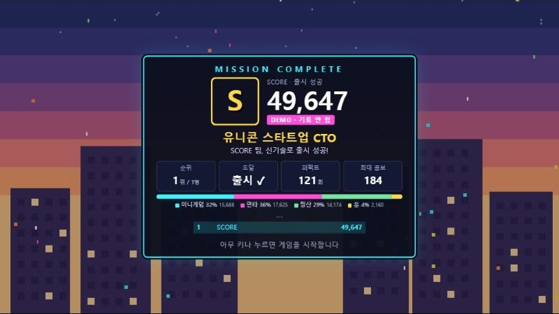

# 06. 점수 정산 전체 흐름

> 한 판 동안 점수와 코인이 언제, 어떤 계산으로 들어오는지 순서대로 정리한 문서입니다. 기준 버전 **v14**(점수 정산 수정안 A~E·H·I 적용).
> 점수는 모두 `addScore(출처, 점수)` 한 곳을 거쳐 더해지고, 출처(미니게임 · 연타 · 정산 · 운)별로 기록되어 결과창 점수 구성 막대에 쓰입니다. 부르는 곳은 다섯 함수: `taskSuccess`(작업) · `feverPress`(연타) · `tallyAdd`(정산표) · `applySpecial`(특수 보상) · `applyItem`(아이템). 화면 없이 100판을 돌려 "출처별 합계 = 최종 점수 = 막대 합계"인 것을 확인했습니다(100/100).

---

## 1. 흐름 한눈에 보기

```
시작 카드 (점수 없음, 배율만 바뀜)
 └ 루트 선택 ── 안전 ×1 / 신기술 Lv.N ×2 × 1.2^(N-1)
    └ 1층 ───── ① 작업 점수  ② 피버 연타
       └ 정산표 ─ ③ 클리어 보너스  ④ 처리 속도 보너스  ⑤ 무결점 배포  (+코인 5)
          └ WARNING ── ⑥ 성공당 60점 (+피버 연타)
             └ 아이템 선택 ── ⑦ 즉시 점수 아이템 / 다음 층 배율
                └ (가끔) 보너스 스테이지 ── ⑧ 성공당 100점, 3회↑ 특수 보상
                   └ 보상 카드 → 룰렛 ── ⑨ 투자 유치 +1,000
                      └ 이벤트(상점·랜덤 카드) ── ⑦ 즉시 점수 아이템 (코인 사용)
    └ 2층 · 3층 반복 (3층 뒤에는 WARNING 없음)
 └ 최종 보스 ── ⑩ 보스 작업  ⑪ 그로기 연타
    └ 출시 정산표 ── ⑫ 출시 보너스 2,000 + 신기술 Lv × 500  ⑬ 남은 시간 × 200 × 신기술 배율 (#43)  ⑭ 남은 코인 × 30
 └ 결과창 ── 점수 구성 막대 (미니게임 · 연타 · 정산 · 운)
 └ 시간 종료로 끝나면: 그 순간까지의 점수만 기록 (③④⑤⑫⑬⑭ 없음)
```

## 2. 항목별 계산식

| # | 언제 | 계산 | 적용되는 배율 |
|---|---|---|---|
| ① | 층 작업 성공 | `50 × 루트 × 퍼펙트 × 작업 × 아이템` (반올림) | 루트 · 퍼펙트 · 야근 수당 · 연속 근무 · 집중 모드/황금 키보드 |
| ② | 층·WARNING·보너스 중 피버 연타 1회 | `15 × 루트 × 1.5^회식 × 아이템` | 루트(층에서만) · 회식 · 집중 모드/황금 키보드(층에서만) |
| ③ | 층 정산표 | `300 × 루트 × 1.5^성과급` | 루트 · 성과급 |
| ④ | 층 정산표 | **처리 속도 보너스** `(기준 시간 − 이번 층 소요 시간, 반올림) × 50`. 기준 = 작업 수 × 1.8초 (신기술은 × 난이도 배율). 남은 시간은 "다음 스테이지로 이어집니다"로만 표시 | 없음 |
| ⑤ | 층 정산표 (무결점 배포 카드 + 그 층 미스 0) | `(그 층 작업 점수 + ③) × 0.5` (카드 설명도 이 계산으로 맞춤) | ①③에 이미 붙은 배율 |
| ⑥ | WARNING 성공 | `60 × 퍼펙트 × 작업` | 퍼펙트 · 야근 수당 · 연속 근무 |
| ⑦ | 아이템 획득 | 보너스 쿠폰 +300 · 로또 +200~2,000 · 대박 로또 +1,000~5,000 (10점 단위) | 없음 (운) |
| ⑧ | 보너스 스테이지 성공 | `100 × 퍼펙트 × 작업` | 퍼펙트 · 야근 수당 · 연속 근무 |
| ⑨ | 특수 보상 「투자 유치」 (룰렛·보너스 스테이지) | `+1,000` | 없음 |
| ⑩ | 보스 작업 성공 | `50 × 퍼펙트 × 작업 × 아이템` | 퍼펙트 · 야근 수당 · 연속 근무 · 집중 모드/황금 키보드 (**루트 배율 없음**) |
| ⑪ | 보스 그로기 연타 1회 | `15 × 1.5^회식 × 아이템` (+ 보스 체력 −1 × 1.5^회식) | 회식 · 집중 모드/황금 키보드 |
| ⑫ | 출시 정산표 | `2,000 + 신기술 Lv × 500` (1층은 항상 안전이라 최대 Lv.2 → 3,000) | 신기술 Lv |
| ⑬ | 출시 정산표 | `남은 초(내림) × 200 × 신기술 점수 배율` (#43: 20 → 200, 신기술 Lv.1 ×2 · Lv.2 ×2.4 · 위험 수당 카드면 ×2.5 · ×3) | **신기술 배율** |
| ⑭ | 출시 정산표 | `남은 코인 × 30` | 없음 |

### 배율 값

| 배율 | 값 |
|---|---|
| 루트 | 안전 ×1 · 신기술 Lv.N `2 × 1.2^(N−1)` (위험한 기술 카드면 2 대신 2.5) |
| 퍼펙트 | ×1.6 (장인 정신 카드 ×2.2) |
| 작업 (야근 수당) | 1장당 ×1.25, 최대 3장 |
| 작업 (연속 근무) | 콤보 10 이상일 때 ×1.3 (콤보는 작업 성공 직후 기준, 커맨드는 화살표마다 콤보 +1) |
| 아이템 (다음 층) | 집중 모드 ×1.5 · 황금 키보드 ×2 (둘 다 있으면 곱함). 다음 한 층(또는 보스)에만 |
| 성과급 | 1장당 ③ ×1.5, 최대 2장 |
| 회식 | 1장당 ②⑪ ×1.5, 피버·그로기 +1초 |
| 출처 (결과창 막대) | 미니게임 = ①⑥⑧⑩ · 연타 = ②⑪ · 정산 = ③④⑤⑫⑬⑭ · 운 = ⑦⑨ |

## 3. 코인

| 얻는 곳 | 코인 | 쓰는 곳 | 코인 |
|---|---|---|---|
| 작업 GOOD / PERFECT (보스 포함) | +1 / +2 | 일반 상점 구매 | 6 · 12 · 22 |
| WARNING · 보너스 스테이지 성공 1회 | +1 | 대박 상점 구매 (30% 할인) | 4 · 8 · 15 |
| 층 클리어 | +5 | 새로고침 | 3, 누를 때마다 +2 |
| 동전 지갑 아이템 | +8 | 랜덤 뽑기 | 일반 5 · 대박 7 |
| | | **출시하면 남은 코인 → ⑭ 1개당 30점** | |

## 4. 실제로 어디서 점수가 나오나 (보통 봇 30판씩)

| 출처 | 모두 안전 | 모두 신기술 |
|---|---|---|
| 그로기 연타 ⑪ | 19.2% | 14.4% |
| 피버 연타 ② | 12.5% | **18.3%** |
| 출시 보너스 ⑫ | 10.3% | 7.6% |
| 남은 코인 ⑭ | 8.8% | 6.1% |
| 보스 작업 ⑩ | 7.2% | 4.7% |
| 아이템 즉시 점수 ⑦ | 6.8% | 7.2% |
| 층 작업 ① | **6.5%** | 9.6% |
| 층 남은 시간 ④ | 5.5% | 3.5% |
| 출시 남은 시간 ⑬ | 5.3% | 2.8% |
| WARNING ⑥ | 5.2% | 3.6% |
| 층 클리어 보너스 ③ | 5.2% | 10.7% |
| 보너스 스테이지 ⑧ | 4.9% | 6.8% |
| 투자 유치 ⑨ | 2.0% | 2.7% |
| 무결점 배포 ⑤ | 0.5% | 2.1% |
| **평균 최종 점수** | **18,700** | **24,700** |

## 5. 점검: 빠졌거나 어긋나 보이는 부분

| # | 내용 | 영향 |
|---|---|---|
| A | **연타(②⑪) 비중이 약 32%로 가장 큼.** 미니게임 실력이 드러나는 층 작업(①)은 6.5~9.6%뿐 | 미니게임을 잘하는 것보다 연타가 점수를 좌우함 |
| B | **최종 보스(⑩⑪⑫⑬)에는 루트·신기술 배율이 없음** | 신기술을 끝까지 골라도 보스 점수는 같음 |
| C | **층 남은 시간 ④는 같은 시간을 여러 번 셈.** 시간이 다음 층으로 이어지므로 1층에서 아낀 10초가 1·2·3층 정산에서 세 번(×5), 출시 때 한 번 더(×20) 점수가 됨 | 초반에 빨리 깬 것이 가장 크게 보상받음 (의도라면 유지) |
| D | **피버 연타 ②에는 아이템 배율(집중 모드·황금 키보드)과 야근 수당이 안 붙음.** 층 작업 ①에는 붙음 | 배율 아이템의 효과가 피버 구간에서는 사라짐 |
| E | **무결점 배포 ⑤는 작업 점수 + 클리어 보너스만 1.5배.** 피버 점수와 남은 시간 보너스는 제외 | 카드 설명("그 층 점수 ×1.5")보다 작게 느껴질 수 있음 |
| F | **WARNING ⑥ · 보너스 스테이지 ⑧에는 루트·아이템 배율이 없음** | 신기술 Lv이 높아도 이벤트 점수는 같음 |
| G | **시간 종료로 끝나면 진행 중이던 층의 ③④⑤가 없고 코인 ⑭도 환산 안 됨** | 출시해야 받는 보상이라는 의도와 일치 |
| H | **점수 구성(어디서 몇 점)을 플레이어에게 보여 주는 화면이 없음.** 엔딩 로그는 층별 합계만, 결과창은 총점만 | 플레이어가 점수 전략을 세우기 어려움 |
| I | 코드에 쓰지 않는 상수 `COIN.bonus` (보너스 스테이지는 `COIN.mid`로 +1) | 동작 문제는 없음, 정리 대상 |

> v14에서 A~E·H·I를 고쳤고 F·G는 의도로 유지했습니다. 6절과 [04-dev-log.md](04-dev-log.md) #31 참고. (위 표는 v13.1 기준 점검 기록)

---

## 6. 수정안 → v14에서 A~E·H·I 적용, F·G 유지

| # | 수정안 | 추천 | 바꾸는 것 |
|---|---|---|---|
| A | **연타 점수 1회 20 → 15점** (피버·그로기 공통) | 적용 | `FEVER.perPress` 한 줄 |
| B | **출시 보너스에 신기술 보상:** 2,000 + 신기술 Lv × 500 (Lv.3이면 3,500) | 적용 | 출시 정산표 한 줄 |
| C | **층 "남은 시간 보너스" → "처리 속도 보너스":** (기준 시간 − 이번 층 소요 시간) × 50. 기준 = 작업 수 × 1.8초(신기술은 난이도 배율만큼 늘림). 남은 시간은 "다음 스테이지로 이어집니다"로 계속 보여 주고, 시간을 실제로 점수로 바꾸는 건 출시 때 한 번만 | 적용 | 층 정산표 한 줄 |
| D | **피버·그로기 연타에도 아이템 배율(집중 모드·황금 키보드) 적용.** 야근 수당은 "작업 점수" 카드라 그대로 작업에만 | 적용 | 연타 계산 한 곳 |
| E | **무결점 배포 카드 설명을 실제 계산에 맞춤:** "노미스 층: 작업 점수 + 클리어 보너스 ×1.5" | 적용 (설명만) | 카드 문구 |
| F | WARNING · 보너스 스테이지에 루트 배율 없음 | **유지** | 이벤트는 루트와 무관하게 같은 조건. 신기술은 이미 보너스 스테이지 확률(45%)이 높음 |
| G | 시간 종료 시 층·출시 정산 없음 | **유지** | "출시해야 받는 보상" 의도와 맞음 |
| H | **결과창에 점수 구성 막대 추가:** 미니게임(①⑥⑧⑩) · 연타(②⑪) · 정산(③④⑤⑫⑬⑭) · 운(⑦⑨) 네 칸 비율과 점수 | 적용 | 점수 출처를 판 중에 기록 + 결과창 한 줄 |
| I | 쓰지 않는 `COIN.bonus` 삭제 | 적용 | 상수 정리 |

### A~D를 함께 적용했을 때 (보통 봇 50판씩, 사본으로 시뮬레이션)

| | 현재 | 수정안 |
|---|---|---|
| 연타 비중 · 모두 안전 | 31.3% | **28.0%** |
| 연타 비중 · 모두 신기술 | 33.5% | **25.9%** |
| 연타 비중 · 평균 | 32.4% | **27.0% (−5.4%p)** |
| 평균 점수 · 모두 안전 | 18,955 | 16,639 |
| 평균 점수 · 모두 신기술 | 23,487 | 23,852 |
| 신기술 ÷ 안전 점수 | 1.24배 | **1.43배** |
| 층 시간 관련 점수 비중 (④ → C) | 3.5~5.5% | 3.8~5.2% (같은 시간을 여러 번 세지 않음) |

- 연타 20점 → 16점은 −2.5%p, 14점은 −7%p 안팎이라 **15점**이 목표(−5%p)에 가장 가까움.
- 안전 루트 점수는 연타 감소만큼 내려가고, 신기술은 B(출시 보너스)로 보전돼 "위험을 감수하면 점수가 더 오른다"가 판 전체에서도 드러남.
- 출처별 합계 = 최종 점수 100/100판 (수정안에서도 빠지는 점수 없음).

### 적용 후 결과 (v14, 보통 봇 50판씩)

| | v13.1 | v14 |
|---|---|---|
| 연타 비중 · 모두 안전 | 31.3% | **27.0%** |
| 연타 비중 · 모두 신기술 | 33.5% | **26.6%** |
| 평균 점수 · 모두 안전 | 18,955 | 16,168 |
| 평균 점수 · 모두 신기술 | 23,487 | 24,337 |
| 출처 합계 = 최종 점수 = 결과창 막대 합계 | — | 100/100판 |


