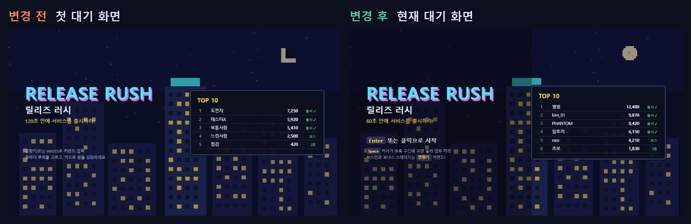

# 릴리즈 러시 개발 문서

> 채용박람회 AI 게임 제작 이벤트 출품작 **「릴리즈 러시」(가칭)**를 **하루 만에** 기획하고 만든 기록입니다.
> Velog 「하루 만에 게임 만들기」 글의 자료로 쓰기 위해 정리하고, 개발이 진행될 때마다 계속 갱신합니다.
> 하루 안에 끝나는 작업이라 항목마다 날짜는 적지 않고, 번호 순서가 곧 진행 순서입니다.

## 프로젝트 한눈에 보기

| 항목 | 내용 |
|---|---|
| 행사 | 채용박람회 AI 게임 제작 이벤트 (출품작 중 10개 선정, 부스 운영) |
| 마감 | 2026-11-10(화) 17:00 |
| 실행 조건 | 인터넷 없이 Windows에서 실행, 랭킹·기록 유지, 닉네임 입력 |
| 게임 | 직장인이 업무 몬스터를 물리치며 기획 → 개발 → 테스트 → 출시까지 55초 안에 돌파하는 아케이드. 층마다 미니게임 4종 중 하나가 무작위로 배정 |
| 기술 | HTML 파일 하나 (Canvas + DOM), localStorage |
| 게임 파일 | `game/release-rush.html` |



## 문서 목록

| 문서 | 내용 | 갱신 시점 |
|---|---|---|
| [01-planning-process.md](01-planning-process.md) | 조건 → 방향 탐구 → 출품 전략 → 장르 결정까지의 기획 과정, 의사결정 로그 | 기획 결정이 생길 때 |
| [02-game-spec.md](02-game-spec.md) | 현재 게임 규칙과 수치 | 규칙·수치가 바뀔 때 |
| [03-tech-architecture.md](03-tech-architecture.md) | 파일 구조, 기술 선택 이유, 점검 방법 | 구조가 바뀔 때 |
| [04-dev-log.md](04-dev-log.md) | 구현 이후 모든 수정의 원인·내용·예상 결과·검증 결과 | **수정할 때마다** |
| [05-backlog.md](05-backlog.md) | 미정 사항, 밸런스 확인 거리, 제출 전 할 일 | 수시로 |
| [06-scoring.md](06-scoring.md) | 점수·코인 정산 전체 흐름, 계산식, 출처별 비중, 점검 목록 | 점수 규칙이 바뀔 때 |
| [07-review.md](07-review.md) | 완성도 · 유불리 평가, 위험 목록, 우선순위별 개선안 | 방향 점검할 때 |
| [`images/`](images/README.md) | 화면 캡처와 변경 전/후 비교 이미지. **버전별 폴더 + 목차(images/README.md)** | 큰 수정이 있을 때 |
| [`manual/`](manual/게임설명서.html) | 제출용 [게임설명서](manual/게임설명서.html)(화면 중심 8쪽) · [매뉴얼](manual/매뉴얼.html)(실행 · 조작 · 랭킹 2쪽) 원본(HTML → PDF), 공통 스타일 `manual.css`, 화면 39장, 캡처 · 클릭 점검 · 시뮬레이션 도구(`manual/capture/`) | 화면 · 조작이 바뀔 때 |

### 이미지 정리 규칙

이미지는 **버전마다 폴더 하나**에 모읍니다. 한눈에 확인하려면 [images/README.md](images/README.md)(버전별 목차)를 여세요.

| 폴더 | 내용 |
|---|---|
| `0-plan/` | 기획 단계 문서 화면 |
| `v1-arrows/` ~ `v15.5-juice/` (`preview-*` = 적용 전 시안) | 버전별 게임 화면과 그 버전에서 만든 변경 전/후 비교 이미지 |
| `velog/` | Velog 글의 「한눈에 보기」 이미지 |

| 파일 이름 접두어 | 내용 | 예 |
|---|---|---|
| `plan-` | 기획 문서 화면 | `0-plan/plan-05-strategy-matrix.jpg` |
| `game-vN-` | 그 버전의 게임 화면 | `v3-battle/game-v3-battle.jpg` |
| `compare-` | 변경 전/후를 나란히 놓은 비교 이미지 (번호는 전체 순서) | `v3-battle/compare-05-battle.jpg` |

새 버전을 만들면 `vN-이름/` 폴더를 추가하고, 이미지 목차에도 한 단락을 추가합니다.

> Velog에 올릴 때는 이미지를 직접 업로드해야 합니다. 문서 안의 `images/...` 경로는 로컬 미리보기용입니다.

## 개발 로그 작성 양식

수정이 생기면 `04-dev-log.md` 맨 아래에 아래 양식으로 추가합니다.

```markdown
## #번호 제목

- **원인/목적:** 왜 바꾸는가 (요청, 발견한 문제, 데이터)
- **수정 내용:** 무엇을 어떻게 바꿨는가
- **예상 결과:** 바꾸면 무엇이 좋아질 것으로 보는가
- **검증 결과:** 실제로 확인한 것 (시뮬레이션 수치, 화면 확인, 남은 문제)
- **관련 파일:** 바뀐 파일


```

화면이 바뀌는 큰 수정은 변경 전/후 캡처를 남기고, 가능하면 한 장으로 나란히 놓은 비교 이미지를 만듭니다. 바꾸기 전 버전은 `game/backup/`에 백업해 두고 다시 띄워서 찍을 수 있게 합니다.

**백업은 모두 `game/backup/`에 모읍니다.** 게임은 `release-rush-vX.Y-이름.html`, 옛 제출물(설명서 · ZIP)은 `game/backup/submit/`. **`submit/`은 배포용 폴더**라 지금 낼 파일(`릴리즈러시/` + ZIP)만 둡니다.

기획 결정은 `01-planning-process.md`의 의사결정 로그 표에 한 줄로 추가합니다.

## Velog 시리즈 — 외전 「하루 만에 게임 만들기」

Velog에는 본편과 별개인 **외전** 시리즈 `외전 · 하루 만에 게임 만들기`로 올립니다. 제목은 `[외전] 하루 만에 게임 만들기 #N — 부제` 형식입니다.
완성된 글은 `velog/` 폴더에 있습니다. 글 · 이미지 · 업로드 작업 기록은 개발 로그가 아니라 [`velog/README.md`](velog/README.md)(V번호)에 남깁니다. 머리 주석에 Velog 제목·시리즈·태그·썸네일을 적고, 맨 위에 표지 이미지(`images/velog/velog-NN-cover.png`, 1600×840)를 둡니다. 글은 짧게, 설명은 이미지로 합니다.
`python velog/build-html.py velog/NN-이름.md`를 실행하면 이미지가 모두 들어간 HTML 파일 하나(`velog/NN-이름.html`)가 만들어집니다(markdown · PIL이 있는 파이썬 필요). 표지는 `velog/make-covers.py`(#2~), #1의 표지 · 흐름도는 `velog/make-images-01.py`로 만듭니다.

| 편 | 주제 | 주요 자료 | 상태 |
|---|---|---|---|
| #1 | 마감 하루 전, 기획서부터 다시 썼다 (인트로) | 01 문서 전체, 0-plan 이미지, 04 로그 #01 | [원고](velog/01-planning-and-start.md) · Velog 출간 · 수정본 임시저장(시리즈 연결 · 편 목록 갱신 남음, [작업 기록](velog/README.md) V2). 이전 긴 초안은 `game/backup/velog/` |
| #2 | 방향키를 버리고 버튼 하나만 남겼다 (v1 → v3: 60초 · 원버튼 · 피버 연타 · 전투 연출 · 데모) | 04 로그 #03 ~ #09 | [초안](velog/02-one-button.md) |
| #3 | 한 판을 처음부터 끝까지 설계했다 (v4 → v13: 미니게임 · WARNING · 카드 · 상점 · 룰 카드 · 엔딩 · 보스 체력) | 04 로그 #12 ~ #24 | [초안](velog/03-one-run.md) |
| #4 | 봇 수백 판이 사람 한 판을 못 이겼다 (시뮬레이션 밸런스 · 67,000점 보정 · 남은 시간 점수) | 04 로그 #24 ~ #31 · #41 ~ #45, 06 문서 | [초안](velog/04-balance-bots.md) |
| #5 | 마감 전에 낸 것과, 사람에게 보여 주고 고친 것 (완성도 평가 · 소리 합성 · 제출 · 캡처 봇 · 알파 테스트) | 04 로그 #32 ~ #38 · #40 · #46, 07 문서 | [초안](velog/05-submit-alpha.md) (실제 제출 문단 TODO) |
| #6 | 올드한 게임에 도파민을 들이부었다 (피버 말풍선 · 버벅임 · 레이저 대기 화면 · 성공 이펙트 · 급박한 3분 · 콤보) | 04 로그 #39 · #47 · #50 ~ #60 | [초안](velog/06-dopamine.md) |
| #7 | 65번 고치고 두 번 제출했다, 본질 위에 연출과 조화가 필요했다 (제출 완료 · 제출 뒤 피드백 2건과 재제출 · 누적 수치 · 출품 확정 시 후속 글 예고) | 제출 완료 화면, 전체 로그 · docs md 누적 수치 | [초안](velog/07-submit-and-after.md) · Velog 임시저장 |

추천 태그: `게임개발`, `게임기획`, `AI활용`, `공모전`, `외전` (기술 편에서는 `JavaScript`, `Canvas` 추가)
