# 이미지 목차 (버전별)

> 버전마다 폴더 하나입니다. `compare-`는 변경 전/후 비교, `game-`은 그 버전의 화면입니다.
> 자세한 이유와 검증 결과는 [04-dev-log.md](../04-dev-log.md)의 해당 번호를 보세요.

| 폴더 | 버전 | 내용 | 개발 로그 | 장수 |
|---|---|---|---|---|
| [`0-plan/`](0-plan/) | 기획 단계 | 방향성 탐구, 출품 전략, 공모 요강 반영, 게임 설계서 | 01-planning-process.md | 8 |
| [`v1-arrows/`](v1-arrows/) | v1 · 첫 초안 (방향키 커맨드) | 초안 구현, 화면 문제 수정, 데모 플레이, 1차 피버 | #01 ~ #05 | 12 |
| [`v2-timing/`](v2-timing/) | v2 · Space 타이밍 원버튼 | 기본 흐름을 타이밍으로, 콤보에 따라 판정 구간 변화, 피버 연타 | #06 ~ #08 | 9 |
| [`v3-battle/`](v3-battle/) | v3 · 전투 연출 | 직장인 vs 업무 몬스터, 대기·루트 화면 비교 | #09 · #11 | 10 |
| [`v4-minigames/`](v4-minigames/) | v4 · 미니게임 랜덤 + WARNING | 미니게임 4종 랜덤 배정, WARNING 중간보스, 최종 보스 섞기 | #12 | 9 |
| [`v5-cards/`](v5-cards/) | v5 · 수치형 전략 카드 | 선택 시간 제한 제거, 효과를 숫자로 | #13 | 2 |
| [`v6-items/`](v6-items/) | v6 · 아이템 · 코인 · 상점 | 카드 효과 표시, WARNING 보상, 랜덤 카드, 상점 2종 | #14 | 8 |
| [`v7-ready/`](v7-ready/) | v7 · 룰 카드 + Space로 시작 | 스테이지 시작 대기, 룰 카드, 점수 상자(가운데 위) | #15 | 6 |
| [`v8-ending/`](v8-ending/) | v8 · 점수 양옆 + 미스 −2초 + 엔딩 | 점수·코인 양옆, 클리어 조건 표시, 미스 페널티, 엔딩 게임 로그 | #16 | 6 |
| [`v9-result/`](v9-result/) | v9 · 게임 결과창 | 결과 화면 요약(등급·점수·핵심 기록 4개·TOP 5), 엔딩 Enter·Space로만, 다시 도전 제거 | #18 ~ #20 | 5 |
| [`v10-launch/`](v10-launch/) | v10 · 출시 컷신 + 결과별 배경 | 끝난 순간의 컷신(SERVICE OPEN / DEPLOY FAILED), 새벽 도시·비 오는 사무실 배경 | #21 | 7 |
| [`v11-tally/`](v11-tally/) | v11 · 클리어 연출 + 정산표 | CLEAR 도장, 남은 시간 → 점수 환산 정산표, Space로 다음 단계 | #22 | 6 |
| [`v12-boss-hp/`](v12-boss-hp/) | v12 · 보스 체력·그로기 + 랜덤 보너스 | 보스 체력 바, 미니게임 4개 → 그로기 연타, 보너스 스테이지를 랜덤 미니게임으로 | #23 | 6 |
| [`v13-balance/`](v13-balance/) | v13 · 미니게임 6종 + 난이도 재조정 | 컴파일 차지·알림 두더지 추가, 일반인 반응속도 봇으로 난이도 측정, 위험 1.5배 어려움 = 점수 2배, 보스 체력 180 | #24 | 4 |
| [`v14-scoring/`](v14-scoring/) | v14 · 점수 정산 정리 | 연타 비중 −5%p, 출시 보너스 신기술 보상, 처리 속도 보너스, 결과창 점수 구성 막대 | #31 | 1 |
| [`v14.4-click-fix/`](v14.4-click-fix/) | v14.4 · 버튼 클릭 룰 카드 수정 | 「시작하기」 · 시작 카드 · 루트를 클릭하면 다음 룰 카드가 같은 클릭으로 넘어가던 문제 | #38 | 3 |
| [`v14.5-fever-glow/`](v14.5-fever-glow/) | v14.5 · 피버 게이지 형광 강조 | 피버 · 그로기 중 게이지가 두꺼워지고 형광 빛 번짐 · 줄무늬 · 빛줄기 · 불꽃 | #39 | 3 |
| [`v14.6-alpha-feedback/`](v14.6-alpha-feedback/) | v14.6 · 알파 테스트 피드백 | 룰 카드 = 키 + TIP + 시범 플레이, 글 줄이고 숫자 크게, 피버 주변 연출, 결과창 압축 | #40 | 10 |
| [`v14.7-risk-balance/`](v14.7-risk-balance/) | v14.7 · 신기술 변별력 | 신기술 층 난이도 ×1.5 · 작업 ×1.5 · 보스 체력 ×2, 룰 카드 여백 | #41 | 3 |
| [`v14.8-time-bonus/`](v14.8-time-bonus/) | v14.8 · 남은 시간 점수 | 출시 때 남은 1초 × 200점 × 신기술 배율, 보스 룰 카드 표시 | #43 | 2 |
| [`preview-fever-flame/`](preview-fever-flame/) | #47 시안 | 불꽃 시안(폐기) · 외침 말풍선 시안 A · B 비교 이미지 · GIF | #47 | 8 |
| [`v15.0-fever-burst/`](v15.0-fever-burst/) | v15.0 · 외침 말풍선 테두리 | 피버 · 그로기 게이지 둘레 날카로운 가시 · 잉크 외곽선 · 망점 · 창 파편 · 별 | #47 | 6 |
| [`preview-idle/`](preview-idle/) | #51 · #53 시안 | 초기 화면 시안: 1차(말풍선) · 2차(말풍선 위치 조정 · 레이저형) 비교 이미지와 3초 GIF | #51 · #53 | 5 |
| [`v15.3-idle-laser/`](v15.3-idle-laser/) | v15.3 · 초기 화면 레이저형 | 레이저 테두리 · 광선 · 스캔선, 네온 도시 · 격자 바닥 · 행진 | #54 | 3 |
| [`preview-juice/`](preview-juice/) | #56 시안 | 미니게임 성공 이펙트 시안: 판정 도장 · 파편 · 충격파 · 코인 · 10콤보 배너 | #56 | 3 |
| [`v15.5-juice/`](v15.5-juice/) | v15.5 · 성공 이펙트 | 판정 도장 · 번개 · CRITICAL · 파편 · 코인/점수 · 가장자리 번쩍 · 연속 퍼펙트 · 콤보 배너 | #57 | 5 |
| [`v15.9-rule-how/`](v15.9-rule-how/) | v15.9 · 룰 카드 방법 한 줄 | 룰 카드 전후 비교(compare-51) · 미니게임 6종 룰 카드 | #65 | 2 |
| [`v15.8-fever-panel/`](v15.8-fever-panel/) | v15.8 · 피버 패널 | 피버 · 그로기 · 피버 끝(다시 시작!) 전후 비교(compare-50), 나란히 GIF | #64 | 2 |
| [`preview-fever-panel/`](preview-fever-panel/) | #63 시안 | 피버 · 그로기 동안 패널 자리를 피버 패널로: 지금 ↔ 시안 비교 이미지 · 나란히 GIF · 그로기 GIF | #63 | 3 |
| [`v15.7-fever-combo/`](v15.7-fever-combo/) | v15.7 · 피버도 콤보로 | 피버 HIT 단계 · FEVER BONUS · 끝난 뒤 콤보(compare-49), 피버 · 그로기 GIF | #60 | 3 |
| [`v15.6-hype/`](v15.6-hype/) | v15.6 · 급박한 3분 + 콤보 | 층별 전후 비교(compare-47) · 콤보 11 → 81 단계(compare-48) · 콤보 상승 · DANGER · 보스 마지막 5초 GIF | #59 | 5 |
| [`preview-hype/`](preview-hype/) | #58 시안 | 「급박한 3분」 시안: 남은 시간 긴장 단계(HURRY · DANGER · LAST 5) · 움직이는 층별 배경 · 몰입 속도선. 비교 이미지 1 + 층별 GIF 4 | #58 | 5 |
| [`velog/`](velog/) | Velog 글 이미지 | 외전 #1 표지 · 시작 흐름도 · 첫 초안 ↔ 지금, 옛 「한눈에 보기」 요약 | docs/velog/README.md V1 | 4 |

---

## 기획 단계

방향성 탐구, 출품 전략, 공모 요강 반영, 게임 설계서 · 개발 로그 01-planning-process.md · 폴더 `0-plan/`

| | |
|---|---|
| 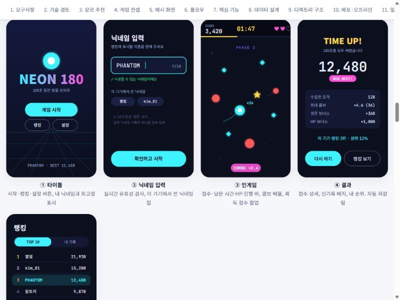 **첫 기획서의 NEON 180 화면 목업 — 방향 수정 전 결과물** `plan-01-first-mockups.jpg` | 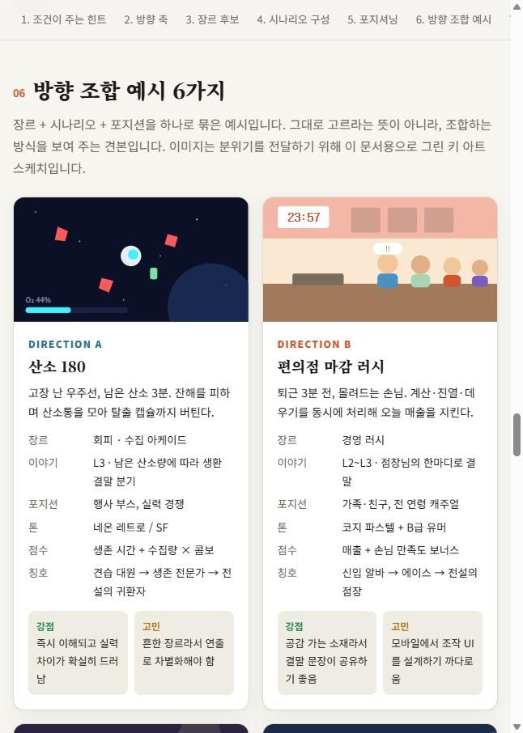 **방향 조합 카드** `plan-02-direction-cards.jpg` |
| 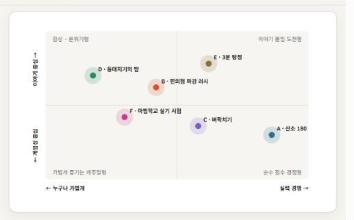 **포지셔닝 맵** `plan-03-positioning-map.png` | 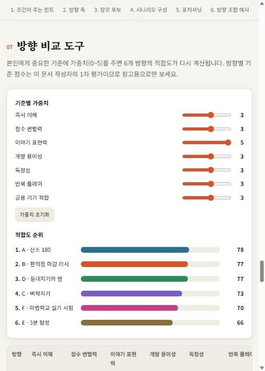 **가중치를 바꾸면 적합도 순위가 다시 계산되는 비교 도구** `plan-04-weight-tool.jpg` |
| 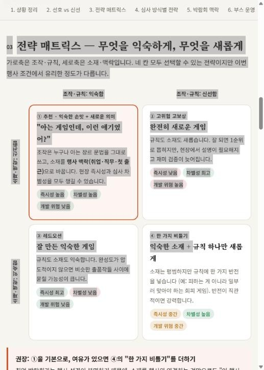 **출품 전략 매트릭스** `plan-05-strategy-matrix.jpg` | 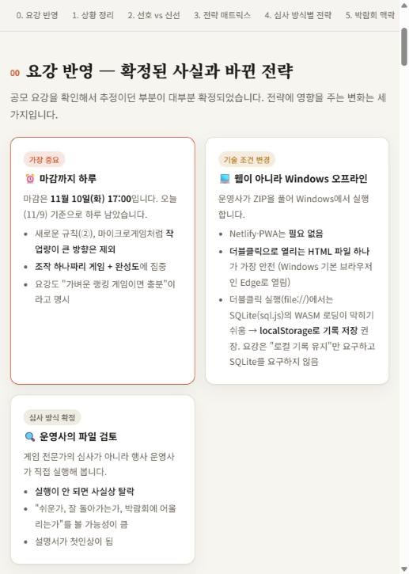 **요강을 반영해 다시 정리한 전략 — 마감 하루, Windows 오프라인, 운영사 검토** `plan-06-contest-rules.jpg` |
| 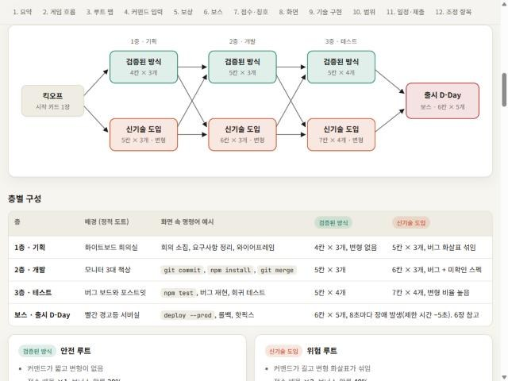 **루트 맵** `plan-07-design-route-map.jpg` | 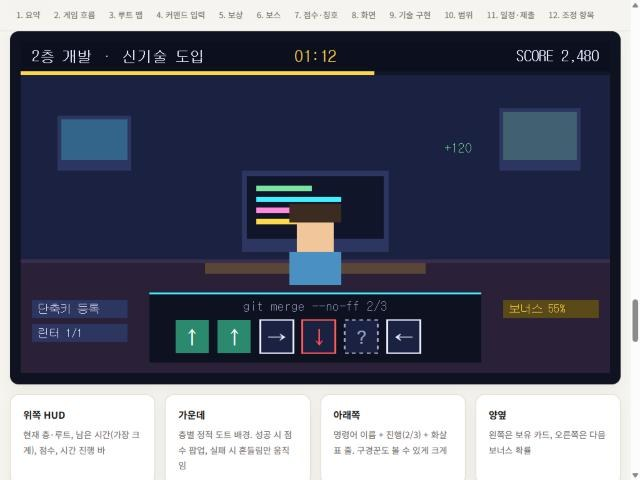 **플레이 화면 목업** `plan-08-design-play-mockup.jpg` |

---

## v1 · 첫 초안 (방향키 커맨드)

초안 구현, 화면 문제 수정, 데모 플레이, 1차 피버 · 개발 로그 #01 ~ #05 · 폴더 `v1-arrows/`

**화살표 크기 변경 전후** · `compare-01-arrow-size.jpg`

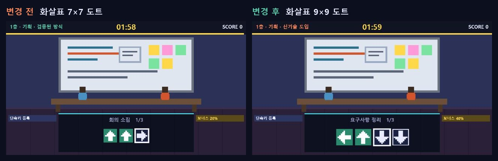

| | |
|---|---|
| 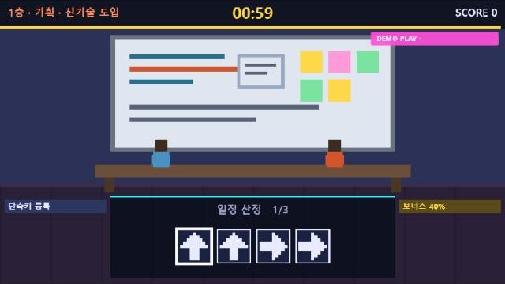 **데모 플레이 중인 화면 (오른쪽 위 DEMO PLAY 표시)** `game-demo-play.jpg` | 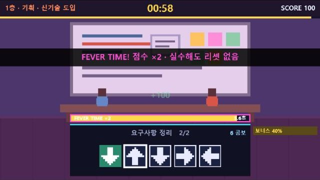 **1차 피버: 게이지와 FEVER TIME 안내** `game-fever-v1.jpg` |
| 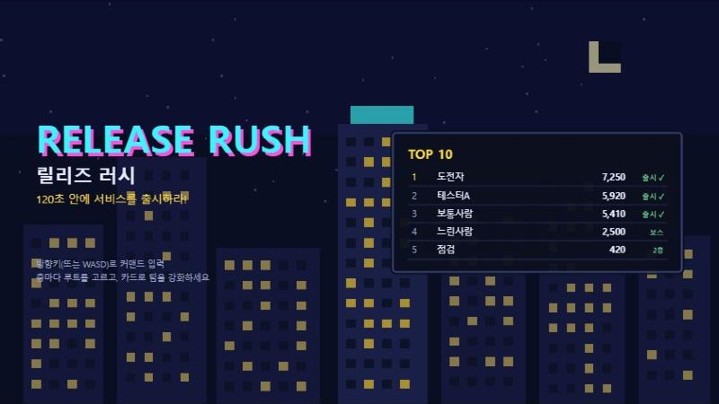 **첫 대기 화면** `game-v1-idle.jpg` | 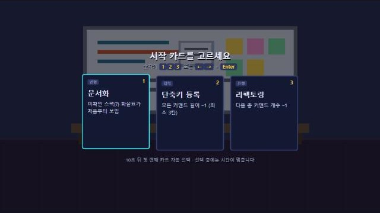 **카드 선택 (초안)** `game-v1-pick.jpg` |
| 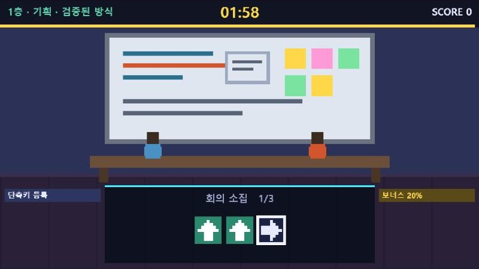 **화살표 7×7 도트 (수정 전)** `game-v1-play-small-arrows.jpg` | 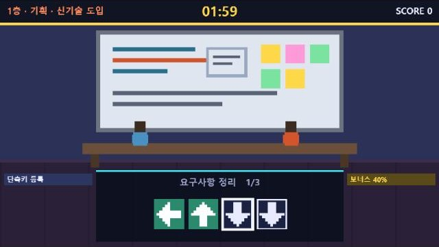 **층 플레이: 방향키 커맨드 (화살표 9×9)** `game-v1-play.jpg` |
| 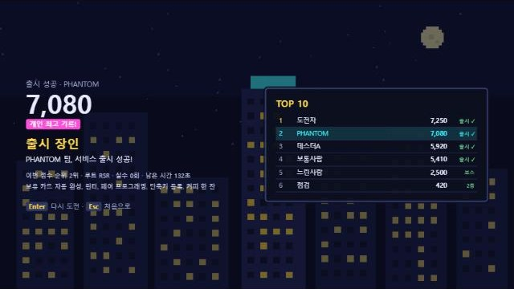 **결과 (초안)** `game-v1-result.jpg` | 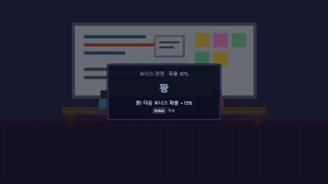 **초안 룰렛** `game-v1-roulette.jpg` |
| 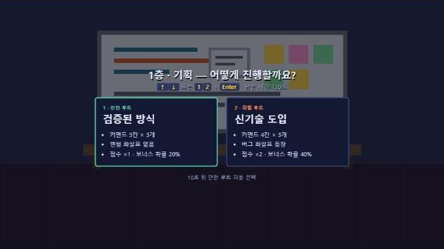 **초안 루트 선택** `game-v1-route.jpg` | 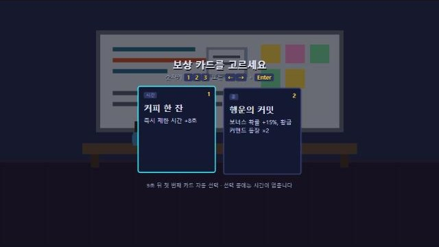 **시니어 합류: 보상 카드 2장** `game-v1-senior-pick.jpg` |
| 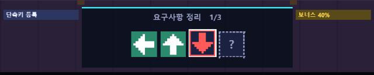 **변형 화살표: 빨강은 반대 방향, ?는 차례가 되면 공개** `game-v1-variant-arrows.png` |  |

---

## v2 · Space 타이밍 원버튼

기본 흐름을 타이밍으로, 콤보에 따라 판정 구간 변화, 피버 연타 · 개발 로그 #06 ~ #08 · 폴더 `v2-timing/`

**층 플레이: 방향키 커맨드에서 Space 타이밍으로** · `compare-02-arrows-to-timing.jpg`

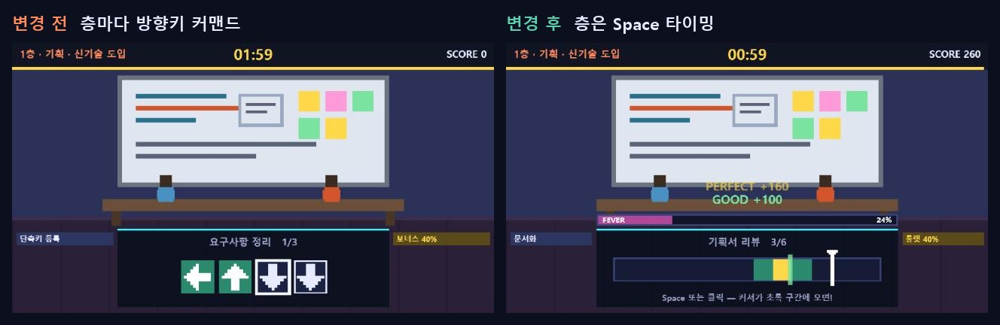

**콤보 0과 콤보 12의 판정 구간 폭 비교** · `compare-03-zone-width.jpg`

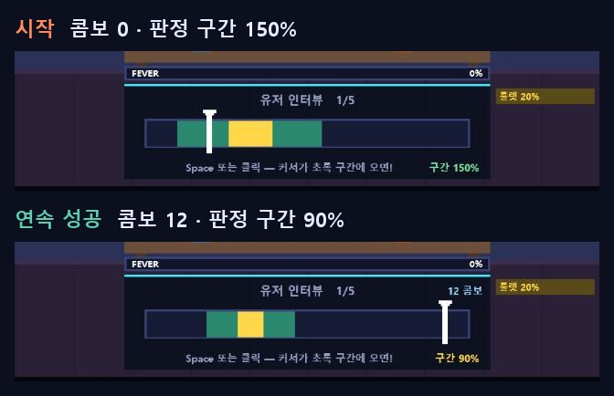

**피버: 점수 ×2에서 아무 키 연타로** · `compare-04-fever.jpg`

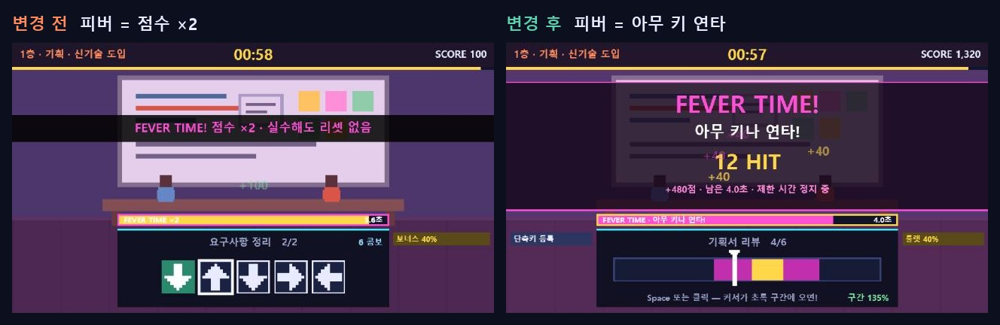

| | |
|---|---|
| 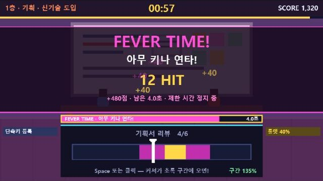 **피버: 아무 키 연타** `game-fever-mash-v2.jpg` | 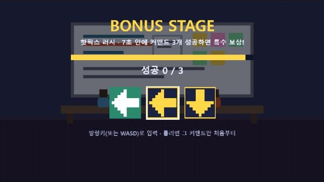 **새로 생긴 보너스 스테이지 「핫픽스 러시」** `game-v2-bonus-stage.jpg` |
| 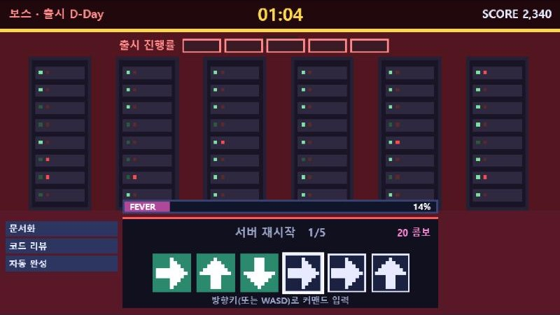 **보스: 방향키 커맨드** `game-v2-boss.jpg` | 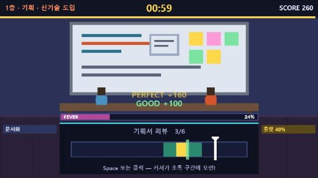 **층 플레이: Space 타이밍** `game-v2-timing.jpg` |
| 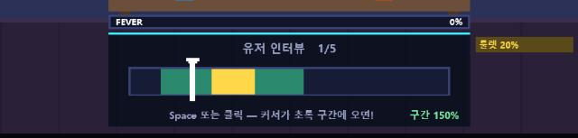 **콤보 0 · 판정 구간 150%** `game-zone-150.png` | 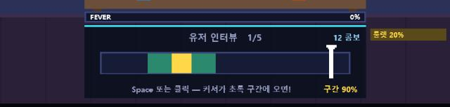 **콤보 12 · 판정 구간 90%** `game-zone-90.png` |

---

## v3 · 전투 연출

직장인 vs 업무 몬스터, 대기·루트 화면 비교 · 개발 로그 #09 · #11 · 폴더 `v3-battle/`

**층 플레이: 정적인 배경에서 전투 연출로** · `compare-05-battle.jpg`

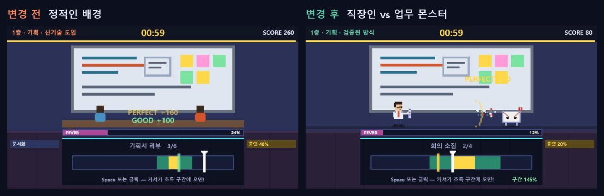

**보스전: 서버실 배경만 있던 화면에서 거대 D-DAY 달력과의 전투로** · `compare-06-boss.jpg`

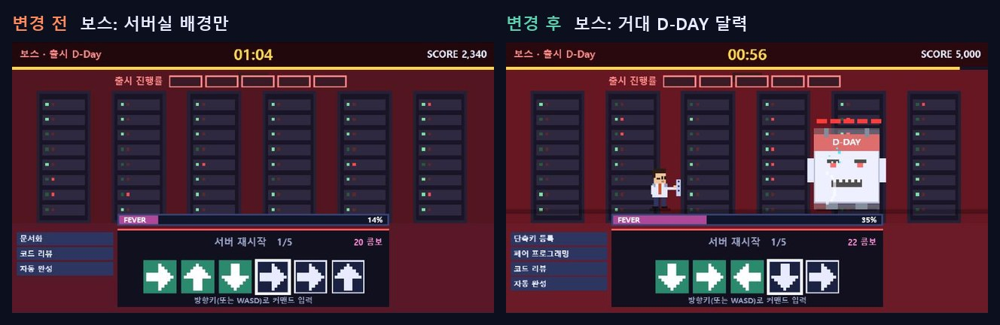

**첫 대기 화면과 현재 대기 화면** · `compare-07-idle.jpg`

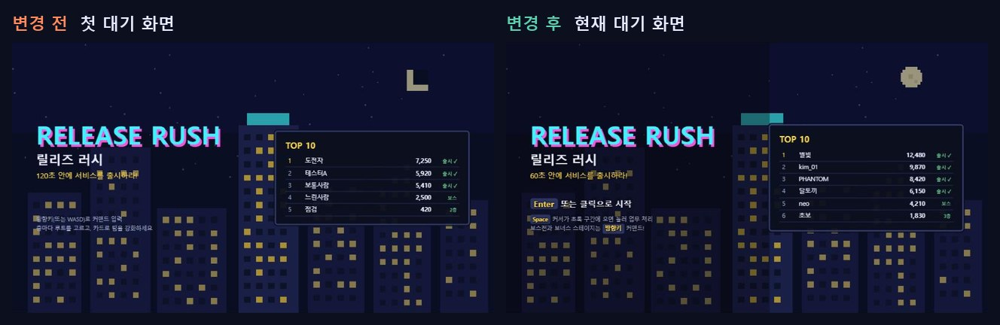

**루트 선택 화면도 커맨드 칸 수 대신 커서 속도·판정 폭·확률을 보여 주도록 변경** · `compare-08-route.jpg`

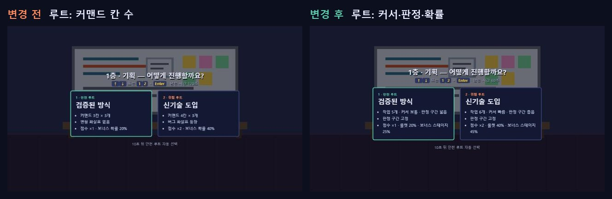

| | |
|---|---|
| 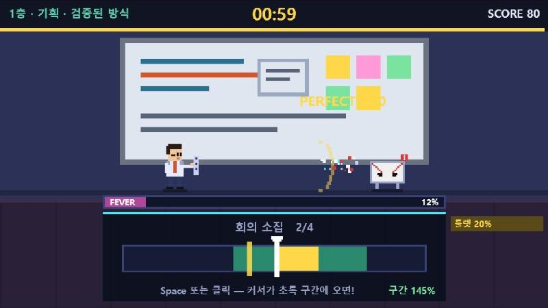 **층 플레이: 전투 연출** `game-v3-battle.jpg` | 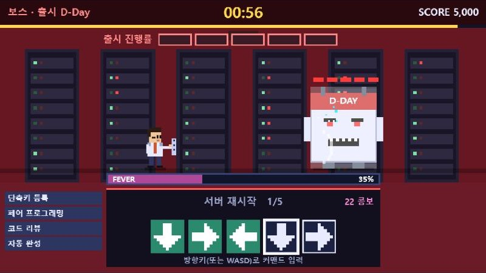 **보스: 거대 D-DAY 달력** `game-v3-boss-battle.jpg` |
| 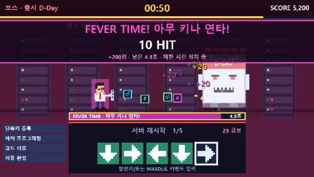 **피버 연타 + 전투** `game-v3-fever-battle.jpg` | 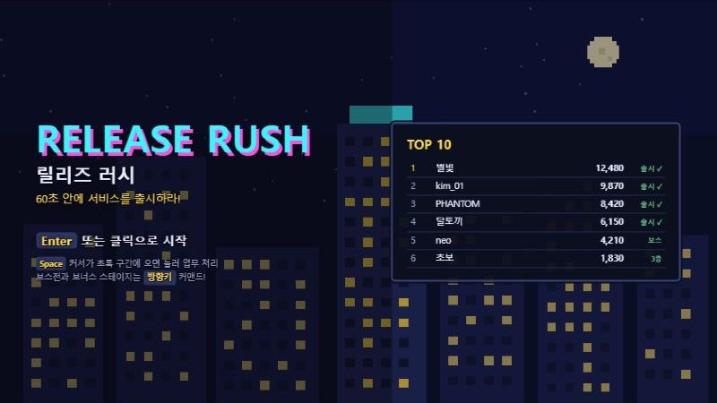 **대기 화면** `game-v3-idle.jpg` |
| 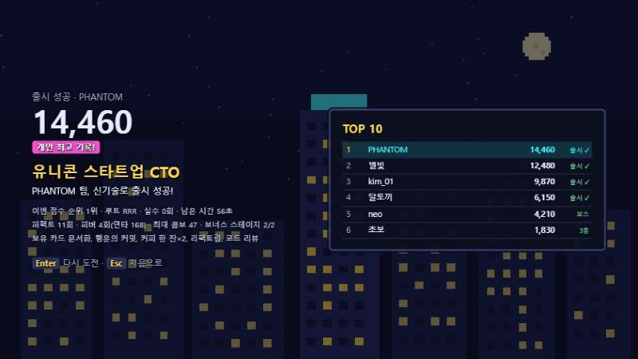 **결과·랭킹** `game-v3-result.jpg` | 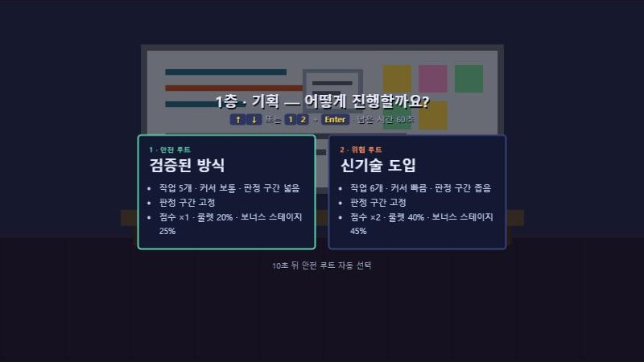 **루트 선택: 커서·판정·확률** `game-v3-route.jpg` |

---

## v4 · 미니게임 랜덤 + WARNING

미니게임 4종 랜덤 배정, WARNING 중간보스, 최종 보스 섞기 · 개발 로그 #12 · 폴더 `v4-minigames/`

**루트 선택 화면에 이번 판 미니게임 순서 표시** · `compare-09-route-lineup.jpg`

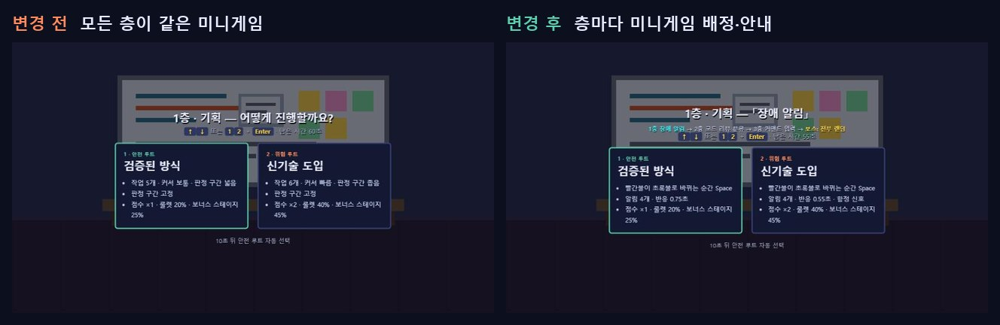

**층마다 다른 미니게임** · `compare-10-stage-variety.jpg`

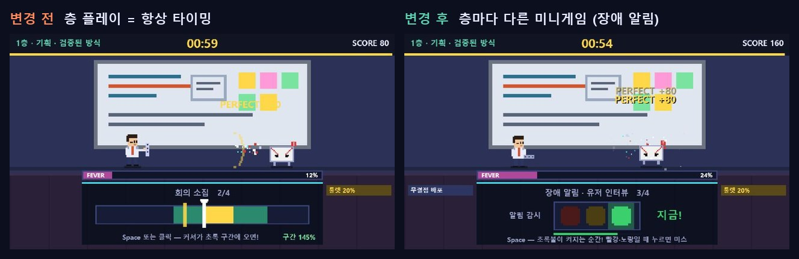

**최종 보스: 방향키만에서 미니게임 섞기로** · `compare-11-boss-mix.jpg`

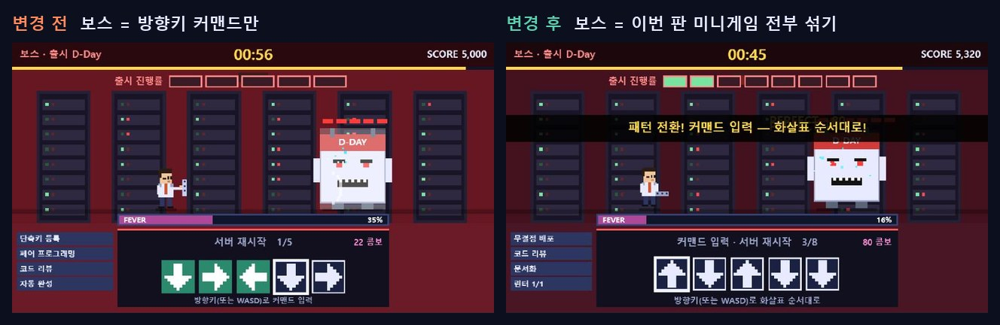

| | |
|---|---|
| 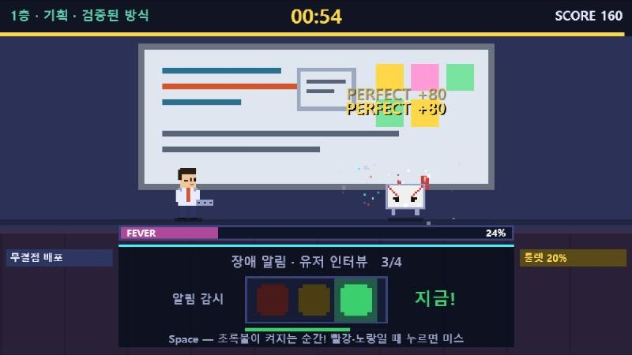 **장애 알림 미니게임** `game-v4-alert.jpg` | 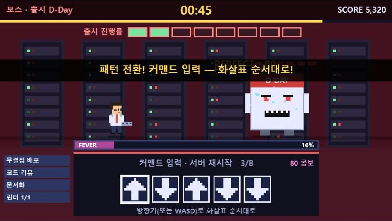 **최종 보스: 미니게임 섞기** `game-v4-boss-mix.jpg` |
| 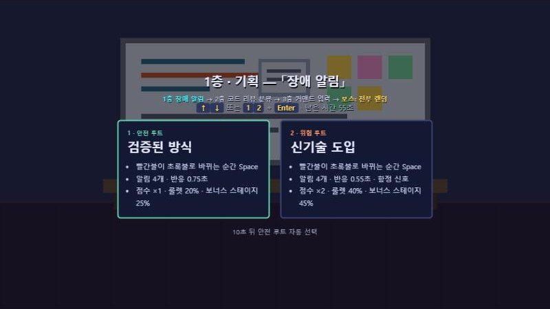 **루트 선택: 이번 판 미니게임 순서** `game-v4-route.jpg` | 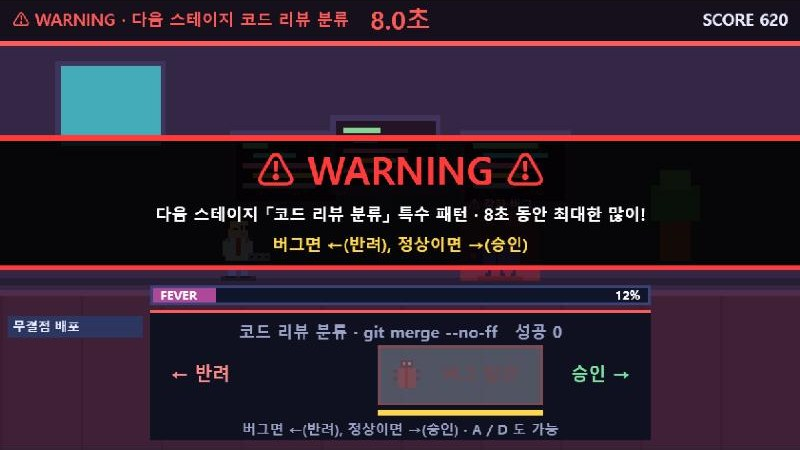 **WARNING 예고** `game-v4-warning-banner.jpg` |
| 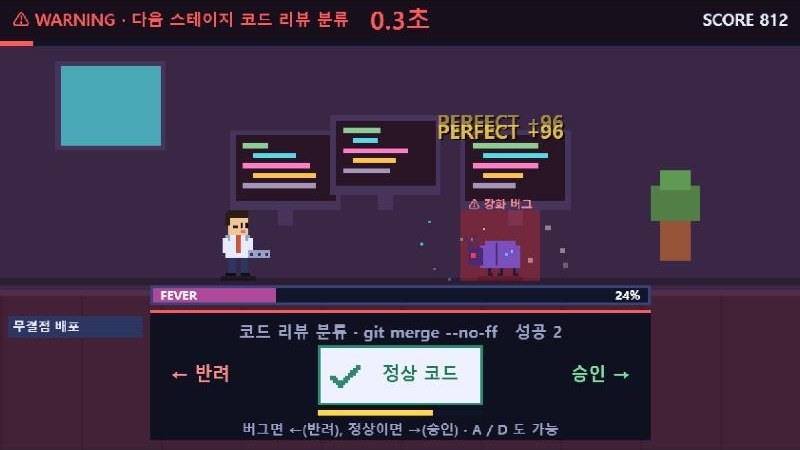 **WARNING 중간보스 플레이 (코드 리뷰 분류, 강화 몬스터)** `game-v4-warning-sort.jpg` | 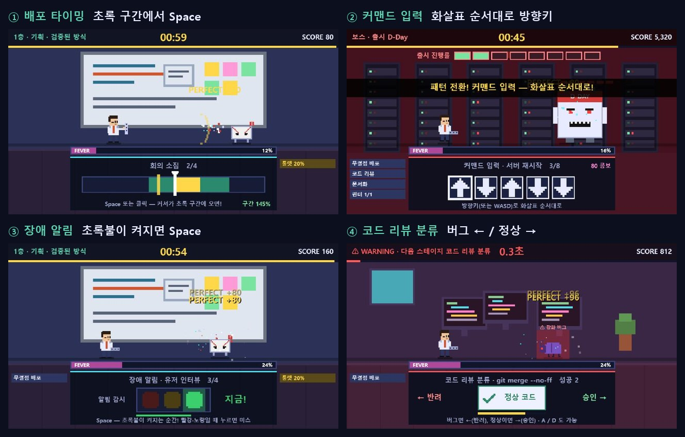 **미니게임 4종** `minigames-4.jpg` |

---

## v5 · 수치형 전략 카드

선택 시간 제한 제거, 효과를 숫자로 · 개발 로그 #13 · 폴더 `v5-cards/`

**카드 선택 화면: 설명형 카드와 자동 선택에서 수치형 카드와 현재 빌드 표시로** · `compare-12-card-pick.jpg`

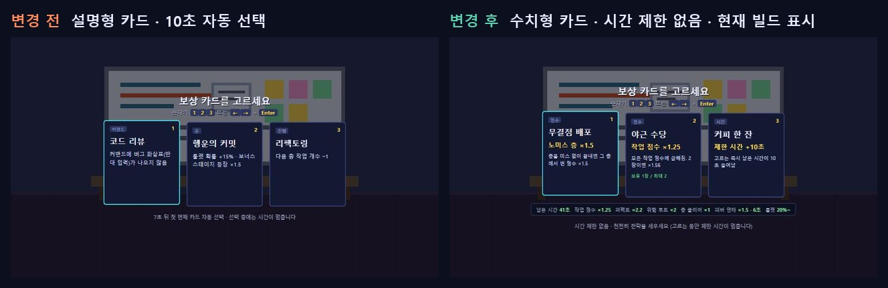

| | |
|---|---|
| 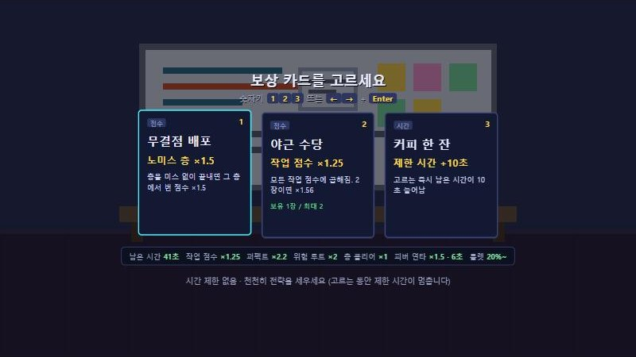 **수치형 카드 + 현재 빌드** `game-v5-pick.jpg` |  |

---

## v6 · 아이템 · 코인 · 상점

카드 효과 표시, WARNING 보상, 랜덤 카드, 상점 2종 · 개발 로그 #14 · 폴더 `v6-items/`

**플레이 화면 양옆: 카드 이름만에서 카드 효과·코인·아이템 표시로** · `compare-13-side-panels.jpg`

| | |
|---|---|
|  **대박 상점** `game-v6-bigshop.jpg` |  **WARNING 보상** `game-v6-itempick.jpg` |
|  **랜덤 카드: 뒤집은 뒤** `game-v6-mystery-open.jpg` |  **랜덤 카드: 고르기 전** `game-v6-mystery.jpg` |
|  **양옆 패널: 카드 효과 · 아이템** `game-v6-play-side.jpg` |  **일반 상점** `game-v6-shop.jpg` |
|  **아이템 이벤트 4종** `item-events-4.jpg` |  |

---

## v7 · 룰 카드 + Space로 시작

스테이지 시작 대기, 룰 카드, 점수 상자(가운데 위) · 개발 로그 #15 · 폴더 `v7-ready/`

**스테이지 시작: 자동 시작 배너에서 룰 카드 + Space로** · `compare-14-stage-start.jpg`

**점수·코인: 위쪽·오른쪽에서 플레이 박스 가운데 위로** · `compare-15-score-box.jpg`

| | |
|---|---|
|  **점수·코인 상자 (가운데 위)** `game-v7-play-scorebox.jpg` |  **최종 보스 시작 룰 카드** `game-v7-ready-boss.jpg` |
|  **WARNING 시작 룰 카드** `game-v7-ready-warning.jpg` |  **층 시작 룰 카드** `game-v7-ready.jpg` |

---

## v8 · 점수 양옆 + 미스 −2초 + 엔딩

점수·코인 양옆, 클리어 조건 표시, 미스 페널티, 엔딩 게임 로그 · 개발 로그 #16 · 폴더 `v8-ending/`

**점수·코인: 가운데 위에서 플레이 박스 양옆으로, 남은 작업 ●○와 미스 −2초** · `compare-16-score-sides.jpg`

**클리어 후: 바로 결과에서 페이드 → 엔딩(게임 로그) → 결과로** · `compare-17-ending.jpg`

| | |
|---|---|
|  **시간 종료 엔딩: INCIDENT REPORT** `game-v8-ending-fail.jpg` |  **엔딩: 이번 판 게임 로그(RELEASE NOTE)** `game-v8-ending.jpg` |
|  **플레이 화면: 점수·코인은 플레이 박스 양옆, 위쪽 오른쪽은 남은 작업, 미스하면 −2초** `game-v8-play-side-stats.jpg` |  **스테이지 시작 룰 카드: 클리어·게임오버 조건, Space를 눌러야 시작** `game-v8-ready-goal.jpg` |

---

## v9 · 게임 결과창

결과 화면 요약(등급·점수·핵심 기록 4개·TOP 5), 엔딩 Enter·Space로만, 다시 도전 제거 · 개발 로그 #18 ~ #20 · 폴더 `v9-result/`

**결과 화면: 상세 통계 나열에서 요약형 결과창으로** · `compare-18-result.jpg`

**시작 화면과 결과 화면: 배경이 같아 끝난 느낌이 약함** · `compare-19-idle-vs-result.jpg`

| | |
|---|---|
|  **game-v9-idle.jpg** `game-v9-idle.jpg` |  **결과** `game-v9-result-clear.jpg` |
|  **시간 종료 결과창 (D 등급, 5위 밖이면 내 순위 덧붙임)** `game-v9-result-fail.jpg` |  |

---

## v10 · 출시 컷신 + 결과별 배경

끝난 순간의 컷신(SERVICE OPEN / DEPLOY FAILED), 새벽 도시·비 오는 사무실 배경 · 개발 로그 #21 · 폴더 `v10-launch/`

**시작 화면(밤)과 끝난 화면(새벽)** · `compare-20-ending-bg.jpg`

**출시 컷신: 성공과 실패** · `compare-21-launch.jpg`

| | |
|---|---|
|  **game-v10-ending-rain.jpg** `game-v10-ending-rain.jpg` |  **game-v10-launch-clear.jpg** `game-v10-launch-clear.jpg` |
|  **game-v10-launch-fail.jpg** `game-v10-launch-fail.jpg` |  **game-v10-result-dawn.jpg** `game-v10-result-dawn.jpg` |
|  **시간 종료 결과: 비 오는 사무실** `game-v10-result-rain.jpg` |  |

---

## v11 · 클리어 연출 + 정산표

CLEAR 도장, 남은 시간 → 점수 환산 정산표, Space로 다음 단계 · 개발 로그 #22 · 폴더 `v11-tally/`

**클리어 달성 순간과 정산표** · `compare-22-stage-clear.jpg`

**WARNING 정산과 최종 보스 정산** · `compare-23-tally-kinds.jpg`

| | |
|---|---|
|  **game-v11-clear-stamp.jpg** `game-v11-clear-stamp.jpg` |  **game-v11-tally-boss.jpg** `game-v11-tally-boss.jpg` |
|  **game-v11-tally-layer.jpg** `game-v11-tally-layer.jpg` |  **game-v11-tally-warning.jpg** `game-v11-tally-warning.jpg` |

---

## v12 · 보스 체력·그로기 + 랜덤 보너스

보스 체력 바, 미니게임 4개 → 그로기 연타, 보너스 스테이지를 랜덤 미니게임으로 · 개발 로그 #23 · 폴더 `v12-boss-hp/`

**보스: 체력 바와 그로기 연타** · `compare-24-boss-hp.jpg`

**보너스 스테이지: 방향키 러시에서 랜덤 미니게임으로** · `compare-25-bonus.jpg`

| | |
|---|---|
|  **game-v12-bonus-play.jpg** `game-v12-bonus-play.jpg` |  **game-v12-bonus-ready.jpg** `game-v12-bonus-ready.jpg` |
|  **game-v12-boss-groggy.jpg** `game-v12-boss-groggy.jpg` |  **보스전 시작: 체력 바와 GROGGY 게이지** `game-v12-boss-hp.jpg` |

---

## v13 · 미니게임 6종 + 난이도 재조정

컴파일 차지·알림 두더지 추가, 일반인 반응속도 봇으로 난이도 측정, 위험 1.5배 어려움 = 점수 2배, 보스 체력 180 · 개발 로그 #24 · 폴더 `v13-balance/`

**새 미니게임: 컴파일 차지 · 알림 두더지** · `compare-26-new-minigames.jpg`

| | |
|---|---|
|  **game-v13-charge.jpg** `game-v13-charge.jpg` |  **game-v13-mole.jpg** `game-v13-mole.jpg` |
|  **루트 선택: 신기술 Lv.2 난이도 ×1.65 → 점수 ×3 (위험한 기술 카드 보유)** `game-v13-route-compound.jpg` |  |

---

## v14 · 점수 정산 정리

연타 비중 −5%p, 출시 보너스 신기술 보상, 처리 속도 보너스, 결과창 점수 구성 막대 · 개발 로그 #31 · 폴더 `v14-scoring/`

| | |
|---|---|
|  **game-v14-result-book.jpg** `game-v14-result-book.jpg` |  |

---

## v14.4 · 버튼 클릭 룰 카드 수정

「시작하기」 · 시작 카드 · 루트를 클릭하면 다음 룰 카드가 같은 클릭으로 넘어가던 문제 · 개발 로그 #38 · 폴더 `v14.4-click-fix/`

**「시작하기」 클릭: 룰 카드 없이 바로 시작 → 1층 룰 카드** · `compare-27-start-click.jpg`

| | |
|---|---|
|  **시작 카드 클릭 뒤 WARNING 룰 카드** `game-v14.4-card-click-warning-ready.jpg` |  **루트 클릭 뒤 2층 룰 카드** `game-v14.4-route-click-ready.jpg` |

> 설명서(#37)에 쓴 화면 40장은 버전 폴더가 아니라 [`../manual/images/`](../manual/images/)에 있습니다(제출용 설명서 원본).

---

## v14.5 · 피버 게이지 형광 강조

피버 · 그로기 중 게이지가 두꺼워지고 형광 빛 번짐 · 줄무늬 · 빛줄기 · 불꽃 · 개발 로그 #39 · 폴더 `v14.5-fever-glow/`

**피버 타임: 얇은 게이지 → 두꺼운 형광 게이지** · `compare-28-fever-gauge.jpg`

**보스 그로기 게이지 (확대): 금색 형광** · `compare-29-groggy-gauge.jpg`

| | |
|---|---|
|  **피버 게이지 확대: 사선 줄무늬 · 빛줄기 · 불꽃** `game-v14.5-fever-gauge-zoom.jpg` |  |

---

## v14.6 · 알파 테스트 피드백

룰 카드 = 키 + TIP + 시범 플레이, 글 줄이고 숫자 크게, 피버 주변 연출, 결과창 압축 · 개발 로그 #40 · 폴더 `v14.6-alpha-feedback/`

**룰 카드: 글 설명 → 키 + TIP 한 줄 + 시범 플레이** · `compare-30-rule-card.jpg`

**카드 선택: 설명 글 → 효과 숫자 크게** · `compare-31-cards.jpg`

**루트 선택: 점수 배율 크게** · `compare-32-route.jpg`

**정산표: 이름 + 점수, 스테이지 점수 크게** · `compare-33-tally.jpg`

**결과창: 등급 · 점수 · 순위 · TOP 5만** · `compare-34-result.jpg`

**피버: 화면 테두리 · 속도선 · 충격파** · `compare-35-fever-aura.jpg`

**엔딩 로그: 점수 · ★ 줄만, 글자 크게** · `compare-36-ending.jpg`

| | |
|---|---|
|  **보스 룰 카드: 3종의 키, 시범 중인 미니게임의 키만 빛남** `game-v14.6-ready-boss.jpg` |  **커맨드 룰 카드: 시범 플레이가 누르는 키가 빛남** `game-v14.6-ready-command.jpg` |
|  **그로기: 금색 화면 테두리 · 모서리 · 충격파** `game-v14.6-groggy-aura.jpg` |  |

---

## v14.7 · 신기술 변별력

신기술 층 난이도 ×1.5 · 작업 ×1.5 · 보스 체력 ×2, 룰 카드 여백 · 개발 로그 #41 · 폴더 `v14.7-risk-balance/`

**룰 카드 여백: 빽빽함 → 여백 늘림 · HUD 아래부터** · `compare-37-rule-card-spacing.jpg`

**루트 선택: 신기술 난이도 ×2.25 · 작업 ×1.5 · 보스 체력 ×2 표시** · `compare-38-route-boss-hp.jpg`

**보스 체력: 180 고정 → 신기술 2회면 720** · `compare-39-boss-hp.jpg`

---

## v14.8 · 남은 시간 점수

출시 때 남은 1초 × 200점 × 신기술 배율 · 개발 로그 #43 · 폴더 `v14.8-time-bonus/`

**출시 정산: 남은 1초 × 20점 → × 200점 × 신기술 배율** · `compare-40-boss-tally.jpg`

**보스 룰 카드: 빨리 깰수록 남은 1초당 N점** · `compare-41-boss-card-score.jpg`

---

## v15.0 · 외침 말풍선 테두리

피버 · 그로기 게이지 둘레 날카로운 가시 · 잉크 외곽선 · 망점 · 창 파편 · 별 · 개발 로그 #47 · 폴더 `v15.0-fever-burst/` (시안은 `preview-fever-flame/`)

**피버: 외침 말풍선 폭발 테두리** · `compare-42-fever-burst.jpg`

**그로기: 주황 · 금색 폭발 테두리** · `compare-43-groggy-burst.jpg`

| | |
|---|---|
|  **피버 연타 중 움직임** `game-v15.0-fever-burst.gif` |  **그로기 연타 중 움직임** `game-v15.0-groggy-burst.gif` |

---

## v15.3 · 초기 화면 레이저형

레이저 테두리 · 광선 · 스캔선, 네온 도시 · 격자 바닥 · 행진 · 개발 로그 #54 · 폴더 `v15.3-idle-laser/` (시안은 `preview-idle/`)

**초기 화면: 밤 도시 → 레이저형** · `compare-44-idle-laser.jpg`

| | |
|---|---|
|  **대기 화면 움직임 (3초)** `game-v15.3-idle.gif` |  **닉네임 화면: 테두리 없이 배경 · 광선만** `game-v15.3-nickname.jpg` |

---

## v15.5 · 성공 이펙트

판정 도장 · 번개 · CRITICAL · 파편 · 코인/점수 · 가장자리 번쩍 · 연속 퍼펙트 · 콤보 배너 · 개발 로그 #57 · 폴더 `v15.5-juice/` (시안은 `preview-juice/`)

**성공 이펙트: 변경 전 ↔ 후** · `compare-45-success-juice.jpg`

**10콤보 · 연속 퍼펙트** · `compare-46-combo-streak.jpg`

| | |
|---|---|
|  **변경 전 ↔ 후 (컴파일 차지)** `game-v15.5-juice-compare.gif` |  **배포 타이밍 · 연속 퍼펙트** `game-v15.5-juice-timing.gif` |

---

## v15.6 · 급박한 3분 + 콤보 이펙트

남은 시간 긴장 단계(HURRY · DANGER · LAST 5) · 움직이는 층별 배경 · 몰입 속도선 · 10콤보부터 콤보마다 커지는 「N COMBO!」 · 개발 로그 #59 · 폴더 `v15.6-hype/` (시안은 `preview-hype/`, #58)

**층별 변경 전 ↔ 후** · `compare-47-hype-floors.jpg`

**콤보 단계 11 → 81** · `compare-48-combo-climb.jpg`

| | |
|---|---|
|  **콤보 9 → 81 상승** `game-v15.6-combo-climb.gif` |  **개발 층 15초 DANGER 진입** `game-v15.6-danger.gif` |
|  **보스 마지막 5초 카운트다운** `game-v15.6-boss-last5.gif` | |

---

## v15.7 · 피버도 콤보로

피버 · 그로기가 끝나면 연타 10회당 +1콤보, 피버 중 HIT 숫자 단계 연출(HOT · ON FIRE · BURNING · MAX POWER) · 개발 로그 #60 · 폴더 `v15.7-fever-combo/`

**피버 HIT 단계 → FEVER BONUS → 콤보** · `compare-49-fever-combo.jpg`

| | |
|---|---|
|  **피버 연타 → +15콤보 → 41 COMBO** `game-v15.7-fever-combo.gif` |  **그로기 연타 → +21콤보 → 47 COMBO** `game-v15.7-groggy-combo.gif` |

---

## v15.8 · 피버 패널

피버 · 그로기 동안 미니게임 패널 자리가 피버 패널로, 끝나면 0.4초 「다시 시작!」 · 개발 로그 #64 · 폴더 `v15.8-fever-panel/` (시안은 `preview-fever-panel/`, #63)

**변경 전 ↔ 후: 피버 · 그로기 · 피버 끝** · `compare-50-fever-panel.jpg`

---

## v15.9 · 룰 카드 「방법」 한 줄

모든 룰 카드에 무엇을 하면 성공인지 한 줄 · 개발 로그 #65 · 폴더 `v15.9-rule-how/`

**변경 전 ↔ 후** · `compare-51-rule-how.jpg`

**미니게임 6종 룰 카드** · `rule-cards-6.jpg`

---

## Velog 글 이미지

외전 「하루 만에 게임 만들기」 글 이미지 · Velog 작업 기록 V1(`docs/velog/README.md`) · 폴더 `velog/`

| | |
|---|---|
|  **외전 #1 표지(썸네일)** `velog-01-cover.png` |  **첫 초안 v1 ↔ 지금 v15.7** `velog-01-then-now.jpg` |
|  **한눈에 보는 시작 (6단계 흐름)** `velog-01-flow.png` |  **옛 「한눈에 보기」 (지금 글에서는 안 씀)** `velog-01-summary.png` |

이미지는 `docs/velog/make-images-01.py`로 다시 만들 수 있습니다.
