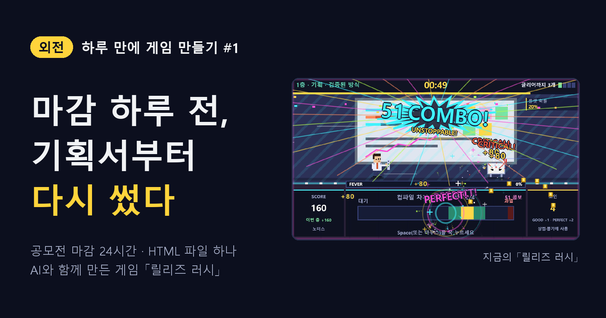
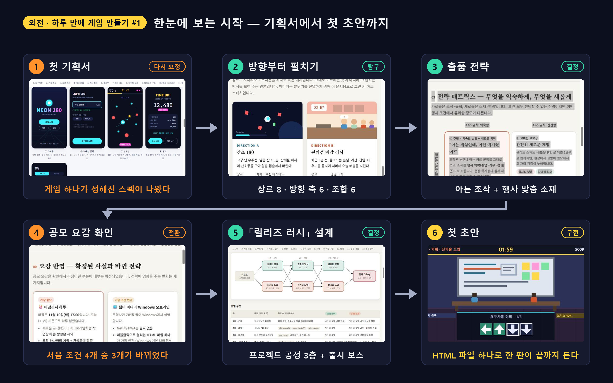
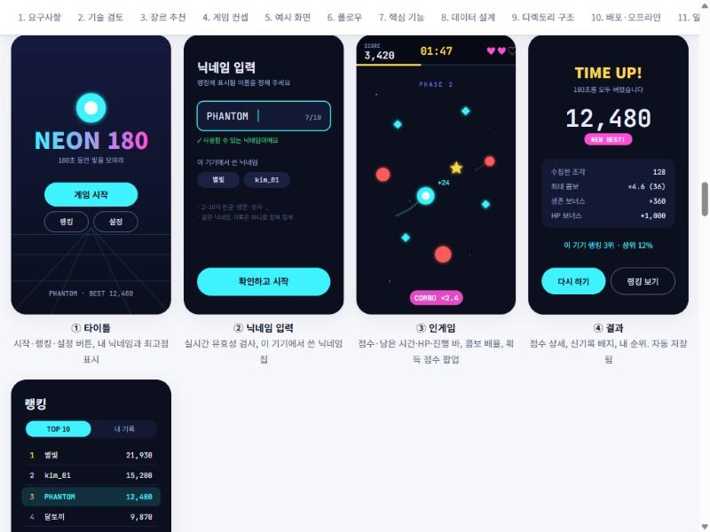
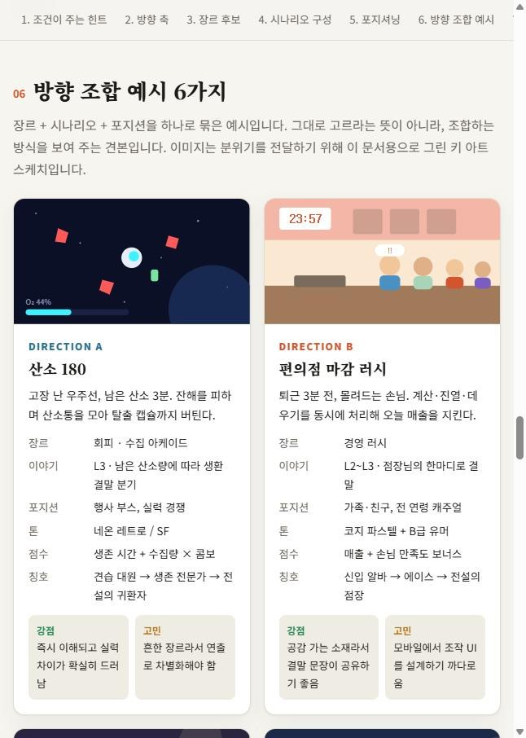
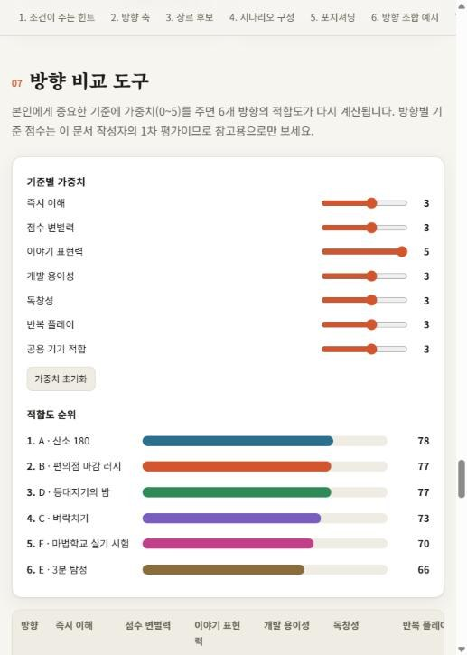
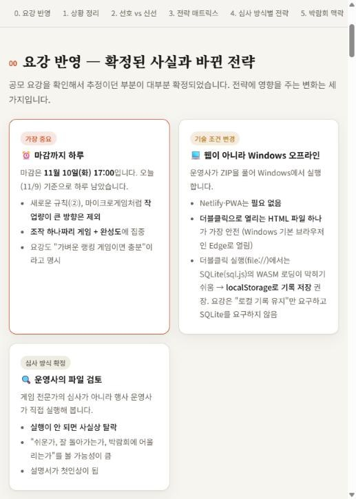
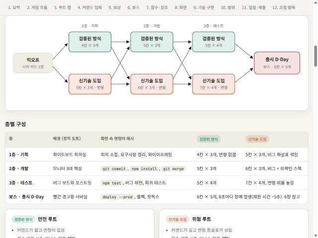
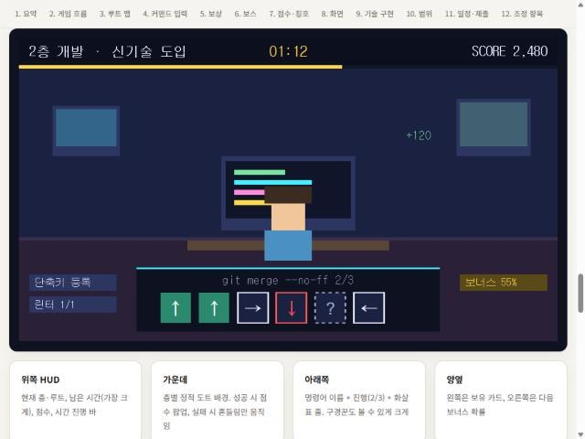
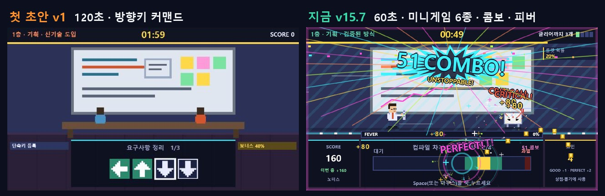

<!--
Velog 제목: [외전] 하루 만에 게임 만들기 #1 — 마감 하루 전, 기획서부터 다시 썼다
시리즈: 외전 · 하루 만에 게임 만들기
태그: 게임개발, 게임기획, AI활용, 공모전, 외전
썸네일: ../images/velog/velog-01-cover.png

이미지 경로(../images/...)는 로컬 미리보기용이다. Velog에서는 이미지를 직접 끌어다 놓아 업로드하고 주소를 바꾼다.
이전 초안(긴 버전)은 game/backup/velog/01-planning-and-start-초안v1.md 에 있다.
-->

> **외전** — 본편과 별개로, 마감 하루 전에 응모한 게임 공모전에서 하루 동안 게임 하나를 만든 기록이다.

## 남은 시간은 하루

채용박람회와 함께 열린 AI 게임 제작 이벤트. 출품작 중 10개를 뽑아 행사 부스에서 방문객이 직접 해 본다.

알게 됐을 때 마감까지 남은 시간은 하루였다. 하루 만에 게임 하나를 어디까지 만들 수 있을까. 궁금해서 응모했다. Claude Code와 대화하며 만들었고, 과정은 전부 문서로 남겼다.

## 한눈에 보는 시작

*그림 1. 첫 기획서를 다시 요청하고, 방향을 펼치고, 요강을 보고 방향을 틀어 첫 초안까지*

## ① 기획서가 너무 빨리 답을 냈다

"3~5분, 웹 배포, 랭킹, 닉네임" 네 가지 조건으로 기획서를 요청했다. 돌아온 것은 「NEON 180」이라는 게임 하나의 완성된 스펙이었다. 원한 건 **고를 수 있는 선택지**였다.

*그림 2. 첫 기획서. 잘 만들었지만, 아직 무엇을 만들지 정하지도 않았다*

## ② 그래서 방향부터 펼쳤다

장르 8개, 방향 축 6개, 조합 예시 6개. 가중치를 바꾸면 순위가 다시 계산되는 비교 도구까지 넣었다.

| 방향 조합 카드 | 가중치 비교 도구 |
| --- | --- |
|  |  |

*그림 3. 답 대신 선택지와 판단 기준을 받았다*

결론은 한 줄이었다. **아는 조작을 빌리고, 행사에 맞는 소재로 새롭게.**

## ③ 요강을 읽자 전제가 바뀌었다

| 조건 | 처음 생각 | 요강을 본 뒤 |
| --- | --- | --- |
| 플레이 시간 | 3~5분 | **1~2분** |
| 실행 환경 | 웹 배포 | **인터넷 없이 Windows에서 더블클릭** |
| 기록 저장 | SQLite | **localStorage** |

4개 중 3개가 바뀌었다. 그대로 갔다면 웹 배포와 DB에 하루를 다 썼을 것이다.

*그림 4. 요강 반영. 마감 하루, Windows 오프라인, 운영사가 직접 실행해 본다*

## ④ 「릴리즈 러시」

> 프로젝트 공정(기획 → 개발 → 테스트)을 돌파해 제한 시간 안에 **출시**하는 게임. 층마다 안전한 "검증된 방식"과 위험한 "신기술 도입" 중 하나를 고른다.

| 설계서의 루트 맵 | 설계서의 화면 목업 |
| --- | --- |
|  |  |

*그림 5. 개발 교육 과정이니, 개발 그 자체를 소재로*

그리고 HTML 파일 하나로 첫 초안을 만들었다. 외부 리소스 없이, 더블클릭하면 한 판이 끝까지 돈다.

## 그리고 지금

*그림 6. 첫 초안(왼쪽)과 지금(오른쪽). 하루 동안 무슨 일이 있었던 걸까*

120초는 60초가 됐고, 방향키 커맨드는 미니게임 6종이 됐다. 그 사이의 이야기를 이어서 쓴다.

| 편 | 내용 |
| --- | --- |
| #1 | 기획서부터 다시 썼다 (이 글) |
| #2 | 방향키를 버리고 버튼 하나만 남겼다 |
| #3 | 한 판을 처음부터 끝까지 설계했다 |
| #4 | 봇 수백 판이 사람 한 판을 못 이겼다 |
| #5 | 마감 전에 낸 것과, 사람에게 보여 주고 고친 것 |
| #6 | 올드한 게임에 도파민을 들이부었다 |
| #7 | 하루를 돌아보며 |

> **답을 빨리 정하지 말 것. 그리고 요강은 가장 먼저 읽을 것.**
