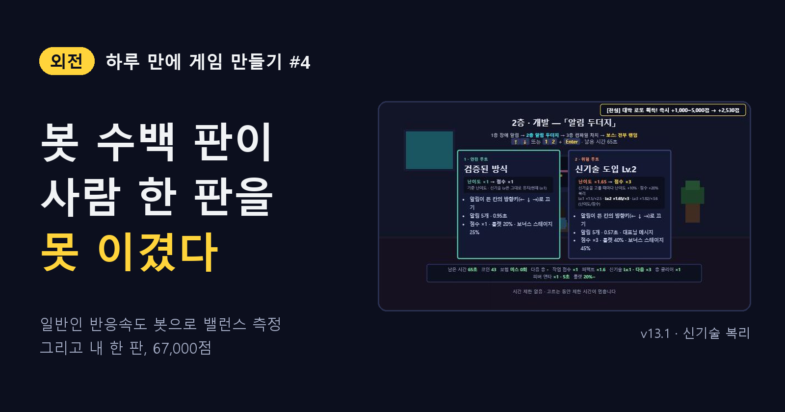
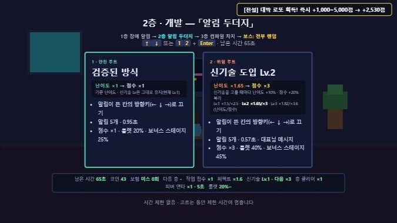
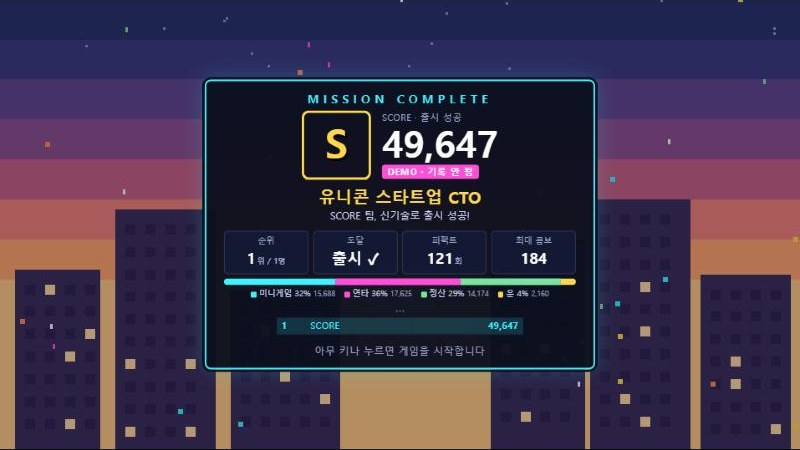
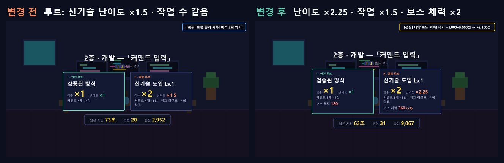
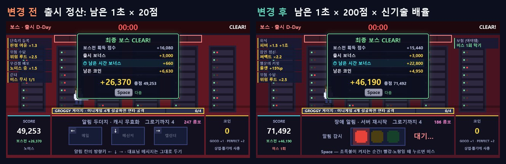

<!--
Velog 제목: [외전] 하루 만에 게임 만들기 #4 — 봇 수백 판이 사람 한 판을 못 이겼다
시리즈: 외전 · 하루 만에 게임 만들기
태그: 게임개발, 게임기획, 게임밸런스, 시뮬레이션, AI활용, 외전
썸네일: ../images/velog/velog-04-cover.png
자료: 개발 로그 #24 ~ #31, #41 ~ #45, docs/06-scoring.md

이미지 경로(../images/...)는 로컬 미리보기용이다. Velog에서는 이미지를 직접 올리고 주소를 바꾼다.
-->

> **외전** — 하루 만에 게임 하나를 만든 기록. [#3](03-one-run.md)에서 미니게임 6종, 카드, 상점, 보스 체력까지 한 판의 구조를 만들었다.

## 하루짜리 게임에는 테스터가 없다

밸런스를 잡으려면 많이 해 봐야 한다. 하지만 마감은 하루, 테스터는 나 하나. 그래서 **사람처럼 치는 봇**을 만들어 수백 판을 돌렸다. 브라우저를 띄우지 않고 Node에서 게임 스크립트를 그대로 돌리니 한 판에 약 1초.

결론부터 말하면, 봇은 많은 걸 찾아냈고 결정적인 하나를 틀렸다.

## ① 일반인 반응속도 봇

"보통 사람"을 숫자로 정했다.

| 항목 | 보통 |
| --- | --- |
| 단순 반응 | 0.30초 (±0.06) |
| 타이밍 오차 | ±0.055초 |
| 화살표 1칸 | 0.30초 |
| 카드 판단 | 0.62초 |
| 함정에 속을 확률 | 12~15% |
| 연타 | **초당 7회** |

초보와 숙련은 이보다 느리거나 빠르고 실수도 다르게 했다. 이 표의 마지막 줄을 기억해 두자.

## ② "1.5배 어려우면 점수 2배"를 맞췄다

위험 루트(신기술 도입)는 1.5배 어렵고 점수는 2배가 목표였다. 미니게임마다 작업 하나에 드는 시간을 360개씩 재 보니, 감으로 정한 수치는 들쭉날쭉했다.

| | 위험 ÷ 안전 (어려움) |
| --- | --- |
| 조정 전 · 배포 타이밍 · 코드 리뷰 · 장애 알림 | 0.9~1.1배 (빠른 커서는 오히려 빨리 끝남) |
| 조정 전 · 커맨드 · 컴파일 차지 | 1.8~2.3배 |
| **조정 후 · 여섯 게임 모두** | **1.3~1.7배, 평균 1.5** |

"커맨드 층만 짧게 느껴진다"는 의견도 봇으로 확인했다. 기분 탓이 아니라 **실제로 작업 수가 가장 적었다**(층마다 3개 안팎, 다른 게임은 4~6개). 옛날 값(×0.6)이 남아 있었다.

## ③ 신기술은 고를수록 커지게

루트에 전략을 더했다. 신기술을 고를 때마다 Lv이 오르고, **난이도 +10% · 점수 +20%가 복리로** 쌓인다. 고르기 전에 계산할 수 있게 숫자로 보여 준다.

*그림 1. 루트 선택: 신기술 Lv.2. 난이도와 점수 배율을 고르기 전에 보여 준다*

## ④ 번 코인의 65%가 버려지고 있었다

남은 코인이 어떻게 되는지 봤더니, 아무것도 안 됐다.

| 보통 봇 40판 평균 | |
| --- | --- |
| 한 판에 번 코인 | 81 |
| 쓴 코인 | 28 |
| **남은 코인 (그냥 사라짐)** | **53** |
| 보스전에서 번 코인 (쓸 곳이 없음) | 22 |

출시하면 남은 코인을 1개당 30점으로 바꾸게 했다. 아껴서 점수로 받을지, 상점에서 쓸지가 새 선택지가 됐다.

## ⑤ 점수에 장부를 달았다

점수가 바뀌는 곳을 모두 `addScore(출처, 점수)` 하나로 모았다. 100판 모두 **출처별 합계 = 최종 점수**를 확인했고, 결과창에 점수 구성 막대를 붙였다.

*그림 2. 점수 구성 막대: 미니게임 · 연타 · 정산 · 운*

장부를 보니 **연타가 점수의 약 32%**로 가장 컸다. 연타 1회 20 → 15점으로 낮춰 27%로 맞췄다.

## ⑥ 고르든 말든 결과가 같았다

그런데 직접 해 보니 **신기술을 골라도 체감이 안 됐다.** 봇으로 재 보니 보통 실력이 모두 안전으로 가면 출시 97%, 모두 신기술로 가도 90%. 차이가 없었다.

신기술 층은 난이도 ×1.5 · 작업 수 ×1.5, 보스 체력은 신기술 1회마다 ×2(180 → 360 → 720)로 올렸다.

*그림 3. 루트 선택에 난이도 ×2.25 · 작업 ×1.5 · 보스 체력을 표시*

| 루트 · 실력 | 출시 (전 → 후) |
| --- | --- |
| 안전 · 보통 | 97% → 97% |
| 신기술 · 보통 | 90% → **10%** |
| 신기술 · 숙련 | 100% → **73%** |

변별력이 생겼다. 그런데 너무 가혹하지 않나? 하는 순간.

## ⑦ 내 한 판: 그로기 한 번, 67,000점

직접 한 판을 했다(패치 전 버전). **보스가 그로기 한 번에 끝났고, 점수는 약 67,000점.**

봇으로는 나올 수 없는 결과였다. 체력 180을 그로기 한 번(6초)에 깎으려면 초당 약 30회를 쳐야 한다. 봇은 초당 7~12회. **봇이 사람보다 훨씬 느리게 연타하고 있었다.** 여러 키를 한꺼번에 두드리면 횟수가 그만큼 늘어난다는 것도 봇은 몰랐다.

봇에 연타 속도 옵션을 넣고 초당 30회로 돌렸더니, 같은 버전에서 그로기 1번 · 67,784점이 나왔다. 내 판과 맞았다.

| 신기술 · 숙련 | 연타 느린 봇 기준 | **사람 연타(초당 20~30회) 기준** |
| --- | --- | --- |
| 출시 | 73% | **85~100%** |
| 보스 | 실패하는 벽 | 그로기 한 번에는 못 끝냄 (4.5~6.2번) |
| 연타 점수 비중 | | **61%** |

앞의 "10% · 73%"는 틀린 숫자였다. 대신 새 문제가 보였다. 어려워질수록 그로기가 늘고, 그로기는 연타 점수를 준다. **어려울수록 연타로 점수가 부풀었다.**

## ⑧ 늦게 깬 판이 더 높았다

측정해 보니 안전 · 숙련에서 빨리 깬 판 ÷ 늦게 깬 판의 점수가 **0.82**. 그로기를 오래 할수록 연타가 쌓이니 늦게 깨는 게 이득이었다.

그래서 방향을 정했다. **연타는 그대로 두고, 남은 시간 점수를 키운다.** 남은 1초당 20점 → **200점 × 신기술 배율**. 그냥 200점으로 올리면 시간이 많이 남는 안전 루트만 유리해져서, 신기술 배율도 곱했다.

*그림 4. 출시 정산: 남은 1초 × 20점 → × 200점 × 신기술 배율*

| 루트 · 실력 | 연타 비중 (전 → 후) | 빠름 ÷ 느림 (전 → 후) |
| --- | --- | --- |
| 안전 · 숙련 | 50% → 35% | 0.82 → **1.09** |
| 신기술 · 숙련 | 61% → 43% | 1.22 → **1.60** |

이제 빨리 깰수록 점수가 높다. 연타는 "빨리 깨는 수단"이 됐다.

## ⑨ 봇은 늦게 누르지 않는다

"두더지에 버그가 있는 것 같다"는 제보도 있었다. 상황을 만들어 재현해 보니 두 가지였다.

- **늦게 누르면 미스 2번.** 알림이 시간 초과로 사라지는 순간 미스, 0.05초 늦게 누른 키가 빈칸 입력으로 또 미스. 봇은 시간 초과 뒤에 누르지 않아서 한 번도 걸리지 않았다.
- **PERFECT 기준이 0.16초.** 신기술 강화 때 두더지만 곡선이 가팔라 알림 시간이 하한에 붙었다. 사람 반응(약 0.25초)으로는 불가능한 판정이었다.

대기 직후 0.35초 입력은 무시하고, 신기술 알림 시간을 0.40 → 0.50초로 풀었다.

## 정리

| 봇이 찾아낸 것 | 봇이 놓친 것 |
| --- | --- |
| 위험 ÷ 안전 난이도 들쭉날쭉 | 사람은 초당 30회 연타한다 |
| 커맨드 층 작업 수가 실제로 적음 | 사람은 여러 키를 한꺼번에 두드린다 |
| 버려지는 코인 65% | 사람은 시간 초과 뒤에 늦게 누른다 |
| 연타 점수 비중, 늦게 깰수록 이득 | 0.16초 판정은 사람에게 불가능하다 |

다음 편은 마감 전에 한 일이다. 완성도를 냉정하게 평가하고, 제출물을 만들고, **진짜 사람**에게 처음 보여 줬다.

> **시뮬레이션은 사람 한 판으로 보정해야 한다.** 봇 수백 판의 결론이 내 67,000점 한 판에 뒤집혔다.
