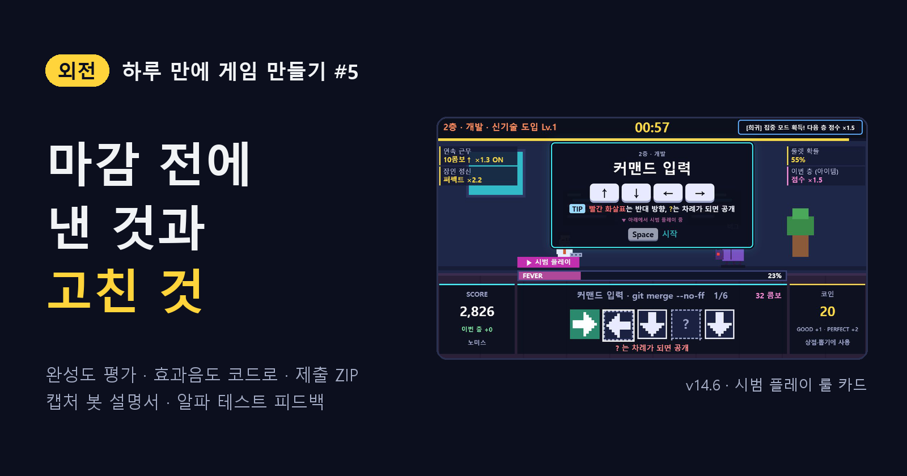
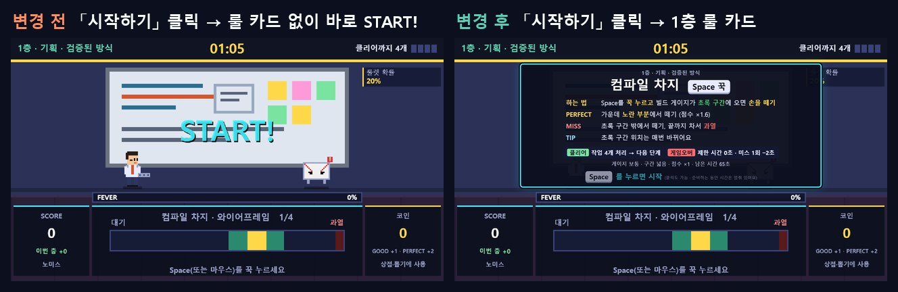
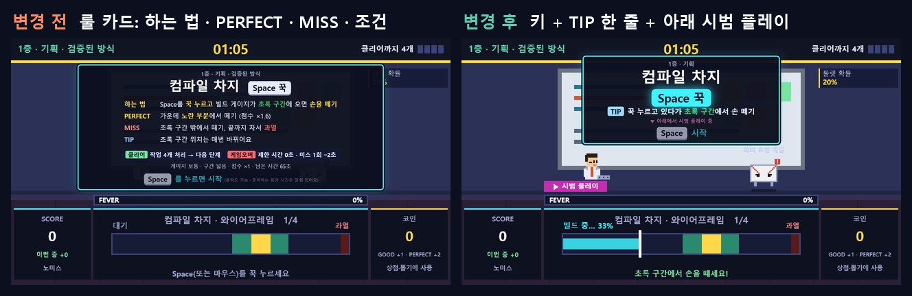
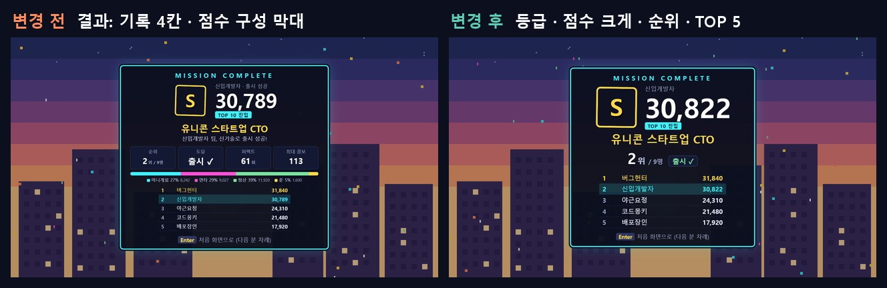

<!--
Velog 제목: [외전] 하루 만에 게임 만들기 #5 — 마감 전에 낸 것과, 사람에게 보여 주고 고친 것
시리즈: 외전 · 하루 만에 게임 만들기
태그: 게임개발, 게임기획, WebAudio, AI활용, 공모전, 외전
썸네일: ../images/velog/velog-05-cover.png
자료: 개발 로그 #32 ~ #38, #40, #46, docs/07-review.md

TODO(직접 채우기): 실제 제출(구글 드라이브 업로드 · 구글폼) 시각과 결과는 기록에 없음. 올리기 전에 "제출" 문단을 채우거나 빼기.
이미지 경로(../images/...)는 로컬 미리보기용이다. Velog에서는 이미지를 직접 올리고 주소를 바꾼다.
-->

> **외전** — 하루 만에 게임 하나를 만든 기록. [#4](04-balance-bots.md)에서 봇으로 밸런스를 잡았고, 사람 한 판에 봇의 결론이 뒤집혔다.

## 기능을 멈추고 점검부터

새 기능을 계속 붙이다가, 한 번 멈췄다. 공모 요강 항목을 하나씩 대조하고, 봇으로 한 판을 실제 시간대로 재서 **완성도와 유불리**를 냉정하게 평가했다.

| 항목 | 결과 |
| --- | --- |
| 플레이 시간 · 오프라인 · 랭킹 · 닉네임 | 충족 (한 판 2.7~3.3분) |
| 설명서 · ZIP · 실행 확인 | **하나도 없음 (치명)** |
| 한 판의 화면 전환 / 확인 입력 | 22회 / 35회 |
| 첫 플레이까지 | 5단계 |
| 초보 클리어 | 2/12 |
| 효과음 | 없음 |

게임은 풍성해졌는데 **낼 수 있는 상태가 아니었다.** 우선순위를 다시 세웠다. P0 제출 준비, P1 부스 체감(첫 플레이 줄이기, 넘기기 줄이기, 효과음), 그리고 새 기능은 마감까지 멈추기.

## ① 첫 플레이까지 5단계 → 3단계

부스에서 처음 온 사람은 카드부터 고르고 싶지 않다. 닉네임을 넣으면 **바로 1층**을 하게 하고, 시작 카드는 1층을 해 본 뒤에 고르게 옮겼다.

- 대기 → 닉네임 → 룰 카드, 3단계면 바로 플레이.
- 한 번 해 본 미니게임은 짧은 룰 카드만.
- 층 정산표는 2초 뒤 자동으로 넘어감. 출시 정산표만 직접 넘김.

## ② 소리도 코드로 만들었다

효과음이 없으니 타격감이 없었다. 하지만 음원 파일을 넣으면 저작권도 걸리고 파일 하나 구조도 깨진다. 그래서 **Web Audio로 소리를 코드에서 직접 합성**했다.

바로 넣지 않고 샘플 페이지를 먼저 만들었다. 16가지 상황마다 A(8비트 칩튠)와 B(부드러운 전자음)를 들어 보고 고르는 페이지. 답은 "모두 A". BGM도 같은 방식으로 장면 4곳의 후보를 들려주고 골랐다.

| 장면 | BGM |
| --- | --- |
| 닉네임 · 선택 화면 | 사무실 대기 |
| 층 · 보너스 | 통통 튀는 |
| WARNING · 보스 | 긴장 |
| 엔딩 · 결과 | 엔딩 |

대기 화면과 데모는 부스 소음을 생각해 조용히, M 키로 전부 끌 수 있게 했다.

## ③ 제출물: 더블클릭 한 번이면 돌아가야 한다

요강은 "인터넷 없이 Windows에서 실행, 운영사가 직접 실행해 본다"였다. 실행이 안 되면 끝이다.

- `게임실행.html` 한 파일. 외부 주소 · 외부 파일 참조 0개.
- 확인은 브라우저를 화면 없이 띄워서 했다. 제출본을 `file://`로 열고 **네트워크를 끈 채** 한 판 → 기록 저장 → 브라우저를 완전히 껐다 켜도 TOP 10에 기록이 남는지.
- 설명서(PDF · TXT)와 함께 ZIP 하나로. 한글 파일 이름이 깨지지 않는지 풀어서 확인.

<!-- TODO: 실제 제출(드라이브 업로드 · 구글폼) 이야기를 여기에 한두 줄 -->

## ④ 설명서는 봇이 찍었다

설명서를 화면 중심으로 다시 만들면서 캡처를 손으로 하지 않았다. 헤드리스 Chrome을 조종하는 **캡처 봇**이 실제 게임을 끝까지 플레이하며, 점검용 훅으로 화면을 멈추고 장면마다 찍는다. 시드 5개로 미니게임 6종과 성공 · 실패 판을 모두 담았다.

그리고 캡처하다가 버그를 찾았다.

*그림 1. 「시작하기」를 클릭하면 1층 룰 카드가 한 번도 안 보이고 바로 시작됐다(왼쪽) → 수정 후(오른쪽)*

버튼을 클릭하면 버튼 동작이 룰 카드를 띄운 뒤, **같은 클릭이 바깥 화면으로 전달돼 방금 뜬 룰 카드를 넘겼다.** 키보드로만 테스트한 봇은 절대 못 찾는 버그. 같은 길을 코드에서 전부 찾아 막고, 실제 마우스 이벤트로 누르는 클릭 점검 5항목을 만들어 이후 매번 돌렸다.

설명서는 결국 **게임설명서(화면 중심 8쪽)**와 **매뉴얼(실행 · 조작 · 랭킹 2쪽)**로 나눴다.

## ⑤ 처음으로 사람에게 보여 줬다

알파 테스트에서 받은 피드백은 다섯 가지였다.

| 피드백 | 고친 것 |
| --- | --- |
| 도입 설명이 현학적이고 어렵다 | 룰 카드엔 **키만 크게**, 아래에서 **시범 플레이**가 반복된다 |
| 직관적이지 않은 조작이 헷갈린다 | 그런 조작에만 TIP 한 문장 ("노란불은 함정!") |
| 글이 너무 많다 | 카드는 이름 + 효과 숫자, 정산표는 이름 + 점수만 |
| 피버 게이지는 좋다 | 주변에 화면 테두리 · 속도선 · 충격파를 더 |
| 결과창이 너무 상세하다 | 등급 · 점수 · 순위 · TOP 5만 크게 |

*그림 2. 룰 카드: 글 설명(왼쪽) → 키 + TIP 한 줄 + 시범 플레이(오른쪽)*

시범 플레이는 지금 작업을 복제해서 패널 안에서 자동으로 반복하고, 누르는 순간 룰 카드의 키 캡이 빛난다. 복제본만 움직여서 실제 점수 · 시간 · 난수에는 영향이 없다.

*그림 3. 결과창: 상세 기록(왼쪽) → 등급 · 점수 · 순위 · TOP 5만(오른쪽)*

## 정리

| 하기 전 | 한 뒤 |
| --- | --- |
| 낼 수 있는 파일 없음 | ZIP 하나: 게임 · 게임설명서 · 매뉴얼 |
| 첫 플레이까지 5단계 | 3단계 |
| 소리 없음 | 효과음 16종 + BGM 4곡, 전부 코드 합성 |
| 글로 설명하는 룰 카드 | 키 + 시범 플레이 |
| 봇만 테스트 | 클릭 점검 + 사람 알파 테스트 |

제출할 수 있는 게임이 됐다. 그런데 다시 해 보니 한 가지가 걸렸다. **게임이 전체적으로 올드하다.** 다음 편은 이펙트를 과하게 들이부은 이야기다.

> **봇과 사람은 다른 버그를 찾는다.** 키보드 봇은 클릭 버그를, 개발자는 "현학적인 설명"을 못 본다.
