<!--
Velog 제목: [외전] 하루 만에 게임 만들기 #6 — 올드한 게임에 도파민을 들이부었다
시리즈: 외전 · 하루 만에 게임 만들기
태그: 게임개발, 게임이펙트, Canvas, 성능최적화, AI활용, 외전
썸네일: ../images/velog/velog-06-cover.png
자료: 개발 로그 #39, #47, #50 ~ #60, 기획 결정 P29 ~ P35

이미지 경로(../images/...)는 로컬 미리보기용이다. Velog에서는 이미지를 직접 올리고 주소를 바꾼다. GIF도 그대로 올릴 수 있다.
-->

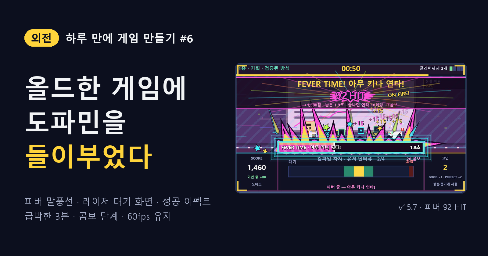

> **외전** — 하루 만에 게임 하나를 만든 기록. [#5](05-submit-alpha.md)에서 제출물을 만들고 알파 테스트 피드백을 반영했다.

## "게임이 올드하다"

제출할 수 있는 게임이 됐는데, 다시 보니 **올드했다.** 성공해도 「PERFECT +80」 글자 하나, 배경은 멈춰 있고, 시간이 줄어도 타이머 색만 변한다.

그래서 게임의 방향을 한 문장으로 정했다. **"도파민 터지고 급박한 3분."** 그리고 원칙 두 개.

1. **판정 · 점수 · 시간 · 난수는 건드리지 않는다.** 전부 보여 주기용 레이어. 같은 시드로 돌리면 이펙트 전후의 점수가 완전히 같아야 한다.
2. **가시성은 지킨다.** 큰 효과는 위쪽 전투 화면과 가장자리에만, 미니게임 패널 안은 짧고 가는 효과만. 60fps.

## ① 피버 게이지: 깜빡임 → 형광 → 외침 말풍선

피버가 터지는 순간이 약했다. 먼저 게이지를 두껍게 하고 형광 빛을 둘렀다.

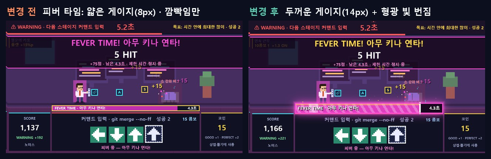
*그림 1. 얇은 게이지(왼쪽) → 두꺼운 형광 게이지(오른쪽)*

다음은 테두리. 손으로 그린 스케치(게이지 둘레의 들쭉날쭉한 테두리)와 만화의 외침 말풍선을 참고로 시안을 만들었다. 불꽃 시안은 "불꽃이 아니라 날카로운 날것"이라는 피드백으로 버리고, 가시 · 잉크 외곽선 · 망점 · 창 파편을 넣은 B안을 골랐다.

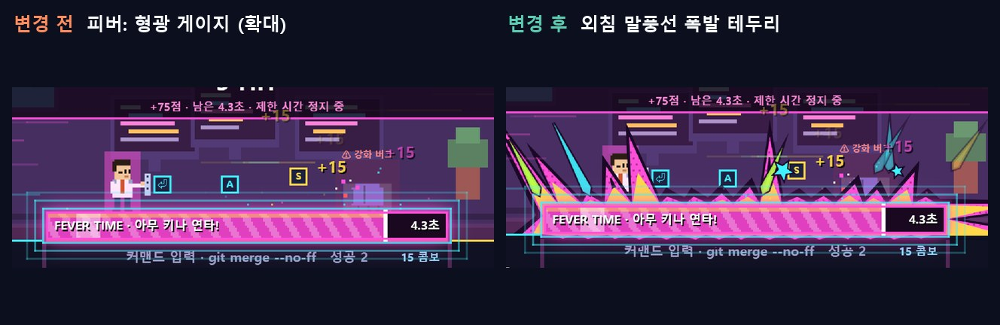
*그림 2. 외침 말풍선 폭발 테두리. 아래쪽은 미니게임 제목을 가리지 않게 평평하게*

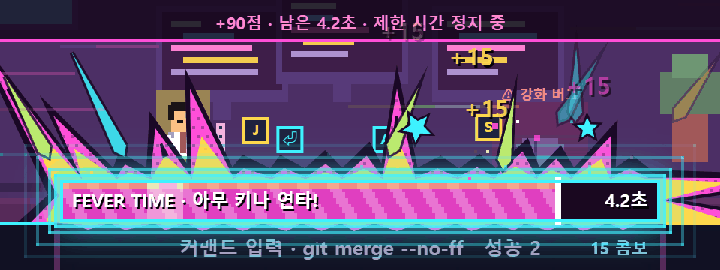
*그림 3. 연타할 때마다 가시가 순간 커진다*

## ② 그리고 2초 동안 멈췄다

"피버 때 버벅인다"는 제보. 프레임 시간을 쟀다. 의심 요소를 하나씩 끈 복사본 7개와 비교했다.

| | 그로기 평균 | 가장 느린 프레임 |
| --- | --- | --- |
| 지금 | 24.5ms | **2,190ms** |
| 그림자 번짐만 끔 | 26.9ms | 1,698ms |
| **망점만 끔** | **0.71ms** | **6.6ms** |

범인은 망점이었다. 1×1 점을 프레임마다 **약 2,400번 따로 그려서**, 쌓인 그리기 명령이 한꺼번에 처리될 때 2초 가까이 멈췄다. 12×12 무늬를 한 번 만들어 두고 한 번에 채우게 바꿨다. 그림은 같고, 가장 느린 프레임은 2,023ms → 10.5ms.

## ③ 지나가는 사람을 붙잡는 대기 화면

부스에서는 대기 화면이 간판이다. 말풍선형과 레이저형 두 시안을 만들어 비교했고, 피버 연출과 겹치지 않는 **레이저형**을 골랐다.

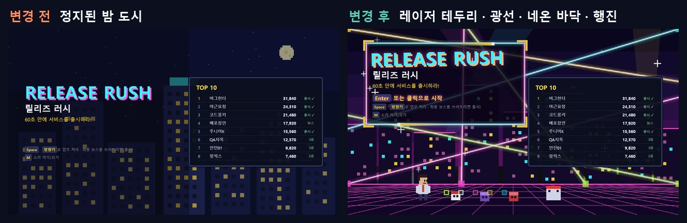
*그림 4. 멈춘 밤 도시(왼쪽) → 레이저 테두리 · 광선 · 네온 바닥 · 행진(오른쪽)*

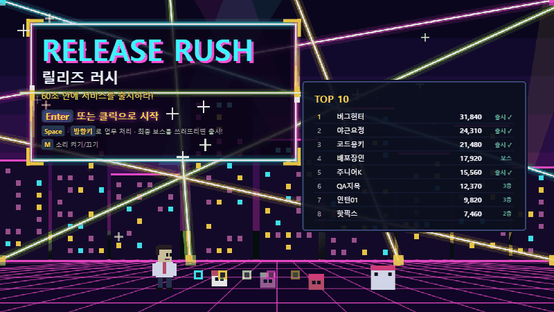
*그림 5. 업무 몬스터를 쫓는 주인공 행진*

대기 화면용 128 BPM 곡을 하나 더 만들고, **레이저 색이 바뀌는 박자를 오디오 시계에 맞췄다.** 15초 뒤 데모 플레이로 넘어가도 곡이 끊기지 않는다.

## ④ 성공할 때마다 화면이 반응한다

미니게임 성공 이펙트를 넣었다. 판정 도장, 파편, 충격파, 몬스터까지 가는 번개, CRITICAL!, 점수 칸으로 날아가는 숫자와 코인, 가장자리 번쩍, 줌 펀치, 연속 퍼펙트 배너.

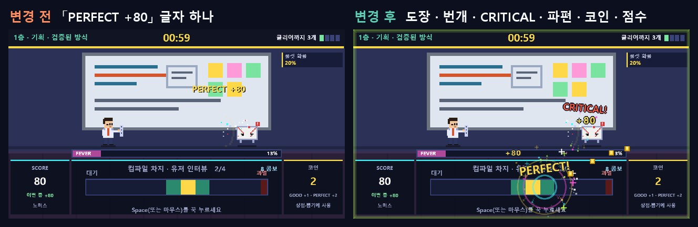
*그림 6. 성공 순간: 「PERFECT +80」 글자 하나(왼쪽) → 오른쪽*

이번에도 성능이 걸렸다. 튀어나오는 글자를 매 프레임 다른 크기로 그리니 **첫 성공 때 0.44초 멈춤.** 정해진 글자는 대기 화면에서 미리 한 번 그려 이미지로 저장하고, 늘리고 돌려서 표현했다. 점수 숫자는 0~9 글자 이미지를 이어 붙였다.

## ⑤ 급박한 3분

남은 시간이 줄수록 화면이 조여 온다. 그리고 층마다 배경이 움직인다.

| 남은 시간 | 연출 |
| --- | --- |
| 30초 | **HURRY** · 주황 박자 깜빡임 |
| 15초 | **DANGER** · 붉은 심장 박동 테두리 · 경고 테이프 |
| 5초 | **LAST 5** · 화면 가운데 거대한 카운트다운 |

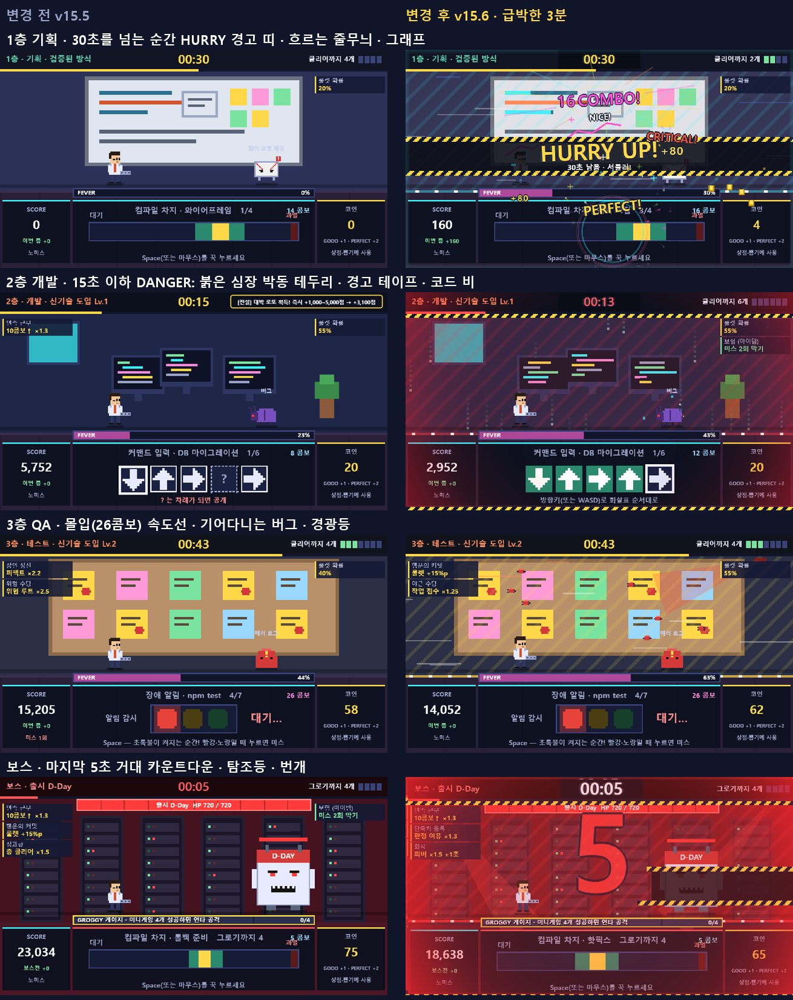
*그림 7. 층별 배경: 기획은 차오르는 그래프, 개발은 코드 비, QA는 기어다니는 버그, 보스는 붉은 탐조등*

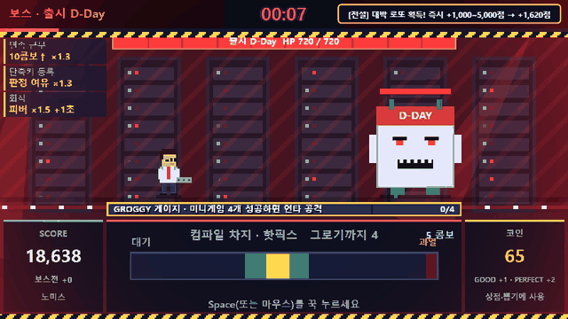
*그림 8. 보스 마지막 5초*

콤보도 바꿨다. 예전엔 10의 배수에서만 배너가 떠서 11~19콤보는 아무 반응이 없었다. 이제 **10콤보부터 콤보마다** 「N COMBO!」가 뜨고, 쌓일수록 커진다.

| 콤보 | 더해지는 것 |
| --- | --- |
| 11~ | 글자 · 충격파 · 별 파편 · NICE! |
| 15~ | 회전하는 무지개 집중선 |
| 20~ | 가시 폭발 · 무지개 글자 · GREAT! |
| 25~ | 화면 흔들림 · 무지개 테두리 |
| 30~ | 색종이 · AMAZING! |
| 40~ · 50~ · 80~ | INCREDIBLE! · UNSTOPPABLE! · LEGENDARY! |

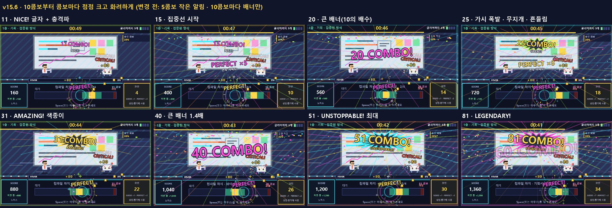
*그림 9. 콤보 11 → 81*

## ⑥ 피버도 콤보로 세면 안 되는 이유

"피버 연타도 콤보에 넣자"는 아이디어가 나왔다. 그대로 하면 사람 연타(초당 약 30회) × 5초 = **피버 한 번에 150콤보.** 첫 피버에 바로 LEGENDARY가 되고, 콤보 단계가 의미를 잃는다.

그래서 피버가 끝나면 **연타 10회당 +1콤보**로 정산하고, 피버 중에는 HIT 숫자가 30 · 60 · 100 · 150마다 커지게 했다.

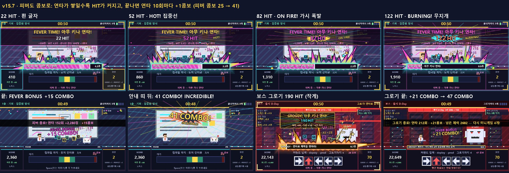
*그림 10. 피버 152 HIT → +15콤보 → 41 COMBO! INCREDIBLE!*

## 정리

| 확인한 것 | 결과 |
| --- | --- |
| 점수 · 출시율 | 이펙트 전후 같은 시드에서 **완전히 같음** |
| 프레임 (실제 화면 갱신, 8초 × 2회) | 중앙값 16.7ms · 33ms 넘는 프레임 0개 |
| 가시성 | 판정 구간 · 타이머 · 점수가 이펙트 중에도 보임 |

과하게 하되 규칙은 건드리지 않고, 화려하게 하되 60fps는 지킨다. 화면은 많이 바뀌었지만 게임의 숫자는 한 자리도 바뀌지 않았다.

다음 편에서는 하루를 돌아본다. 무엇이 잘 됐고, AI와 함께 하루에 게임 하나를 만들면 무엇이 남는지.

> **이펙트는 보여 주기용 레이어로 분리하면 마음껏 과해질 수 있다.** 대신 프레임 시간은 매번 재야 한다. 망점 2,400개가 2초를 먹었다.
