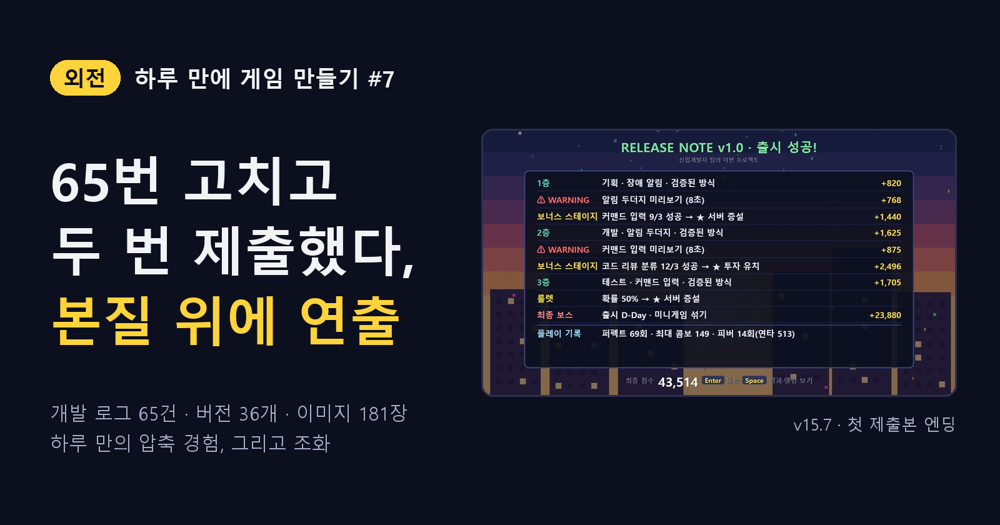
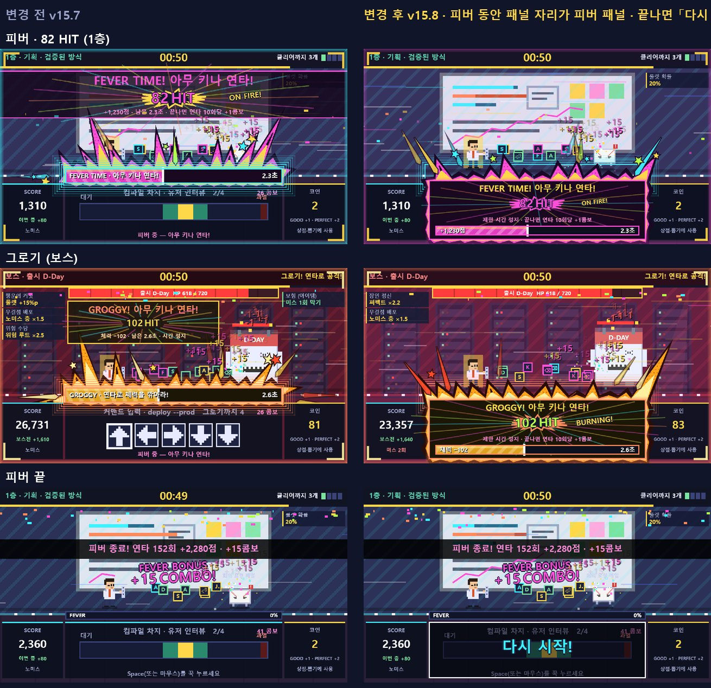
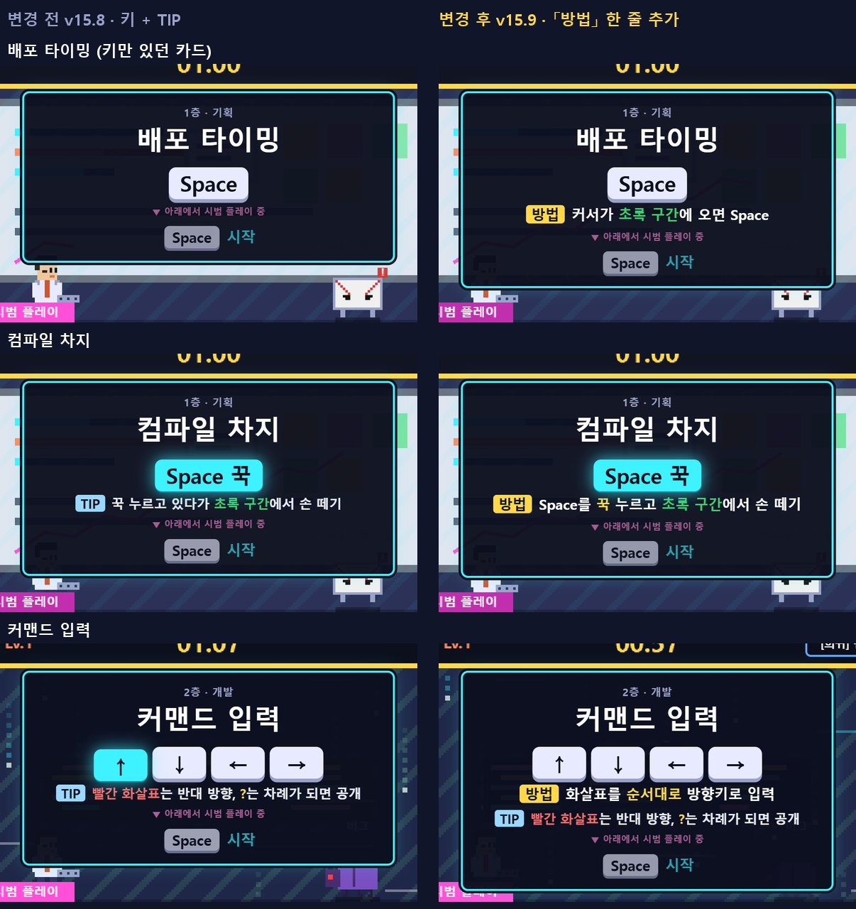
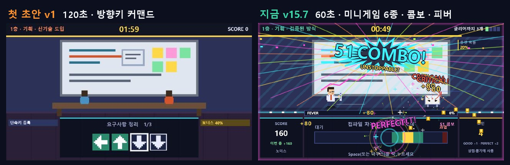

<!--
Velog 제목: [외전] 하루 만에 게임 만들기 #7 — 65번 고치고 두 번 제출했다, 본질 위에 연출과 조화가 필요했다
시리즈: 외전 · 하루 만에 게임 만들기
태그: 게임개발, 게임기획, 회고, AI활용, 공모전, 외전
썸네일: ../images/velog/velog-07-cover.png
자료: 제출 완료 화면, 개발 로그 #01 ~ #65, 기획 결정 P1 ~ P37, 05 백로그, docs 폴더 md 8개(누적 수치)

이미지 경로는 로컬 미리보기용이다. Velog에서는 이미지를 직접 올리고 주소를 바꾼다.
누적 수치는 2026-11-10 다시 제출한 직후(v15.9) docs/*.md · docs/images · game/backup에서 센 값이다.
-->

> **외전** — 하루 만에 게임 하나를 만든 기록. [#6](06-dopamine.md)에서 올드한 게임에 도파민을 들이부었다. 이번 편은 마지막 제출까지를 돌아본다.

## 제출했다

마감은 11월 10일 17시. ZIP 하나(`게임실행.html` · `게임설명서.pdf` · `매뉴얼.pdf` · `매뉴얼.txt`)를 구글 드라이브에 올리고, 구글 설문으로 참가 신청을 냈다.

*그림 1. 채용박람회 AI 게임 제작 이벤트 참가 신청 제출 완료 화면*

## 제출하고 나서 받은 피드백, 그리고 다시 제출

제출하고 끝이 아니었다. 게임을 해 본 사람들에게서 피드백을 두 개 더 받았고, 마감 전이라 고쳐서 다시 냈다.

**① "피버 게이지를 미니게임 자리로 옮겨 더 잘 보이게"**

피버 중 안내가 위쪽 띠, 패널 위 게이지, 패널 아래 문구 세 곳에 흩어져 있었다. 정작 시선이 머무는 패널에는 멈춘 미니게임이 그대로 보였다. 그래서 피버 · 그로기 동안에는 미니게임 자리를 **피버 패널**로 바꿨다. 끝나면 0.4초 동안 「다시 시작!」을 띄우고 입력을 받지 않아, 연타하던 손 그대로 미스하는 일을 막았다. (v15.8)

*그림 2. 피버 패널: 변경 전 ↔ 후*

**② "사람들이 시작 전 설명을 이해하지 못한다"**

알파 테스트 뒤 룰 카드를 「누를 키 + 헷갈리는 조작 TIP」으로 줄이면서, **무엇을 하면 성공인지** 말하는 문장이 빠져 있었다. 배포 타이밍 카드에는 「Space」 하나만 있었다. 그래서 모든 룰 카드에 「방법」 한 줄을 넣었다. 배포 타이밍이라면 "커서가 초록 구간에 오면 Space"다. (v15.9)

*그림 3. 룰 카드: 변경 전 ↔ 후*

둘 다 판정 · 점수 규칙은 그대로 두었다. 게임설명서와 매뉴얼 그림도 새 화면으로 바꾸고 ZIP을 다시 만들어 제출했다.

## 하루를 숫자로 보면

다시 제출하고 나서 문서 폴더를 세어 봤다.

| 항목 | 누적 |
| --- | --- |
| 개발 로그(수정 한 건마다 원인 · 내용 · 검증) | **65건** (#01 ~ #65) |
| 기획 결정 | **37개** (P1 ~ P37) |
| 게임 버전 | v1 → v15.9, **36개 버전** · 버전별 백업 파일 35개 |
| 캡처 · 비교 이미지 | **181장** (전후 비교 52장 · GIF 27장) |
| 개발 문서 | md 8개 · 약 15만 자 (개발 로그만 약 9만 자) |
| 제출 설명서 | 2쪽 → 12쪽 → 게임설명서 8쪽 + 매뉴얼 2쪽 |
| 제출 | **2번** (v15.7 → 피드백 반영 v15.9) |
| Velog 외전 | 이 글까지 7편 |

기획서를 다시 쓰고, 규칙을 바꾸고, 봇으로 밸런스를 맞추고, 제출물을 만들고, 사람에게 보여 주고 고치고, 연출을 더하고, 제출한 뒤에도 피드백을 받아 다시 냈다. 기획부터 제출, 피드백까지 한 바퀴를 하루 안에 다 돌았다. 하루 만에 압축해서 겪은 경험이었다.

*그림 4. 첫 초안 v1 ↔ 첫 제출본 v15.7*

## 고칠수록 느낀 것: 본질과 연출, 그리고 조화

처음에는 게임의 본질에 집중했다. 방향키를 버리고 버튼 하나로 줄였고([#2](02-one-button.md)), 한 판의 구조를 처음부터 끝까지 짰고([#3](03-one-run.md)), 봇으로 점수와 난이도를 맞췄다([#4](04-balance-bots.md)).

그런데 규칙과 숫자가 맞아도 게임은 **올드했다**([#6](06-dopamine.md)). 성공해도 글자 하나가 뜨고 끝나니, 잘 만든 규칙이 재미로 전해지지 않았다. 그래서 연출을 더했다.

연출을 더할수록 이번에는 본질과 부딪혔다.

- 큰 효과가 판정 구간을 가리면 재미가 아니라 방해가 된다. 그래서 큰 효과는 전투 화면과 가장자리에만 두고, 미니게임 패널 안은 짧고 가는 효과만 넣었다.
- "피버 연타도 콤보로 세자"는 연출 아이디어를 그대로 넣으면 피버 한 번에 150콤보가 되어 콤보 단계가 의미를 잃는다. 그래서 연타 10회당 +1콤보로 맞췄다.
- 모든 연출은 판정 · 점수 · 시간을 건드리지 않는 레이어로 분리했다. 같은 시드에서 이펙트 전후 점수가 완전히 같다.

제출 뒤에 받은 피드백도 같은 이야기였다. 규칙은 그대로인데, 지시가 보이는 자리와 설명 한 줄이 없어서 전해지지 않았다.

수많은 수정을 거치며 느낀 것은 이것이다. **게임의 본질은 중요하다. 하지만 본질만으로는 전해지지 않고, 연출이 필요하다. 그리고 둘이 서로를 해치지 않게 맞추는 조화가 필요하다.**

## 다음 이야기

이 행사는 출품작 중 10개를 골라 채용박람회 부스에서 운영한다. 출품이 확정되면 그 이야기를 이어서 쓰겠다.

> **본질이 맞아도 연출이 없으면 전해지지 않고, 연출이 본질을 가리면 재미가 아니다. 둘의 조화가 필요했다.**
