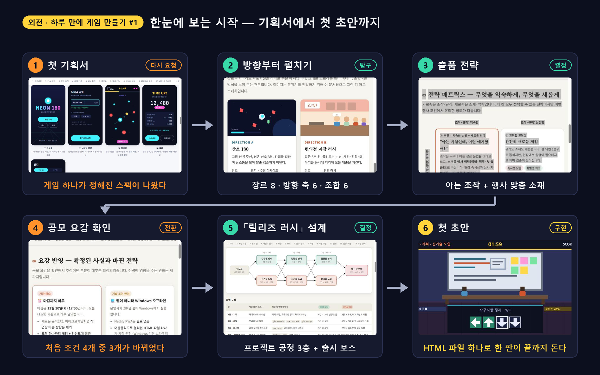
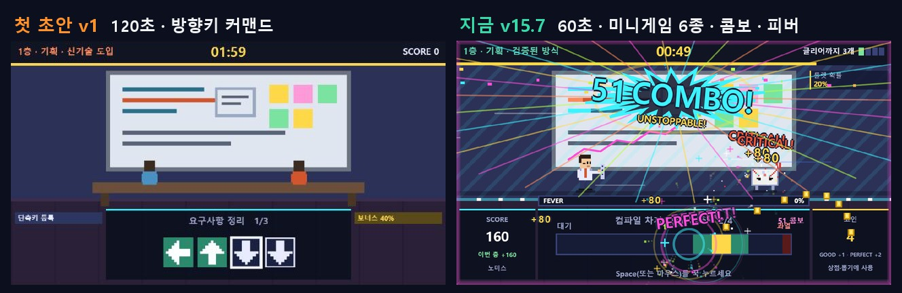

# Velog 작업 기록 — 외전 「하루 만에 게임 만들기」

> Velog 글을 쓰고 올린 과정을 기록합니다. 게임 개발 내용은 [04-dev-log.md](../04-dev-log.md)에만 남기고, 글 · 이미지 · 업로드 작업은 여기에 남깁니다.
> 연재 목록과 원고 규칙은 [docs/README.md](../README.md#velog-시리즈--외전-하루-만에-게임-만들기)에 있습니다.
> 항목은 `## V번호 제목`으로 맨 아래에 추가합니다. 양식은 개발 로그와 같습니다(원인/목적 → 내용 → 예상 결과 → 검증 결과 → 관련 파일).

| 파일 | 내용 |
|---|---|
| `01-planning-and-start.md` · `.html` | 외전 #1 원고(로컬 이미지 경로)와 미리보기 HTML |
| `02-one-button.md` ~ `06-dopamine.md` · `.html` | #2 ~ #6 초안과 미리보기 HTML |
| `make-images-01.py` | #1 표지 · 흐름도 · 첫 초안 ↔ 지금 이미지 생성 |
| `make-covers.py` | #2 ~ #6 표지(썸네일) 생성 |
| `build-html.py` | 원고 → 이미지가 들어간 HTML 한 파일 |
| `upload-01/` | #1 업로드용 이미지(번호 순)와 Velog 주소를 넣은 최종 본문 `velog-final.md` |

---

## V1 1화를 외전 인트로로 축약 + 시작 과정 이미지 (게임 미적용)

- **원인/목적:** "VELOG 1화 초안을 최대한 간결하고 인트로 느낌이 나도록 글 길이를 수정하고, 외전으로 하루 만에 게임 만들기 시리즈로 추가. 기획서 초안 등의 이미지나 캡처로 어떻게 시작했는지 한눈에 보이게." 기존 초안은 약 13,900자 · 표 9개로, 시리즈 첫 글치고 길고 글 위주였음.
- **수정 내용:**
  - 원고 `docs/velog/01-planning-and-start.md`를 **약 4,250자(약 1/3)**로 다시 씀. 구성: 표지 → 「남은 시간은 하루」 → **한눈에 보는 시작(6단계 흐름 이미지)** → ① 기획서 다시 요청 ② 방향 펼치기 ③ 요강으로 바뀐 조건 3개 ④ 「릴리즈 러시」 + 첫 초안 → **그리고 지금(첫 초안 ↔ v15.7)** → 다음 편 목록. 아이디어 9단계 표 · 기술 선택 표 · 점검 훅 · 남은 문제는 뺌(다음 편 자료로 남김).
  - Velog 메타: 제목 `[외전] 하루 만에 게임 만들기 #1 — 마감 하루 전, 기획서부터 다시 썼다`, 시리즈 `외전 · 하루 만에 게임 만들기`, 태그에 `외전` 추가, 썸네일을 새 표지로.
  - 새 이미지 3장(`docs/velog/make-images-01.py`로 생성, 맑은 고딕 · 게임 배경색 #0c0f1e):
    - `images/velog/velog-01-cover.png` (1600×840) 표지 · 썸네일: 외전 배지 + 제목 + 지금의 게임 화면(51콤보).
    - `images/velog/velog-01-flow.png` (2400×1500) 6단계 흐름: 첫 기획서(NEON 180) → 방향 펼치기 → 출품 전략 → 공모 요강 → 「릴리즈 러시」 설계 → 첫 초안. 단계마다 원본 캡처 썸네일 + 한 줄 결과.
    - `images/velog/velog-01-then-now.jpg` (1328×432, 비교 이미지 양식) 첫 초안 v1(120초 · 방향키) ↔ 지금 v15.7(60초 · 미니게임 6종 · 콤보 · 피버).
  - 옛 「한눈에 보기」(`velog-01-summary.png`)는 지우지 않고 남김(글에서는 안 씀).
  - `docs/README.md` Velog 시리즈 절을 외전 기준으로 고침(제목 형식 · 표지 규칙 · 편 번호 #1~#5), `images/README.md` velog 폴더 4장으로 갱신.
- **예상 결과:** 첫 화면에서 표지 → 흐름 이미지 한 장으로 "어떻게 시작했는지"가 보이고, 마지막 비교 이미지가 다음 편을 읽을 이유가 됨.
- **검증 결과:** `build-html.py`로 HTML 다시 만듦(약 2.6MB, 이미지 9장 모두 내장). 로컬 미리보기(velog-preview, 5174)에서 이미지 9/9 로드, 그림 4 · 표 4 정상 표시 확인. 흐름 이미지 1단계 제목이 태그와 겹쳐 「첫 기획서」로 줄이고, 2단계는 카드가 보이게 자르는 위치를 내림.
- **백업:** `game/backup/velog/01-planning-and-start-초안v1.md` · `.html` (축약 전 원고)
- **관련 파일:** `docs/velog/01-planning-and-start.md` · `.html`, `docs/velog/make-images-01.py`, `docs/images/velog/`, `docs/README.md`, `docs/images/README.md`

## V2 외전 #1 Velog에 올리기 (임시저장 완료 · 시리즈 연결 남음)

- **원인/목적:** "VELOG에 올려줘" → 이후 "내용 다시 확인하고 이미지 위치랑 글 본문 먼저 수정해 임시글로 전부 우선 작성 완료해".
- **진행 내용:**
  - 앱 안 브라우저로 Velog(@ssler1)에 제목 · 태그 5개(게임개발 · 게임기획 · AI활용 · 공모전 · 외전) · 본문 입력. 한글 자동 입력에서 「바뀐」이 깨져 본문 문장을 「과정은 전부 문서로 남겼다」로 바꿈(로컬 원고도 같게).
  - 앱 안 브라우저는 파일 업로드 도구가 없고 끌어다 놓기도 전달되지 않아, 사용자가 툴바 이미지 버튼으로 10장 업로드(00 썸네일 포함). 크기로 순서를 맞추고 크기가 같은 05/06 · 07/08은 화면으로 확인.
  - 이미지 주소를 제자리에 넣은 최종 본문 `docs/velog/upload-01/velog-final.md`(2,484자). 업로드용 이미지는 `docs/velog/upload-01/`.
  - 출간 버튼이 Cloudflare 봇 확인(Turnstile)으로 비활성 → 사용자가 직접 출간. 이후 수정 화면을 열자 **옛 자동저장본**(이미지가 맨 위에 몰리고 본문에 `IMG-…` 자리표시가 남은 상태)이 불러와져, 본문 전체를 최종본으로 다시 입력하고 **임시저장**.
- **검증 결과:** 새 탭에서 임시글을 다시 열어 본문이 최종 원고와 글자 수 · 해시 모두 같음(2,484자, 자리표시 0개)을 확인. 게시된 글에서 이미지 10장(본문 9 + 썸네일) 모두 로드.
- **남은 것:** 시리즈 「외전 · 하루 만에 게임 만들기」는 만들어졌지만 글이 아직 연결되지 않음(시리즈 0개). 수정한 임시글을 게시본에 반영하는 「수정하기」(출간)와 함께 시리즈 선택 필요 — 봇 확인 때문에 버튼은 사용자가 눌러야 함.
- **관련 파일:** `docs/velog/01-planning-and-start.md` · `.html`, `docs/velog/upload-01/`

## V3 개발 과정 전체를 큰 이벤트로 나눠 #2 ~ #6 초안 작성

- **원인/목적:** "전반적인 개발 과정 문서를 전부 확인하고 큰 이벤트를 기준으로 velog 초안을 우선 작성해봐".
- **편성:** 개발 로그 #01 ~ #61 · 기획 결정 P1 ~ P35 · 05 백로그를 읽고, 버전 흐름에서 방향이 바뀐 지점으로 나눔. 옛 계획(#2 밸런스 · #3 원버튼 · #4 손맛 · #5 마감)은 시간 순서와 맞지 않아 다시 짬.

| 편 | 큰 이벤트 | 로그 |
|---|---|---|
| #2 | 손맛: 120 → 60초, 방향키 → Space 타이밍, 콤보 판정, 피버 연타, 전투 연출, 데모 | #03 ~ #09 |
| #3 | 한 판 구조: 미니게임 랜덤 · WARNING, 숫자 카드, 아이템 · 상점, 룰 카드 · 미스 −2초, 정산표 · 컷신 · 엔딩 · 결과창, 보스 체력, 6종 | #12 ~ #24 |
| #4 | 봇 밸런스: 일반인 반응속도 봇, 위험 1.5배 = 점수 2배, 신기술 복리, 코인 65% 버려짐, 점수 장부, 변별력, 67,000점 보정, 남은 시간 점수, 두더지 | #24 ~ #31 · #41 ~ #45 |
| #5 | 마감 준비: 완성도 평가, 첫 플레이 3단계, 소리 코드 합성, 제출 ZIP · file:// 점검, 캡처 봇 · 클릭 버그, 알파 테스트 | #32 ~ #38 · #40 · #46 |
| #6 | 도파민: 피버 게이지 · 말풍선, 망점 2초 멈춤, 레이저 대기 화면 · BGM 박자, 성공 이펙트 · 글자 캐시, 급박한 3분 · 콤보 단계, 피버 콤보 | #39 · #47 · #50 ~ #60 |

- **작성 원칙:** #1처럼 블로그 작성자 1인칭(직접 해 보니 · 내 한 판). 편마다 표지 → 한 줄 소개 → 번호 붙은 이벤트(그림은 기존 compare · GIF) → 정리 표 → 다음 편 예고 → 한 줄 교훈. 수치는 개발 로그 값 그대로.
- **표지:** `make-covers.py`로 `images/velog/velog-02 ~ 06-cover.png`(1600×840).
- **#1 편 목록:** 로컬 원고의 편 목록을 새 편성으로 바꿈. Velog 임시글 · 게시본에는 아직 옛 목록이 남아 있음.
- **남은 것:** #5의 실제 제출(드라이브 · 구글폼) 문단은 기록이 없어 TODO로 둠. #7 회고는 예정. Velog 업로드는 아직 안 함.
- **관련 파일:** `docs/velog/02-one-button.md` ~ `06-dopamine.md` · `.html`, `docs/velog/make-covers.py`, `docs/images/velog/`, `docs/velog/01-planning-and-start.md`, `docs/README.md`

## V4 #2 ~ #6 Velog 임시글로 올리기 (이미지 41장 포함 · 출간 전)

- **원인/목적:** "velog 디렉토리의 글을 바탕으로 초안을 임시글로 올리려는데 이미지까지 전부 올릴 수 있나" → "5편 모두 올리기".
- **진행 내용:**
  - 앱 안 브라우저(@ssler1)에서 편마다 새 글을 열고, 원고 머리 주석의 제목 · 태그와 `upload-02-06/velog-body-0N.md` 본문을 넣음.
  - 이미지는 `manifest.json` 순서대로 Velog 툴바 이미지 버튼의 파일 입력에 스크립트로 파일을 넘겨 올림(사용자 끌어다 놓기 불필요). 표 칸 안 이미지가 깨지지 않게 본문 끝 빈 줄에서 올려 주소만 받고, 마지막에 `IMG-0N-xx` 자리표시를 주소로 바꾼 본문으로 임시저장.
  - GIF 3장(최대 5.5MB)도 그대로 올라감.
  - 이미지 주소를 넣은 최종 본문 `upload-02-06/velog-final-02.md` ~ `velog-final-06.md`.
- **검증 결과:** 다섯 편 모두 임시글을 새로 열어 본문이 업로드 원고와 같음(이미지 주소만 다름), 자리표시 0개, 이미지 8 · 13 · 5 · 4 · 11장 모두 로드. 임시 글 목록에 #1 ~ #6 한 편씩(중복 없음). Velog가 태그를 소문자로 바꿈(`AI활용` → `ai활용`, `Canvas` → `canvas`).
- **남은 것:** 시리즈 연결 · 썸네일 · URL은 출간 화면에서 넣어야 하고, 출간 버튼은 봇 확인 때문에 사용자가 눌러야 함. #5 실제 제출 문단은 여전히 비어 있음. 본문 첫 줄의 이전 편 이름(#2 ~ #5)은 링크 없이 글자로만 들어가 있음.
- **관련 파일:** `docs/velog/upload-02-06/velog-final-02.md` ~ `velog-final-06.md`

## V5 #7 제출 후기 초안 작성 + Velog 임시글 (출간 전)

- **원인/목적:** "제출 완료 이미지를 추가했고, 마지막 제출까지의 소감을 남기는 글과 출품 확정 시 추가 글 예고, 수많은 수정을 거치며 게임 본질도 중요하지만 연출과 조화가 필요함을 느꼈다는 내용으로 초안 및 velog 임시글 작성. md 파일에서 누적 수정 수치를 체크해 하루만의 압축 경험으로 추가."
- **누적 수치(제출 직후 docs/*.md · game/backup 기준):** 개발 로그 62건(#01 ~ #62) · 기획 결정 35개(P1 ~ P35) · 게임 버전 v1 → v15.7 34개 · 버전 백업 파일 33개 · 이미지 173장(비교 50 · GIF 24) · md 8개 약 14만 자(개발 로그 약 8만 자) · 설명서 2쪽 → 12쪽 → 게임설명서 8쪽 + 매뉴얼 2쪽.
- **수정 내용:**
  - 원고 `docs/velog/07-submit-and-after.md`: 표지 → 제출했다(제출 완료 화면) → 하루를 숫자로 보면(누적 수치 표 · 압축 경험) → 첫 초안 ↔ 제출본 → 본질과 연출, 그리고 조화(#2 ~ #6의 실제 사례: 가시성 원칙 · 피버 콤보 10회당 +1 · 점수 불변 레이어) → 다음 이야기(출품 확정 시 후속 글).
  - 표지 `images/velog/velog-07-cover.png`: `make-covers.py`에 #7을 추가하고 #7만 생성(기존 #2 ~ #6 표지는 다시 만들지 않음).
  - 업로드 묶음 `upload-07/`(이미지 3장 · manifest · 자리표시 본문 `velog-body-07.md` · 주소를 넣은 `velog-final-07.md`). 미리보기 HTML은 이 PC의 파이썬에 `markdown` 패키지가 없어 만들지 못함(`build-html.py` 실행 실패).
- **검증 결과:** Velog 임시글을 새로 열어 본문이 `velog-final-07.md`와 완전히 같고 이미지 3/3 로드. 태그 6개(Velog가 `AI활용`을 `ai활용`으로 바꿈).
- **남은 것:** 시리즈 연결 · 썸네일 · URL과 출간은 사용자가 직접. #6 끝의 예고("AI와 함께 하루에 게임 하나를 만들면 무엇이 남는지")는 이 글에서 다루지 않음.
- **관련 파일:** `docs/velog/07-submit-and-after.md`, `docs/velog/upload-07/`, `docs/velog/make-covers.py`, `docs/images/velog/velog-07-cover.png`, `docs/README.md`

## V6 #7에 제출 뒤 피드백 · 재제출 추가 (임시글 갱신 · 출간 전)

- **원인/목적:** "velog 작성 이후 추가 피드백을 받아 수정안을 dev log에 추가했고 다시 제출했어. 이 내용을 velog 마지막 글에 추가."
- **수정 내용:**
  - `07-submit-and-after.md`에 절 「제출하고 나서 받은 피드백, 그리고 다시 제출」 추가: ① 피버 패널(개발 로그 #63 · #64, v15.8, P36) ② 룰 카드 「방법」 한 줄(#65, v15.9, P37), 그림 `compare-50-fever-panel.jpg` · `compare-51-rule-how.jpg`. 조화 절에 "제출 뒤 피드백도 같은 이야기였다" 한 문단.
  - 누적 수치를 다시 셈: 개발 로그 65건 · 기획 결정 37개 · 버전 v1 → v15.9 36개 · 백업 35개 · 이미지 181장(비교 52 · GIF 27) · md 약 15만 자(개발 로그 약 9만 자) · 제출 2번 행 추가.
  - 제목 `#7 — 65번 고치고 두 번 제출했다, 본질 위에 연출과 조화가 필요했다`, 표지 숫자 갱신(`make-covers.py` #7만 다시 생성).
  - `upload-07/`에 이미지 2장 추가, manifest · `velog-body-07.md` · `velog-final-07.md` 갱신.
- **검증 결과:** 고치기 전 Velog 임시글이 이전 `velog-final-07.md`와 같음(직접 고친 곳 없음)을 확인한 뒤 교체. 다시 열어 본문이 새 `velog-final-07.md`와 완전히 같고 이미지 5/5 로드.
- **남은 것:** 출간 · 시리즈 · 썸네일 · URL은 사용자가 직접. 이전 표지 이미지는 Velog 저장소에 남아 있지만 글에서는 쓰지 않음.
- **관련 파일:** `docs/velog/07-submit-and-after.md`, `docs/velog/upload-07/`, `docs/velog/make-covers.py`, `docs/images/velog/velog-07-cover.png`, `docs/README.md`
